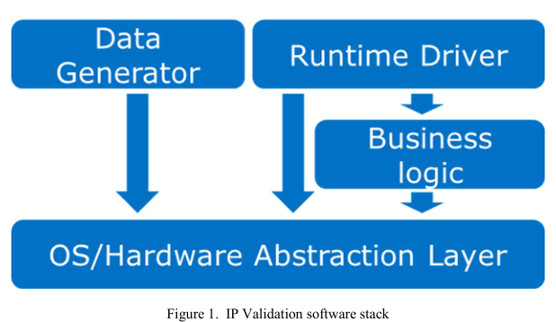
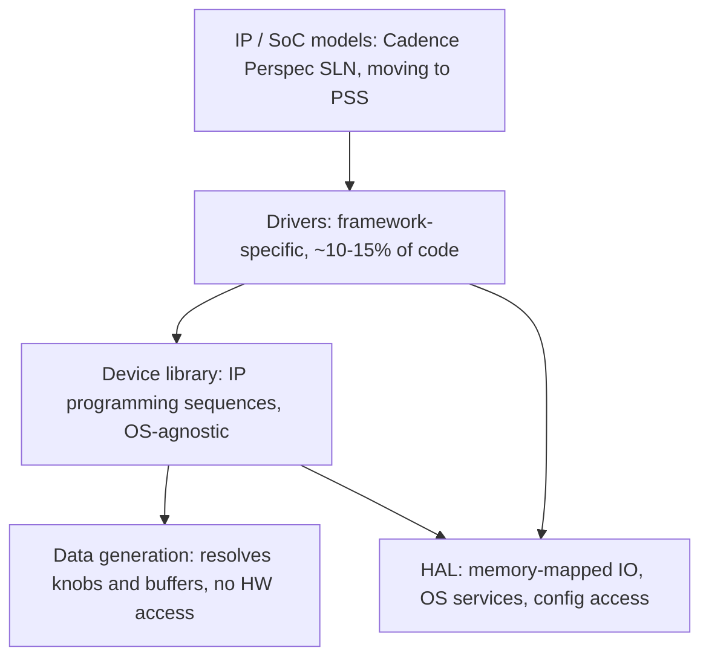

<!-- generated by yt-paper; edits will be overwritten -->
[DVCon](../dvcon/index.md) › [US](../dvcon/us.md) › [2022](../dvcon/by-year.md#2022) › [Verification](../dvcon/by-topic.md#verification)

# Case Study: Successes and Challenges of Validation Content Reuse

<figure class="rep-fig" markdown>
{ loading=lazy }
<figcaption>Figure 1. IP Validation software stack — from the original paper (Mike Chin et al.)</figcaption>
</figure>

[:material-open-in-new: Original paper](https://dvcon-proceedings.org/wp-content/uploads/Case-Study-Successes-and-Challenges-of-Reuse-1.pdf){ .md-button .md-button--primary target=_blank }

| | |
|---|---|
| Authors | Mike Chin (Intel Corporation, Folsom, CA), Jonathan Edwards (Intel Corporation, Folsom, CA), Hooi Jing Tan (Intel Technology Sdn. Bhd., Penang, Malaysia), Josh Pfrimmer (Intel Corporation, Folsom, CA) |
| Venue | DVCon US 2022 |
| Topic | Verification |
| Type | PAPER |
| ID | `ref-20261018-646f` |

## Summary

**Intel describes a layered, portable validation-content software stack (HAL, data generation, device library, drivers) plus IP-level PSS-style modeling, and reports that reusing IP content from pre-silicon through SoC integration and manufacturing screening yielded about 600 RTL bugs, roughly $19.75M in manufacturing savings, and 32 headcount savings.**

**Intel은 HAL, 데이터 생성, 디바이스 라이브러리, 드라이버로 이루어진 이식 가능한 검증 콘텐츠 소프트웨어 스택과 IP 수준의 PSS 스타일 모델링을 제시하며, IP 콘텐츠 재사용을 프리실리콘부터 SoC 통합과 제조 스크리닝까지 적용해 약 600개의 RTL 버그, 약 $19.75M의 제조 비용 절감, 32 인력 절감을 보고합니다.**

## Key Insights

- Portability is achieved by splitting the stack: the HAL is the only layer that must be re-implemented per validation framework, while data generation and device library code is written once and ported unchanged; drivers are framework-specific and estimated at roughly 10-15% of total code.

- 이식성은 스택 분리를 통해 확보됩니다. HAL만 검증 프레임워크마다 새로 구현하면 되며, 데이터 생성과 디바이스 라이브러리 코드는 한 번 작성해 그대로 포팅합니다. 드라이버는 프레임워크 종속적이며 전체 코드의 약 10-15%로 추정됩니다.

- Data generation passes parameters via structs, so new validation knobs require changing only the struct and its implementation, keeping the modeling-facing interface static.

- 데이터 생성 계층은 struct로 파라미터를 전달합니다. 새로운 검증 knob가 필요할 때 struct와 그 구현만 수정하면 되므로 모델링 측 인터페이스는 정적으로 유지됩니다.

- Reuse results reported: almost 200 SoC RTL bugs over 4 successive projects, a share of SoC bugs found through IP content reuse of 63-83% across the listed projects, and about 600 RTL bugs total across IP and SoC.

- 보고된 재사용 결과는 4개의 연속 프로젝트에서 SoC RTL 버그 거의 200개, 나열된 프로젝트에서 IP 콘텐츠 재사용으로 찾은 SoC 버그 비율 63-83%, IP와 SoC를 합쳐 약 600개의 RTL 버그입니다.

- Economics reported: $19.75M total manufacturing savings to date (System-to-Tester $10M, TTR $4.8M, Screening Unit Elimination $4.95M), 32 development headcount saved over 4+ generations, with a team of roughly 15.

- 보고된 경제성 지표는 지금까지 총 $19.75M의 제조 비용 절감(System-to-Tester $10M, TTR $4.8M, Screening Unit Elimination $4.95M), 4세대 이상에 걸쳐 32명의 개발 인력 절감, 약 15명 규모의 팀입니다.

- Open challenges: only ~70% of modeling problems are preliminarily assessed as expressible in Portable Stimulus, cross-IP/subsystem modeling needs better encapsulation, and ISA portability beyond x86 is unresolved; new content adds noise mainly through enabling, while the base stays stable.

- 미해결 과제는 다음과 같습니다. 예비 평가에서 모델링 문제의 약 70%만 Portable Stimulus로 표현 가능한 것으로 나타났고, cross-IP/서브시스템 모델링에는 더 나은 캡슐화가 필요하며, x86 이외 ISA로의 이식성은 아직 해결되지 않았습니다. 신규 콘텐츠는 주로 enabling 과정에서 노이즈를 추가하지만 기존 기반은 안정적으로 유지됩니다.

## Detailed Summary

### Background and Problem

- Intel's IP validation team builds internal test content for IPs (high-speed IO, low-speed IO, security, context/audio, storage, etc.). The goal is to validate to specification, including permutations of settings, sequential and parallel behavior, and high-stress workloads.

- Intel의 IP 검증팀은 여러 IP(고속 IO, 저속 IO, 보안, context/audio, 스토리지 등)를 위한 내부 테스트 콘텐츠를 만듭니다. 목표는 스펙 기준 검증이며, 설정 조합, 순차 및 병렬 동작, 고강도 워크로드를 포함합니다.

- Content must run on different platforms: IP validation uses FPGA (real devices and testcards) and emulation (mostly transactors, sometimes virtual testcards). SoC validation runs on emulation and post-silicon, and adds power management, sideband access, fuse support, and SKU configuration differences.

- 콘텐츠는 여러 플랫폼에서 실행되어야 합니다. IP 검증은 FPGA(실제 디바이스와 testcard)와 에뮬레이션(대부분 transactor, 일부 가상 testcard)을 사용합니다. SoC 검증은 에뮬레이션과 post-silicon에서 실행되며, 전력 관리, sideband 접근, fuse 지원, SKU 구성 차이가 추가됩니다.

- Manufacturing screening is limited to post-silicon platforms and needs more units to screen all IO interfaces.

- 제조 스크리닝은 post-silicon 플랫폼으로 제한되며, 모든 IO 인터페이스를 스크리닝하려면 더 많은 유닛이 필요합니다.

- The core problems are: depth of IP validation, scaling that content to SoC integration and manufacturing screening, and handling platform and endpoint-device variation without rewriting content.

- 핵심 문제는 IP 검증의 깊이 확보, 이 콘텐츠를 SoC 통합과 제조 스크리닝으로 확장하는 것, 그리고 콘텐츠를 다시 쓰지 않고 플랫폼과 endpoint 디바이스 차이를 처리하는 것입니다.

### Architecture and Methodology

The software stack is organized into four layers, with reuse across bare metal, kernel drivers (Windows/Linux), and user-space applications as a design goal:

소프트웨어 스택은 4개 계층으로 구성되며, bare metal, 커널 드라이버(Windows/Linux), 사용자 공간 애플리케이션에서 재사용되는 것을 설계 목표로 합니다:

- **HAL**: the portability layer. It abstracts logging, threads, memory allocation, memory-mapped IO (e.g., `mem_read32`/`mem_write32`), and configuration dictionary reads. The minimal subset needed to implement it is kept small.

- **HAL**: 이식성 계층입니다. 로깅, 스레드, 메모리 할당, 메모리 맵 IO(예: `mem_read32`/`mem_write32`), 설정 dictionary 읽기를 추상화합니다. 전체 구현에 필요한 최소 함수 집합을 작게 유지합니다.

- **Data generation**: sets IP parameters and data buffers, touches no hardware, and resolves all decision-making so target execution is efficient. Because it is hardware-free, it can be shifted left into JIT or off-target setup. Structs are the transfer mechanism.

- **데이터 생성**: IP 파라미터와 데이터 버퍼를 설정하며, 하드웨어에 접근하지 않습니다. 모든 결정을 여기서 해결해 타겟 실행을 효율적으로 만들고, 하드웨어 접근이 없으므로 JIT나 off-target 설정 코드로 shift-left할 수 있습니다. 데이터 전달 수단은 struct입니다.

- **Device library**: business logic containing IP programming sequences (initialization, configuration, operations, interrupt handling). It takes inputs from data generation and does not use OS services.

- **디바이스 라이브러리**: 비즈니스 로직 계층이며, IP 프로그래밍 시퀀스(초기화, 구성, 동작, 인터럽트 처리)를 담습니다. 입력은 데이터 생성에서 받으며 OS 서비스를 사용하지 않습니다.

- **Drivers**: marshal user intent against what the framework or OS allows. They are not portable across frameworks, since interrupt and other features differ.

- **드라이버**: 사용자 의도를 프레임워크나 OS가 허용하는 범위와 맞춥니다. 인터럽트 등 기능 구현이 프레임워크마다 다르므로 이식되지 않습니다.

- **Modeling**: Intel currently uses Cadence Perspec with SLN syntax, with an eventual full move to Portable Stimulus. Each IP model's actions match the test-plan granularity ("content capabilities"). A quality check is that well-formed actions share little code with each other. Each IP is a subcomponent in SoC models without modification, and cross-IP and system flows live in the SoC model.

- **모델링**: 현재는 Cadence Perspec과 SLN 문법을 사용하며, 최종적으로는 Portable Stimulus로 완전히 이행할 계획입니다. 각 IP 모델의 액션은 테스트 플랜 수준의 세분성("content capability")에 맞춰집니다. 품질 기준은 잘 구성된 액션끼리는 코드를 거의 공유하지 않는 것입니다. 각 IP는 수정 없이 SoC 모델의 하위 컴포넌트가 되며, cross-IP 및 시스템 흐름은 SoC 모델에 둡니다.

- **Platform discovery**: content probes IP version and hardware features, identifies attached devices, and reads BIOS settings. This feeds the models so that features can be enabled or disabled and content generated per platform.

- **플랫폼 디스커버리**: IP 버전과 하드웨어 기능을 조회하고, 연결된 디바이스 종류를 식별하며, BIOS 설정을 읽습니다. 이 정보를 모델에 넣어 기능을 켜거나 끄고 플랫폼에 맞는 콘텐츠를 생성합니다.

### Results and Conclusions

- **RTL bugs (IP)**: effectiveness is measured mainly by pre-silicon RTL bugs found. Figure 5 shows bugs across a breadth of IP domains. Figure 6 shows reuse across projects finding a growing number of bugs (Meteorlake in flight).

- **IP RTL 버그**: 효과는 주로 프리실리콘에서 찾은 RTL 버그 수로 측정합니다. Figure 5는 여러 IP 도메인에 걸친 버그를 보여줍니다. Figure 6은 프로젝트 간 재사용이 발견 버그 수를 늘린다는 것을 보여줍니다(Meteorlake 진행 중).

- **RTL bugs (SoC)**: over 4 successive projects, almost 200 SoC RTL bugs were found. The share found through IP content reuse is 77% (Tigerlake), 83% (Emittsburg), 63% (Alderlake), and 71% (Meteorlake), per the document's table and Figure 7.

- **SoC RTL 버그**: 4개의 연속 프로젝트에서 SoC RTL 버그를 거의 200개 찾았습니다. 문서의 표와 Figure 7에 따르면 IP 콘텐츠 재사용으로 찾은 비율은 Tigerlake 77%, Emittsburg 83%, Alderlake 63%, Meteorlake 71%입니다.

- **Manufacturing cost savings (Table 1)**: System-to-Tester $10M; TTR $0.02 × 240M = $4.8M; Screening Unit Elimination $450K × 11 = $4.95M; total $19.75M to date.

- **제조 비용 절감(Table 1)**: System-to-Tester $10M, TTR $0.02 × 240M = $4.8M, Screening Unit Elimination $450K × 11 = $4.95M, 지금까지 총 $19.75M입니다.

- **Headcount savings (Table 2)**: South complex pre-si 4, North complex pre-si 4, cross-die pre-si 4, post-si client/devices 14, manufacturing 6; total 32.

- **인력 절감(Table 2)**: South complex pre-si 4, North complex pre-si 4, cross-die pre-si 4, post-si client/devices 14, manufacturing 6, 총 32명입니다.

- **Stability (Figure 8)**: new content adds noise, mostly from enabling, while the bulk of the base stays stable. Noise trends down project-over-project. No exact figures are given in the text.

- **안정성(Figure 8)**: 신규 콘텐츠는 주로 enabling 과정에서 노이즈를 추가하지만 기존 기반의 대부분은 안정적입니다. 노이즈는 프로젝트마다 감소하는 추세입니다. 본문에 정확한 수치는 없습니다.

- **Conclusion**: the paper claims over 600 RTL bugs across IP and SoC, and gains in screening cost and quality. Future work includes fuller PSS adoption (preliminary applicability to ~70% of modeling problems), standardized abstraction layers for 3rd-party IP driver collateral, portability across non-x86 ISAs, headless execution platforms, and co-validation of production software with synthetic content.

- **결론**: IP와 SoC를 합쳐 600개 이상의 RTL 버그를 찾았다고 주장하며, 스크리닝 비용과 품질 향상을 보고합니다. 향후 과제는 PSS의 본격 도입(모델링 문제의 약 70%에 적용 가능하다는 예비 평가), 3rd-party IP 드라이버 콜래터럴을 위한 표준 추상화 계층, 비-x86 ISA 이식성, headless 실행 플랫폼, 합성 콘텐츠와 프로덕션 소프트웨어의 공동 검증입니다.

- Limitations: results are Intel-internal and reported without full methodology or raw data. The figures' exact values are not all present in the text.

- 한계: 결과는 Intel 내부 데이터이며, 전체 방법론과 원시 데이터 없이 보고됩니다. 그림의 정확한 값이 모두 본문에 있는 것은 아닙니다.

## Videos

<iframe src="https://www.youtube-nocookie.com/embed/o-x0DYNRIt0" title="[DVCON2022]Case Study: Successes and Challenges of Validation Content Reuse " loading="lazy" allow="accelerometer; clipboard-write; encrypted-media; gyroscope; picture-in-picture; web-share" referrerpolicy="strict-origin-when-cross-origin" allowfullscreen></iframe>

**[DVCON2022]Case Study: Successes and Challenges of Validation Content Reuse ** — [Watch on YouTube](https://www.youtube.com/watch?v=o-x0DYNRIt0) · [Video page](../videos/o-x0DYNRIt0.md)
