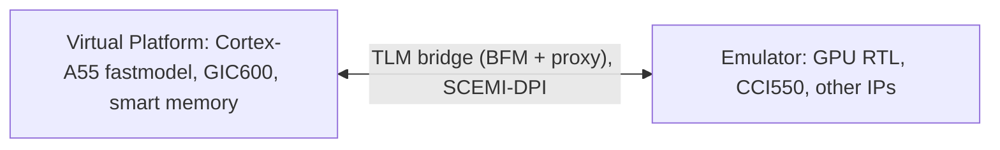

<!-- generated by yt-paper; edits will be overwritten -->
[DVCon](../dvcon/index.md) › [US](../dvcon/us.md) › [2022](../dvcon/by-year.md#2022) › [Emulation](../dvcon/by-topic.md#emulation)

# Hybrid Emulation: Accelerating Software driven verification and debug

<figure class="rep-fig" markdown>
{ loading=lazy }
<figcaption>Figure 2. Hybrid platform block diagram — from the original paper (Issac P Zacharia et al.)</figcaption>
</figure>

[:material-open-in-new: Original paper](https://dvcon-proceedings.org/wp-content/uploads/Hybrid-Emulation-Accelerating-Software-driven-Verification-and-Debug-1.pdf){ .md-button .md-button--primary target=_blank }

| | |
|---|---|
| Authors | Issac P Zacharia (Arm Ltd, Cambridge, UK), Jitendra Aggarwal (Arm Ltd, Bengaluru, India) |
| Venue | DVCon US 2022 |
| Topic | Emulation |
| Type | PAPER |
| ID | `ref-20261018-6683` |

## Summary

**Arm replaces the Cortex-A55 RTL with fastmodels in a virtual platform while the GPU runs in an emulator, gaining full GPU design visibility, a reported 45X faster Linux boot than full-RTL emulation, and the ability to reproduce FPGA (Juno) issues.**

**Arm은 Cortex-A55 RTL을 fastmodel로 대체하여 가상 플랫폼에서 실행하고 GPU는 에뮬레이터에서 구동함으로써, 전체 GPU 설계 가시성을 확보하고 full-RTL 에뮬레이션 대비 Linux 부팅 45배 향상(보고값)을 달성했으며 FPGA(Juno) 이슈를 재현할 수 있게 했다.**

## Key Insights

- Partitioning the CPU, GIC600 and smart memory into a virtual platform while the GPU RTL stays in the emulator restores the full design visibility missing on the Juno FPGA platform without the cost of full-RTL OS boot.

- CPU, GIC600, smart memory를 가상 플랫폼에 두고 GPU RTL만 에뮬레이터에 남기는 분할 방식은, full-RTL OS 부팅 비용 없이 Juno FPGA 플랫폼에서 부족했던 전체 설계 가시성을 회복시킨다.

- Reported runtimes are Linux boot 62 s, Debian Buster 11 185 s and Android 10 2640 s, with Linux boot 45X faster than legacy full-RTL emulation.

- 보고된 실행 시간은 Linux 부팅 62초, Debian Buster 11 185초, Android 10 2640초이며, Linux 부팅은 기존 full-RTL 에뮬레이션 대비 45배 빠르다.

- Smart memory lets the CPU access memory by backdoor and avoids crossing the TLM boundary, but the authors warn that frequent VP-emulator transactions degrade runtime, so transaction size should be maximized and high-traffic transactors minimized.

- Smart memory를 통해 CPU는 backdoor로 메모리에 접근하여 TLM 경계를 넘지 않지만, 저자들은 VP와 에뮬레이터 간 빈번한 트랜잭션이 실행 성능을 저하시킨다고 경고하므로 트랜잭션 크기를 최대화하고 트래픽이 많은 transactor는 최소화해야 한다고 권고한다.

- The Hybrid CPU runs in zero simulation time and is nondeterministic, so Hybrid Capture Replay records VP inputs against the design clock to make failures reproducible across runs.

- Hybrid CPU는 시뮬레이션 시간 0에서 비동기로 동작하여 비결정적이므로, Hybrid Capture Replay는 VP 입력을 design clock 기준으로 기록하여 실행 간 실패를 재현 가능하게 한다.

- The authors position Hybrid as a complement to cycle-accurate validation rather than a replacement, and the paper gives no bug counts or emulator capacity figures.

- 저자들은 Hybrid를 cycle-accurate 검증의 대체가 아닌 보완으로 규정하며, 논문은 버그 건수나 에뮬레이터 용량 수치를 제시하지 않는다.

## Detailed Summary

### Background and Problem

- Arm GPU verification on the FPGA-based Juno platform gives high throughput but poor design visibility and difficult trace extraction, so root-causing HW/SW issues took significant time.

- Juno FPGA 플랫폼에서의 Arm GPU 검증은 처리량은 높지만 설계 가시성이 낮고 트레이스 추출이 어려워 HW/SW 이슈의 근본 원인 분석에 상당한 시간이 소요되었다.

- Full-RTL emulation cannot hold the whole SoC when booting an OS and running real software, and unit-level simulation can take weeks to reproduce OS/app issues.

- Full-RTL 에뮬레이션으로는 OS 부팅과 실제 소프트웨어 실행을 위한 전체 SoC를 올리기 어려우며, unit-level 시뮬레이션에서는 OS/앱 이슈 재현에 수 주가 걸릴 수 있다.

- Goal: a hybrid platform with full GPU RTL visibility and fast software execution, enabling shift-left HW/SW co-verification before RTL or silicon is available.

- 목표는 GPU RTL의 전체 가시성과 빠른 소프트웨어 실행을 동시에 제공하는 하이브리드 플랫폼으로, RTL이나 실리콘 이전 단계에서 HW/SW 공동 검증을 앞당기는 것이다.

### Architecture and Methodology

- The Cortex-A55 RTL, GIC600 and smart memory are replaced by Arm fastmodels in a virtual platform; the GPU and other SoC IP run in the emulator.

- Cortex-A55 RTL, GIC600, smart memory를 가상 플랫폼의 Arm fastmodel로 대체하고, GPU 및 기타 SoC IP는 에뮬레이터에서 구동한다.

- TLM transactor bridges connect the two sides, with EDA-provided built-in models; a virtual router connects to CCI550 on the RTL side.

- TLM transactor bridge가 두 측을 연결하며, EDA 제공 내장 모델을 사용하고, 가상 router는 RTL 측 CCI550에 연결된다.

- Shared "smart memory" is accessed by the CPU through backdoor, avoiding crossing the RTL boundary. Synchronization uses emulator clock pause to exchange CPU architectural and cache state.

- 공유 메모리인 "smart memory"는 CPU가 backdoor로 접근하여 RTL 경계를 넘지 않는다. 동기화는 에뮬레이터 clock pause를 이용해 CPU 아키텍처 상태와 캐시 상태를 교환하는 방식이다.

- Hybrid Capture Replay records VP inputs against the design clock for deterministic replay.

- Hybrid Capture Replay는 VP 입력을 design clock 기준으로 기록하여 결정적 재실행을 가능하게 한다.

### Results and Conclusions

- Reported runtimes: Linux boot 62 s, Debian Buster 11 185 s, Android 10 2640 s; Linux boot is 45X faster than legacy full-RTL emulation.

- 보고된 실행 시간은 Linux 부팅 62초, Debian Buster 11 185초, Android 10 2640초이며, Linux 부팅은 기존 full-RTL 에뮬레이션 대비 45배 빠르다.

- Re-running FPGA-captured tests with full visibility let the team reproduce and fix HW/SW bugs earlier than in previous projects.

- FPGA에서 포착된 테스트를 전체 가시성 환경에서 재실행하여, 이전 프로젝트보다 일찍 HW/SW 버그를 재현하고 수정했다.

- Hybrid is positioned as complementary to cycle-accurate validation; future work targets server/enterprise systems limited by emulator size. The paper gives no quantitative bug or capacity data.

- Hybrid는 cycle-accurate 검증을 보완하는 방식으로 제시되며, 에뮬레이터 크기에 제약받는 서버/엔터프라이즈 시스템으로의 확장이 향후 계획이다. 논문은 정량적인 버그 또는 용량 데이터는 제시하지 않는다.

## Videos

<iframe src="https://www.youtube-nocookie.com/embed/LPCzFr2vPZc" title="[DVCON2022]Hybrid Emulation: Accelerating Software Driven Verification and Debug" loading="lazy" allow="accelerometer; clipboard-write; encrypted-media; gyroscope; picture-in-picture; web-share" referrerpolicy="strict-origin-when-cross-origin" allowfullscreen></iframe>

**[DVCON2022]Hybrid Emulation: Accelerating Software Driven Verification and Debug** — [Watch on YouTube](https://www.youtube.com/watch?v=LPCzFr2vPZc) · [Video page](../videos/LPCzFr2vPZc.md)
