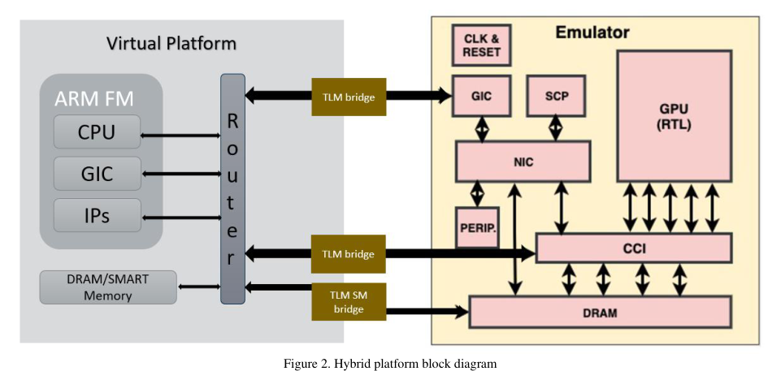
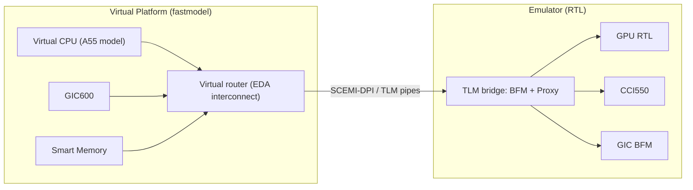

<!-- generated by yt-paper; edits will be overwritten -->
[DVCon](../dvcon/index.md) › [US](../dvcon/us.md) › [2022](../dvcon/by-year.md#2022) › [Emulation](../dvcon/by-topic.md#emulation)

# Hybrid Emulation: Accelerating Software driven verification and debug

<figure class="rep-fig" markdown>
{ loading=lazy }
<figcaption>Figure 2. Hybrid platform block diagram — from the original paper (Issac P Zacharia et al.)</figcaption>
</figure>

[:material-open-in-new: Original paper](https://dvcon-proceedings.org/wp-content/uploads/Hybrid-Emulation-Accelerating-Software-driven-Verification-and-Debug-1.pdf){ .md-button .md-button--primary target=_blank }

| | |
|---|---|
| Authors | Issac P Zacharia (Arm Ltd, Cambridge, UK), Jitendra Aggarwal (Arm Ltd, Bengaluru, India) |
| Venue | DVCon US 2022 |
| Topic | Emulation |
| Type | PAPER |
| ID | `ref-20261018-6683` |

## Summary

**Arm describes a hybrid platform that runs the CPU as a fastmodel virtual platform and the GPU RTL on an emulator, connected through TLM bridges and a shared "smart memory", to get full design visibility and faster OS-level software bring-up than full RTL emulation, while reproducing FPGA-platform issues.**

**Arm은 CPU를 fastmodel 가상 플랫폼으로, GPU RTL을 에뮬레이터에서 동작시키고 이를 TLM 브리지와 공유 "smart memory"로 연결한 하이브리드 플랫폼을 제시하여, 전체 RTL 에뮬레이션보다 빠르게 OS 레벨 소프트웨어를 부팅하면서도 완전한 설계 가시성을 확보하고 FPGA 플랫폼에서 보고된 문제를 재현할 수 있음을 보인다.**

## Key Insights

- The hybrid split replaces the Arm Cortex-A55 RTL, GIC600 and smart memory with fastmodels/virtual models on the VP side, keeping only the GPU (and CCI550 / GIC BFM) in RTL on the emulator, which reduces hardware footprint and speeds up software execution.

- 하이브리드 분할은 VP 측의 fastmodel(Cortex-A55, GIC600, smart memory)로 Cortex-A55 RTL, GIC600, smart memory를 대체하고, GPU와 기타 블록(CCI550, GIC BFM)만 에뮬레이터에서 RTL로 유지한다. 이를 통해 하드웨어 풋프린트를 줄이고 소프트웨어 실행을 가속한다.

- Smart memory is accessed by the virtual CPU via backdoor, avoiding TLM crossings; the paper states frequent VP-to-emulator transactions degrade runtime, so transaction size should be maximized and high-traffic transactors minimized.

- Smart memory는 가상 CPU가 TLM을 거치지 않고 백도어로 접근하므로 CPU 메모리 트래픽이 RTL 경계를 넘지 않는다. 논문은 VP와 에뮬레이터 간 빈번한 트랜잭션이 런타임 성능을 저하시킨다고 명시하며, 따라서 트랜잭션 크기를 최대화하고 트래픽이 많은 트랜잭터를 최소화할 것을 권장한다.

- Reported runtimes: Linux boot 62 s, Android 10 2640 s, Debian Buster 11 185 s; a 45X runtime improvement on the Linux boot benchmark versus legacy full RTL emulation.

- 보고된 런타임은 Linux 부팅 62초, Android 10 2640초, Debian Buster 11 185초이며, Linux 부팅 벤치마크에서 기존 전체 RTL 에뮬레이션 대비 45배의 런타임 향상이 있었다.

- Because the virtual CPU runs asynchronously in 0 simulation time, runs are non-deterministic; Hybrid Capture Replay records VP inputs against the design clock and replays them in later sessions for reproducible debug.

- 가상 CPU는 0 시뮬레이션 시간에 비동기적으로 실행되므로 실행마다 결과가 달라질 수 있다. Hybrid Capture Replay는 VP 입력을 설계 클록 기준으로 기록해 이후 세션에서 재생함으로써 재현 가능한 디버그를 지원한다.

- The platform reproduces hardware/software issues first seen on the FPGA-based Juno platform with full RTL visibility, but the paper positions it as complementary to, not a replacement for, cycle-accurate validation.

- FPGA 기반 Juno 플랫폼에서 나타난 HW/SW 문제를 전체 RTL 가시성을 가진 상태에서 재현할 수 있었다. 다만 논문은 이 방식이 사이클 정확도가 필요한 검증을 대체하는 것이 아니라 보완하는 것이라고 설명한다.

## Detailed Summary

### Background and Problem

- Arm GPU hardware/software verification was traditionally done on an FPGA-based Juno SoC board. Runtime throughput was high, but design visibility was poor and trace extraction was difficult, which lengthened root-causing.

- Arm GPU의 HW/SW 검증은 전통적으로 FPGA 기반 Juno SoC 보드에서 수행되었다. 런타임 처리량은 높았지만 설계 가시성이 낮고 트레이스 추출이 어려워 원인 분석에 오랜 시간이 걸렸다.

- Full RTL emulation cannot load the whole SoC once designs grow, especially when OS boot and application software must be validated.

- 설계 규모가 커지면 전체 RTL 에뮬레이션에 SoC 전체를 올릴 수 없으며, 특히 OS 부팅과 응용 소프트웨어 검증이 필요한 경우 더욱 그렇다.

- The authors list four pain points: long debug time due to poor visibility and trace access; weeks to build stimulus for real OS application issues at unit level; difficult GPU HW/SW live debug; and issues not reproducible across verification platforms.

- 저자들은 네 가지 문제를 제시한다. 가시성 부족과 트레이스 확보 어려움으로 인한 디버그 시간 증가, 실제 OS 응용 프로그램 이슈를 단위 수준 시뮬레이션에서 재현하기 위해 자극을 만드는 데 수 주가 걸림, GPU HW/SW 라이브 디버그의 어려움, 검증 플랫폼 간 이슈 재현 불가.

- Goal: shift HW/SW co-verification left, enabling software development before RTL or silicon is available and easing CPU subsystem upgrades.

- 목표: RTL이나 실리콘이 준비되기 전에 소프트웨어 개발을 가능하게 하여 HW/SW 공동 검증을 앞당기고, CPU 서브시스템 업그레이드를 쉽게 하는 것.

### Architecture and Methodology

The platform splits the SoC between a virtual platform (VP) and an emulator. The CPU side is an Arm fastmodel (Cortex-A55 with GIC600 and smart memory) in the VP. The GPU and other SoC blocks remain RTL on the emulator. The paper does not name the EDA vendor or emulator product.

이 플랫폼은 SoC를 가상 플랫폼(VP)과 에뮬레이터로 나눈다. CPU 측은 VP의 Arm fastmodel(GIC600 및 smart memory를 포함한 Cortex-A55)이다. GPU와 기타 SoC 블록은 에뮬레이터에서 RTL로 유지된다. 논문은 EDA 벤더나 에뮬레이터 제품명을 밝히지 않는다.

- **Transactors:** Built-in EDA Hybrid toolchain models convert RTL-to-virtual activity into transactions. They use SCEMI-DPI to carry TLM traffic across the boundary. The bridge is a thin BFM plus proxy layer: RTL ports connect to the BFM, and software transactions go to the proxy.

- **트랜잭터:** EDA Hybrid 툴체인의 기본 제공 모델이 RTL과 가상 환경 간 활동을 트랜잭션으로 변환한다. 경계를 넘는 TLM 트래픽은 SCEMI-DPI로 전달된다. 브리지는 BFM과 proxy로 구성된 얇은 계층으로, RTL 포트는 BFM에 연결되고 소프트웨어 트랜잭션은 proxy 측으로 전달된다.

- **Smart memory:** A shared memory visible to both sides. The CPU reaches it through backdoor access, not TLM, so CPU memory traffic does not cross the RTL boundary. The GPU accesses it through the RTL channel.

- **Smart memory:** 양쪽에서 모두 보이는 공유 메모리다. CPU는 TLM이 아닌 백도어로 접근하므로 CPU 메모리 트래픽이 RTL 경계를 넘지 않는다. GPU는 RTL 채널을 통해 접근한다.

- **Synchronization:** When fastmodel and emulator must sync, the emulator clock is paused and the CPU architectural state and cache data are exchanged.

- **동기화:** fastmodel과 에뮬레이터를 동기화해야 할 때는 에뮬레이터 클록을 일시 정지하고 CPU 아키텍처 상태와 캐시 데이터를 교환한다.

- **Performance guidance:** Frequent VP-emulator transactions degrade runtime. Maximize transaction size and minimize high-traffic transactors.

- **성능 지침:** VP와 에뮬레이터 간 빈번한 트랜잭션은 런타임을 저하시킨다. 트랜잭션 크기를 최대화하고 트래픽이 많은 트랜잭터를 최소화한다.

- **Validation sequence:** Bare-metal tests accessed GPU registers and smart memory. The team then booted Linux, Android 10 and Debian Buster 11, and ran graphics tests.

- **검증 순서:** 베어메탈 테스트로 GPU 레지스터와 smart memory에 접근했다. 이후 Linux, Android 10, Debian Buster 11을 부팅하고 그래픽 테스트를 실행했다.

- **Debug features:** Detailed logging, TLM visualization, CPU register and memory map viewers, and smart-memory debug tools. Hybrid Capture Replay records VP inputs against the design clock and replays them in later sessions. Non-CPU subsystem debug uses native RTL monitors, waveforms and memory dumps.

- **디버그 기능:** 상세 로깅, TLM 시각화, CPU 레지스터 및 메모리 맵 뷰어, smart memory 디버그 도구를 제공한다. Hybrid Capture Replay는 VP 입력을 설계 클록 기준으로 기록하고 이후 세션에서 재생한다. CPU 이외의 서브시스템 디버그는 RTL 모니터, 파형, 메모리 덤프 등 기존 방식을 사용한다.

### Results and Conclusions

| Test | Runtime |
|---|---|
| Linux Boot | 62 s |
| Android 10 | 2640 s |
| Debian Buster 11 | 185 s |

| 테스트 | 런타임 |
|---|---|
| Linux Boot | 62 s |
| Android 10 | 2640 s |
| Debian Buster 11 | 185 s |

- Moving the Linux boot benchmark from legacy full RTL emulation to the hybrid platform gave a 45X runtime improvement. The paper does not report the absolute baseline runtime.

- Linux 부팅 벤치마크를 기존 전체 RTL 에뮬레이션에서 하이브리드 플랫폼으로 옮기자 런타임이 45배 향상되었다. 논문은 기준선의 절대 런타임은 보고하지 않는다.

- Issues seen on the FPGA Juno platform were reproduced by rerunning the same test on the hybrid model with full visibility. The authors say this cut debug time and let them fix HW and SW bugs earlier than in previous projects.

- FPGA Juno 플랫폼에서 나타난 이슈는 하이브리드 모델에서 같은 테스트를 다시 실행해 전체 가시성을 확보한 상태에서 재현되었다. 저자들은 이를 통해 디버그 시간이 크게 줄었고, 이전 프로젝트보다 HW 및 SW 버그를 더 일찍 수정할 수 있었다고 설명한다.

- Figure 3 shows a graphics test running on Android after boot.

- Figure 3은 부팅 후 Android에서 그래픽 테스트가 실행되는 모습을 보여준다.

- The authors say the methodology suits high-level software use cases such as OS boot and driver development. They also note that cycle-accurate CPU validation is still needed, so the hybrid platform complements rather than replaces it.

- 저자들은 이 방식이 OS 부팅이나 드라이버 개발 같은 상위 수준 소프트웨어 사용 사례에 적합하다고 본다. 또한 CPU의 사이클 정확도 검증은 여전히 필요하므로 하이브리드 플랫폼은 이를 대체하지 않고 보완한다고 명시한다.

- Next steps: deploy on newer and unreleased Arm CPUs, and extend to server and enterprise infrastructure, where full-system visibility is limited by emulator capacity.

- 향후 계획: 최신 및 미출시 Arm CPU에 적용하고, 서버 및 엔터프라이즈 인프라로 확장하는 것. 이 영역에서는 에뮬레이터 용량 때문에 전체 시스템 가시성에 제약이 있다.

## Videos

<iframe src="https://www.youtube-nocookie.com/embed/LPCzFr2vPZc" title="[DVCON2022]Hybrid Emulation: Accelerating Software Driven Verification and Debug" loading="lazy" allow="accelerometer; clipboard-write; encrypted-media; gyroscope; picture-in-picture; web-share" referrerpolicy="strict-origin-when-cross-origin" allowfullscreen></iframe>

**[DVCON2022]Hybrid Emulation: Accelerating Software Driven Verification and Debug** — [Watch on YouTube](https://www.youtube.com/watch?v=LPCzFr2vPZc) · [Video page](../videos/LPCzFr2vPZc.md)
