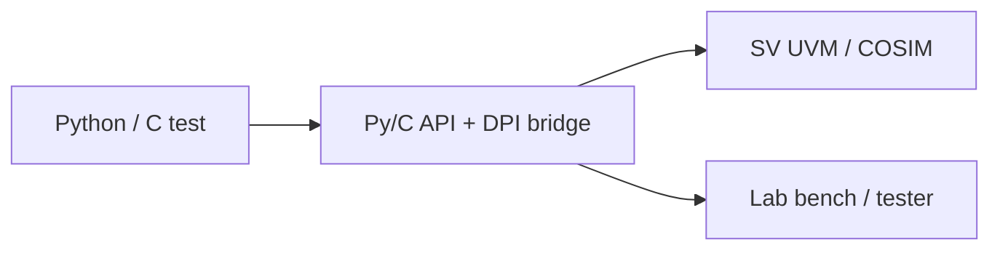

<!-- generated by yt-paper; edits will be overwritten -->
[DVCon](../dvcon/index.md) › [India](../dvcon/india.md) › [2019](../dvcon/by-year.md#2019) › [Verification](../dvcon/by-topic.md#verification)

# Unified Test Writing Framework for Pre and Post Silicon Verification

<figure class="rep-fig" markdown>
{ loading=lazy }
<figcaption>Fig. 1: Pre- and Post-Silicon Test Framework — from the original paper (Rahulkumar Patel et al.)</figcaption>
</figure>

[:material-open-in-new: Original paper](https://dvcon-proceedings.org/wp-content/uploads/unified-test-writing-framework-for-pre-and-post-silicon-verification-paper.pdf){ .md-button .md-button--primary target=_blank }

| | |
|---|---|
| Authors | Rahulkumar Patel (Analog Devices Inc., Bengaluru, India), Pablo Cholbi (Analog Devices Inc., Bengaluru, India), Sivasubrahmanya Evani (Analog Devices Inc., Bengaluru, India), Raman K (Analog Devices Inc., Bengaluru, India) |
| Venue | DVCon India 2019 |
| Topic | Verification |
| Type | PAPER |
| ID | `ref-20261018-678e` |

## Summary

**A common C/Python test-writing framework with an IP-XACT-generated register model and a DPI plus Py/C API bridge that reuses system-level tests across UVM/cosim and the post-silicon lab bench for a 77GHz radar sensor chip.**

**IP-XACT 기반 레지스터 모델과 DPI 및 Py/C API 브리지를 갖춘 C/Python 공용 테스트 작성 프레임워크로, 77GHz 레이더 센서 칩에서 UVM/cosim과 post-silicon 랩 벤치 사이의 시스템 레벨 테스트를 재사용한다.**

## Key Insights

- System-level interfaces (SPI, I2C, JTAG, GPIO) and their high-level actions are identical in simulation and on the bench, so a single test layer can serve both pre- and post-silicon.

- 시스템 레벨 인터페이스(SPI, I2C, JTAG, GPIO)와 그 상위 레벨 동작은 시뮬레이션과 벤치에서 동일하므로, 단일 테스트 계층으로 pre-silicon과 post-silicon을 모두 지원할 수 있다.

- A DPI plus Python/C API bridge lets the existing C test suite run unchanged while Python is adopted for lab-equipment drivers; full migration to Python is planned long term.

- DPI 및 Python/C API 브리지를 통해 기존 C 테스트 스위트를 수정 없이 실행하면서 랩 장비 드라이버에는 Python을 도입했으며, 장기적으로 모든 테스트를 Python으로 이전할 계획이다.

- The register model is auto-generated from IP-XACT, keeping C/Python tests in sync with the RTL register map without manual maintenance.

- 레지스터 모델이 IP-XACT에서 자동 생성되어 수동 유지보수 없이 C/Python 테스트를 RTL 레지스터 맵과 동기화된 상태로 유지한다.

- Deployed on a 77GHz radar sensor chip in 28nm RF-CMOS, with tests reused across digital sims, analog-digital cosim, firmware, and the bench.

- 28nm RF-CMOS 공정의 77GHz 레이더 센서 칩에 적용되었으며, 디지털 시뮬레이션, 아날로그-디지털 cosim, 펌웨어, 벤치 전반에서 테스트를 재사용했다.

- Benefits are reported only qualitatively (shorter evaluation time, earlier time-to-market); the paper gives no speedup, coverage, or measured numbers.

- 효과는 정성적으로만 보고된다(평가 시간 단축, 출시 시기 앞당김). 논문은 속도 향상, 커버리지, 측정 수치를 제시하지 않는다.

## Detailed Summary

### Background and Problem

- Digital verification relies on UVM, but analog and system designers find it too complex to write tests, and post-silicon bring-up and design-to-evaluation debug loops are slow.

- 디지털 검증은 UVM에 의존하지만, 아날로그 및 시스템 설계자에게는 테스트 작성이 너무 복잡하며, post-silicon bring-up과 설계-평가 간 디버그 루프가 느리다.

- At system level, the chip's external interfaces (SPI, I2C, JTAG, GPIO) and their high-level actions (read/write, wait on event, drive input, delay) are the same in simulation and on the bench, so one test layer can serve both.

- 시스템 레벨에서 칩의 외부 인터페이스(SPI, I2C, JTAG, GPIO)와 상위 레벨 동작(read/write, 이벤트 대기, 입력 구동, delay)은 시뮬레이션과 벤치에서 동일하므로, 하나의 테스트 계층으로 두 단계를 모두 지원할 수 있다.

- The existing C test infrastructure does not suit lab-equipment drivers, which require Python. Python-SV bidirectional communication is needed, and the existing C tests must run without migration.

- 기존 C 테스트 인프라는 Python이 필요한 랩 장비 드라이버에 적합하지 않다. Python-SV 양방향 통신이 필요하며, 기존 C 테스트는 마이그레이션 없이 실행되어야 한다.

### Architecture and Methodology

- A C front end provides a register model auto-generated from IP-XACT, bit-field access, and primitives for MMR and memory access, analog probing, force/release, wait-for-value, delay, and random generation. It runs in COSIM, reusing UVM agents.

- C 프런트엔드는 IP-XACT에서 자동 생성된 레지스터 모델, bit-field 접근, 그리고 MMR 및 메모리 접근, 아날로그 probing, force/release, 값 대기, delay, 난수 생성 기능을 제공한다. UVM 에이전트를 재사용하여 COSIM에서 실행된다.

- A transparent bridge connects SV and C through DPI import/export, and C and Python through the Py/C API (embedding and extending). Existing C tests run unchanged, and the long-term plan is to migrate them to Python.

- SV와 C는 DPI import/export로, C와 Python은 Py/C API(embedding 및 extending)로 연결되는 투명한 브리지가 있다. 기존 C 테스트는 수정 없이 실행되며, 장기 계획은 이를 Python으로 마이그레이션하는 것이다.

### Results and Conclusions

- Implemented on a 77GHz radar sensor chip in 28nm RF-CMOS.

- 28nm RF-CMOS 공정의 77GHz 레이더 센서 칩에 구현되었다.

- Pre-silicon: automated SPI-to-register connectivity checks, analog node voltage checks in cosim (dependent on strict net-naming conventions), NumPy-based FFT checks, boot-up flow, and designer participation in test writing.

- Pre-silicon: SPI-to-register 연결성 자동 점검, cosim에서의 아날로그 노드 전압 점검(엄격한 net-naming 규칙에 의존), NumPy 기반 FFT 검증, boot-up 흐름, 설계자의 테스트 작성 참여.

- Post-silicon: the configuration library was shared with Evaluation and Apps, failing configurations were replayed in DV simulation, and a Visual Basic front end on the Ultra-Flex tester was translated from Py/C with minimal effort.

- Post-silicon: 구성 라이브러리를 Evaluation 및 Apps와 공유했고, 문제가 된 구성은 DV 시뮬레이션에서 재현할 수 있었으며, Ultra-Flex 테스터의 Visual Basic 프런트엔드는 최소한의 노력으로 Py/C에서 변환되었다.

- The authors report shorter silicon evaluation and an earlier time-to-market, but provide no quantitative measurements.

- 저자들은 실리콘 평가 기간 단축과 출시 시기 앞당김을 보고하지만, 정량적 측정값은 제시하지 않는다.

## Videos

<iframe src="https://www.youtube-nocookie.com/embed/W_odEND1SD8" title="[DVCON2019_INDIA]Unified Test Writing Framework for Pre and Post Silicon Verification" loading="lazy" allow="accelerometer; clipboard-write; encrypted-media; gyroscope; picture-in-picture; web-share" referrerpolicy="strict-origin-when-cross-origin" allowfullscreen></iframe>

**[DVCON2019_INDIA]Unified Test Writing Framework for Pre and Post Silicon Verification** — [Watch on YouTube](https://www.youtube.com/watch?v=W_odEND1SD8) · [Video page](../videos/W_odEND1SD8.md)
