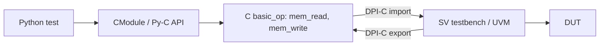

<!-- generated by yt-paper; edits will be overwritten -->
[DVCon](../dvcon/index.md) › [India](../dvcon/india.md) › [2019](../dvcon/by-year.md#2019) › [Verification](../dvcon/by-topic.md#verification)

# Unified Test Writing Framework for Pre and Post Silicon Verification

<figure class="rep-fig" markdown>
{ loading=lazy }
<figcaption>Fig. 5: Python-SV Simulation Flow — from the original paper (Rahulkumar Patel et al.)</figcaption>
</figure>

[:material-open-in-new: Original paper](https://dvcon-proceedings.org/wp-content/uploads/unified-test-writing-framework-for-pre-and-post-silicon-verification-paper.pdf){ .md-button .md-button--primary target=_blank }

| | |
|---|---|
| Authors | Rahulkumar Patel (Analog Devices Inc.), Pablo Cholbi (Analog Devices Inc.), Sivasubrahmanya Evani (Analog Devices Inc.), Raman K (Analog Devices Inc.) — DVCon Europe |
| Venue | DVCon India 2019 |
| Topic | Verification |
| Type | PAPER |
| ID | `ref-20261018-678e` |

## Summary

**A common high-level test-writing framework that lets analog designers write tests in C/Python on top of a UVM-based SV environment via DPI and Python/C API bridges, reusing the same tests from pre-silicon cosim through post-silicon lab bring-up on a 77GHz radar chip.**

**UVM 기반 SV 환경 위에서 DPI와 Python/C API 브리지를 통해 아날로그 설계자도 테스트를 작성할 수 있게 하여, 77GHz 레이더 칩의 cosim부터 post-silicon 랩 bring-up까지 동일한 테스트 라이브러리를 재사용하는 통합 프레임워크를 제안한다.**

## Key Insights

- Tests are written against a high-level interface vocabulary (MMR read/write, memory access, force/release, wait-on-node, delay) that is shared between UVM simulation (UVC-driven) and lab hardware, so the same test library runs in both phases.

- 테스트는 UVM 시뮬레이션(UVC 구동)과 랩 하드웨어에서 공통으로 쓰이는 고수준 인터페이스 어휘(MMR read/write, 메모리 접근, force/release, 노드 대기, delay)로 작성되어, 두 단계에서 같은 테스트 라이브러리를 실행할 수 있다.

- The C register model is auto-generated from IP-XACT, and the bit-field access layer hides register addresses and bit offsets so analog designers can write tests without knowing UVM.

- C 레지스터 모델은 IP-XACT에서 자동 생성되며, bit-field 접근 계층이 레지스터 주소와 비트 오프셋을 숨겨 아날로그 설계자가 UVM을 몰라도 테스트를 작성할 수 있다.

- A transparent bridge built from SV DPI-C import/export plus the Python/C API lets Python drive the SV simulator, allowing the existing C test suite to run unchanged while migration to Python is planned long-term.

- SV DPI-C import/export와 Python/C API로 구성된 투명한 브리지를 통해 Python이 SV 시뮬레이터를 구동할 수 있어, 기존 C 테스트 스위트를 수정 없이 실행하며 장기적으로 Python으로 이전할 계획이다.

- Reported results on a 77GHz radar sensor chip (28nm RF-CMOS) include SPI-to-register connectivity checks in digital sims, voltage-level checks at analog nodes in cosim, and reuse of functions across digital, cosim and firmware; the paper gives no quantitative schedule or time-saving figures.

- 77GHz 레이더 센서 칩(28nm RF-CMOS)에서 디지털 시뮬레이션의 SPI-레지스터 연결성 검사, cosim의 아날로그 노드 전압 레벨 검사, 디지털·cosim·펌웨어 간 함수 재사용이 보고되었다. 다만 일정 단축이나 공수에 대한 정량적 수치는 제시되지 않았다.

- Post-silicon reuse included sharing the chip configuration library with Evaluation and Apps teams and translating Py/C configurations into VB code for the Ultra-Flex tester with minimal effort.

- Post-silicon 재사용으로 chip 설정 라이브러리를 Evaluation 및 Apps 팀과 공유했고, Py/C 설정을 Ultra-Flex 테스터의 VB 프론트엔드 코드로 최소한의 노력으로 변환했다.

## Detailed Summary

### Background and Problem

- Digital verification is predominantly UVM-based, but analog designers find UVM infrastructure too complex to write tests in, which limits who can author cosim tests.

- 디지털 검증은 대부분 UVM 기반이지만, 아날로그 설계자에게 UVM 인프라는 너무 복잡해 cosim 테스트 작성자가 제한된다.

- Pre-silicon (simulation) and post-silicon (lab bring-up, evaluation, application boards) test flows are typically duplicated. Interfaces (SPI, I2C, JTAG, GPIO) and high-level actions (read/write frame, wait on output event, drive input, wait for time) are the same in both, so the paper argues a shared high-level test framework is feasible.

- 시뮬레이션(pre-silicon)과 랩 bring-up·평가·애플리케이션 보드(post-silicon) 테스트 흐름은 보통 중복된다. SPI, I2C, JTAG, GPIO 같은 인터페이스와 read/write frame, 출력 이벤트 대기, 입력 구동, 시간 대기 같은 고수준 동작은 두 단계에서 동일하므로, 공통 고수준 테스트 프레임워크가 가능하다고 본다.

- Two problems are addressed: (1) reuse of tests and infrastructure across digital, cosim and firmware verification; (2) extending that reuse to post-silicon, where lab equipment is driven from Python rather than C, and the existing C test suite must not need a costly migration.

- 두 가지 문제를 다룬다. (1) 디지털, cosim, 펌웨어 검증 간 테스트와 인프라 재사용, (2) 이를 post-silicon으로 확장하는 것. 후자에서는 랩 장비를 C가 아닌 Python으로 구동해야 하며, 기존 C 테스트 스위트를 값비싼 마이그레이션 없이 활용해야 한다.

### Architecture and Methodology

- **C front end**: tests are written in C with an auto-generated C model of the chip register map (from IP-XACT). Low-level primitives include MMR read/write, memory read/write, analog node voltage probing, force/release of digital/analog nodes, wait-for-value on nodes, delay and random generation. Bit-field access is exposed as C data types, with addresses and offsets abstracted.

- **C 프론트엔드**: 테스트는 IP-XACT에서 자동 생성된 C 레지스터 맵 모델로 C에서 작성된다. 기본 프리미티브는 MMR read/write, 메모리 read/write, 아날로그 노드 전압 프로빙, 디지털/아날로그 노드 force/release, 노드 값 대기, delay, 난수 생성이다. bit-field 접근은 C 데이터 타입으로 제공되며, 주소와 오프셋은 추상화된다.

- **COSIM**: analog-digital co-simulation reuses the digital UVM setup and agents, supports analog models that are not SV real-number models, and uses the analog simulator's waveform post-processing.

- **COSIM**: 아날로그-디지털 co-simulation은 디지털 UVM 환경과 에이전트를 재사용하고, SV real-number 모델이 아닌 아날로그 모델을 지원하며, 아날로그 시뮬레이터의 파형 후처리 기능을 사용한다.

- **Bridge to SV**: the bridge is transparent to the user and consists of DPI-C imports/exports between SV and C, plus the Python/C API. Python is embedded in C (`PyImport_AppendInittab`, `Py_Initialize`, calling `command.main_py()`), and C functions such as `mem_read`/`mem_write` are wrapped as a Python extension module (`CModule`).

- **SV 브리지**: 사용자에게 투명한 브리지로, SV와 C 사이의 DPI-C import/export와 Python/C API로 구성된다. Python은 C에 임베딩되고(`PyImport_AppendInittab`, `Py_Initialize`, `command.main_py()` 호출), `mem_read`/`mem_write` 같은 C 함수는 Python 확장 모듈(`CModule`)로 래핑된다.

- **Example Python test (Fig. 9)**: PLL init via `adcpll_fast_init_gen`, register writes with `dev_reg_update()`, `read_expect`, memory write/read, `force_digital`/`wait_state`/`release`, `gen_random_data`, and loops over RX/AFE subsystem instances.

- **Python 테스트 예시(Fig. 9)**: `adcpll_fast_init_gen`을 통한 PLL 초기화, `dev_reg_update()`를 동반한 레지스터 쓰기, `read_expect`, 메모리 쓰기/읽기, `force_digital`/`wait_state`/`release`, `gen_random_data`, RX/AFE 서브시스템 인스턴스 반복.

- Python is planned to replace the C tests in the long term, to reduce maintenance of both C and Python infrastructure.

- 장기적으로 Python이 C 테스트를 대체할 계획이며, 이는 C와 Python 두 인프라의 유지보수를 줄이기 위함이다.

### Results and Conclusions

- **Pre-silicon (C/Py)**: automated test generation checks SPI-to-digital-register connectivity in digital sims, and the same approach checks voltage levels at deep analog nodes in cosim (enabled by strict net-naming conventions across RTL and schematics); functions are reused across digital and cosim; numpy is used for FFT-based datapath checks; system boot-up infrastructure was built with minimal effort; designers joined test development.

- **Pre-silicon (C/Py)**: 자동 테스트 생성으로 디지털 시뮬레이션에서 SPI-디지털 레지스터 연결성을 검사하고, 같은 방식을 cosim에서 깊은 아날로그 노드의 전압 레벨 검사에 확장했다(RTL과 회로도 간 엄격한 net 네이밍 규칙 덕분). 디지털과 cosim 간 함수 재사용, FFT 등 데이터패스 검사용 numpy 활용, 최소 노력으로 시스템 부팅 인프라 구축, 설계자의 테스트 개발 참여가 이루어졌다.

- **Post-silicon (Py)**: design shared the chip configuration library with Evaluation and Apps teams; failing lab configurations could be imported into the DV environment for debug; Ultra-Flex tester VB front end was populated from Py/C configurations with minimal effort.

- **Post-silicon (Py)**: 설계팀이 chip 설정 라이브러리를 Evaluation 및 Apps 팀과 공유했고, 랩에서 문제가 된 설정을 DV 환경으로 가져와 디버그할 수 있었다. Ultra-Flex 테스터의 VB 프론트엔드도 Py/C 설정으로부터 최소한의 노력으로 구성되었다.

- Target device: 77GHz radar sensor chip, 28nm RF-CMOS.

- 대상 디바이스: 28nm RF-CMOS 기반 77GHz 레이더 센서 칩.

- The paper claims shortened evaluation timelines, faster total verification, and earlier time-to-market, but provides no quantitative measurements (no schedule durations or effort numbers) to back these claims.

- 평가 일정 단축, 전체 검증 시간 단축, time-to-market 단축을 주장하지만, 이를 뒷받침할 정량적 측정(일정 기간, 공수 수치)은 제시하지 않는다.

- Limitations noted implicitly: the existing C suite still runs through the bridge; Python migration is future work; the flow depends on disciplined net naming and IP-XACT-generated infrastructure.

- 암묵적 한계: 기존 C 스위트는 여전히 브리지를 통해 실행되며, Python 이전은 향후 과제이고, 흐름은 엄격한 net 네이밍과 IP-XACT 기반 인프라에 의존한다.

## Videos

<iframe src="https://www.youtube-nocookie.com/embed/W_odEND1SD8" title="[DVCON2019_INDIA]Unified Test Writing Framework for Pre and Post Silicon Verification" loading="lazy" allow="accelerometer; clipboard-write; encrypted-media; gyroscope; picture-in-picture; web-share" referrerpolicy="strict-origin-when-cross-origin" allowfullscreen></iframe>

**[DVCON2019_INDIA]Unified Test Writing Framework for Pre and Post Silicon Verification** — [Watch on YouTube](https://www.youtube.com/watch?v=W_odEND1SD8) · [Video page](../videos/W_odEND1SD8.md)
