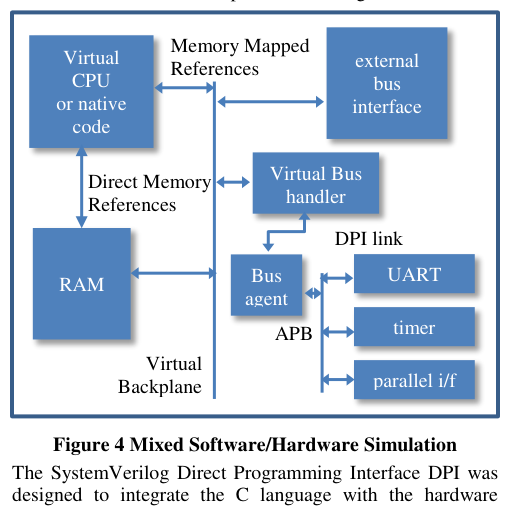
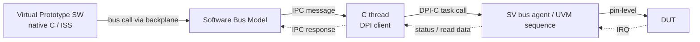

<!-- generated by yt-paper; edits will be overwritten -->
[DVCon](../dvcon/index.md) › [US](../dvcon/us.md) › [2013](../dvcon/by-year.md#2013) › [Verification](../dvcon/by-topic.md#verification)

# Easy Steps Towards Virtual Prototyping using the SystemVerilog DPI

<figure class="rep-fig" markdown>
{ loading=lazy }
<figcaption>Figure 4 Mixed Software/Hardware Simulation The SystemVerilog Direct Programming Interface DPI was designed to integrate the C language with the hardware — from the original paper (Dave Rich et al.)</figcaption>
</figure>

[:material-open-in-new: Original paper](https://dvcon-proceedings.org/wp-content/uploads/easy-steps-towards-virtual-prototyping-using-the-systemverilog-dpi.pdf){ .md-button .md-button--primary target=_blank }

| | |
|---|---|
| Authors | Dave Rich (Mentor Graphics, Inc., Fremont, CA) |
| Venue | DVCon US 2013 |
| Topic | Verification |
| Type | PAPER |
| ID | `ref-20261018-6a03` |

## Summary

**The paper shows how SystemVerilog DPI-C bridges C software and an HDL testbench so that software bus transactions become procedure calls into UVM/BFM bus agents, with tunable time compression, transaction-based interrupt and payload handling, and IPC-based control, letting the hardware verification environment be reused by the virtual prototype.**

**이 논문은 SystemVerilog DPI-C로 C 소프트웨어와 HDL 테스트벤치를 연결하여, 소프트웨어의 버스 트랜잭션을 UVM/BFM 버스 에이전트에 대한 프로시저 호출로 변환하는 방법을 보인다. 여기에는 조정 가능한 시간 압축, 트랜잭션 기반의 인터럽트 및 페이로드 처리, IPC 기반 제어가 포함되어, 하드웨어 검증 환경을 가상 프로토타입에서 재사용할 수 있게 한다.**

## Key Insights

- DPI-C raises the HW/SW boundary to procedure-call level: the C routine blocks on exported APB_read/APB_write tasks while SystemVerilog simulation time advances, whereas PLI is aimed at pin-level transactions and tool interfaces.

- DPI-C는 HW/SW 경계를 프로시저 호출 수준으로 끌어올린다. C 루틴은 export된 APB_read/APB_write 태스크에서 블록되는 동안 SystemVerilog 시뮬레이션 시간이 진행되며, PLI는 핀 수준 트랜잭션과 툴 인터페이스를 대상으로 한다.

- Time compression: hardware time advances only on the bus cycles the virtual prototype selects, so thousands of consecutive idle cycles can be skipped. Idle time is injected with an APB_idle(n) task or with constrained-random cycles derived from the instruction count, and a fork/join_any monitor reports interrupts back to the software side.

- 시간 압축: 하드웨어 시간은 가상 프로토타입이 선택한 버스 사이클 동안에만 진행되므로, 연속된 수천 개의 유휴 사이클을 건너뛸 수 있다. 유휴 시간은 APB_idle(n) 태스크나 명령어 수로부터 도출한 constrained-random 사이클로 주입하며, fork/join_any 모니터가 인터럽트를 소프트웨어 측에 보고한다.

- Transactions are packed structs (Operation, Address, ReqDuration, InterruptMode Ignore/Complete/Abort, Length, Payload) that cross the language boundary as byte arrays. Dynamic payloads are handled by a fixed maximum size with Length, by fixed-size chunks (for example, a 5K payload sent as 3 transactions over 2K blocks), or by a two-call allocate-then-fill scheme.

- 트랜잭션은 Operation, Address, ReqDuration, InterruptMode(Ignore/Complete/Abort), Length, Payload로 구성된 패킹된 구조체이며, 언어 경계를 바이트 배열로 넘는다. 가변 크기 페이로드는 최대 고정 크기와 Length, 고정 크기 블록 분할(예: 5K 페이로드를 2K 블록 3개 트랜잭션으로 전송), 또는 두 번의 호출로 할당 후 채우기 방식으로 처리한다.

- Control direction is a design choice: the SystemVerilog side can be master by importing a C task (import "DPI-C" task c_code), or the virtual prototype can be master, with an IPC socket connecting the hardware-side C client. The only difference is which process initiates the socket.

- 제어 방향은 설계 선택 사항이다. SystemVerilog 측이 master가 되어 C 태스크를 import(import "DPI-C" task c_code)하거나, 가상 프로토타입이 master가 되어 IPC 소켓으로 하드웨어 측 C 클라이언트와 연결할 수 있다. 차이는 소켓을 어느 프로세스가 시작하느냐뿐이다.

- The paper reports no quantitative benchmarks. Its performance statements are qualitative, for example that a virtual platform may run within one or two orders of magnitude of the real system. Timing parameters should be validated on the target project.

- 논문은 정량적 벤치마크를 제시하지 않는다. 성능에 대한 서술은 정성적이며, 예를 들어 가상 플랫폼이 실제 시스템의 1~2 자릿수 이내에서 동작할 수 있다는 정도이다. 타이밍 파라미터는 대상 프로젝트에서 직접 검증해야 한다.

## Detailed Summary

### Background and Problem

- Hardware and software are verified separately, and full-system verification only starts once an FPGA or emulation platform is available, which is often too late in the project schedule.

- 하드웨어와 소프트웨어는 별도로 검증되며, 전체 시스템 검증은 FPGA나 에뮬레이션 플랫폼이 준비된 뒤에야 시작된다. 이는 프로젝트 일정상 너무 늦은 경우가 많다.

- A virtual prototype (VP) runs target software on a fast host using high-level models. Adding HDL-level hardware models slows it dramatically and limits simulation to small OS fragments or short code segments.

- 가상 프로토타입(VP)은 고성능 호스트에서 높은 수준의 모델로 대상 소프트웨어를 실행한다. 여기에 HDL 수준 하드웨어 모델을 추가하면 속도가 크게 떨어지고, 시뮬레이션은 작은 OS 조각이나 짧은 코드 세그먼트로 제한된다.

- Block-level hardware verification (VIP or bus-functional models) is efficient, but it lacks software-driven stimulus. Driving a bus through an ISS at pin or cycle accuracy is inefficient.

- 블록 수준 하드웨어 검증(VIP 또는 bus-functional 모델)은 효율적이지만 소프트웨어 주도 자극이 부족하다. ISS로 버스를 핀 또는 사이클 정확도로 구동하는 방식도 비효율적이다.

- Goal: verify the communication between software and hardware rather than the whole system. Software bus transactions should drive the HDL bus at procedure-call abstraction, and the hardware testbench should be reusable from the VP.

- 목표: 전체 시스템이 아니라 소프트웨어와 하드웨어 사이의 통신을 검증한다. 소프트웨어 버스 트랜잭션을 프로시저 호출 추상화 수준에서 HDL 버스로 구동하고, 하드웨어 테스트벤치를 VP에서 재사용할 수 있게 한다.

### Architecture and Methodology

- Abstraction levels follow the SystemC TLM-2.0 coding styles: Untimed (UT), Loosely-timed (LT), Approximately-timed (AT), and Cycle-accurate (CC). Software can use any level. Synthesizable hardware is usually CC, while testbenches can be higher level. The UVM register abstraction layer maps procedural calls to memory references.

- 추상화 수준은 SystemC TLM-2.0 코딩 스타일을 따른다: Untimed(UT), Loosely-timed(LT), Approximately-timed(AT), Cycle-accurate(CC). 소프트웨어는 어느 수준이든 사용할 수 있다. 합성 가능한 하드웨어는 대체로 CC이고, 테스트벤치는 더 높은 수준일 수 있다. UVM 레지스터 추상화 계층은 프로시저 호출을 메모리 참조로 매핑한다.

- DPI-C link: an SV function or task appears as a C routine, and a C routine appears as an SV task or function. Only compatible types are passed, by value. In the Figure 5 example, C_routine calls the exported APB_read and APB_write tasks and stays blocked until they complete.

- DPI-C 링크: SV 함수나 태스크는 C 루틴처럼 보이고, C 루틴은 SV 태스크나 함수처럼 보인다. 호환 가능한 타입만 값으로 전달된다. 그림 5의 예에서 C_routine은 export된 APB_read와 APB_write 태스크를 호출하고, 완료될 때까지 블록된 상태로 있다.

- Time compression (Figure 6): hardware time advances only during bus cycles chosen by the VP. Two ways to add idle time are an explicit idle task, APB_idle(cycles) (Figure 7), or adding the instruction count to each bus operation and injecting constrained-random idle cycles. Interrupts (Figure 8) use a fork/join_any monitor that waits for either the requested cycles or IRQ!=0, then returns iRequested and actualCycles. The completion model is agreed per application: report the interrupt during the operation, or abort and return "incomplete" (InterruptMode Ignore, Complete, or Abort).

- 시간 압축(그림 6): 하드웨어 시간은 VP가 선택한 버스 사이클 동안에만 진행된다. 유휴 시간을 추가하는 방법은 두 가지로, 명시적 유휴 태스크 APB_idle(cycles)(그림 7)을 쓰거나, 각 버스 연산에 명령어 수를 더하고 constrained-random 유휴 사이클을 주입하는 방식이다. 인터럽트(그림 8)는 요청된 사이클 수 또는 IRQ!=0을 기다리는 fork/join_any 모니터를 사용하며, iRequested와 actualCycles를 반환한다. 완료 모델은 응용에 따라 합의한다. 연산 중 인터럽트를 보고하거나, 연산을 중단하고 "미완료"를 즉시 반환한다(InterruptMode Ignore, Complete, Abort).

- Transaction specification (Figure 9): a struct with Operation (read, write, idle, burst), 32-bit Address, ReqStart, ReqDuration, TrStart, TrEnd, InterruptMode, InterruptReq, InterruptTime, Length, and Payload bytes. Each side of the boundary allocates and manages memory for the transaction. Dynamic payloads use one of three methods: a fixed maximum size with Length, fixed-size blocks over multiple operations, or a two-call allocate-then-fill scheme.

- 트랜잭션 명세(그림 9): Operation(read, write, idle, burst), 32비트 Address, ReqStart, ReqDuration, TrStart, TrEnd, InterruptMode, InterruptReq, InterruptTime, Length, 그리고 Payload 바이트로 구성된 구조체이다. 경계의 각 측이 트랜잭션의 메모리를 할당하고 관리한다. 가변 크기 페이로드는 세 가지 방법 중 하나로 처리한다. 최대 고정 크기와 Length 사용, 여러 연산에 걸친 고정 크기 블록 전송, 또는 두 번의 호출로 할당 후 채우기.

- Control flow:
  - SV-master: a C thread is started from an initial block with import "DPI-C" task c_code (Figure 10). The C code consumes time by calling the exported task v_code.
  - VP-master: the virtual backplane's software bus model sends an IPC message over a socket and waits for a response. The hardware-side C client receives the message, executes the transaction through DPI into the SV bus functional model, and returns the result (Figure 11).

- 제어 흐름:
  - SV master: 초기 블록에서 import "DPI-C" task c_code로 C 스레드를 시작한다(그림 10). C 코드는 export된 태스크 v_code를 호출하여 시간을 소비한다.
  - VP master: 가상 백플레인의 소프트웨어 버스 모델이 IPC 소켓으로 메시지를 보내고 응답을 기다린다. 하드웨어 측 C 클라이언트가 메시지를 받아 DPI를 통해 SV bus functional 모델에 트랜잭션을 실행하고 결과를 반환한다(그림 11).

- UVM integration (Figure 12): DPI-invoked C code starts UVM sequences. The sequences can come from a pure UVM test, from the VP process, or from both. The UVM register model (for example regA.read() and regA.write()) maps addresses to the correct interface, so the existing hardware testbench is reused.

- UVM 통합(그림 12): DPI로 호출된 C 코드가 UVM 시퀀스를 시작한다. 시퀀스는 순수 UVM 테스트, VP 프로세스, 또는 둘의 조합에서 생성될 수 있다. UVM 레지스터 모델(예: regA.read(), regA.write())이 주소를 올바른 인터페이스로 매핑하므로 기존 하드웨어 테스트벤치를 재사용한다.

### Results and Conclusions

- The paper has no quantitative benchmarks or speedup measurements. Its performance statements are qualitative: a VP may run within one or two orders of magnitude of the real system, and hardware-level models have a severe impact on speed. The paper argues for skipping idle bus cycles rather than modeling every one.

- 논문에는 정량적 벤치마크나 속도 향상 측정 결과가 없다. 성능에 대한 서술은 정성적이다. 가상 프로토타입은 실제 시스템의 1~2 자릿수 이내에서 동작할 수 있으며, 하드웨어 수준 모델은 속도에 심각한 영향을 준다. 논문은 모든 유휴 버스 사이클을 모델링하기보다 건너뛰는 것을 주장한다.

- The techniques were deployed on several projects. The virtual prototypes were internal platforms, open-source Python stimulus generators, and commercial systems such as Wind River Simics.

- 이 기법은 여러 프로젝트에 적용되었다. 가상 프로토타입은 내부 플랫폼, 오픈소스 Python 자극 생성기, 그리고 Wind River Simics 같은 상용 시스템이었다.

- Open issues not covered in detail: handling multiple interface threads, and interactive debugging of two processes communicating over IPC sockets.

- 자세히 다루지 않은 미해결 과제: 여러 인터페이스 스레드 처리, IPC 소켓으로 통신하는 두 프로세스의 대화형 디버깅.

- Conclusion: DPI-C plus UVM supports a transaction-level HW/SW co-verification environment in which the hardware testbench is reused by the virtual prototype, with the timing accuracy of each side set independently.

- 결론: DPI-C와 UVM의 결합은 트랜잭션 수준의 HW/SW 공동 검증 환경을 지원한다. 이 환경에서는 하드웨어 테스트벤치를 가상 프로토타입이 재사용하며, 양측의 타이밍 정확도를 독립적으로 설정할 수 있다.

## Videos

<iframe src="https://www.youtube-nocookie.com/embed/AoUFwMf9jEI" title="[DVCON2013]Easy Steps Towards Virtual Prototyping using the SystemVerilog DPI" loading="lazy" allow="accelerometer; clipboard-write; encrypted-media; gyroscope; picture-in-picture; web-share" referrerpolicy="strict-origin-when-cross-origin" allowfullscreen></iframe>

**[DVCON2013]Easy Steps Towards Virtual Prototyping using the SystemVerilog DPI** — [Watch on YouTube](https://www.youtube.com/watch?v=AoUFwMf9jEI) · [Video page](../videos/AoUFwMf9jEI.md)
