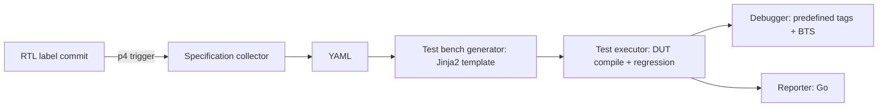

<!-- generated by yt-paper; edits will be overwritten -->
[DVCon](../dvcon/index.md) › [US](../dvcon/us.md) › [2025](../dvcon/by-year.md#2025) › [Verification](../dvcon/by-topic.md#verification)

# Test bench Framework for Fully Automated Register Tests of Numerous IPs in SoC

<figure class="rep-fig" markdown>
{ loading=lazy }
<figcaption>Figure 5. Working flow of the test bench framework — from the original paper (Wonyeong So et al.)</figcaption>
</figure>

[:material-open-in-new: Original paper](https://dvcon-proceedings.org/wp-content/uploads/1088-2.pdf){ .md-button .md-button--primary target=_blank }

| | |
|---|---|
| Authors | Wonyeong So (Samsung Electronics), Minje Kim (Samsung Electronics), Jihye Lim (Samsung Electronics), Sunil Roe (Samsung Electronics), Youngsik Kim (Samsung Electronics), Sunil Brain Choi (Samsung Electronics) |
| Venue | DVCon US 2025 |
| Topic | Verification |
| Type | PAPER |
| ID | `ref-20261018-7575` |

## Summary

**A Python/Go framework that auto-generates UVM register read/write and security-access test benches for every IP in an SoC from IP-XACT, address-map, UVM register model and security (TZPC) specs, then runs regressions, debugs errors with BTS, and reports results, triggered by RTL label releases in Perforce.**

**IP-XACT, 주소 맵, UVM 레지스터 모델, 보안(TZPC) 스펙으로부터 SoC 내 모든 IP의 UVM 레지스터 read/write 및 보안 접근 테스트 벤치를 자동 생성하고, 회귀 실행·BTS 기반 디버깅·리포팅을 Perforce RTL 라벨 트리거로 자동화하는 Python/Go 프레임워크이다.**

## Key Insights

- Cross-checks three specification sources (IP-XACT XML, SoC address map Excel, UVM register model) for IP-list and base-address mismatches, logging a specification bug when they disagree.

- IP-XACT XML, SoC 주소 맵 Excel, UVM 레지스터 모델 세 가지 스펙 소스를 교차 검증하여 IP 목록과 base address 불일치를 찾고, 불일치 시 스펙 버그로 로그를 남긴다.

- Generates one register access test bench per IP from a YAML intermediate via Jinja2 templates and macros; the template is simple (repeated read/write), so template changes are expected to be minimal.

- 중간 표현인 YAML을 거쳐 Jinja2 템플릿과 매크로로 IP별 레지스터 테스트 벤치를 생성한다. 템플릿 구조가 단순한 read/write 반복이라 변경이 최소화된다고 설명한다.

- Error handling is split: predefined UVM_ERROR tags map to fixed solutions, while unexpected bus hangs and error responses are localized by a BTS (Bus Trace System) debugger invoked through VIP callbacks.

- 에러 처리는 두 갈래다. 사전 정의된 UVM_ERROR 태그는 고정 해결책에 연결되고, 예상치 못한 bus hang과 error response는 VIP 콜백으로 호출되는 BTS(Bus Trace System) 디버거가 위치를 찾는다.

- Across five Samsung SoC projects, IP register access tests accounted for roughly 33-39% of total tests (average ~35%); the IP count matched the number of generated register test benches.

- 다섯 개 Samsung SoC 프로젝트에서 IP 레지스터 접근 테스트는 전체 테스트의 약 0.33~0.39(평균 약 35%)를 차지했고, IP 수와 생성된 레지스터 테스트 벤치 수가 일치했다.

- Full automation is triggered by p4 trigger on RTL label file commits in predefined paths with fixed naming patterns, giving per-label sanity checks without manual intervention. The paper reports no measured speedup or bug-detection figures.

- RTL 라벨 파일이 정해진 경로와 명명 규칙으로 커밋되면 p4 trigger가 작동해 사람 개입 없이 라벨별 sanity check를 수행한다. 논문은 실행 시간 단축이나 버그 검출 수치는 제시하지 않았다.

## Detailed Summary

### Background and Problem

- SoC designs integrate ever more IPs, and each IP needs its own register read/write test bench. Maintaining these by hand is time-consuming and error-prone, and specification changes (common early in projects) force repeated test bench edits.

- SoC에 통합되는 IP가 늘어날수록 IP마다 레지스터 read/write 테스트 벤치가 필요하다. 이를 수작업으로 유지보수하는 일은 시간이 많이 들고 오류가 생기기 쉬우며, 프로젝트 초기에 빈번한 스펙 변경이 있으면 테스트 벤치를 반복해서 수정해야 한다.

- Specifications come in heterogeneous forms (HDL-format descriptions, Excel address maps, emails, chat, verbal). Misinterpretation or stale specifications create verification holes that let SoC bugs through.

- 스펙은 HDL 형식 설명, Excel 주소 맵, 이메일, 채팅, 구두 등 여러 형태로 존재한다. 스펙 오해나 최신화되지 않은 스펙은 verification hole을 만들고 SoC 버그를 놓치게 한다.

- Register access tests were chosen as the target because they are simple in scenario complexity, essential as a prerequisite for deeper tests, and numerous with a predefined IP list.

- 레지스터 접근 테스트는 시나리오 복잡도가 낮지만, 더 복잡한 테스트의 선행 조건으로 필수적이며, 미리 정의된 IP 목록을 가진 대량의 테스트라는 점에서 대상으로 선택되었다.

### Architecture and Methodology

- **Specification collector (Python):** parses IP-XACT XML (IP names), the SoC address map Excel file (IP-to-block mapping and base addresses), and the UVM register model (UVM handler names and base addresses). Mismatches are reported as specification errors. Security attributes from a structured table (for example a TZPC table) are also collected, enabling tests in which a non-secure master must not access a secure IP. The result is a per-IP YAML file.

- **Specification collector (Python):** IP-XACT XML(IP 이름), SoC 주소 맵 Excel 파일(IP와 블록 매핑 및 base address), UVM 레지스터 모델(UVM handler 이름 및 base address)을 파싱한다. 불일치는 스펙 오류로 보고한다. TZPC 테이블 같은 구조화된 파일에서 보안 속성도 수집하며, 비보안 master가 보안 IP에 접근하지 못하는지를 검증할 수 있게 한다. 결과는 IP별 YAML 파일이다.

- **Test bench generator (Python + Jinja2):** a per-IP UVM sequence template (`*_register_rw_access_vseq_c`) plus a macro (`REGISTER_LOOP`) that iterates over register blocks and exposes variables such as register_inst, register_name, security, and security_field. The authors argue that a fixed read/write structure makes template-based generation suitable.

- **Test bench generator (Python + Jinja2):** IP별 UVM 시퀀스 템플릿(`*_register_rw_access_vseq_c`)과 레지스터 블록을 순회하는 매크로(`REGISTER_LOOP`)를 사용한다. 매크로는 register_inst, register_name, security, security_field 등의 변수를 제공한다. 저자들은 read/write 구조가 고정되어 있어 템플릿 기반 생성이 적합하다고 주장한다.

- **Test executor:** compiles the DUT and runs register regressions automatically. Hundreds of test benches make manual execution impractical.

- **Test executor:** DUT를 컴파일하고 레지스터 회귀를 자동으로 실행한다. 테스트 벤치가 수백 개에 이르므로 수작업 실행은 비현실적이다.

- **Debugger:** errors are emitted as UVM_ERROR with tags (for example `[SFRSEC][NOSECUREG]`), each linked to a predefined debugging guide. Unpredicted failures are handled by BTS, a UVM monitor that is activated through VIP callbacks. A timeout callback is classified as a bus hang and an end-response error callback as an error response. Both trigger a BTS debug report in the log.

- **Debugger:** 에러는 태그(예: `[SFRSEC][NOSECUREG]`)가 붙은 UVM_ERROR로 출력되며, 각 태그는 사전 정의된 디버깅 가이드와 연결된다. 예상하지 못한 실패는 VIP 콜백으로 활성화되는 UVM monitor 형태의 BTS가 처리한다. timeout 콜백은 bus hang으로, end response의 에러 콜백은 error response로 분류되며, 두 경우 모두 BTS 디버그 결과가 로그에 출력된다.

- **Reporter (Go):** chosen for responsiveness on large result sets. It provides three views: a per-block pass/fail and pass-rate overview, a per-block regression list, and per-IP error-type drill-down.

- **Reporter (Go):** 대용량 결과 데이터에 대한 응답성 때문에 Go로 개발되었다. 블록별 pass/fail 및 pass rate 개요, 블록별 회귀 목록, IP별 에러 유형 상세 보기의 세 가지 뷰를 제공한다.

- **Automation trigger:** the framework runs on Perforce `p4 trigger` when an RTL label file is committed to a predefined path with a predefined naming pattern. It then generates the test benches, runs simulations, and submits a Perforce change list. Git Actions is mentioned as an alternative.

- **자동화 트리거:** 정해진 경로에 정해진 명명 패턴으로 RTL 라벨 파일이 Perforce에 커밋되면 `p4 trigger`로 실행된다. 이후 테스트 벤치 생성, 시뮬레이션 실행, Perforce change list 제출이 이어진다. Git Actions도 대안으로 언급된다.

### Results and Conclusions

- Across five recent SoC projects (A to E), the IP register access tests account for 0.33 to 0.39 of total tests. The reported IP and test counts are: A 1,845 IPs / 5,418 register tests / 13,894 total; B 1,632 / 4,804 / 13,687; C 1,279 / 3,798 / 10,501; D 1,184 / 2,839 / 8,570; E 1,756 / 6,595 / 18,127. The average is approximately 35%.

- 최근 다섯 개 SoC 프로젝트(A~E)에서 IP 레지스터 접근 테스트는 전체 테스트의 0.33~0.39를 차지했다. 보고된 IP 수 / 레지스터 테스트 수 / 전체 테스트 수는 A 1,845 / 5,418 / 13,894, B 1,632 / 4,804 / 13,687, C 1,279 / 3,798 / 10,501, D 1,184 / 2,839 / 8,570, E 1,756 / 6,595 / 18,127이다. 평균은 약 35%이다.

- The number of IPs matches the number of generated register test benches. The extra tests come from security-related variants.

- IP 수와 생성된 레지스터 테스트 벤치 수가 일치한다. 추가 테스트는 보안 관련 테스트에서 나온다.

- The authors claim the framework removes the maintenance effort for these test benches, proactively catches verification holes from unnoticed specification changes, and acts as a per-label sanity check.

- 저자들은 이 프레임워크가 테스트 벤치 유지보수 부담을 없애고, 인지하지 못한 스펙 변경으로 인한 verification hole을 사전에 방지하며, 라벨별 sanity check 역할을 한다고 주장한다.

- The paper gives no measured runtime savings, debug-time reduction, or bug-detection statistics. The claims are qualitative beyond the coverage ratio. The paper also presents the framework as a partial fraction (about 35%) of total test effort, not a complete replacement.

- 실행 시간 절감, 디버그 시간 단축, 버그 검출 통계에 대한 측정 결과는 제시되지 않았다. 커버리지 비율 외의 주장은 정성적이다. 또한 이 프레임워크는 전체 테스트 노력의 약 35%를 다루는 것이며 전면 대체가 아니다.

- The Table 4 counts are reproduced as stated in the paper. The figures are not independently validated.

- Table 4의 수치는 논문에 기재된 그대로이며, 독립적으로 검증되지 않았다.

## Videos

<iframe src="https://www.youtube-nocookie.com/embed/VN30Q60D1X4" title="[DVCON2025]Test bench Framework for Fully Automated Register Tests of Numerous IPs in SoC" loading="lazy" allow="accelerometer; clipboard-write; encrypted-media; gyroscope; picture-in-picture; web-share" referrerpolicy="strict-origin-when-cross-origin" allowfullscreen></iframe>

**[DVCON2025]Test bench Framework for Fully Automated Register Tests of Numerous IPs in SoC** — [Watch on YouTube](https://www.youtube.com/watch?v=VN30Q60D1X4) · [Video page](../videos/VN30Q60D1X4.md)
