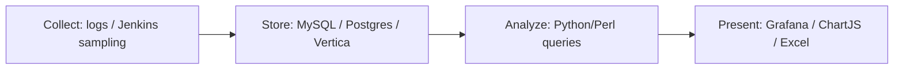

<!-- generated by yt-paper; edits will be overwritten -->
[DVCon](../dvcon/index.md) › [US](../dvcon/us.md) › [2019](../dvcon/by-year.md#2019) › [Verification](../dvcon/by-topic.md#verification)

# Big Data in Verification: Making Your Engineers Smarter

<figure class="rep-fig" markdown>
{ loading=lazy }
<figcaption>Figure 1. Compute Farm Data – Pending jobs spike — from the original paper (David Lacey et al.)</figcaption>
</figure>

[:material-open-in-new: Original paper](https://dvcon-proceedings.org/wp-content/uploads/big-data-in-verification-making-your-engineers-smarter.pdf){ .md-button .md-button--primary target=_blank }

| | |
|---|---|
| Authors | David Lacey (Hewlett Packard Enterprise), Mike McGrath (Hewlett Packard Enterprise), Alan Pippin (Hewlett Packard Enterprise), Ed Powell (Hewlett Packard Enterprise), Ron Thurgood (Hewlett Packard Enterprise), Alex Wilson (Hewlett Packard Enterprise) |
| Venue | DVCon US 2019 |
| Topic | Verification |
| Type | PAPER |
| ID | `ref-20261018-7a2b` |

## Summary

**HPE shows how lightweight, mostly open-source Big Data analytics over compute farm, performance, test-result, and coverage data can expose license, performance, and simulation bottlenecks in ASIC verification without AI or MapReduce.**

**HPE는 컴퓨트 팜, 성능, 테스트 결과, 커버리지 데이터에 대해 대부분 오픈소스 기반의 가벼운 Big Data 분석을 적용하여, AI나 MapReduce 없이도 ASIC 검증의 라이선스, 성능, 시뮬레이션 병목을 찾아낼 수 있음을 보여준다.**

## Key Insights

- Sampling license and job data every 6 minutes exposed a regression business violating its license buffer and CI jobs that were all scheduled at the same times; fixing user requests and spreading CI jobs flattened the demand and reduced user job pending times.

- 라이선스와 잡 데이터를 6분 주기로 수집한 결과, 한 사업부가 라이선스 버퍼를 위반하고 CI 잡들이 같은 시각에 몰려 있는 문제가 드러났으며, 사용자 요청을 수정하고 CI 잡을 분산하자 수요가 평탄해지고 사용자 잡 대기 시간이 줄었다.

- Licenses were wasted by post-simulation scripts holding a license and by a compile step licensed for its full duration; releasing the license after simulation and a vendor change improved cycle throughput per license without buying more licenses.

- 시뮬레이션 후처리 스크립트가 라이선스를 계속 점유하고 컴파일 단계가 전 구간 라이선스를 요구하면서 라이선스가 낭비되었고, 시뮬레이션 종료 후 라이선스를 반환하도록 수정하고 벤더 도구를 변경하여 추가 구매 없이 라이선스당 사이클 처리량을 개선했다.

- Automated outlier detection on nightly performance data flagged a sudden bandwidth drop that was traced to a stimulus bug, where all data transfer commands were read at simulation start instead of spread across the transfer.

- 야간 성능 데이터에 대한 자동 이상치 탐지가 급격한 대역폭 저하를 포착했고, 이는 모든 데이터 전송 명령이 전송 구간 전체에 분산되지 않고 시뮬레이션 시작 시점에 읽히는 stimulus 버그로 추적되었다.

- A 6x simulation slowdown was traced to garbage-collection thrashing caused by a testbench change that increased memory demand without a matching increase in the memory requested by the test; raising the request resolved it.

- 시뮬레이션 6배 지연은 테스트벤치 변경으로 메모리 요구량이 증가했지만 테스트의 메모리 요청량은 그대로여서 발생한 가비지 컬렉션 스래싱으로 추적되었으며, 메모리 요청량을 늘려 해결했다.

- The toolkit (MariaDB/MySQL, Postgres, Python/Perl, Jenkins, Grafana, ChartJS) was reported to take about one engineer-month to build and a few engineer-hours per month to maintain; the paper reports no quantitative results for the multi-TB coverage database approach, which remains incomplete.

- 툴킷(MariaDB/MySQL, Postgres, Python/Perl, Jenkins, Grafana, ChartJS)은 구축에 약 1 엔지니어-월, 유지보수에 월 몇 엔지니어-시간이 소요된다고 보고되었으며, 수 TB 규모 커버리지 DB 접근법에 대한 정량적 결과는 제시되지 않았고 아직 진행 중이다.

## Detailed Summary

### Background and Problem

- HPE's ASIC verification flows produce large volumes of compute farm, performance, test-result, and coverage data (about 400M, 70M, 20M rows/year and about 1 TB/month for coverage, per Table 1).

- HPE의 ASIC 검증 흐름은 컴퓨트 팜, 성능, 테스트 결과, 커버리지 데이터를 대량으로 생성한다(Table 1 기준 약 400M, 70M, 20M rows/year, 커버리지는 약 1 TB/month).

- The paper argues that Big Data value comes from asking the right questions of collected data, not from AI, NoSQL, or MapReduce, so that forecasting and debugging decisions get better.

- 본 논문은 Big Data의 가치가 AI, NoSQL, MapReduce가 아니라 수집한 데이터에 올바른 질문을 던지는 데서 나오며, 이를 통해 라이선스 예측과 디버깅 의사결정을 개선할 수 있다고 주장한다.

### Architecture and Methodology

- Pipeline: collect (logs, Jenkins sampling jobs) → store in SQL or unstructured DBs → analyze with query scripts → present in Grafana, ChartJS, or Excel.

- 파이프라인: 수집(로그, Jenkins 샘플링 잡) → SQL 또는 비정형 DB 저장 → 쿼리 스크립트로 분석 → Grafana, ChartJS, Excel로 시각화.

- Compute farm: license-starvation and reserved-but-unused license case studies; CI job start times were spread out.

- 컴퓨트 팜: 라이선스 기아(starvation)와 예약만 되고 사용되지 않는 라이선스 사례 연구; CI 잡 시작 시각을 분산하였다.

- Performance: the Autoperf tool with a Vertica backend and nightly outlier detection; a stimulus bug was found.

- 성능: Vertica 백엔드를 사용하는 Autoperf 툴과 야간 이상치 탐지; stimulus 버그를 발견하였다.

- Test results: a 6x slowdown was traced to GC thrashing.

- 테스트 결과: 6배 시뮬레이션 지연을 GC 스래싱으로 추적하였다.

- Big coverage (proposed, incomplete): XML-driven value-change instrumentation, expiring raw data, derived metrics, and a REST service. Traditional covergroups are retained for rare corner cases.

- Big coverage(제안, 미완성): XML 기반 value-change 계측, 만료되는 raw 데이터, 파생 메트릭, REST 서비스. 희귀 corner case에는 기존 covergroup을 유지한다.

### Results and Conclusions

- Outcomes are anecdotal and qualitative: starvation and demand spikes were reduced, license usage was improved without new purchases, a performance drop was fixed, and a 6x simulation slowdown was resolved.

- 결과는 일화적이고 정성적이다: 기아 및 수요 급증이 줄었고, 신규 구매 없이 라이선스 사용이 개선되었으며, 성능 저하가 수정되었고, 6배 시뮬레이션 지연이 해결되었다.

- The toolkit took about one engineer-month to build and a few engineer-hours per month to maintain.

- 툴킷은 구축에 약 1 엔지니어-월, 유지보수에 월 몇 엔지니어-시간이 소요되었다.

- The coverage database work and the planned unstructured-DB, Hadoop, and AI/ML stimulus directions are not evaluated quantitatively.

- 커버리지 DB 작업과 계획된 비정형 DB, Hadoop, AI/ML stimulus 방향은 정량적으로 평가되지 않았다.

## Videos

<iframe src="https://www.youtube-nocookie.com/embed/dkn55xILVts" title="[DVCON2019] Big Data in Verification: Making Your Engineers Smarter" loading="lazy" allow="accelerometer; clipboard-write; encrypted-media; gyroscope; picture-in-picture; web-share" referrerpolicy="strict-origin-when-cross-origin" allowfullscreen></iframe>

**[DVCON2019] Big Data in Verification: Making Your Engineers Smarter** — [Watch on YouTube](https://www.youtube.com/watch?v=dkn55xILVts) · [Video page](../videos/dkn55xILVts.md)
