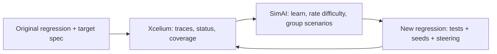

<!-- generated by yt-paper; edits will be overwritten -->
[DVCon](../dvcon/index.md) › [US](../dvcon/us.md) › [2025](../dvcon/by-year.md#2025) › [Verification](../dvcon/by-topic.md#verification)

# Functional Coverage Closure in SoC Interconnect Verification with Iterative Machine Learning

<figure class="rep-fig" markdown>
{ loading=lazy }
<figcaption>Figure 2. An overview of the proposed flow. — from the original paper (Jihye Kwon et al.)</figcaption>
</figure>

[:material-open-in-new: Original paper](https://dvcon-proceedings.org/wp-content/uploads/1096.pdf){ .md-button .md-button--primary target=_blank }

| | |
|---|---|
| Authors | Jihye Kwon (Cadence Design Systems), Sukwon Ha (Samsung Electronics), Youngsik Kim (Samsung Electronics), Seonil Brian Choi (Samsung Electronics), Daeseo Cha (Samsung Electronics), Space Kim (Samsung Electronics), Kunhyuk Kang (Samsung Electronics), John Pierce (Cadence Design Systems), Amit Metodi (Cadence Design Systems), Saurabh Sharma (Cadence Design Systems), Heedo Jung (Cadence Design Systems), Yosinori Watanabe (Cadence Design Systems) |
| Venue | DVCon US 2025 |
| Topic | Verification |
| Type | PAPER |
| ID | `ref-20261018-7a35` |

## Summary

**A SimAI-driven iterative ML flow turns prior Xcelium traces and coverage into steering instructions and new regressions, closing two hard SoC interconnect coverage categories to 100% with 4.92x and 18.20x less CPU time than repeated regression.**

**SimAI 기반의 반복적 ML 흐름은 이전 Xcelium 트레이스와 커버리지 결과로부터 steering instruction과 새로운 regression을 생성하여, 반복 regression 대비 CPU 시간을 각각 4.92배, 18.20배 줄이면서 SoC 인터커넥트의 어려운 커버리지 카테고리 두 개를 100%까지 달성한다.**

## Key Insights

- Category 1 (over 120,000 bins): repeated original regression needed 41,158 CPU hours to reach 96.27%, while the SimAI flow reached 100% in 8,362 CPU hours (772 runs), a 4.92x reduction.

- Category 1(120,000개 이상의 bin): 반복 실행한 original regression은 96.27%에 도달하는 데 41,158 CPU hours가 필요했고, SimAI 흐름은 8,362 CPU hours(772 runs)로 100%를 달성하여 4.92배 절감했다.

- Category 2 (5,850 bins): repeated regression plateaued at 79.91% after 41,158 CPU hours, while SimAI reached 100% in 2,261 CPU hours (329 runs), an 18.20x reduction.

- Category 2(5,850개 bin): 반복 regression은 41,158 CPU hours 후 79.91%에서 정체되었고, SimAI는 2,261 CPU hours(329 runs)로 100%에 도달하여 18.20배 절감했다.

- The gain comes from scenario-level analysis (satisfied vs. remaining scenarios, estimated difficulty of unobserved values) and from packing independent scenarios into single runs, rather than from simply adding more random seeds.

- 이득은 단순히 random seed를 늘린 결과가 아니라, 시나리오 단위 분석(충족/잔여 시나리오, 관측되지 않은 값의 예상 난이도)과 독립적인 시나리오를 한 run에 묶는 방식에서 나온다.

- The paper claims additional savings from avoiding manual test/constraint edits for the last few percent of bins, but this human effort is not quantified.

- 논문은 마지막 몇 퍼센트의 bin을 채우기 위해 테스트와 constraint를 수동 수정하지 않아도 되어 추가 절감이 있다고 주장하지만, 이 인적 노력은 수치로 정량화되지 않았다.

- Results depend on the completeness of the target scenario specification; bins not covered by the spec may stay unhit, and automatic spec derivation is left as future work. Evaluation covers a single production project with no variance reported.

- 결과는 target scenario specification의 완전성에 의존하며, spec에 포함되지 않은 bin은 여전히 미달성될 수 있고 spec의 자동 도출은 향후 과제로 남아 있다. 평가는 단일 production 프로젝트에 대한 것이며 분산(variance)은 보고되지 않았다.

## Detailed Summary

### Background and Problem

- SoC interconnects join hundreds of master and slave IPs over mixed protocols, and their coverage models reach hundreds of thousands of elements.

- SoC 인터커넥트는 혼합 프로토콜로 수백 개의 master 및 slave IP를 연결하며, 커버리지 모델은 수십만 개의 요소에 달한다.

- Closure with constrained-random regressions relies on repeated reruns and manual test or constraint edits; returns diminish sharply near full coverage.

- constrained-random regression으로 커버리지를 닫으려면 반복 재실행과 수동 테스트·constraint 수정이 필요하며, 커버리지가 높아질수록 효율이 급격히 떨어진다.

- Directed tests per bin are infeasible, so unhit bins usually require costly human analysis.

- bin마다 directed test를 만드는 것은 현실적이지 않아 미달성 bin은 대개 사람이 많은 시간을 들여 분석해야 한다.

### Architecture and Methodology

- SimAI (Cadence) consumes Xcelium traces, run status, and coverage, plus a user-supplied target scenario specification.

- SimAI(Cadence)는 Xcelium의 트레이스, 실행 상태, 커버리지 결과와 사용자가 제공한 target scenario specification을 입력으로 받는다.

- Each iteration pre-processes the data, identifies satisfied and remaining scenarios, and estimates difficulty (e.g., values never observed in traces).

- 각 반복에서 데이터를 전처리하고, 충족된 시나리오와 남은 시나리오를 식별하며, 난이도(예: 트레이스에서 관측되지 않은 값)를 추정한다.

- Contradictory scenarios get separate runs; independent scenarios are grouped into one run.

- 서로 모순되는 시나리오는 별도 run으로 분리하고, 독립적인 시나리오는 하나의 run에 묶는다.

- The output regression reuses the original tests and seed counts and adds per-run Xcelium steering instructions.

- 생성된 regression은 원래 테스트와 seed 수를 재사용하고, run마다 Xcelium steering instruction을 추가한다.

### Results and Conclusions

- Testbench: UVM-based, with master/slave VIPs, an SVD scoreboard, and a mobile AP interconnect (hundreds of masters, near 1,000 slaves).

- 테스트벤치: UVM 기반이며, master/slave VIP, SVD scoreboard, 모바일 AP 인터커넥트(master 수백 개, slave 약 1,000개)로 구성된다.

- Category 1 (over 500 cover items, about 120,000 bins): baseline 41,158 CPU h reached 96.27%; SimAI reached 100% at 8,362 CPU h (772 runs), a 4.92x reduction and +3.73 %pt.

- Category 1(500개 이상의 cover item, 약 120,000 bin): 기준선은 41,158 CPU h에 96.27%에 도달했고, SimAI는 8,362 CPU h(772 runs)로 100%에 도달하여 4.92배 절감, +3.73 %pt를 달성했다.

- Category 2 (496 cover items, 5,850 bins): baseline 79.91% at 41,158 CPU h; SimAI reached 100% at 2,261 CPU h (329 runs), an 18.20x reduction and +20.09 %pt.

- Category 2(496개 cover item, 5,850 bin): 기준선은 41,158 CPU h에 79.91%였고, SimAI는 2,261 CPU h(329 runs)로 100%에 도달하여 18.20배 절감, +20.09 %pt를 달성했다.

- Effectiveness depends on a complete target spec. The evaluation is a single production project, and no variance is reported.

- 효과는 완전한 target spec에 의존한다. 평가는 단일 production 프로젝트에 대한 것이며 분산은 보고되지 않았다.

## Videos

<iframe src="https://www.youtube-nocookie.com/embed/l-LeCVSpfaw" title="[DVCON2025]Functional Coverage Closure in SoC Interconnect Verification Iterative Machine Learning" loading="lazy" allow="accelerometer; clipboard-write; encrypted-media; gyroscope; picture-in-picture; web-share" referrerpolicy="strict-origin-when-cross-origin" allowfullscreen></iframe>

**[DVCON2025]Functional Coverage Closure in SoC Interconnect Verification Iterative Machine Learning** — [Watch on YouTube](https://www.youtube.com/watch?v=l-LeCVSpfaw) · [Video page](../videos/l-LeCVSpfaw.md)
