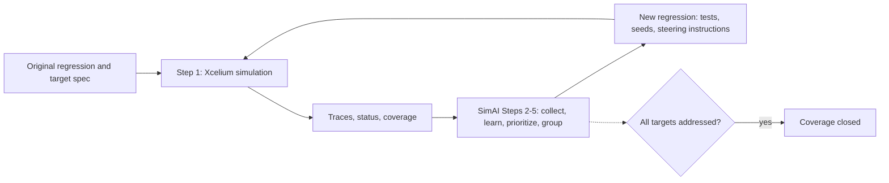

<!-- generated by yt-paper; edits will be overwritten -->
[DVCon](../dvcon/index.md) › [US](../dvcon/us.md) › [2025](../dvcon/by-year.md#2025) › [Verification](../dvcon/by-topic.md#verification)

# Functional Coverage Closure in SoC Interconnect Verification with Iterative Machine Learning

<figure class="rep-fig" markdown>
{ loading=lazy }
<figcaption>Figure 2 presents a high-level overview of the proposed iterative flow. Initially, the design verification team develops a regression and produces a target specification. The regression mainly consists of a number of constrained random tests and their random seed counts. The target specification contains a list of target scenarios. For SoC — from the original paper (Jihye Kwon et al.)</figcaption>
</figure>

[:material-open-in-new: Original paper](https://dvcon-proceedings.org/wp-content/uploads/1096.pdf){ .md-button .md-button--primary target=_blank }

| | |
|---|---|
| Authors | Jihye Kwon (Cadence), Sukwon Ha (Samsung Electronics), Youngsik Kim (Samsung Electronics), Seonil Brian Choi (Samsung Electronics), Daeseo Cha (Samsung Electronics), Space Kim (Samsung Electronics), Kunhyuk Kang (Samsung Electronics), John Pierce (Cadence), Amit Metodi (Cadence), Saurabh Sharma (Cadence), Heedo Jung (Cadence), Yosinori Watanabe (Cadence) |
| Venue | DVCon US 2025 |
| Topic | Verification |
| Type | PAPER |
| ID | `ref-20261018-7a35` |

## Summary

**An iterative ML flow (Cadence SimAI driving Xcelium) generates steering-instruction regressions from simulation traces to close SoC interconnect functional coverage with 4.92x and 18.20x less CPU time than repeated constrained-random regression on a production mobile AP project.**

**Cadence SimAI가 Xcelium을 구동해 시뮬레이션 트레이스로부터 steering 명령이 포함된 regression을 반복 생성하는 ML 기반 흐름으로, 양산 모바일 AP 프로젝트에서 반복적인 constrained-random regression 대비 CPU 시간을 4.92x(Category 1), 18.20x(Category 2) 줄이며 SoC 인터커넥트 기능 커버리지를 클로저했다.**

## Key Insights

- Repeatedly re-running a constrained-random regression hits diminishing returns: in Category 1 the traditional flow needed 24 iterations (6,576 runs, 41,158 CPU hours) to reach only 96.27%, and the last 4 iterations added just 1.43%.

- constrained-random regression을 반복 실행하면 수익 체감이 크다. Category 1에서 기존 방식은 24회 반복(6,576 runs, 41,158 CPU hours)을 해도 96.27%에 그쳤고, 마지막 4회 반복은 1.43%만 추가했다.

- SimAI derives per-run steering instructions for Xcelium from traces, so unhit bins are targeted without manual test or constraint edits. Category 1 reached 100% in 772 runs and 8,362 CPU hours (4.92x less CPU time); Category 2 reached 100% in 329 runs and 2,261 CPU hours (18.20x less).

- SimAI는 트레이스로부터 Xcelium용 run별 steering 명령을 생성하므로 테스트나 constraint를 수작업으로 고치지 않고도 미도달 bin을 겨냥한다. Category 1은 772 runs, 8,362 CPU hours로 100%에 도달해 CPU 시간 4.92x 절감, Category 2는 329 runs, 2,261 CPU hours로 100%에 도달해 18.20x 절감했다.

- Scenario scheduling depends on relationships between targets: scenarios that constrain the same random variable to disjoint value ranges (contradictory) need separate runs, while scenarios on distinct variables (independent) can share one run.

- 목표 시나리오 간 관계가 스케줄링을 결정한다. 같은 random 변수를 서로 겹치지 않는 값 범위로 제약하는 contradictory 시나리오는 별도 run이 필요하고, 서로 다른 변수를 쓰는 independent 시나리오는 한 run에 함께 넣을 수 있다.

- The approach is only as complete as the target specification. If the spec omits scenarios needed for a bin, the flow can fail to hit that bin even when every listed scenario is satisfied; automatic derivation of the spec is listed as future work.

- 이 접근법의 완성도는 target specification에 달려 있다. 특정 bin에 필요한 시나리오가 spec에서 빠지면, 나열된 모든 시나리오를 만족하더라도 해당 bin은 도달하지 못할 수 있다. spec의 자동 도출은 향후 과제로 제시되었다.

## Detailed Summary

### Background and Problem

- An SoC interconnect (Cache Coherent Interconnect, NoC, AXI/AHB interconnect, bridges) connects hundreds of master and slave IPs. It creates hundreds of thousands of data paths, and the coverage model (coverpoint and cross bins) grows with them.

- SoC 인터커넥트(Cache Coherent Interconnect, NoC, AXI/AHB 인터커넥트, 브리지)는 수백 개의 master 및 slave IP를 연결한다. 수십만 개의 데이터 경로가 생기며, coverpoint 및 cross bin으로 구성된 커버리지 모델도 함께 커진다.

- The conventional closure loop is: run a constrained-random regression repeatedly, inspect unhit bins, then hand-edit constraints or write directed tests. Directed tests cannot be written for every bin, and unreachable bins are excluded only after manual analysis.

- 기존 클로저 루프는 다음과 같다. constrained-random regression을 반복 실행하고, 미도달 bin을 분석한 뒤, constraint를 수작업으로 수정하거나 directed test를 작성한다. 모든 bin에 directed test를 만드는 것은 불가능하며, 도달 불가능한 bin은 수작업 분석 후에야 제외된다.

- The paper focuses on two categories of covergroup items in a production mobile application processor project that consumed the most human effort and compute.

- 이 논문은 양산 모바일 애플리케이션 프로세서 프로젝트에서 가장 많은 인력과 컴퓨트를 소모한 두 종류의 covergroup 항목에 초점을 맞춘다.

### Architecture and Methodology

- **Testbench:** UVM-based, generated to match the interconnect topology. It has master VIPs that generate random sequences, slave VIPs that respond, a System Verification Scoreboard (SVD) VIP for end-to-end coherency and integrity checks, and the functional coverage model. Active VIPs replace the components early in design. Passive VIPs that monitor the interconnect-to-component signals are an alternative.

- **테스트벤치:** 인터커넥트 토폴로지에 맞춰 생성된 UVM 기반 구조다. 랜덤 시퀀스를 생성하는 master VIP, 이에 응답하는 slave VIP, end-to-end coherency 및 무결성을 검사하는 System Verification Scoreboard(SVD) VIP, 그리고 functional coverage 모델로 구성된다. 설계 초기에 active VIP가 컴포넌트를 대체한다. 인터커넥트와 컴포넌트 사이 신호를 모니터링하는 passive VIP도 대안으로 쓸 수 있다.

- **Flow:** SimAI (a Cadence AI-driven verification feature) works with the Xcelium Logic Simulator. The objective used is user-specified scenario coverage, not autonomous coverage maximization or bug hunting. The flow runs in steps:
  1. Simulate the regression in Xcelium and produce traces (randomize calls and variable values), status, and coverage.
  2. SimAI collects and pre-processes the data.
  3. SimAI marks scenarios already satisfied and scores the difficulty of the rest. Values never observed in traces are harder.
  4. SimAI selects targets and groups them into runs. Contradictory scenarios (same variable, disjoint ranges) get separate runs. Independent scenarios (distinct variables) may share a run.
  5. SimAI emits a new regression. It points to the original tests and seed counts, plus per-run instructions that steer randomization so the scheduled scenarios occur.

- **흐름:** SimAI(Cadence의 AI 기반 검증 기능)는 Xcelium Logic Simulator와 함께 동작한다. 목적 함수는 자율적 커버리지 최대화나 버그 헌팅이 아니라 사용자가 지정한 시나리오 커버리지다. 흐름은 다음 단계로 진행된다.
  1. Xcelium으로 regression을 시뮬레이션하여 트레이스(randomize 호출과 변수 값), 상태, 커버리지를 생성한다.
  2. SimAI가 데이터를 수집하고 전처리한다.
  3. SimAI가 이미 만족된 시나리오를 표시하고 나머지의 난이도를 평가한다. 트레이스에서 한 번도 관측되지 않은 값은 더 어려운 것으로 본다.
  4. SimAI가 타깃을 선택하고 run 단위로 묶는다. Contradictory 시나리오(같은 변수, 겹치지 않는 범위)는 별도 run에 배치한다. Independent 시나리오(서로 다른 변수)는 같은 run에 함께 넣을 수 있다.
  5. SimAI가 새 regression을 생성한다. 원래 테스트 파일과 seed 수를 가리키며, 예약된 시나리오가 발생하도록 randomization을 조종하는 run별 명령을 포함한다.

- The loop repeats until all target scenarios are addressed, at which point coverage is closed. The paper notes that packing many targets into one run lengthens individual runs, but says this overhead is small next to the conventional approach's total time.

- 모든 목표 시나리오가 처리될 때까지 루프를 반복하며, 그 시점에 커버리지가 클로즈된다. 논문은 한 run에 많은 타깃을 묶으면 개별 run 시간이 길어지지만, 이 오버헤드는 기존 방식의 총 시간에 비하면 작다고 밝힌다.

### Results and Conclusions

- **Category 1** (over 500 cover items, about 120,000 bins; reachability-matrix related address, data, and direction checks):
  - Traditional: the initial 274-run regression hit 26.74% at 1,744 CPU hours. Repeating it 24 times reached 96.27% with 6,576 runs and 41,158 CPU hours. The remaining 4,478 bins would need manual test edits.
  - Proposed: the first SimAI regression (233 runs, about 4,600 CPU hours) added 72.85%, reaching 99.59% at 6,340 CPU hours. The second regression (265 runs, 2,022 CPU hours) closed the rest. Total: 772 runs, 8,362 CPU hours, 100%.
  - Result: 4.92x less CPU time and +3.73 %pt coverage.

- **Category 1** (500개 이상의 cover item, 약 120,000 bin. reachability matrix와 관련된 address, data, direction 검사):
  - 기존 방식: 초기 274-run regression은 1,744 CPU hours에 26.74%를 달성했다. 24회 반복하면 6,576 runs, 41,158 CPU hours로 96.27%에 도달했다. 남은 4,478개 bin은 테스트 수작업 수정이 필요했다.
  - 제안 방식: 첫 SimAI regression(233 runs, 약 4,600 CPU hours)이 72.85%를 추가해 6,340 CPU hours에서 99.59%에 도달했다. 두 번째 regression(265 runs, 2,022 CPU hours)이 나머지를 모두 닫았다. 총계: 772 runs, 8,362 CPU hours, 100%.
  - 결과: CPU 시간 4.92x 절감, 커버리지 +3.73 %pt.

- **Category 2** (496 cover items, 5,850 bins; QoS value transmitted from masters to targets):
  - Traditional: 8.48% after the initial 1,744 CPU hours. After 24 iterations, 79.91% at 41,158 CPU hours. 1,175 bins remained.
  - Proposed: the first SimAI regression (48 runs, 451 CPU hours) added 90.19%. The second (7 runs, 67 CPU hours) closed the rest. Total: 329 runs, 2,261 CPU hours, 100%.
  - Result: 18.20x less CPU time and +20.09 %pt coverage.

- **Category 2** (496개의 cover item, 5,850 bin. master에서 타깃으로 전달되는 QoS 값):
  - 기존 방식: 초기 1,744 CPU hours 후 8.48%. 24회 반복 후 41,158 CPU hours로 79.91%. 1,175개 bin이 남았다.
  - 제안 방식: 첫 SimAI regression(48 runs, 451 CPU hours)이 90.19%를 추가했다. 두 번째(7 runs, 67 CPU hours)가 나머지를 닫았다. 총계: 329 runs, 2,261 CPU hours, 100%.
  - 결과: CPU 시간 18.20x 절감, 커버리지 +20.09 %pt.

- **Conclusions:** The approach cuts simulation time and manual effort on this single industrial case. The paper reports no comparison beyond these two categories and no variance or repeat-run data. Its main limitation is the dependence on a complete target specification, and automatic spec derivation is future work.

- **결론:** 이 접근법은 단일 산업 사례에서 시뮬레이션 시간과 수작업 노력을 줄였다. 논문은 두 Category 외의 비교나 반복 실행에 따른 분산 데이터를 제시하지 않는다. 주요 한계는 완전한 target specification에 의존한다는 점이며, spec의 자동 도출은 향후 과제다.

## Videos

<iframe src="https://www.youtube-nocookie.com/embed/l-LeCVSpfaw" title="[DVCON2025]Functional Coverage Closure in SoC Interconnect Verification Iterative Machine Learning" loading="lazy" allow="accelerometer; clipboard-write; encrypted-media; gyroscope; picture-in-picture; web-share" referrerpolicy="strict-origin-when-cross-origin" allowfullscreen></iframe>

**[DVCON2025]Functional Coverage Closure in SoC Interconnect Verification Iterative Machine Learning** — [Watch on YouTube](https://www.youtube.com/watch?v=l-LeCVSpfaw) · [Video page](../videos/l-LeCVSpfaw.md)
