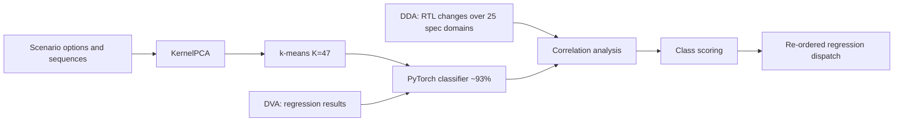

<!-- generated by yt-paper; edits will be overwritten -->
[DVCon](../dvcon/index.md) › [US](../dvcon/us.md) › [2022](../dvcon/by-year.md#2022) › [Verification](../dvcon/by-topic.md#verification)

# Machine Learning Based Verification Planning Methodology Using Design and Verification Data

<figure class="rep-fig" markdown>
{ loading=lazy }
<figcaption>Figure 2 shows the system that is configured to apply the experimental flow to each development stage of SOC projects. During an entire SOC development, design and verification data are released almost every week with a new name called label from the design repository. Design data includes registers, integration information, and RTL — from the original paper (Hanna Jang et al.)</figcaption>
</figure>

[:material-open-in-new: Original paper](https://dvcon-proceedings.org/wp-content/uploads/Machine-Learning-Based-Verification-Planning-Methodology-Using-Design-and-Verification-Data-1.pdf){ .md-button .md-button--primary target=_blank }

| | |
|---|---|
| Authors | Hanna Jang, Seonghee Yim, Sunchang Choi, Seonil Brian Choi (Samsung Electronics, Hwaseong, Korea) |
| Venue | DVCon US 2022 |
| Topic | Verification |
| Type | PAPER |
| ID | `ref-20261018-7aa6` |

## Summary

**The paper clusters full-chip verification scenarios with k-means (K=47), trains a PyTorch classifier on those labels, correlates per-class failure rates with RTL changes across 25 design-spec domains, and re-orders regression dispatch so likely-failing tests run first in a mobile SoC flow.**

**이 논문은 full-chip 검증 시나리오를 k-means(K=47)로 군집화하고 그 레이블로 PyTorch 분류기를 학습시킨 뒤, 클래스별 failure rate를 25개 설계 스펙 도메인의 RTL 변경량과 상관 분석하여, 모바일 SoC 흐름에서 실패 가능성이 높은 테스트를 먼저 실행하도록 regression 디스패치 순서를 재정렬하는 방법론을 제안한다.**

## Key Insights

- Scenario features (run options, sequence, register settings) were reduced with KernelPCA, clustered with k-means into 47 classes (44 valid for Projects A and B), and a PyTorch classifier trained on those labels reached about 93% correct answers with an 8:2 train/test split.

- 시나리오 피처(실행 옵션, 시퀀스, 레지스터 설정)를 KernelPCA로 차원 축소한 뒤 k-means로 47개 클래스(Project A, B에서는 유효 44개)로 군집화했으며, 이 레이블로 학습한 PyTorch 분류기는 8:2 train/test 분할에서 약 93%의 정답률을 보였다.

- Elbow alone pushed K upward, but models with more than 60 classes performed poorly, so K was bounded to 40–60 and confirmed with Silhouette, yielding K=47.

- Elbow만으로는 K가 커지는 경향이 있었고 클래스 수가 60을 넘는 모델은 성능이 나빠 K 범위를 40–60으로 제한한 뒤 Silhouette로 확인하여 K=47을 결정했다.

- Design-change correlation is non-uniform: register and component-instance changes (Spec 9, 19, 21) drive failures across nearly all classes, while bus and port changes (Spec 4, 6, 16) were inversely correlated with failures, i.e., they stabilized RTL.

- 설계 변경과 실패의 상관관계는 스펙별로 차이가 크다. 레지스터 및 component instance 변경(Spec 9, 19, 21)은 거의 모든 클래스에서 실패를 유발했고, bus 및 port 변경(Spec 4, 6, 16)은 실패와 역상관을 보여 RTL을 안정시키는 방향이었다.

- Re-ordering VL3 regression by class scores is reported to cut time to 70%/80%/90% completion from 10/11/12 days to 6/8/10 days, with median debug time of 1.3 days and average of 1.9 days.

- VL3 regression을 클래스 점수로 재정렬하면 70%/80%/90% 완료 시점까지의 시간이 10/11/12일에서 6/8/10일로 줄어든다고 보고되었으며, 디버그 시간은 중앙값 1.3일, 평균 1.9일이다.

- Validation is thin: only Project A had all VL-stage data, cross-project agreement was checked only on VL3 class trends for Projects A and B, and the paper gives no baseline methodology or variance, so generalization is unproven.

- 검증 근거는 제한적이다. 전 VL 단계 데이터가 있는 프로젝트는 Project A뿐이었고, 교차 프로젝트 일치성은 Project A와 B의 VL3 클래스 추세만 확인했으며, 기준선(baseline) 방법이나 분산에 대한 설명이 없어 일반화 가능성은 입증되지 않았다.

## Detailed Summary

### Background and Problem

- Full-chip scenario-based regression for mobile SoCs is long and can sit on the project critical path. Tests are run in essentially random order, so new failures appear almost daily over about 35 days of regression (Figure 1).

- 모바일 SoC의 full-chip 시나리오 기반 regression은 시간이 길고 프로젝트 critical path가 될 수 있다. 테스트가 사실상 무작위 순서로 실행되어 약 35일간의 regression 동안 거의 매일 새로운 실패가 나타난다(Figure 1).

- Late discovery of failures shortens debug time and degrades verification quality. The goal is to find likely-failing tests early and to relate failure occurrence to design change at each development stage.

- 실패를 늦게 발견하면 디버그 시간이 줄고 검증 품질이 떨어진다. 목표는 실패 가능성이 높은 테스트를 일찍 찾고, 각 개발 단계에서 실패 발생을 설계 변경과 연결하는 것이다.

- Verification scenarios are too large and varied to label manually, so the paper derives pseudo-labels by unsupervised clustering and then trains a supervised classifier on them.

- 검증 시나리오는 규모가 크고 다양해 사람이 레이블링하기 어렵기 때문에, 비지도 군집화로 가짜 레이블(pseudo-label)을 만든 뒤 이를 정답으로 지도 분류 모델을 학습한다.

### Architecture and Methodology

- Development flow: SoC specification, then IP development, block development, and SoC integration. Verification is organized into Verification Levels VL1–VL4. The text states that regression mainly runs at VL4 in one place and generally starts at VL3 in the Results discussion.

- 개발 흐름: SoC 스펙 정의 후 IP 개발, block 개발, SoC 통합 순으로 진행된다. 검증은 VL1–VL4 단계로 정의된다. 본문에서는 한 곳에서 regression이 주로 VL4에서 수행된다고 하고, 결과 논의에서는 일반적으로 VL3부터 시작된다고 기술한다.

- Data infrastructure: DDA collects design data (RTL changes, registers, IP-XACT metadata, integration information) mapped to 25 specification domains. DVA uses a regression manager to collect LSF info, run results, logs, and environment. The study used 1.7 million simulation results and 4.2 million design files.

- 데이터 인프라: DDA는 25개 스펙 도메인에 매핑된 설계 데이터(RTL 변경, 레지스터, IP-XACT 메타데이터, 통합 정보)를 수집한다. DVA는 regression manager를 사용해 LSF 정보, 실행 결과, 로그, 환경 정보를 수집한다. 연구에서는 1.7백만 건의 시뮬레이션 결과와 4.2백만 개의 설계 파일을 사용했다.

- Pipeline: scenario options and sequences are reduced with Sklearn KernelPCA (for nonlinear data) to hundreds of features based on cumulative contribution. k-means produces class labels. A PyTorch deep classifier (8:2 split, about 93% accuracy) then assigns classes to scenarios. Per-class failure rates by VL (Figure 5) and class-versus-spec change correlations (Figure 7) feed a scoring function that sets the dispatch order.

- 파이프라인: 시나리오 옵션과 시퀀스를 Sklearn KernelPCA(비선형 데이터용)로 누적 기여율 기준 수백 개 피처로 축소한다. k-means로 클래스 레이블을 생성하고, PyTorch 딥러닝 분류기(8:2 분할, 약 93% 정확도)가 시나리오에 클래스를 부여한다. VL별 클래스 failure rate(Figure 5)와 클래스-스펙 변경 상관(Figure 7)이 점수 함수에 입력되어 디스패치 순서를 결정한다.

- K selection: Elbow (WCSS/SSE) keeps decreasing with more classes, but models above 60 classes performed poorly. The range was fixed at 40–60 and refined with Silhouette, giving K=47.

- K 선택: Elbow(WCSS/SSE)는 클래스 수가 많을수록 계속 감소하지만, 60개를 넘는 모델은 성능이 나빴다. 따라서 범위를 40–60으로 고정하고 Silhouette로 보정하여 K=47을 결정했다.

- Cross-project check: VL3 classification results for Projects A and B were compared (Figure 4). Similar per-class trends were taken as evidence of reliable clustering. Subsequent analysis used Project A because it alone had data for all VL steps.

- 교차 프로젝트 검증: Project A와 B의 VL3 분류 결과를 비교했다(Figure 4). 클래스별 추세가 유사한 점을 군집화 신뢰성의 근거로 삼았다. 이후 분석은 VL 전 단계 데이터가 있는 Project A만으로 수행했다.

- Correlation findings: changes in Spec 9, 19, and 21 (component instance, register) cause failures in almost all classes. Classes 2, 43, and 44 (heavy VL2 failures) are sensitive to nearly all domain changes. Changes in Spec 4, 6, and 16 (bus, port) are inversely correlated with failures.

- 상관 분석 결과: Spec 9, 19, 21(component instance, register) 변경은 거의 모든 클래스에서 실패를 유발했다. VL2에서 실패가 많았던 클래스 2, 43, 44는 거의 모든 도메인 변경에 민감했다. Spec 4, 6, 16(bus, port) 변경은 실패와 역상관을 보였다.

### Results and Conclusions

- Scores were computed from failures and design changes per class. The regression schedule was re-ordered (Figures 8 and 9) and compared with the original run on Project A's VL3 regression.

- 클래스별 실패 수와 설계 변경량으로 점수를 계산했고, Project A의 VL3 regression 순서를 재정렬하여 기존 실행 결과와 비교했다(Figure 8, 9).

- Reported verification time at the 70%, 80%, and 90% milestones: 6, 8, and 10 days (optimized) versus 10, 11, and 12 days (original). The text describes the metric as "failure rate," which is ambiguous.

- 70%, 80%, 90% 기준 시점의 보고된 검증 시간: 최적화 6, 8, 10일 대비 기존 10, 11, 12일. 본문은 이 지표를 "failure rate"로 표현하고 있어 의미가 모호하다.

- Reported VL3 figures: per-label periods of 13–15 days, a 21.5% improvement in functional pass-rate progress up to 80% of VL3, which is stated as 64% of the total verification period.

- VL3 보고 수치: 레이블별 검증 기간 13–15일, VL3의 80%까지 기능 pass rate 진행률 21.5% 향상(전체 검증 기간의 64%에 해당한다고 기술됨).

- Debug period (class-to-pass switching): median 1.3 days, average 1.9 days.

- 디버그 기간(클래스에서 pass로 전환되는 기간): 중앙값 1.3일, 평균 1.9일.

- Conclusions: failure patterns per development stage look similar across SoC projects, so failing cases may be predictable ahead of time. Bus and port changes tended to increase passing tests, while register changes tended to increase failing tests. Future work requires data from all stages of more projects and code and functional coverage to improve root-cause analysis.

- 결론: 개발 단계별 실패 패턴이 SoC 프로젝트 간 유사하여 실패 케이스를 미리 예측할 수 있을 가능성이 있다. Bus 및 port 변경은 통과 테스트를 늘리는 경향이, 레지스터 변경은 실패 테스트를 늘리는 경향이 있었다. 향후 과제로 더 많은 프로젝트의 전 단계 데이터 확보와 root-cause 분석을 위한 code 및 functional coverage 정보 활용이 제시되었다.

- Caveat: the paper gives limited methodological detail (baseline definition, statistical variance, and single-project depth), so the reported speedups should be treated as preliminary.

- 유의점: 기준선(baseline) 정의, 통계적 분산, 단일 프로젝트 중심의 분석 등 방법론 설명이 제한적이므로, 보고된 속도 향상 수치는 예비 결과로 보는 것이 적절하다.

## Videos

<iframe src="https://www.youtube-nocookie.com/embed/8Zp0xkU97Fs" title="[DVCON2022] Machine Learning Based Verification Planning Methodology Using Design and Verification" loading="lazy" allow="accelerometer; clipboard-write; encrypted-media; gyroscope; picture-in-picture; web-share" referrerpolicy="strict-origin-when-cross-origin" allowfullscreen></iframe>

**[DVCON2022] Machine Learning Based Verification Planning Methodology Using Design and Verification** — [Watch on YouTube](https://www.youtube.com/watch?v=8Zp0xkU97Fs) · [Video page](../videos/8Zp0xkU97Fs.md)
