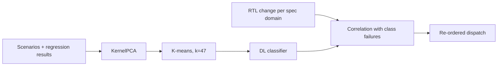

<!-- generated by yt-paper; edits will be overwritten -->
[DVCon](../dvcon/index.md) › [US](../dvcon/us.md) › [2022](../dvcon/by-year.md#2022) › [Verification](../dvcon/by-topic.md#verification)

# Machine Learning Based Verification Planning Methodology Using Design and Verification Data

<figure class="rep-fig" markdown>
{ loading=lazy }
<figcaption>Figure 2: Overall Architecture or Experimental System — from the original paper (Hanna Jang et al.)</figcaption>
</figure>

[:material-open-in-new: Original paper](https://dvcon-proceedings.org/wp-content/uploads/Machine-Learning-Based-Verification-Planning-Methodology-Using-Design-and-Verification-Data-1.pdf){ .md-button .md-button--primary target=_blank } [:material-presentation-play: Official talk](https://youtu.be/AHu4O-IR_dU?t=3249){ .md-button target=_blank }

| | |
|---|---|
| Authors | Hanna Jang (Samsung Electronics), Seonghee Yim (Samsung Electronics), Sunchang Choi (Samsung Electronics), Seonil Brian Choi (Samsung Electronics) |
| Venue | DVCon US 2022 |
| Topic | Verification |
| Type | PAPER |
| ID | `ref-20261018-7aa6` |

## Summary

**The paper clusters millions of full-chip verification scenarios with K-means, trains a deep-learning classifier on those labels, correlates them with per-domain RTL change data, and re-orders regression dispatch so likely-failing tests run first in mobile SOC projects.**

**이 논문은 K-means로 수백만 개의 풀칩 검증 시나리오를 클러스터링하고, 그 라벨로 딥러닝 분류기를 학습하며, 도메인별 RTL 변경 데이터와 상관 분석하여 모바일 SOC 프로젝트에서 실패 가능성이 높은 테스트를 먼저 실행하도록 regression 순서를 재정렬하는 방법을 제시합니다.**

## Key Insights

- Scenario labels come from K-means (k=47, or 44 valid for Projects A and B) because millions of scenarios are too large for manual labeling; the classifier reached 93% accuracy with an 8:2 train/test split.

- 시나리오 라벨은 수백만 개 시나리오를 수동 라벨링하기 어려워 K-means(k=47, Project A와 B는 유효 44개)로 생성했으며, 8:2 train/test 분할에서 분류기 정확도는 93%였습니다.

- Elbow and Silhouette were used to pick k in the 40-60 range; models trained with more than 60 classes performed poorly.

- k는 Elbow와 Silhouette 방법으로 40-60 범위에서 정했고, 60개 초과 클래스로 학습한 모델은 성능이 나빴습니다.

- The paper correlates 25 specification-domain RTL change metrics with per-class failure rates, finding Spec 9, 19, and 21 (component instance, register) linked to failures across almost all classes, while Spec 4, 6, and 16 (bus, port) were inversely correlated.

- 논문은 25개 spec 도메인의 RTL 변경 지표와 클래스별 실패율을 상관 분석했으며, Spec 9, 19, 21(component instance, register)은 거의 모든 클래스의 실패와 연관되고 Spec 4, 6, 16(bus, port)은 반비례 관계였습니다.

- Re-ordered regression reportedly reaches 70%, 80%, and 90% pass-rate milestones in 6, 8, and 10 days versus 10, 11, and 12 days for the original schedule.

- 재정렬된 regression은 70%, 80%, 90% pass 달성 시점이 6, 8, 10일로, 기존 스케줄의 10, 11, 12일보다 빠른 것으로 보고됩니다.

- Validation is limited: the results are from a single company's internal SOC projects, the optimized-order comparison is reported without a detailed methodology, and the paper notes that coverage data is not yet included.

- 검증의 한계: 결과는 한 회사의 내부 SOC 프로젝트에서 나왔고, 최적화 순서 비교는 상세한 방법 설명 없이 보고되며, 논문은 coverage 데이터가 아직 포함되지 않았다고 밝힙니다.

## Detailed Summary

### Background and Problem

- Regressions of full-chip SOC verification take long and can sit on the project critical path; failing tests appear almost daily, often late, which cuts debug time (Figure 1 shows about 35 days of regression).

- 풀칩 SOC 검증 regression은 시간이 오래 걸려 프로젝트 critical path가 될 수 있으며, 실패 테스트가 거의 매일 늦게 발견되어 디버그 시간을 줄입니다(Figure 1은 약 35일간의 regression을 보여줌).

- Test order is effectively random, and manual labeling of scenarios is infeasible at this scale.

- 테스트 실행 순서가 사실상 무작위이며, 이 규모의 시나리오를 수동으로 라벨링하는 것은 불가능합니다.

### Architecture and Methodology

- DDA collects design data (RTL changes, IP-XACT metadata over 25 spec domains); DVA manages regression runs and collects LSF, logs, and results. Training data: 1.7M simulation results and 4.2M design files.

- DDA는 설계 데이터(RTL 변경, 25개 spec 도메인의 IP-XACT 메타데이터)를 수집하고, DVA는 regression 실행(LSF, 로그, 결과)을 관리합니다. 학습 데이터는 시뮬레이션 결과 1.7M건과 설계 파일 4.2M건입니다.

- Pipeline: KernelPCA reduces features to hundreds; K-means generates labels (k=47); a PyTorch deep-learning classifier is trained on them.

- 파이프라인: KernelPCA로 특징을 수백 개로 축소, K-means로 라벨 생성(k=47), PyTorch 기반 딥러닝 분류기 학습.

- Per-class failure rates by VL stage (Figure 5) are correlated with per-domain RTL change rates (Figures 6–7), and the schedule is re-ordered by a combined score.

- VL 단계별 클래스 실패율(Figure 5)을 도메인별 RTL 변경률(Figure 6–7)과 상관 분석하고, 결합 점수로 스케줄을 재정렬합니다.

### Results and Conclusions

- Classifier accuracy is 93%; Projects A and B show similar per-class trends at VL3.

- 분류기 정확도는 93%이며, Project A와 B는 VL3에서 클래스별 경향이 유사합니다.

- Re-ordering reportedly reaches 70%/80%/90% pass milestones in 6/8/10 days vs. 10/11/12 days originally (Figure 9).

- 재정렬 시 70%/80%/90% pass 달성 시점이 원래 10/11/12일 대비 6/8/10일로 단축된다고 보고됩니다(Figure 9).

- Median debug period is 1.3 days and the mean is 1.9 days. The paper's conclusions point to adding coverage data to improve root-cause analysis. The evidence comes from one company's internal projects, with limited methodological detail.

- 디버그 기간은 중앙값 1.3일, 평균 1.9일입니다. 결론은 근본 원인 분석을 위해 coverage 데이터를 추가할 것을 제시합니다. 근거는 단일 기업의 내부 프로젝트이며 방법론 설명은 제한적입니다.

## Videos

<iframe src="https://www.youtube-nocookie.com/embed/8Zp0xkU97Fs" title="[DVCON2022] Machine Learning Based Verification Planning Methodology Using Design and Verification" loading="lazy" allow="accelerometer; clipboard-write; encrypted-media; gyroscope; picture-in-picture; web-share" referrerpolicy="strict-origin-when-cross-origin" allowfullscreen></iframe>

**[DVCON2022] Machine Learning Based Verification Planning Methodology Using Design and Verification** — [Watch on YouTube](https://www.youtube.com/watch?v=8Zp0xkU97Fs) · [Video page](../videos/8Zp0xkU97Fs.md)

**Official presentation:** [DVCon U.S. 2022 · Regression Runtime and Debug Optimization · 54:09](https://youtu.be/AHu4O-IR_dU?t=3249){ target=_blank }
