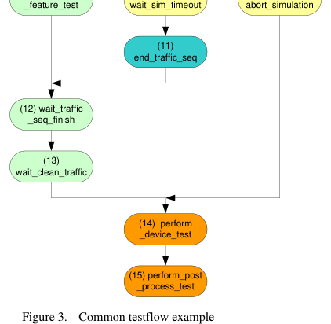
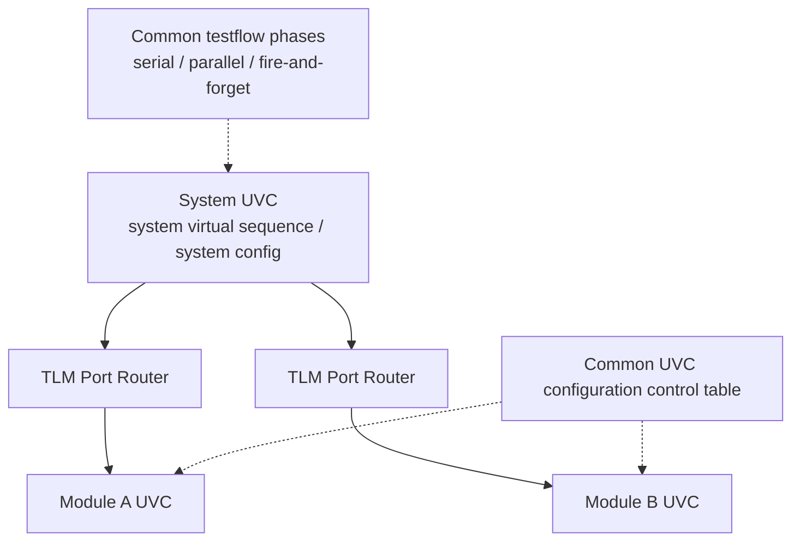

<!-- generated by yt-paper; edits will be overwritten -->
[DVCon](../dvcon/index.md) › [US](../dvcon/us.md) › [2013](../dvcon/by-year.md#2013) › [Verification](../dvcon/by-topic.md#verification)

# Maximize Vertical Reuse, Building Module to System Verification Environments with UVM e

<figure class="rep-fig" markdown>
{ loading=lazy }
<figcaption>Figure 3. Common testflow example — from the original paper (Horace Chan et al.)</figcaption>
</figure>

[:material-open-in-new: Original paper](https://dvcon-proceedings.org/wp-content/uploads/maximize-vertical-reuse-building-module-to-system-verification-environments-with-uvm-e.pdf){ .md-button .md-button--primary target=_blank }

| | |
|---|---|
| Authors | Horace Chan (PMC-Sierra), Brian Vandegriend (PMC-Sierra), Deepali Joshi (PMC-Sierra), Corey Goss (Cadence) |
| Venue | DVCon US 2013 |
| Topic | Verification |
| Type | PAPER |
| ID | `ref-20261018-7acd` |

## Summary

**The paper presents a hierarchical UVM e testbench framework that lets module UVCs be imported into system-level environments with plug-and-play integration, using three extensions (a TLM port router, a common UVC configuration control table, and a common testflow virtual sequence), and reports roughly 4x gates-verified-per-line-of-code on a 200M-gate ASIC.**

**이 논문은 모듈 UVC를 시스템 수준 환경으로 plug-and-play 방식으로 가져올 수 있도록 하는 계층형 UVM e 테스트벤치 프레임워크를 제시한다. 이를 위해 TLM port router, 공통 UVC 구성 제어 테이블, 공통 testflow 가상 시퀀스라는 세 가지 확장을 도입했으며, 200M 게이트 ASIC에서 게이트 대비 라인 수 기준 약 4배의 생산성 향상을 보고한다.**

## Key Insights

- Vertical reuse is achieved by importing module UVCs recursively into subsystem and system UVCs; the paper reports that a subsystem came up in 2-3 days and the full system testbench was integrated in under a month, versus 2-3 months in the previous project.

- 수직 재사용은 모듈 UVC를 서브시스템 및 시스템 UVC에 재귀적으로 import하여 달성된다. 논문은 서브시스템 하나를 2-3일 만에 구동했고 전체 시스템 테스트벤치를 한 달 이내에 통합했다고 보고하며, 이는 이전 프로젝트의 2-3개월과 비교된다.

- The UVM e TLM binding model is limiting (transport ports are one-to-one, analysis ports broadcast, bindings are static), so the authors added a table-driven TLM port router keyed by (port id, channel id) that supports multicast and runtime rerouting.

- UVM e의 TLM 바인딩 모델은 제약이 많다(transport 포트는 1:1, analysis 포트는 브로드캐스트, 바인딩은 정적). 이에 저자들은 (port id, channel id)를 키로 사용하는 테이블 기반 TLM port router를 추가했으며, 이는 멀티캐스트와 런타임 재라우팅을 지원한다.

- A common configuration control table indexed by RTL port and protocol layer controls enable, active/passive, and TLM bind per UVC, letting the system UVC disconnect unwanted bindings without editing module UVC code.

- RTL 포트와 프로토콜 계층으로 인덱싱된 공통 구성 제어 테이블은 UVC별 enable, active/passive, TLM bind를 제어한다. 따라서 시스템 UVC는 모듈 UVC 내부 코드를 수정하지 않고도 불필요한 바인딩을 해제할 수 있다.

- A simplified common testflow with serial, parallel, and parallel fire-and-forget phase kinds replaces the more complex UVM e testflow; the reported project testflow has 15 phases, and the authors report a 4x gates-per-line productivity gain (104k to 413k) with system testbench LOC cut by 34%.

- serial, parallel, parallel fire-and-forget 세 가지 phase 유형을 가진 단순화된 공통 testflow가 UVM e 기본 testflow를 대체한다. 프로젝트 testflow는 15개 phase로 구성되며, 논문은 게이트 대비 라인 수 기준 생산성이 104k에서 413k로(약 4배) 향상되었고 시스템 테스트벤치 LOC는 34% 감소했다고 보고한다.

- Inherited module code quality becomes a system-level performance risk: the authors recommend profiling and code review, and report a 30% simulation speedup from rewriting about a dozen lines; shared VIP revision conflicts are handled by freezing VIP early and keeping revisions backward compatible.

- 상속된 모듈 코드의 품질은 시스템 수준 성능 위험이 된다. 저자들은 프로파일링과 코드 리뷰를 권장하며, 약 12줄의 코드를 재작성하여 시뮬레이션 성능이 30% 향상되었다고 보고한다. 공유 VIP의 리비전 충돌은 VIP를 조기에 동결하고 리비전 간 하위 호환성을 유지하여 관리한다.

## Detailed Summary

### Background and Problem

- Modern ASIC/SoC designs (about 200M gates here, four times the previous project's 60M) make a ground-up system testbench impractical. The authors adopt divide-and-conquer: module, subsystem, and system testbenches, each reusing the level below.

- 현대 ASIC/SoC 설계(여기서는 200M 게이트, 이전 프로젝트 60M의 약 4배)에서는 처음부터 시스템 테스트벤치를 구축하는 것이 비현실적이다. 저자들은 분할 정복 전략을 채택하여 모듈, 서브시스템, 시스템 테스트벤치를 각각 하위 계층을 재사용하도록 구성한다.

- UVM standardizes the testbench architecture, but the authors found that UVM guidelines did not provide a framework for seamless module-to-system integration. The previous project failed for three reasons: (1) code maintenance, since module testbenches evolved without regard to system impact; (2) debug friction, since RTL changes were not communicated to system engineers and non-issues consumed debug time; (3) knowledge transfer, since subsystem engineers could not reproduce system failures in their own environments. Teams therefore duplicated code instead of reusing it.

- UVM은 테스트벤치 아키텍처를 표준화하지만, 저자들은 UVM 가이드라인이 모듈에서 시스템으로의 seamless 통합을 위한 프레임워크를 제공하지 않는다고 판단했다. 이전 프로젝트는 세 가지 이유로 실패했다. (1) 코드 유지보수: 모듈 테스트벤치가 시스템 영향을 고려하지 않고 진화했다. (2) 디버그 어려움: RTL 변경 사항이 시스템 엔지니어에게 전달되지 않아 사소한 문제 디버그에 시간이 소모되었다. (3) 지식 전달: 서브시스템 엔지니어가 시스템 실패를 자신의 환경에서 재현할 수 없었다. 결과적으로 팀은 재사용 대신 코드를 복제했다.

- Prior work (Froechlich, Think Verification, Ng, D'Onofrio/OVM, Zhang and Strickland from CDNLive) is cited. The authors note that these sources lack implementation detail, and that the testflow concept coordinates test execution across lower-level testbenches.

- Froechlich, Think Verification, Ng, OVM 기반 D'Onofrio, CDNLive의 Zhang 및 Strickland 등 선행 연구가 인용된다. 저자들은 이 자료들이 구현 세부 정보가 부족하다고 지적하며, 하위 테스트벤치 간 테스트 실행을 조율하는 데 testflow 개념이 중요하다고 언급한다.

### Architecture and Methodology

- **Module UVC structure (Figure 1):** a module testbench is a standard UVM-style environment with three differences. (1) The master virtual sequencer and register sequencer live outside the module UVC and link to its testflow virtual sequence by pointer. (2) Stimulus is layered (interface UVC driving RTL, protocol UVC, payload generator), with TLM ports between layers so a system UVC can tap any layer without restructuring. (3) Receive-side checkers and monitors are also layered, and module-owned scoreboards are exposed to the system UVC.

- **모듈 UVC 구조 (Figure 1):** 모듈 테스트벤치는 표준 UVM 형태의 환경이며 세 가지 차이점이 있다. (1) 마스터 가상 시퀀서와 레지스터 시퀀서는 모듈 UVC 외부에 위치하며 포인터로 내부 testflow 가상 시퀀스에 연결된다. (2) 자극 생성은 계층화되어 있다(RTL을 구동하는 인터페이스 UVC, 프로토콜 UVC, 페이로드 생성기). 계층 간은 TLM 포트로 연결되어 시스템 UVC가 구조 변경 없이 어떤 계층에도 접근할 수 있다. (3) 수신 측 checker와 monitor도 계층화되어 있으며, 모듈 소유 scoreboard는 시스템 UVC에 노출된다.

- **System UVC (Figure 2):** imports module UVCs recursively. The system virtual sequence drives the imported module virtual sequences. Module RTL-facing interfaces are disabled, and module monitors and scoreboards are chained for end-to-end checking. Mid-DUT interface UVCs can be enabled as passive agents to allow hop-by-hop checking. The project system UVC contains 10 subsystem UVCs, some with 3-4 module UVCs, for a total depth of 3.

- **시스템 UVC (Figure 2):** 모듈 UVC를 재귀적으로 import한다. 시스템 가상 시퀀스는 import된 모듈 가상 시퀀스를 구동한다. 모듈의 RTL 연결 인터페이스는 비활성화되고, 모듈 monitor와 scoreboard는 종단 간 검사를 위해 연결된다. DUT 중간의 인터페이스 UVC는 passive 에이전트로 활성화하여 hop-by-hop 검사를 할 수 있다. 프로젝트의 시스템 UVC는 10개의 서브시스템 UVC로 구성되며, 일부는 3-4개의 모듈 UVC를 포함하여 전체 깊이는 3이다.

- **Enhancement A, TLM port router:** an e template unit (`port_router_u`) with a table-based routing algorithm. The source (port id, channel id) pair keys a routing table entry that gives one or more destinations, supporting multicast with transaction duplication and channel-id rewrite. Lookup uses an e keyed list. Routing can change during simulation.

- **확장 A, TLM port router:** 테이블 기반 라우팅 알고리즘을 구현한 e template unit(`port_router_u`)이다. 소스 (port id, channel id) 쌍이 라우팅 테이블 항목의 키가 되어 하나 이상의 목적지를 반환하며, 멀티캐스트 시 트랜잭션을 복제하고 channel id를 재작성한다. 조회에는 e keyed list를 사용하며, 시뮬레이션 중 라우팅을 변경할 수 있다.

- **Enhancement B, common UVC configuration control:** a per-module table indexed by RTL port and protocol layer stores `enable`, `is_active` (active/passive), and `bind_enable`. Module UVCs must obey it when instantiating UVCs and connecting TLM ports in the connect phase. The system UVC can therefore unbind unwanted connections while keeping the rest of the module internals intact.

- **확장 B, 공통 UVC 구성 제어:** 모듈별 테이블은 RTL 포트와 프로토콜 계층으로 인덱싱되며 `enable`, `is_active`(active/passive), `bind_enable`을 저장한다. 모듈 UVC는 UVC 인스턴스 생성 및 connect phase의 TLM 포트 연결 시 이를 따라야 한다. 따라서 시스템 UVC는 모듈 내부 구조를 유지하면서 불필요한 바인딩만 해제할 수 있다.

- **Enhancement C, common testflow virtual sequence:** every module virtual sequence inherits empty time-consuming methods (testflow phases). The system UVC runs all imported phases in lock step, using three kinds of phase:
  - Serial: one module's phase completes before the next module starts (e.g., no interleaved register accesses).
  - Parallel with synchronization: all modules run the phase and the system waits for all to finish (e.g., waiting for reset release).
  - Parallel fire-and-forget: phases are launched and the system moves on once all are launched (e.g., traffic start).
  The authors chose a simpler single-entry testflow over the UVM e testflow, which they judged too complex and error-prone.

- **확장 C, 공통 testflow 가상 시퀀스:** 모든 모듈 가상 시퀀스는 testflow phase라 불리는 빈 시간 소모 메서드(TCM)를 상속한다. 시스템 UVC는 import된 모든 phase를 lock step으로 실행하며, 세 가지 phase 유형을 사용한다.
  - Serial: 한 모듈의 phase가 완료된 후 다음 모듈이 시작된다(예: 레지스터 접근 중첩 방지).
  - Parallel with synchronization: 모든 모듈이 phase를 병렬 실행하고 시스템은 모두 끝날 때까지 대기한다(예: 리셋 해제 대기).
  - Parallel fire-and-forget: phase를 병렬로 시작하고 모두 시작되면 시스템이 다음 phase로 진행한다(예: 트래픽 시작).
  저자들은 UVM e 기본 testflow가 너무 복잡하고 오류가 나기 쉽다고 판단하여, 최상위 테스트벤치의 단일 진입점을 가진 더 단순한 testflow를 선택했다.

The project testflow has 15 phases, from init_env and reset through config, traffic start, feature/device tests, traffic termination, clean-traffic flush, and post-process checks, with abort and timeout handling.

프로젝트 testflow는 15개 phase로 구성된다. init_env와 reset에서 시작해 구성, 트래픽 시작, 기능/디바이스 테스트, 트래픽 종료, clean-traffic 플러시, 후처리 검사까지 이어지며, abort 및 timeout 처리를 포함한다.

### Results and Conclusions

- **Table I (previous vs current project):**

- **Table I (이전 프로젝트 vs 현재 프로젝트):**

| Metric | Previous | Current | Change |
|---|---|---|---|
| Gates | 60M | 200M | +333% |
| Total LOC | 575k | 484k | -16% |
| System TB LOC | 324k | 215k | -34% |
| System TB share of code | 56% | 44% | -22% |
| Gates verified per line | 104k | 413k | +400% (about 4x) |

| 지표 | 이전 | 현재 | 변화 |
|---|---|---|---|
| 게이트 수 | 60M | 200M | +333% |
| 전체 LOC | 575k | 484k | -16% |
| 시스템 TB LOC | 324k | 215k | -34% |
| 전체 코드 중 시스템 TB 비율 | 56% | 44% | -22% |
| 라인당 검증 게이트 수 | 104k | 413k | +400% (약 4배) |

- **Integration time:** the previous system testbench took 2-3 months to build, plus ongoing maintenance. In the current project, a subsystem took 2-3 days to bring up, and the full system testbench was integrated in under a month. A system testcase that imports two subsystem testcases and constrains coherent traffic took fewer than 20 lines.

- **통합 시간:** 이전 프로젝트에서는 시스템 테스트벤치 구축에 2-3개월이 걸렸고, 이후 유지보수에도 많은 시간이 들었다. 현재 프로젝트에서는 서브시스템 하나를 구동하는 데 2-3일이 걸렸고, 전체 시스템 테스트벤치는 한 달 이내에 통합되었다. 두 서브시스템 testcase를 import하고 일관된 트래픽을 제약하는 시스템 testcase는 20줄 미만으로 작성되었다.

- **Debug turnaround:** module UVC internal monitors can be enabled in passive mode in the system environment, giving subsystem engineers the same debug view as in their own testbench without ramp-up.

- **디버그 턴어라운드:** 시스템 환경에서 모듈 UVC 내부 monitor를 passive 모드로 활성화하면, 서브시스템 엔지니어가 자신의 테스트벤치와 동일한 수준의 디버그 정보를 얻을 수 있으며 학습 기간이 필요 없다.

- **Challenges:**
  - VIP revision conflicts across module UVCs: freeze reuse VIP early, keep revisions backward compatible, or coordinate a simultaneous update.
  - Poor module code (CPU-heavy loops, memory leaks) that is invisible at module scale but degrades system simulation: require profiling and senior code review (a 30% speedup came from rewriting a dozen lines).

- **과제:**
  - 모듈 UVC 간 VIP 리비전 충돌: 재사용 VIP를 조기에 동결하고, 리비전 간 하위 호환성을 유지하거나 동시 업데이트를 조율한다.
  - 모듈 코드 품질 문제(CPU 과다 사용 루프, 메모리 누수): 모듈 규모에서는 드러나지 않지만 시스템 시뮬레이션 성능을 저하시킨다. 프로파일링과 시니어 코드 리뷰가 필요하다(약 12줄 재작성으로 30% 속도 향상).

- **Future work (SV port feasibility):** the authors judge a port to UVM SystemVerilog impractical but theoretically possible. The main obstacle is the AOP-based testflow, which would need callbacks and class factories, and SV design patterns require considerably more code. Associative arrays and parameterized types map onto the keyed lists and templates, and the configuration override via when-subtypes would need explicit parameter export.

- **향후 과제 (SV 포팅 가능성):** 저자들은 UVM SystemVerilog로의 포팅이 실용적이지 않지만 이론적으로는 가능하다고 판단한다. 주요 장애물은 AOP 기반 testflow로, callback과 class factory로 재구현해야 한다. SV에서 디자인 패턴을 사용하면 훨씬 많은 코드가 필요하다. 연관 배열과 parameterized type은 keyed list와 template에 대응되지만, when-subtype 기반 설정 override는 파라미터를 명시적으로 export해야 한다.

- **Conclusion:** the framework yields higher productivity, fewer testbench bugs, higher code quality, and faster RTL debug, lowering development cost and shortening the schedule. The authors cite a 4x productivity gain by code density.

- **결론:** 이 프레임워크는 생산성 향상, 테스트벤치 버그 감소, 코드 품질 향상, RTL 디버그 턴어라운드 단축을 가져오며, 개발 비용을 낮추고 일정을 단축한다. 저자들은 코드 밀도 기준 4배의 생산성 향상을 보고한다.

## Videos

<iframe src="https://www.youtube-nocookie.com/embed/bXhsC6gVkK0" title="[DVCON2013] Maximize Vertical Reuse, Building Module to System Verification Environments with UVM e" loading="lazy" allow="accelerometer; clipboard-write; encrypted-media; gyroscope; picture-in-picture; web-share" referrerpolicy="strict-origin-when-cross-origin" allowfullscreen></iframe>

**[DVCON2013] Maximize Vertical Reuse, Building Module to System Verification Environments with UVM e** — [Watch on YouTube](https://www.youtube.com/watch?v=bXhsC6gVkK0) · [Video page](../videos/bXhsC6gVkK0.md)
