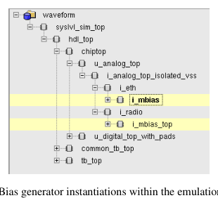
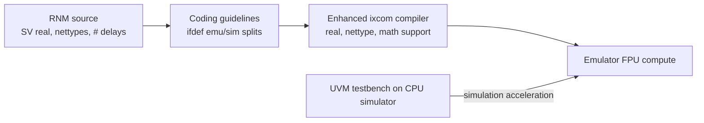

<!-- generated by yt-paper; edits will be overwritten -->
[DVCon](../dvcon/index.md) › [Europe](../dvcon/europe.md) › [2024](../dvcon/by-year.md#2024) › [Emulation](../dvcon/by-topic.md#emulation)

# Enabling True System-Level, Mixed-Signal Emulation

<figure class="rep-fig" markdown>
{ loading=lazy }
<figcaption>Figure 2. Bias generator instantiations within the emulation run. — from the original paper (Nimay Shah et al.)</figcaption>
</figure>

[:material-open-in-new: Original paper](https://dvcon-proceedings.org/wp-content/uploads/157-Enabling-True-System-Level-Mixed-Signal-Emulation.pdf){ .md-button .md-button--primary target=_blank }

| | |
|---|---|
| Authors | Nimay Shah (Analog Devices, Wilmington, MA, USA), Paul Wright (Analog Devices, Limerick, Ireland), Pranav Dhayagude (Analog Devices, Wilmington, MA, USA), Raj Mitra (Cadence Design Systems, Burlington, MA, USA), Adam Sherer (Cadence Design Systems, Burlington, MA, USA); DVCon Europe |
| Venue | DVCon Europe 2024 |
| Topic | Emulation |
| Type | PAPER |
| ID | `ref-20261018-8099` |

## Summary

**The paper extends an emulation compiler (ixcom) and RNM coding guidelines so that SystemVerilog real-number models (RNMs) of analog/mixed-signal blocks can be synthesized and run on an emulator in simulation-acceleration mode, validated on a CP-PLL, an A-PLL, and the bias generator of a 4T4R ORAN transceiver SoC with a 320x speedup over simulation.**

**ixcom 에뮬레이션 컴파일러와 RNM 코딩 가이드라인을 확장하여, 아날로그/혼합신호 블록의 SystemVerilog real-number model(RNM)을 수정 없이 합성해 simulation-acceleration 모드에서 에뮬레이터에 실행할 수 있게 하고, CP-PLL, A-PLL, 4T4R ORAN 트랜시버 SoC의 bias generator로 검증하여 시뮬레이션 대비 320배 속도 향상을 보고한 논문입니다.**

## Key Insights

- Real-number models can be synthesized directly on the emulator (SV-2009 real types, SV-2012 nettypes with resolution functions, # delays, floating-point and math operations), avoiding the months-long recoding into fixed-point models that prior approaches required (e.g., the image sensor case).

- Real-number model을 에뮬레이터에서 직접 합성할 수 있습니다(SV-2009 real 타입, resolution function을 포함한 SV-2012 nettype, # delay, 부동소수점 및 수학 연산 지원). 이로써 기존 방식에서 필요했던, 수개월이 걸리는 fixed-point 모델 재코딩(예: 이미지 센서 사례)을 피할 수 있습니다.

- On the 4T4R ORAN SoC, the full RNM bias generator reduced maximum emulation frequency from 959 kHz (all-digital bias generator) to 635 kHz (33% degradation); the self-trim run took 45 s on emulation vs. 14400 s in pure simulation (320x speedup), with FPU utilization of 52.47%.

- 4T4R ORAN SoC에서 RNM 기반 bias generator를 적용하면 최대 에뮬레이션 주파수가 959 kHz(all-digital bias generator)에서 635 kHz로 떨어집니다(33% 저하). Self-trim 실행 시간은 에뮬레이션 45 s, 순수 시뮬레이션 14400 s로 320배 속도 향상이며, FPU 사용률은 52.47%입니다.

- Hard limits to plan around: $atan/$asin/$acos are unsupported (A-PLL used a user-code arctan approximation), $sin/$cos inputs must be bounded to ±40π, dynamic arrays, concurrent/immediate assertions and coverage on real types, force/release of real types, and automatic connect-module insertion are not supported.

- 계획 시 고려해야 할 제약: $atan/$asin/$acos는 미지원(A-PLL은 사용자 코드 arctan 근사를 사용), $sin/$cos 입력은 ±40π로 제한, dynamic array, real 타입에 대한 concurrent/immediate assertion 및 coverage, real 타입의 force/release, 자동 connect module 삽입은 지원되지 않습니다.

- Analog-side integration uses three model categories: emulation-compliant library components, extracted LUT models generated by an internal tool requiring no modification, and a minimal set of hand-written SV guarded by `ifdef emulation/simulation splits; supplies are assumed always on in emulation so supply checks are disabled and inputs are converted to logic types.

- 아날로그 측 통합은 세 가지 모델 범주를 사용합니다. 에뮬레이션 호환 라이브러리 컴포넌트, 내부 도구로 추출한 LUT 모델(수정 불필요), 그리고 `ifdef emulation/simulation 분기가 필요한 최소한의 수작업 SV입니다. 에뮬레이션에서는 전원이 항상 켜져 있다고 가정하므로 supply check를 비활성화하고 입력을 logic 타입으로 변환합니다.

- A VPI plus Python script traces every connection from top-level IO to leaf instances and reports signal types (logic, interconnect, coerced wreal, real variable, custom nettype) in a spreadsheet to find DMS connectivity issues before the emulation build.

- VPI와 Python 스크립트가 최상위 IO에서 leaf 인스턴스까지 모든 연결을 추적하고, 신호 타입(logic, interconnect, coerced wreal, real variable, custom nettype)을 스프레드시트로 보고하여 에뮬레이션 빌드 전에 DMS 연결 문제를 찾아냅니다.

## Detailed Summary

### Background and Problem

- Emulators only handle synthesizable digital logic, so analog/mixed-signal (AMS) content is typically black-boxed in SoC emulation. Analog blocks are replaced by register-only stubs, and calibration loops that depend on analog feedback cannot be verified end-to-end before tapeout.

- 에뮬레이터는 합성 가능한 디지털 로직만 처리하므로, SoC 에뮬레이션에서 아날로그/혼합신호(AMS) 부분은 보통 black box로 처리됩니다. 아날로그 블록은 레지스터만 가진 스텁으로 대체되고, 아날로그 피드백에 의존하는 calibration loop는 tapeout 전에 end-to-end로 검증할 수 없습니다.

- Full AMS co-simulation is limited by analog simulator runtime. Fixed-point bit-model conversion of SystemVerilog Real Number Models (RNM) was shown on an image sensor (5.6 s of real system function in 2.1 h of emulation), but required months of recoding, a larger emulation footprint (accuracy vs. size tradeoff), and ongoing synchronization with the RNM simulation models.

- AMS co-simulation은 아날로그 시뮬레이터의 런타임 때문에 테스트 수가 제한됩니다. SystemVerilog Real Number Model(RNM)을 fixed-point bit 모델로 변환하는 방식은 이미지 센서에서 시연되었습니다(에뮬레이션 2.1 h 동안 실제 시스템 기능 5.6 s). 그러나 이 방식은 수개월의 재코딩, 정확도 대 모델 크기 간 trade-off(에뮬레이션 footprint 증가), 그리고 RNM 시뮬레이션 모델과의 지속적인 동기화가 필요했습니다.

- Goal: synthesize the original RNMs to floating-point fidelity without recoding, keeping the existing UVM simulation-acceleration flow (testbench on CPU simulator, DUT on emulator).

- 목표: 원래 RNM을 재코딩하지 않고 floating-point 충실도로 합성하며, 기존 UVM simulation-acceleration 흐름(CPU 시뮬레이터의 testbench, 에뮬레이터의 DUT)을 유지하는 것입니다.

### Architecture and Methodology

The approach combines RNM coding guidelines, enhancements to the front-end compiler (ixcom) on the emulation platform, and validation on real designs.

접근법은 RNM 코딩 가이드라인, 에뮬레이션 플랫폼 front-end 컴파일러(ixcom)의 확장, 실제 설계를 통한 검증을 결합합니다.

- **Datatypes**: real, shortreal, realtime, their unpacked arrays and structs; SV-2012 nettypes including synthesizable resolution functions (no dynamic arrays).

- **데이터 타입**: real, shortreal, realtime 및 이들의 unpacked 배열과 struct. SV-2012 nettype은 합성 가능한 resolution function을 포함하여 지원됩니다(dynamic array 사용 불가).

- **Delays**: `#` delays are supported in always-with-delay, continuous assign with delay, always with explicit event plus delay, and rise/fall gate-primitive delays.

- **Delay**: always-with-delay, delay가 있는 continuous assign, 명시적 event와 delay가 있는 always, rise/fall gate primitive delay를 지원합니다.

- **Math**: real operators from IEEE 1800-2017 Table 11-1 (except `inside`) and most math functions from Table 20-4. $sin/$cos inputs bounded to ±40π; inverse trig functions are not supported. Conversion functions ($rtoi, $itor, $realtobits, $bitstoreal, $shortrealtobits, $bitstoshortreal) are supported. Argument reduction to ±2π is done in user code with $floor.

- **수학 연산**: IEEE 1800-2017 Table 11-1의 real 연산자(`inside` 제외)와 Table 20-4의 대부분의 수학 함수를 지원합니다. $sin/$cos 입력은 ±40π로 제한되며, 역삼각 함수는 미지원입니다. 변환 함수($rtoi, $itor, $realtobits, $bitstoreal, $shortrealtobits, $bitstoshortreal)는 지원됩니다. ±2π로의 인자 축소는 $floor를 이용한 사용자 코드로 구현합니다.

- **DMS connectivity**: the compiler adds datatype coercion (not 1:1 with simulators), but automatic connect-module (CM) insertion is not supported. A VPI and a Python post-processor trace each hierarchical connection and flag problem segments in a spreadsheet.

- **DMS 연결**: 컴파일러는 datatype coercion을 추가하지만 시뮬레이터와 1:1로 일치하지는 않으며, 자동 connect module(CM) 삽입은 지원되지 않습니다. VPI와 Python 후처리 스크립트가 계층 연결 각각을 추적하고 문제 구간을 스프레드시트로 표시합니다.

- **Unsupported**: dynamic arrays, concurrent and immediate assertions and coverage on real types, force/release of real types.

- **미지원 항목**: dynamic array, real 타입에 대한 concurrent 및 immediate assertion과 coverage, real 타입의 force/release.

- **Model categories** for the bias generator: (1) Analog Devices simulation library components, updated to be emulation-compliant; (2) extracted LUT models generated by an internal tool, which needed no changes; (3) minimal hand-written SV, restricted to `ifdef emulation/simulation differences, discipline management and hand-instantiated connect modules.

- **Bias generator 모델 범주**: (1) Analog Devices 시뮬레이션 라이브러리 컴포넌트(에뮬레이션 호환으로 업데이트), (2) 내부 도구로 추출한 LUT 모델(수정 불필요), (3) `ifdef emulation/simulation 차이, 디바이스 관리, 수동 인스턴스화된 connect module이 필요한 경우에 한정된 최소한의 수작업 SV.

- **Integration**: the `analog_top` module was removed from the `-moduleStubList` of ixcom, and a configuration view instantiates two bias generator instances (Figure 2). Supplies are undriven on emulation (assumed always on), so supply checks are disabled with `ifdef and their inputs are converted to logic types (Figure 3).

- **통합**: ixcom의 `-moduleStubList`에서 `analog_top` 모듈을 제외하고, configuration view로 두 개의 bias generator 인스턴스를 인스턴스화합니다(Figure 2). 에뮬레이션에서 supply 핀은 구동되지 않으므로(항상 켜져 있다고 가정), supply check는 `ifdef로 비활성화하고 입력은 logic 타입으로 변환합니다(Figure 3).

- **Validation**: the bias generator model is netlisted from the analog design environment and checked against transistor-level, RNM-simulation and RNM-emulation runs for power-down and trim use cases.

- **검증**: bias generator 모델은 아날로그 설계 환경에서 netlist되며, power-down 및 trim 사용 사례에 대해 transistor-level, RNM 시뮬레이션, RNM 에뮬레이션 실행 결과와 비교됩니다.

### Results and Conclusions

- **CP-PLL**: a charge-pump PLL served as the basic proof-of-concept to validate guidelines and tool enhancements.

- **CP-PLL**: charge-pump PLL을 기본 proof-of-concept로 사용하여 가이드라인과 도구 확장을 검증했습니다.

- **Bias generator self-trim** (4T4R ORAN transceiver running Ubuntu): the trim routine, triggered by register writes from the processor, completes on both simulation (Figure 4) and emulation (Figure 5). Waveforms are not identical because the constraint-randomization solver outputs differ.

- **Bias generator self-trim**(Ubuntu를 실행하는 4T4R ORAN 트랜시버): 프로세서의 레지스터 쓰기로 시작되는 trim 루틴이 시뮬레이션(Figure 4)과 에뮬레이션(Figure 5) 모두에서 완료됩니다. 제약 randomization solver의 출력이 달라 파형은 동일하지 않습니다.

- **Performance**: maximum emulation frequency drops from 959 kHz (all-digital bias generator) to 635 kHz (33% degradation). Runtime is 45 s on emulation vs. 14400 s in pure DMS simulation, a 320x speedup. FPU utilization is 52.47%. The authors expect larger gains on more complex cases.

- **성능**: 최대 에뮬레이션 주파수는 959 kHz(all-digital bias generator)에서 635 kHz로 떨어집니다(33% 저하). 런타임은 에뮬레이션 45 s, 순수 DMS 시뮬레이션 14400 s로, 320배 속도 향상입니다. FPU 사용률은 52.47%입니다. 저자들은 더 복잡한 사례에서 더 큰 이득을 기대합니다.

- **A-PLL**: phase detection uses a user-code arctan approximation (Figure 6) based on published references. The PLL locks to the reference (Figure 7), and the results closely match Xcelium reference simulations.

- **A-PLL**: 위상 검출은 공개된 참고문헌에 기반한 사용자 코드 arctan 근사(Figure 6)를 사용합니다. PLL은 기준 클럭에 lock되며(Figure 7), 결과는 Xcelium 참조 시뮬레이션과 밀접하게 일치합니다.

- **Conclusions**: the authors state the tools and methodology are ready for production use with known limitations and workarounds. Future work includes making the Analog Devices simulation library fully emulation-compliant and expanding RNM/DMS construct support in the tools and hardware.

- **결론**: 저자들은 알려진 제약과 검증된 우회 방법을 갖춘 상태로 도구와 방법론이 프로덕션 사용 준비가 되었다고 밝힙니다. 향후 과제는 Analog Devices 시뮬레이션 라이브러리를 완전히 에뮬레이션 호환으로 만드는 것과, 도구 및 하드웨어에서 RNM/DMS 구문 지원을 확대하는 것입니다.

- Note: the source text is complete; no truncation.

- 원문이 완전하며 잘린 부분은 없습니다.

## Videos

<iframe src="https://www.youtube-nocookie.com/embed/shvv5KRtxp8" title="[DVCON2024] Enabling True System-Level, Mixed-Signal Emulation" loading="lazy" allow="accelerometer; clipboard-write; encrypted-media; gyroscope; picture-in-picture; web-share" referrerpolicy="strict-origin-when-cross-origin" allowfullscreen></iframe>

**[DVCON2024] Enabling True System-Level, Mixed-Signal Emulation** — [Watch on YouTube](https://www.youtube.com/watch?v=shvv5KRtxp8) · [Video page](../videos/shvv5KRtxp8.md)
