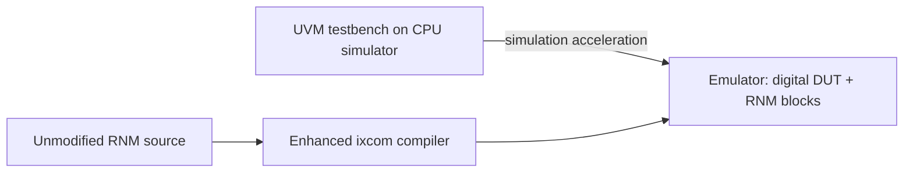

<!-- generated by yt-paper; edits will be overwritten -->
[DVCon](../dvcon/index.md) › [Europe](../dvcon/europe.md) › [2024](../dvcon/by-year.md#2024) › [Emulation](../dvcon/by-topic.md#emulation)

# Enabling True System-Level, Mixed-Signal Emulation

<figure class="rep-fig" markdown>
{ loading=lazy }
<figcaption>Figure 2. Bias generator instantiations within the emulation run. — from the original paper (Nimay Shah et al.)</figcaption>
</figure>

[:material-open-in-new: Original paper](https://dvcon-proceedings.org/wp-content/uploads/157-Enabling-True-System-Level-Mixed-Signal-Emulation.pdf){ .md-button .md-button--primary target=_blank }

| | |
|---|---|
| Authors | Nimay Shah (Analog Devices), Paul Wright (Analog Devices), Pranav Dhayagude (Analog Devices), Raj Mitra (Cadence Design Systems), Adam Sherer (Cadence Design Systems) |
| Venue | DVCon Europe 2024 |
| Topic | Emulation |
| Type | PAPER |
| ID | `ref-20261018-8099` |

## Summary

**Enhanced ixcom compiler and RNM coding guidelines let SystemVerilog real-number models run directly on FPU-based emulation hardware, enabling pre-silicon mixed-signal verification with software in the loop without fixed-point recoding.**

**향상된 ixcom 컴파일러와 RNM 코딩 가이드라인을 통해 SystemVerilog 실수형 모델(RNM)을 FPU 기반 에뮬레이션 하드웨어에서 직접 실행할 수 있게 되어, 고정소수점 재코딩 없이 소프트웨어를 포함한 mixed-signal 검증을 tapeout 이전에 수행할 수 있습니다.**

## Key Insights

- Synthesizing unmodified RNMs via compiler enhancements removes the months-long fixed-point recoding that prior emulation flows required, and keeps a single RNM codebase for simulation and emulation.

- 컴파일러 개선과 RNM 코딩 가이드라인으로 수정되지 않은 RNM을 합성할 수 있어, 기존 고정소수점 모델 재코딩에 필요했던 수개월의 작업이 사라지고 시뮬레이션과 에뮬레이션이 단일 RNM 코드베이스를 공유합니다.

- Full bias-generator RNM reduced maximum emulation frequency from 959 kHz to 635 kHz (33% degradation), yet emulation runtime was 45 s versus 14,400 s in simulation (320x speedup) at 52.47% FPU utilization.

- 완전한 bias generator RNM을 적용하면 최대 에뮬레이션 주파수가 959 kHz에서 635 kHz로 떨어지지만(33% 저하), 에뮬레이션 런타임은 45 s로 시뮬레이션 14,400 s 대비 320배 빨랐고 FPU 사용률은 52.47%였습니다.

- Unsupported constructs need workarounds: inverse trig ($atan/$asin/$acos) requires a user-code arctan approximation, and dynamic arrays, CM insertion, real-type assertions/coverage, and force/release on reals are not supported.

- 역삼각함수($atan/$asin/$acos)는 지원되지 않아 사용자 코드 arctan 근사가 필요하며, dynamic array, CM insertion, 실수형 assertion/coverage, 실수형 force/release는 지원되지 않습니다.

- Emulation assumes always-on supplies, so supply checks were disabled with `ifdef and undriven supply pins default to logic 0, a setup detail needed for DMS reuse.

- 에뮬레이션 환경은 전원이 항상 켜져 있다고 가정하므로 `ifdef로 전원 체크를 비활성화했고, 구동되지 않은 전원 핀은 logic 0으로 기본 설정되며, 이는 DMS 재사용을 위해 필요한 설정 세부사항입니다.

- Evidence is limited to a bias generator, a CP-PLL, an A-PLL (waveform comparison against Xcelium), and a 4T4R SoC claimed production-ready; no quantitative fidelity metric is reported beyond waveform matching.

- 검증 근거는 bias generator, CP-PLL, A-PLL(Xcelium 파형 비교), 그리고 양산 적용 가능하다고 주장한 4T4R SoC에 한정되며, 파형 일치 이외의 정량적 충실도 지표는 보고되지 않았습니다.

## Detailed Summary

### Background and Problem

- Traditional emulation supports only synthesizable digital logic, and co-simulation with an analog simulator is runtime-limited. Calibration loops and analog-feedback low-power behavior therefore stay unverified pre-silicon.

- 기존 에뮬레이션은 합성 가능한 디지털 로직만 지원하며, 아날로그 시뮬레이터와의 co-simulation은 런타임 한계가 있습니다. 따라서 calibration loop와 아날로그 피드백 기반 저전력 동작은 tapeout 이전에 검증되지 못했습니다.

- Prior fixed-point re-modeling of RNMs cost months of recoding and large emulation footprints (image sensor case: 5.6 s of system time in 2.1 h of emulation). Analog blocks were often black-boxed with register-only stubs.

- 기존 고정소수점 RNM 재모델링은 수개월의 재코딩과 큰 에뮬레이션 footprint를 요구했습니다(이미지 센서 사례: 에뮬레이션 2.1 h로 5.6 s의 시스템 기능 구동). 아날로그 블록은 레지스터만 가진 stub으로 black box 처리되는 경우가 많았습니다.

### Architecture and Methodology

- The enhanced front-end compiler (ixcom) maps SV-2009 real types, SV-2012 nettypes with resolution functions, `#` delays, real math, and conversion system functions onto emulation FPUs.

- 향상된 front-end 컴파일러(ixcom)는 SV-2009 실수형, resolution function을 포함한 SV-2012 nettype, `# delay`, 실수 연산, 변환 시스템 함수를 에뮬레이션 FPU에 매핑합니다.

- Coding guidelines: resolution functions use fixed-size arrays; $sin/$cos inputs are bounded to ±40π; inverse trig is replaced by user-code approximation. CM insertion is unsupported; a VPI plus Python script traces DMS connections.

- 코딩 가이드라인: resolution function은 고정 크기 배열을 사용하고, $sin/$cos 입력은 ±40π로 제한하며, 역삼각함수는 사용자 코드 근사로 대체합니다. CM insertion은 지원되지 않으며, VPI와 Python 스크립트로 DMS 연결을 추적합니다.

- The bias generator (50 µA bias to the oscillator) combines an emulation-compliant library, an extracted LUT, and minimal handwritten SV with `ifdef-guarded supply checks.

- bias generator(발진기에 50 µA 바이어스 공급)는 에뮬레이션 호환 라이브러리, 추출된 LUT, `ifdef로 전원 체크를 보호한 최소한의 수기 SV 코드를 조합해 모델링했습니다.

- Runs in simulation-acceleration mode: the UVM testbench runs on the CPU simulator, while the DUT and RNMs run on the emulator.

- simulation-acceleration 모드로 동작합니다. UVM testbench는 CPU 시뮬레이터에서, DUT와 RNM은 에뮬레이터에서 실행됩니다.

### Results and Conclusions

- The register-triggered bias-generator self-trim routine completes in both simulation and emulation; waveform differences stem from constraint-solver outputs.

- 레지스터 쓰기로 시작되는 bias generator self-trim 루틴은 시뮬레이션과 에뮬레이션 모두에서 완료되었으며, 파형 차이는 constraint solver 출력에서 비롯됩니다.

- Maximum emulation frequency fell from 959 kHz (all-digital bias) to 635 kHz with the full RNM. Emulation ran in 45 s versus 14,400 s in simulation (320x).

- 최대 에뮬레이션 주파수는 전체 디지털 bias 기준 959 kHz에서 완전한 RNM 적용 시 635 kHz로 떨어졌습니다. 에뮬레이션은 45 s, 시뮬레이션은 14,400 s가 걸려 320배 차이를 보였습니다.

- The A-PLL's arctan approximation locked to the reference, closely matching Xcelium results.

- A-PLL의 arctan 근사는 기준 클록에 락되었으며 Xcelium 결과와 근접하게 일치했습니다.

- The authors call the flow production-ready for the 4T4R ORAN transceiver, with known limitations: dynamic arrays, real-type assertions and coverage, and force/release on reals.

- 저자들은 4T4R ORAN 트랜시버에 대해 양산 적용이 가능하다고 주장하며, 알려진 한계로 dynamic array, 실수형 assertion과 coverage, 실수형 force/release를 제시했습니다.

## Videos

<iframe src="https://www.youtube-nocookie.com/embed/shvv5KRtxp8" title="[DVCON2024] Enabling True System-Level, Mixed-Signal Emulation" loading="lazy" allow="accelerometer; clipboard-write; encrypted-media; gyroscope; picture-in-picture; web-share" referrerpolicy="strict-origin-when-cross-origin" allowfullscreen></iframe>

**[DVCON2024] Enabling True System-Level, Mixed-Signal Emulation** — [Watch on YouTube](https://www.youtube.com/watch?v=shvv5KRtxp8) · [Video page](../videos/shvv5KRtxp8.md)
