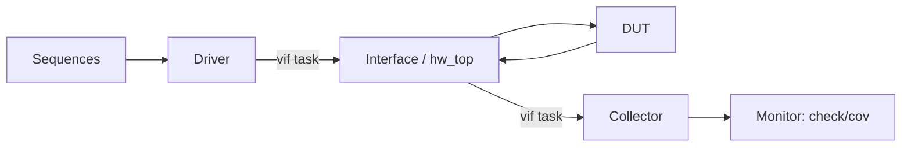

<!-- generated by yt-paper; edits will be overwritten -->
[DVCon](../dvcon/index.md) › [US](../dvcon/us.md) › [2014](../dvcon/by-year.md#2014) › [Emulation](../dvcon/by-topic.md#emulation)

# UVM Testbench Considerations for Acceleration

<figure class="rep-fig" markdown>
{ loading=lazy }
<figcaption>Fig. 2. Simplified verification environment with DUT and TB separated. — from the original paper (Kathleen A Meade et al.)</figcaption>
</figure>

[:material-open-in-new: Original paper](https://dvcon-proceedings.org/wp-content/uploads/uvm-testbench-considerations-for-acceleration.pdf){ .md-button .md-button--primary target=_blank }

| | |
|---|---|
| Authors | Kathleen A Meade (Cadence Design Systems, Inc) |
| Venue | DVCon US 2014 |
| Topic | Emulation |
| Type | PAPER |
| ID | `ref-20261018-8282` |

## Summary

**The paper gives practical UVM coding guidelines (TB/DUT partitioning, collector/monitor split, synthesizable drive/collect tasks, timing-free sequences, clock/reset agent) so one UVM environment can run in simulation and hardware acceleration, citing 5-20X speedup for signal-based and 30-300X for transaction-based acceleration.**

**이 논문은 하나의 UVM 환경을 시뮬레이션과 하드웨어 가속에서 함께 쓸 수 있도록 TB/DUT 분할, collector/monitor 분리, synthesizable drive/collect 태스크, 타이밍 없는 시퀀스, clock/reset agent 등 실무 가이드라인을 제시하며, 신호 기반 가속은 5~20X, 트랜잭션 기반 가속은 30~300X의 속도 향상을 보고합니다.**

## Key Insights

- Acceleration pays off only when DUT time dominates: with DUT 60% and 15% sync overhead, the paper's estimate is HW_TIME 69% and max speedup ~3.2X, while DUT 85% and 10% overhead gives ~15.4X.

- 가속의 효과는 DUT 시간이 지배적일 때만 큽니다. DUT 60%, 동기화 오버헤드 15%인 경우 논문 추정치는 HW_TIME 69%, 최대 속도 향상 약 3.2X이고, DUT 85%, 오버헤드 10%이면 약 15.4X입니다.

- Split the monitor into a signal-level collector (the only class touching the DUT, made synthesizable) and a transaction-level monitor for checking/coverage connected via TLM ports.

- monitor를 신호 수준 collector(DUT에 접근하는 유일한 클래스이며 synthesizable하게 작성)와 TLM 포트로 연결된 트랜잭션 수준 monitor(체킹/커버리지)로 분리합니다.

- Move drive_transfer/collect_transfer into the interface or hw_top; the cost is losing UVM factory overrides of those tasks, which the author says is rarely needed.

- drive_transfer/collect_transfer 태스크를 interface 또는 hw_top으로 옮깁니다. 대가로 이 태스크들에 대한 UVM factory override가 불가능해지며, 저자는 이런 override가 거의 필요하지 않다고 봅니다.

- Remove #delays and clock/reset waits from sequences by using a clock/reset agent with a hardware-side timer, so timeouts do not trigger costly sync events.

- 시퀀스에서 #delay와 clock/reset 대기를 제거하고, 하드웨어 측 타이머를 가진 clock/reset agent를 사용하여 타임아웃이 비용이 큰 동기화 이벤트를 유발하지 않도록 합니다.

- Signal-based migration yields 5-20X and transaction-based acceleration 30-300X, but any TB code moved to hardware must be synthesizable and randomization should be minimized in accelerated runs.

- 신호 기반 이전은 5-20X, 트랜잭션 기반 가속은 30-300X의 속도 향상을 얻지만, 하드웨어로 옮기는 TB 코드는 반드시 synthesizable해야 하며 가속 실행에서는 랜덤화를 최소화해야 합니다.

## Detailed Summary

### Background and Problem

- Teams want one UVM testbench for both simulation and hardware acceleration, but acceleration only helps when DUT runtime dominates and every SW/HW synchronization adds overhead.

- 팀들은 시뮬레이션과 하드웨어 가속에 동일한 UVM testbench를 쓰고 싶어 하지만, 가속은 DUT 실행 시간이 지배적일 때만 효과가 있으며 SW/HW 동기화마다 오버헤드가 추가됩니다.

- The paper's model: $HW\_TIME = DUT + DUT \times SYNC$, and speedup $= 100/(100-HW\_TIME)$. With DUT 60% and SYNC 15%, speedup is ~3.2X; with DUT 85% and SYNC 10%, it is ~15.4X.

- 논문의 모델: $HW\_TIME = DUT + DUT \times SYNC$, 속도 향상 $= 100/(100-HW\_TIME)$. DUT 60%, SYNC 15%이면 약 3.2X, DUT 85%, SYNC 10%이면 약 15.4X입니다.

### Architecture and Methodology

- Partition the top level: `hw_top` holds the DUT, clock generator, interfaces and optional synthesizable memory; `tb_top` only imports UVM/UVC packages, sets virtual interfaces in `uvm_config_db`, and calls `run_test()`.

- 최상위 분할: `hw_top`은 DUT, 클럭 생성기, interface, 선택적 synthesizable 메모리를 포함하고, `tb_top`은 UVM/UVC 패키지만 import하고 `uvm_config_db`로 virtual interface를 설정한 뒤 `run_test()`를 호출합니다.

- Split the monitor into a signal-level collector (passive, protocol-aware, synthesizable) and a transaction-level monitor (checking, coverage) linked by TLM ports.

- monitor를 신호 수준 collector(수동적, 프로토콜 인지, synthesizable)와 TLM 포트로 연결된 트랜잭션 수준 monitor(체킹, 커버리지)로 분리합니다.

- Restrict DUT access to driver and collector only. Implement `drive_transfer`/`collect_transfer` as synthesizable tasks placed in the interface or `hw_top`.

- DUT 접근은 driver와 collector로만 제한합니다. `drive_transfer`/`collect_transfer`는 synthesizable 태스크로 구현하여 interface 또는 `hw_top`에 둡니다.

- Replace `#delay`, clock waits and signal waits in sequences with a reusable clock/reset agent. Its driver calls interface tasks, and a hardware-side timer handles timeouts.

- 시퀀스의 `#delay`, 클럭 대기, 신호 대기를 재사용 가능한 clock/reset agent로 대체합니다. driver는 interface 태스크를 호출하고, 타임아웃은 하드웨어 측 타이머가 처리합니다.

- Keep randomization simple and provide non-randomizing sequences for accelerated runs.

- 랜덤화는 단순하게 유지하고, 가속 실행용으로 randomize()를 호출하지 않는 시퀀스를 제공합니다.

### Results and Conclusions

- Signal-based migration (TB in simulator, DUT in accelerator) reportedly yields 5X-20X; transaction-based acceleration yields 30X-300X.

- 신호 기반 이전(TB는 시뮬레이터, DUT는 가속기)은 5X-20X, 트랜잭션 기반 가속은 30X-300X의 효과가 보고되었습니다.

- The paper reports no new experimental dataset; the speedup ranges are cited from prior experience and the arithmetic examples are illustrative.

- 논문은 새로운 실험 데이터를 제시하지 않으며, 속도 향상 범위는 기존 경험에서 인용된 것이고 산술 예시는 설명용입니다.

- Conclusion: making UVM environments acceleration-ready early costs little in simulation and can pay off in performance; the author notes the recommendations are UVM enhancements for a single environment.

- 결론: 가속 대응 UVM 환경을 초기에 만드는 비용은 시뮬레이션에서 작고 성능 이득은 클 수 있으며, 저자는 이 권고가 단일 환경을 위한 UVM 확장이라고 설명합니다.

## Videos

<iframe src="https://www.youtube-nocookie.com/embed/2Z9lPq8l_h4" title="[DVCON2014]UVM Testbench Considerations for Acceleration" loading="lazy" allow="accelerometer; clipboard-write; encrypted-media; gyroscope; picture-in-picture; web-share" referrerpolicy="strict-origin-when-cross-origin" allowfullscreen></iframe>

**[DVCON2014]UVM Testbench Considerations for Acceleration** — [Watch on YouTube](https://www.youtube.com/watch?v=2Z9lPq8l_h4) · [Video page](../videos/2Z9lPq8l_h4.md)
