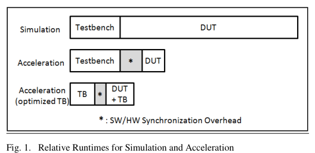
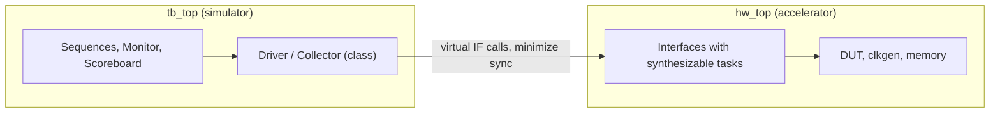

<!-- generated by yt-paper; edits will be overwritten -->
[DVCon](../dvcon/index.md) › [US](../dvcon/us.md) › [2014](../dvcon/by-year.md#2014) › [Verification](../dvcon/by-topic.md#verification)

# UVM Testbench Considerations for Acceleration

<figure class="rep-fig" markdown>
{ loading=lazy }
<figcaption>Fig. 1. Relative Runtimes for Simulation and Acceleration — from the original paper (Kathleen A Meade et al.)</figcaption>
</figure>

[:material-open-in-new: Original paper](https://dvcon-proceedings.org/wp-content/uploads/uvm-testbench-considerations-for-acceleration.pdf){ .md-button .md-button--primary target=_blank }

| | |
|---|---|
| Authors | Kathleen A Meade (Cadence Design Systems, Inc) |
| Venue | DVCon US 2014 |
| Topic | Verification |
| Type | PAPER |
| ID | `ref-20261018-8282` |

## Summary

**The paper gives guidelines for restructuring an existing UVM testbench (partitioning, collector/monitor split, synthesizable driver/collector tasks, timing removal, and simplified randomization) so the same environment runs in both simulation and hardware acceleration.**

**이 논문은 기존 UVM 테스트벤치를 시뮬레이션과 하드웨어 가속에서 동일하게 실행할 수 있도록, 상위 모듈 분할, collector/monitor 분리, 합성 가능한 드라이버/컬렉터 태스크, 타이밍 제거, 단순화된 랜덤화 등의 구조적 개선 지침을 제시한다.**

## Key Insights

- Acceleration pays off only when DUT runtime dominates. With TB 25%, DUT 60%, and sync overhead 15%, HW_TIME = 60% + 60%×15% = 69% and the maximum speedup is about 3.2X; with DUT 85% and overhead 10%, HW_TIME = 93.5% and the speedup is about 15.4X.

- 가속은 DUT 실행 시간이 지배적일 때만 효율적이다. TB 25%, DUT 60%, 동기화 오버헤드 15%인 경우 HW_TIME = 60% + 60%×15% = 69%이고 최대 속도 향상은 약 3.2X이다. DUT 85%, 오버헤드 10%인 경우 HW_TIME = 93.5%이고 속도 향상은 약 15.4X이다.

- Expected gains depend on the migration style: signal-level acceleration (testbench stays in simulator) gives roughly 5X to 20X, while transaction-based acceleration (driver/collector tasks moved to hardware) gives roughly 30X to 300X.

- 기대 효과는 이전 방식에 따라 다르다. 신호 수준 가속(테스트벤치는 시뮬레이터에 유지)은 약 5X~20X, 트랜잭션 기반 가속(드라이버/컬렉터 태스크를 하드웨어로 이동)은 약 30X~300X 범위이다.

- Partition the top level into hw_top (DUT, clock generator, interfaces, optional synthesizable memory) and a minimal tb_top that only sets virtual interfaces in uvm_config_db and calls run_test(). Limit DUT access to the driver and collector only.

- 상위 모듈을 hw_top(DUT, 클록 생성기, 인터페이스, 선택적 합성 가능 메모리)과 uvm_config_db로 가상 인터페이스를 설정하고 run_test()만 호출하는 최소한의 tb_top으로 분할한다. DUT 접근은 드라이버와 컬렉터로만 제한한다.

- Split the monitor into a signal-level collector (synthesizable, protocol-following) and a transaction-level monitor (checking and coverage) connected via UVM TLM ports, and move drive_transfer/collect_transfer tasks into the interface to cut synchronization events, at the cost of UVM factory overridability.

- 모니터를 신호 수준 컬렉터(합성 가능, 프로토콜 준수)와 트랜잭션 수준 모니터(검사 및 커버리지)로 분리하고 UVM TLM 포트로 연결한다. drive_transfer/collect_transfer 태스크를 인터페이스로 옮겨 동기화 이벤트를 줄이되, UVM 팩토리 오버라이드가 불가능해진다는 대가가 있다.

- Remove timing from sequences: use a reusable clock/reset agent with a timer and delay sequences executed inside the interface, and keep constraints simple and provide non-randomize() sequences for acceleration runs.

- 시퀀스에서 타이밍을 제거한다. 타이머와 딜레이 시퀀스를 포함한 재사용 가능한 클록/리셋 에이전트를 인터페이스 안에서 실행하고, 제약은 단순하게 유지하며 가속 실행용으로 randomize()를 호출하지 않는 시퀀스를 제공한다.

## Detailed Summary

### Background and Problem

- UVM is widely reused across block and system projects. The goal stated is one UVM testbench (TB) that runs in both simulation and hardware acceleration, so teams maintain a single development stream.

- UVM은 블록 및 시스템 프로젝트 전반에 걸쳐 널리 재사용되고 있다. 이 논문이 제시하는 목표는 하나의 UVM 테스트벤치(TB)가 시뮬레이션과 하드웨어 가속 모두에서 실행되도록 하여, 팀이 단일 개발 흐름만 관리하도록 하는 것이다.

- Total accelerated runtime is governed by three factors: (1) UVM TB runtime in the simulator (randomization, checking, coverage), (2) SW/HW synchronization overhead whenever data or signals cross between simulator and accelerator, and (3) DUT runtime on the accelerator, which must be synthesizable.

- 가속 실행 시간은 세 가지 요인에 의해 결정된다. (1) 시뮬레이터에서의 UVM TB 실행 시간(랜덤화, 검사, 커버리지), (2) 시뮬레이터와 가속기 사이에서 데이터나 신호가 오갈 때 발생하는 SW/HW 동기화 오버헤드, (3) 가속기에서 실행되는 DUT 시간(합성 가능해야 함).

- Acceleration is inefficient when TB time is large relative to DUT time, and when simulation runs are short. Build/configuration time is negligible only for long runs.

- TB 시간이 DUT 시간에 비해 크거나 시뮬레이션 실행이 짧은 경우에는 가속 효율이 낮다. 구성 및 빌드 시간은 긴 실행에서만 무시할 수 있다.

- Worked example from the paper: HW_TIME = DUT + DUT×sync. For DUT 60% and sync 15%, HW_TIME = 69%, speedup = 100/(100−69) ≈ 3.2X ("may not be a good option"). For DUT 85% and sync 10%, HW_TIME = 93.5%, speedup = 100/6.5 ≈ 15.4X.

- 논문의 예시 계산: HW_TIME = DUT + DUT×동기화. DUT 60%, 동기화 15%이면 HW_TIME = 69%, 속도 향상 = 100/(100−69) ≈ 3.2X로 "좋은 선택이 아닐 수 있다"고 설명한다. DUT 85%, 동기화 10%이면 HW_TIME = 93.5%, 속도 향상 = 100/6.5 ≈ 15.4X이다.

### Architecture and Methodology

- **Top-level partitioning (Figs. 2–4):** hw_top contains the DUT instance, clock generator, UVC interfaces, and optional synthesizable memory. tb_top contains only the UVM package, UVC packages, an initial block that sets virtual interfaces via uvm_config_db, and run_test(). The paper states this should not affect simulation performance.

- **상위 모듈 분할 (Fig. 2–4):** hw_top에는 DUT 인스턴스, 클록 생성기, UVC 인터페이스, 선택적 합성 가능 메모리가 포함된다. tb_top에는 UVM 패키지, UVC 패키지, uvm_config_db로 가상 인터페이스를 설정하고 run_test()를 호출하는 initial 블록만 포함된다. 논문은 이것이 시뮬레이션 성능에 영향을 주지 않는다고 설명한다.

- **Collector/monitor split (Figs. 5–6):** UVM's single monitor is divided into a low-level collector that follows the interface protocol and captures transactions from signals, and a high-level monitor that performs checking and coverage. Transactions pass via UVM TLM ports to the monitor, scoreboard, and other components.

- **Collector/monitor 분리 (Fig. 5–6):** UVM의 단일 모니터를 인터페이스 프로토콜을 따라 신호에서 트랜잭션을 캡처하는 저수준 collector와, 검사 및 커버리지를 수행하는 고수준 monitor로 나눈다. 트랜잭션은 UVM TLM 포트를 통해 monitor, scoreboard 및 기타 컴포넌트로 전달된다.

- **Minimize DUT–TB interaction:** Access to the DUT is restricted to driver and collector. Common violations are waits on signal changes inside sequences and waits for reset. A clock/reset agent and an interrupt agent are proposed to absorb these.

- **DUT–TB 상호작용 최소화:** DUT 접근은 드라이버와 컬렉터로만 제한한다. 흔한 위반 사례는 시퀀스 내부에서 신호 변화를 기다리는 것과 리셋을 기다리는 것이다. 이를 흡수하기 위해 클록/리셋 에이전트와 인터럽트 에이전트를 제안한다.

- **Synthesizable driver/collector tasks (Figs. 7–8):** drive_transfer and collect_transfer are made synthesizable and moved into the interface (hw_top side), with the driver/collector calling them through a virtual interface handle. Trade-off: the UVM factory cannot override tasks in the interface; the paper notes such overrides are rarely needed.

- **합성 가능한 드라이버/컬렉터 태스크 (Fig. 7–8):** drive_transfer와 collect_transfer를 합성 가능하도록 만들고 인터페이스(hw_top 측)로 옮기며, 드라이버/컬렉터는 가상 인터페이스 핸들을 통해 이를 호출한다. 트레이드오프: 인터페이스에 있는 태스크는 UVM 팩토리로 오버라이드할 수 없다. 논문은 이러한 오버라이드가 드물게 필요하다고 언급한다.

- **Reusable clock/reset agent (Figs. 9–11):** A clk_reset_item carries clk_period, reset_delay, cycle_count, wait_count, and run_clk fields. The driver gets the interface in connect_phase and, in run_phase, calls interface tasks start_clock or count_clocks. The clock generator sits in a module, controlled from an interface.

- **재사용 가능한 클록/리셋 에이전트 (Fig. 9–11):** clk_reset_item은 clk_period, reset_delay, cycle_count, wait_count, run_clk 필드를 가진다. 드라이버는 connect_phase에서 인터페이스를 가져오고, run_phase에서 인터페이스 태스크 start_clock 또는 count_clocks를 호출한다. 클록 생성기는 모듈 안에 배치되고 인터페이스를 통해 제어된다.

- **Timeouts:** A timer inside the clock/reset UVC counts clocks in hardware, avoiding per-cycle synchronization from class-side timeouts. It supports concurrent timeout requests and an optional error if the timeout is not reached.

- **타임아웃:** 클록/리셋 UVC 내부의 타이머가 하드웨어에서 클록을 세므로, 클래스 측 타임아웃에서 발생하는 사이클 단위 동기화를 피한다. 동시 타임아웃 요청을 지원하며, 타임아웃 전에 이벤트가 발생하지 않으면 오류를 보고하도록 설정할 수 있다.

- **Removing timing from sequences (Figs. 12–13):** The paper replaces `@(negedge reset)`, `repeat(30) @(posedge clk)` style waits in a virtual sequence with clock_and_reset_start_seq and clock_and_reset_delay_seq calls sent to the clk_reset sequencer, so delays execute in the interface on both platforms.

- **시퀀스에서 타이밍 제거 (Fig. 12–13):** 논문은 가상 시퀀스의 `@(negedge reset)`, `repeat(30) @(posedge clk)` 형태의 대기를 clock_and_reset_start_seq와 clock_and_reset_delay_seq 호출로 대체하여 clk_reset 시퀀서로 전송한다. 이렇게 하면 두 플랫폼 모두에서 딜레이가 인터페이스 안에서 실행된다.

- **Randomization:** Keep constraints simple; provide an interface UVC sequence that does not call randomize() for acceleration runs.

- **랜덤화:** 제약을 단순하게 유지하고, 가속 실행을 위해 randomize()를 호출하지 않는 인터페이스 UVC 시퀀스를 제공한다.

### Results and Conclusions

- The paper is a guideline document. It provides no measured benchmark tables. Its quantitative content is the illustrative HW_TIME calculation above and the cited ranges: about 5X to 20X for signal-based acceleration and 30X to 300X for transaction-based acceleration, "depending on the implementation details."

- 이 논문은 가이드라인 문서이며 측정된 벤치마크 표는 제공하지 않는다. 정량적 내용은 위의 HW_TIME 예시 계산과 인용된 범위뿐이다. 신호 기반 가속은 약 5X~20X, 트랜잭션 기반 가속은 약 30X~300X이며 "구현 세부사항에 따라 다르다"고 명시한다.

- Conclusion: time invested up front in portable UVM environments (partitioning, minimal top-level TB, synthesizable transfer tasks, timing-free sequences) yields large performance gains later while keeping one environment for simulation and acceleration. The paper describes its suggestions as enhancements to UVM for this goal.

- 결론: 이식 가능한 UVM 환경(분할, 최소한의 상위 TB, 합성 가능한 전송 태스크, 타이밍 없는 시퀀스)에 초기 시간을 투자하면, 시뮬레이션과 가속에 하나의 환경을 유지하면서 이후 큰 성능 이득을 얻을 수 있다. 논문은 이 제안을 해당 목표를 위한 UVM의 개선안으로 설명한다.

- Limitations noted in the text: synthesizable constraints on hardware-side code, loss of factory override on interface-resident tasks, and the fact that code snippets are simplified.

- 본문에 언급된 한계: 하드웨어 측 코드에 대한 합성 가능성 제약, 인터페이스에 있는 태스크의 팩토리 오버라이드 불가, 코드 예제가 단순화되어 있다는 점.

## Videos

<iframe src="https://www.youtube-nocookie.com/embed/2Z9lPq8l_h4" title="[DVCON2014]UVM Testbench Considerations for Acceleration" loading="lazy" allow="accelerometer; clipboard-write; encrypted-media; gyroscope; picture-in-picture; web-share" referrerpolicy="strict-origin-when-cross-origin" allowfullscreen></iframe>

**[DVCON2014]UVM Testbench Considerations for Acceleration** — [Watch on YouTube](https://www.youtube.com/watch?v=2Z9lPq8l_h4) · [Video page](../videos/2Z9lPq8l_h4.md)
