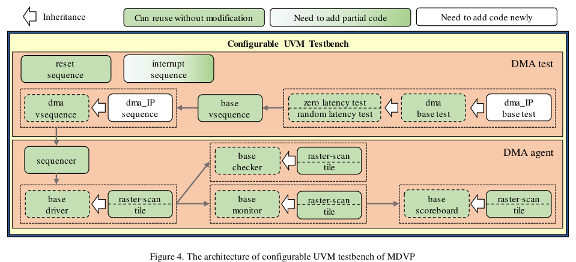
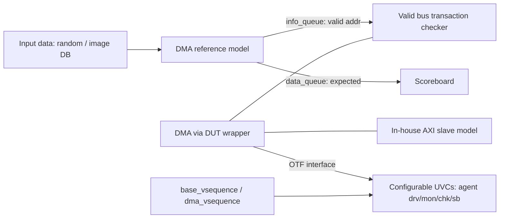

<!-- generated by yt-paper; edits will be overwritten -->
[DVCon](../dvcon/index.md) › [US](../dvcon/us.md) › [2020](../dvcon/by-year.md#2020) › [Verification](../dvcon/by-topic.md#verification)

# Multimedia IP DMA verification platform

<figure class="rep-fig" markdown>
{ loading=lazy }
<figcaption>Figure 1. The architecture of general multimedia IP that has bus interface. — from the original paper (Suhyung Kim et al.)</figcaption>
</figure>

[:material-open-in-new: Original paper](https://dvcon-proceedings.org/wp-content/uploads/multimedia-ip-dma-verification-platform.pdf){ .md-button .md-button--primary target=_blank }

| | |
|---|---|
| Authors | Suhyung Kim, Sangkyu Park, Myungwoo Seo, Sangjin Lee, Jiyeon Park (Samsung Electronics Co., Ltd., Hwaseong-si, Korea) |
| Venue | DVCon US 2020 |
| Topic | Verification |
| Type | PAPER |
| ID | `ref-20261018-86a9` |

## Summary

**MDVP is a UVM-based DMA verification platform for Samsung Exynos multimedia IPs that combines a shared DMA reference model, a reusable testbench with a valid bus transaction checker, and a configurable UVM testbench so that novice engineers can build new DMA testbenches quickly.**

**MDVP는 Exynos 멀티미디어 IP의 DMA 검증을 위한 UVM 기반 플랫폼으로, 공용 DMA reference model, 재사용 가능한 testbench(valid bus transaction checker 포함), 설정 가능한 UVM testbench를 결합하여 신규 엔지니어도 DMA testbench를 빠르게 구축할 수 있게 한다.**

## Key Insights

- A valid-address info_queue and expected-value data_queue generated once by the DMA reference model let the bus transaction checker flag unintended reads/writes without recalculating addresses in each UVC or VIP.

- DMA reference model이 한 번 생성하는 valid-address info_queue와 expected-value data_queue 덕분에, bus transaction checker는 각 UVC나 VIP에서 주소를 다시 계산하지 않고도 의도하지 않은 읽기/쓰기를 검출할 수 있다.

- The in-house AXI slave memory model increased simulation speed by 100% over the commercial VIP and reduced VIP license cost.

- 자체 개발한 AXI slave memory model은 상용 VIP 대비 시뮬레이션 속도를 100% 향상시켰고 VIP 라이선스 비용도 줄였다.

- Reuse structure (DMA agent, factory-overridden DMA base test, parameterized interfaces, base_vsequence with control knobs, and dma_vsequence with empty hooks) cut per-DMA code from 1298 lines (first MDVP) to 556 lines and initial testbench time from about 1 day to about 30 minutes.

- DMA agent, factory override 기반 DMA base test, 파라미터화된 interface, control knob을 가진 base_vsequence, 빈 메서드 훅을 가진 dma_vsequence로 구성된 재사용 구조 덕분에 DMA당 코드는 1298줄(최초 MDVP)에서 556줄로, 초기 testbench 구축 시간은 약 1일에서 약 30분으로 줄었다.

- Throughput of verification staffing rose from 2-3 DMA instances per senior engineer to 5 DMA instances per engineer on average, with a 5-engineer team handling more than 20 DMA verifications.

- 엔지니어 1인당 동시 검증 가능한 DMA 수는 시니어 기준 2-3개에서 평균 5개로 늘었으며, 5명 팀이 20개 이상의 DMA 검증을 처리한다.

- The paper is an industry experience report with no formal benchmark against alternative methodologies; the figures are self-reported by the team.

- 본 논문은 산업 경험 보고서로, 대안 방법론과의 정식 벤치마크 비교는 없고 수치는 저자 팀의 자체 보고다.

## Detailed Summary

### Background and Problem

- Multimedia IP DMAs in Exynos SoCs read and write large image/voice data directly to DRAM over the bus. A DMA bug can hang the bus and the whole SoC, so DMA verification traditionally required senior engineers. A senior engineer could usually cover only 2-3 DMA instances at once.

- Exynos SoC의 멀티미디어 IP DMA는 대용량 이미지/음성 데이터를 버스를 통해 DRAM에 직접 읽고 쓴다. DMA 버그는 버스를 멈추게 하여 SoC 전체에 영향을 줄 수 있으므로, 전통적으로 시니어 엔지니어가 검증을 담당했고 시니어 1명은 보통 DMA 2-3개만 동시에 검증할 수 있었다.

- DMA variants differ in data format and on-the-fly (OTF) interface protocol, so each instance needs a driver, monitor, checker and scoreboard plus a memory format converter. Common checks include RTL output correctness, OTF protocol correctness, expected bus requests, and AXI protocol compliance. Bus checks require system-level expertise.

- DMA마다 데이터 포맷과 OTF(on-the-fly) interface 프로토콜이 달라서, 인스턴스마다 driver, monitor, checker, scoreboard와 메모리 포맷 converter가 필요하다. 공통 검사 항목은 RTL 출력 정확성, OTF 프로토콜 정확성, 기대된 bus 요청 여부, AXI 프로토콜 준수이며, bus 관련 검사에는 시스템 전반에 대한 전문 지식이 필요하다.

- Goals: enable novice engineers to reach adequate verification quality, release an initial testbench quickly, maximize code reuse, and ramp up novices rapidly.

- 목표: 신규 엔지니어도 적절한 검증 품질을 확보하고, 초기 testbench를 빠르게 출시하며, 코드 재사용을 극대화하고, 신규 엔지니어의 학습 기간을 단축하는 것이다.

### Architecture and Methodology

MDVP is a UVM-based platform with three parts: a DMA reference model, a reusable testbench, and a configurable UVM testbench.

MDVP는 DMA reference model, 재사용 가능한 testbench, 설정 가능한 UVM testbench의 세 부분으로 구성된 UVM 기반 플랫폼이다.

- **Input data:** random patterns for general DMAs, and natural image patterns (generated with ImageMagick from a database of tens of thousands of images, covering Bayer, RGB and YUV formats) for compressor-equipped DMAs.

- **입력 데이터:** 일반 DMA에는 random 패턴을, 압축기를 포함한 DMA에는 이미지 패턴(ImageMagick으로 수만 장의 이미지 DB에서 생성, Bayer, RGB, YUV 포맷 포함)을 사용한다.

- **DMA reference model:** a new model written for MDVP rather than reusing the IP models, which were hard to convert. It performs pixel formatting and memory-map conversion from base address, stride, pixel format and memory format. Outputs are (1) valid address ranges, used by the valid bus transaction checker, and (2) expected data, used as RDMA input and WDMA reference. These are stored as `dma_info_queue` (start address, valid byte count) and `dma_data_queue`. The info_queue is built once per dma sequence, so UVCs and VIPs do not recompute valid addresses.

- **DMA reference model:** IP 모델은 변환이 어려워 MDVP 전용으로 새로 작성했다. base address, stride, pixel format, memory format을 기반으로 pixel formatting과 memory map 변환을 수행한다. 출력은 (1) valid bus transaction checker가 사용하는 valid address 범위와 (2) RDMA 입력 및 WDMA 기준값으로 쓰이는 expected data이며, 각각 `dma_info_queue`(시작 주소, 유효 바이트 수)와 `dma_data_queue`에 저장된다. info_queue는 dma sequence당 한 번만 생성되므로 UVC와 VIP가 valid address를 다시 계산할 필요가 없다.

- **Reusable testbench:** a DUT wrapper instantiates the DMA. Components are an APB BFM, clock/reset generator, valid bus transaction checker, and in-house AXI slave memory model. The checker flags bus requests to addresses outside the valid set, which scoreboards cannot see for unintended WDMA writes or RDMA reads not consumed by the output.

- **재사용 가능한 testbench:** DUT wrapper가 DMA를 인스턴스화한다. 구성 요소는 APB BFM, clock/reset generator, valid bus transaction checker, 자체 AXI slave memory model이다. checker는 유효 집합 밖의 주소에 대한 bus 요청을 검출하며, 이는 scoreboard가 WDMA의 의도하지 않은 쓰기나 출력에 사용되지 않은 RDMA 읽기를 보지 못하는 문제를 보완한다.

- **In-house AXI slave model:** optimized for the features MDVP actually uses; the paper reports 100% faster simulation than the commercial VIP.

- **자체 AXI slave model:** MDVP가 실제로 사용하는 기능에 맞춰 최적화되었으며, 논문은 상용 VIP보다 100% 빠른 시뮬레이션 속도를 보고한다.

- **Configurable UVM testbench:**
  - *DMA agent:* driver, monitor, checker and scoreboard connected through uvm_analysis_port, so UVC developers focus on component logic.
  - *DMA base test:* factory overriding in `dma_IP_base_test` selects UVCs. Test classes inherit it, which removes repeated configuration code.
  - *Parameterized interfaces and components:* bit-width parameters (for example `tile_if#(DATA_WIDTH, POS_X, POS_Y)` and `tile_driver_c#(...)`) allow one UVC to serve several interface variants.
  - *base_vsequence:* common test scenarios with random control knobs. Scenarios override knobs via factory override (for example zero-latency and random-latency tests).
  - *dma_vsequence:* predefined common methods plus empty methods that each DMA specification fills in.
  - *Parameterized sequences:* linking methods between configuration sequences and UVC sequence items. These use parameterized subroutines because SystemVerilog virtual tasks/functions cannot overload by argument.

- **설정 가능한 UVM testbench:**
  - *DMA agent:* driver, monitor, checker, scoreboard가 uvm_analysis_port로 연결되어, UVC 개발자는 testbench 구조와 무관하게 컴포넌트 로직에만 집중할 수 있다.
  - *DMA base test:* `dma_IP_base_test`에서 factory override로 UVC를 선택한다. 테스트 클래스는 이를 상속하므로 반복되는 설정 코드가 줄어든다.
  - *파라미터화된 interface와 component:* bit-width 파라미터(예: `tile_if#(DATA_WIDTH, POS_X, POS_Y)`, `tile_driver_c#(...)`)를 사용해 하나의 UVC가 여러 interface 변형을 지원한다.
  - *base_vsequence:* 랜덤 control knob을 가진 공통 테스트 시나리오를 제공한다. 시나리오는 factory override로 knob을 활성화한다(예: zero-latency, random-latency 테스트).
  - *dma_vsequence:* 공통 사전 정의 메서드와, DMA 사양에 맞춰 각자 구현하는 빈 메서드로 구성된다.
  - *파라미터화된 sequence:* configuration sequence와 UVC sequence item을 연결하는 메서드를 제공한다. SystemVerilog의 virtual task/function은 인자에 따른 overloading을 지원하지 않으므로 parameterized subroutine을 사용한다.

### Results and Conclusions

- Table I (as reported by the authors):
  - Lines of code per DMA instance: 1298 (first MDVP) → 556 (current MDVP). The "without MDVP" column is N/A.
  - Time to initial testbench: 1-2 days without MDVP → average 1 day (first MDVP) → average 30 minutes (current MDVP).
  - DMAs per verification engineer simultaneously: senior 2-3 and junior 1-2 without MDVP → average 4 (first MDVP) → average 5 (current MDVP).

- 표 I(저자 보고 기준):
  - DMA 인스턴스당 코드 라인 수: 1298줄(최초 MDVP) → 556줄(현재 MDVP). "MDVP 미사용" 열은 N/A다.
  - 초기 testbench 구축 시간: MDVP 미사용 시 1-2일 → 최초 MDVP 평균 1일 → 현재 MDVP 평균 30분.
  - 엔지니어 1인당 동시 검증 DMA 수: MDVP 미사용 시 시니어 2-3개, 주니어 1-2개 → 최초 MDVP 평균 4개 → 현재 MDVP 평균 5개.

- The first project with MDVP, staffed by one senior, two junior and two novice engineers, verified 25 DMA instances at once.

- MDVP를 처음 적용한 프로젝트는 시니어 1명, 주니어 2명, 신규 2명으로 구성된 팀이 DMA 25개를 동시에 검증했다.

- The current team of 5 engineers handles more than 20 DMA verifications within schedule.

- 현재 5명 팀이 일정 내에 20개 이상의 DMA 검증을 처리한다.

- The paper gives no formal baseline or statistical evaluation. The numbers come from internal project experience, and the paper does not describe the DMAs or the metrics in detail.

- 논문은 정식 baseline이나 통계적 평가를 제시하지 않는다. 수치는 내부 프로젝트 경험에서 나온 것이며, 대상 DMA와 측정 지표는 자세히 설명되지 않는다.

- Conclusion: reuse of UVCs, sequences and tests accumulated over several projects is what lets novices build testbenches quickly. The authors describe MDVP as having been used across several Exynos DMA projects.

- 결론: 여러 프로젝트에 걸쳐 축적된 UVC, sequence, test의 재사용이 신규 엔지니어의 빠른 testbench 구축을 가능하게 했다. 저자들은 MDVP가 여러 Exynos DMA 프로젝트에 사용되었다고 설명한다.

## Videos

<iframe src="https://www.youtube-nocookie.com/embed/aYd553EDwmo" title="[DVCON2020]Multimedia IP DMA verification platform" loading="lazy" allow="accelerometer; clipboard-write; encrypted-media; gyroscope; picture-in-picture; web-share" referrerpolicy="strict-origin-when-cross-origin" allowfullscreen></iframe>

**[DVCON2020]Multimedia IP DMA verification platform** — [Watch on YouTube](https://www.youtube.com/watch?v=aYd553EDwmo) · [Video page](../videos/aYd553EDwmo.md)
