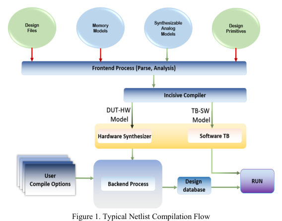
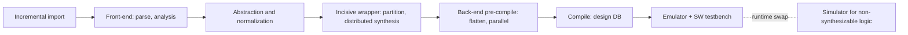

<!-- generated by yt-paper; edits will be overwritten -->
[DVCon](../dvcon/index.md) › [India](../dvcon/india.md) › [2024](../dvcon/by-year.md#2024) › [Emulation](../dvcon/by-topic.md#emulation)

# Expedited Gate Level Verification: Unleashing the Potential of Netlist Integrated Emulation Platforms

<figure class="rep-fig" markdown>
{ loading=lazy }
<figcaption>Figure 1. Typical Netlist Compilation Flow — from the original paper (Samhith Kumar Pottem et al.)</figcaption>
</figure>

[:material-open-in-new: Original paper](https://dvcon-proceedings.org/wp-content/uploads/5B1-DVCon_India_2024_Final_Paper_3974.pdf){ .md-button .md-button--primary target=_blank }

| | |
|---|---|
| Authors | Samhith Kumar Pottem, Vasudeva Reddy Ambati, Rahul S S, Sarang Kalbande, Garima Srivastava (Samsung Semiconductor India Research), Hyundon Kim (Samsung Electronics) |
| Venue | DVCon India 2024 |
| Topic | Emulation |
| Type | PAPER |
| ID | `ref-20261018-8aac` |

## Summary

**The paper presents a netlist-integrated Gate Level Emulation (GLE) platform on custom ASIC emulators (Cadence Palladium Z2) that cuts netlist compile time through intermittent and explicit netlist flows and raises emulator clock rate through oversampling and hybrid/stub partitioning, reporting roughly 55x faster execution than GLS and about 60% test coverage versus about 10% for GLS.**

**본 논문은 커스텀 ASIC 에뮬레이터(Cadence Palladium Z2) 기반의 netlist 통합 Gate Level Emulation(GLE) 플랫폼을 제시한다. Intermittent 및 explicit netlist 플로우로 netlist 컴파일 시간을 줄이고, oversampling과 hybrid/stub 파티셔닝으로 에뮬레이터 클럭 속도를 높이며, GLS 대비 약 55배 빠른 실행 시간과 GLS의 약 10% 대비 약 60% 테스트 커버리지를 보고한다.**

## Key Insights

- Compile-flow choice dominates netlist turnaround: Table II totals are 42:36 h for the RTL-style netlist flow, 20:01 h for the intermittent flow, and 04:57 h for the explicit flow, with HW synthesis (20:05:44 in the RTL flow) and Elaboration (09:50:30 RTL vs 00:15:00 explicit) as the largest contributors.

- 컴파일 플로우 선택이 netlist 턴어라운드를 좌우한다. Table II 총 시간은 RTL 방식 netlist 플로우 42:36 h, intermittent 플로우 20:01 h, explicit 플로우 04:57 h이며, 가장 큰 비중은 HW synthesis(RTL 플로우 20:05:44)와 Elaboration(RTL 09:50:30 대 explicit 00:15:00)이다.

- Oversampling ratio trades speed against capacity and correctness: with the x1 ratio the operating speed is 800 KHz for full netlist, 1000 KHz for hybrid, and 1400 KHz for stubbed, versus 400/600/800 KHz without oversampling (x2). Smaller ratios cost capacity and can break designs with asynchronous loops, so each design needs a per-design check.

- Oversampling 비율은 속도와 용량·정확성 사이의 트레이드오프다. x1 비율에서 동작 속도는 full netlist 800 KHz, hybrid 1000 KHz, stubbed 1400 KHz이며, oversampling을 쓰지 않은 x2에서는 각각 400/600/800 KHz다. 비율을 낮추면 용량 비용이 늘고 비동기 루프가 있는 설계에서 기능이 깨질 수 있어 설계별 검증이 필요하다.

- Hybrid (only selected IPs at gate level) and stub (blocks excluded when they are independent) partitioning raise speed further; relative to full netlist at x1, the derived gains are about 1.25x (hybrid) and 1.75x (stubbed).

- Hybrid(선택한 IP만 gate level)와 stub(독립 블록 제외) 파티셔닝은 속도를 추가로 높인다. x1 기준 full netlist 대비 파생 이득은 hybrid 약 1.25배, stubbed 약 1.75배다.

- Across the two SoCs (1B and 2B gates), Table IV reports ASIC full-netlist speeds of 1100 KHz and 780 KHz, rising to 1400 KHz and 1050 KHz after expedition, against GLS speeds of 0.6 and 0.45 KHz in the same table's GLS column. The claimed figures (55x in the abstract, 50-60x in the conclusion, about 7x compile and 6x runtime) do not reconcile cleanly with the tables, and the GLS baseline and coverage metric are not defined, so the headline numbers should be treated with caution.

- Table IV는 1B, 2B 게이트 SoC에서 ASIC full netlist 속도가 각각 1100 KHz, 780 KHz이고 expedition 적용 후 1400 KHz, 1050 KHz로 오르며, 같은 표의 GLS 열은 0.6 KHz, 0.45 KHz임을 보여준다. 다만 초록의 55배, 결론의 50-60배, 컴파일 약 7배 및 런타임 약 6배 수치는 표와 깔끔하게 맞지 않으며, GLS 기준선과 커버리지 측정 방식도 정의되어 있지 않으므로 주의해서 해석해야 한다.

- Table I shows ASIC emulation compiling in 18 h at 600 KHz versus FPGA at 24 h at 2000 KHz for a 1.5B-gate design. The text calls the FPGA clock 'slightly higher', which understates the gap in the table, while the ASIC advantage is in compile time, scalability, and debug support.

- Table I에서 1.5B 게이트 설계의 컴파일 시간은 ASIC 18 h, FPGA 24 h이고, 동작 클럭은 ASIC 600 KHz, FPGA 2000 KHz다. 본문은 FPGA 클럭이 '약간 높다'고 서술하지만 표의 차이는 그보다 크며, ASIC의 장점은 컴파일 시간, 확장성, 디버그 지원에 있다.

## Detailed Summary

### Background and Problem

- Gate Level Simulation (GLS) is needed to capture physical implementation effects and switching activity (for example, dynamic power and DFT scan validation), but a single test can take multiple days in simulation.

- Gate Level Simulation(GLS)은 물리 구현 효과와 스위칭 액티비티(예: 동적 전력, DFT scan 검증)를 포착하는 데 필요하지만, 시뮬레이션에서는 테스트 하나에 며칠이 걸릴 수 있다.

- The authors' earlier FPGA-based GLE work (DVCon India 2023, ref. [1]) reduced per-scenario validation time but had long compile times and reduced runtime performance on SoCs with billions of gates.

- 저자들의 이전 FPGA 기반 GLE 연구(DVCon India 2023, 참고문헌 [1])는 시나리오별 검증 시간을 줄였지만, 수십억 게이트 SoC에서 컴파일 시간이 길고 런타임 성능이 떨어지는 문제가 있었다.

- Post-tape-out bugs force costly SoC re-spins. The paper states that GLS coverage typically reaches only about 10% because it starts after RTL sign-off and runs for a short window before Metal Tape-Out (MTO).

- Tape-out 이후 버그는 값비싼 SoC 재제작(re-spin)으로 이어진다. 논문은 GLS가 RTL sign-off 이후에 시작되어 Metal Tape-Out(MTO) 전까지의 짧은 기간에만 실행되므로 커버리지가 약 10% 수준에 그친다고 밝힌다.

- Goal: a GLE platform on custom ASIC emulators with compile-time and runtime expedition techniques, tested on an automotive chipset and an Exynos premium mobile SoC.

- 목표: 자동차용 칩셋과 Exynos 프리미엄 모바일 SoC를 대상으로, 컴파일 시간과 런타임 성능을 개선하는 expedition 기법을 적용한 커스텀 ASIC 에뮬레이터 기반 GLE 플랫폼을 구현하는 것이다.

### Architecture and Methodology

The generic netlist compile flow (Figure 1) is:

일반적인 netlist 컴파일 플로우(Figure 1)는 다음과 같다.

- Front-end: incremental import of design files, primitives, memory models, and synthesizable analog models. Analysis checks syntax, semantics, and custom rules.

- Front-end: 설계 파일, primitive, 메모리 모델, 합성 가능한 아날로그 모델을 incremental하게 import한다. Analysis 단계는 문법, 의미, 사용자 정의 규칙을 점검한다.

- Distributed synthesis runs at module level across workstations for designs of tens of millions to billions of gates. A library mapping file links physical and logical library paths.

- Distributed synthesis는 수천만에서 수십억 게이트 설계를 모듈 단위로 여러 워크스테이션에 분산해 수행한다. Library mapping 파일이 물리 라이브러리 경로와 논리 라이브러리 경로를 연결한다.

- Back-end: the flattened netlist is compiled into the design database loaded on the emulator, with runtime switching between the simulator-hosted testbench and the DUT.

- Back-end: flatten된 netlist를 컴파일해 에뮬레이터에 로드할 design DB를 만들며, 런타임에 시뮬레이터에서 실행되는 testbench와 DUT 사이를 전환할 수 있다.

Compile-time expedition:

컴파일 시간 expedition:

- **Intermittent flow** (Figure 2): netlist files are analysed once into a logical library. Elaboration of the RTL hierarchy finds unbound netlist modules, imports them with I/O interface extraction, and bypasses the front-end.

- **Intermittent 플로우**(Figure 2): netlist 파일을 한 번 분석해 논리 라이브러리로 구성한다. RTL 계층 elaboration 중에 바인딩되지 않은 netlist 모듈을 찾아 I/O 인터페이스 정보를 추출하여 import하며, front-end를 건너뛴다.

- **Explicit netlist flow** (Figure 3): already-synthesized netlists go straight to the synthesis stage, bypassing front-end and Incisive compile. It needs explicit netlist object references, a complete netlist, technology-compatible cell libraries, and RTL-format cells converted to gates. It is provided for backward compatibility.

- **Explicit netlist 플로우**(Figure 3): 이미 합성된 netlist를 바로 synthesis 단계로 넘겨 front-end와 Incisive 컴파일을 모두 우회한다. 명시적인 netlist 객체 참조, 완전한 netlist, 공정 기술과 호환되는 cell library가 필요하며, RTL 형식 cell은 gate로 변환해야 한다. 하위 호환성을 위해 제공되는 방식이다.

Runtime expedition:

런타임 expedition:

- **Oversampling**: the ratio is the number of emulator cycles per fastest design clock cycle, configurable to 0.5, 1, or any even number. The default mode refreshes each net at least once every two emulator cycles (x2). Smaller ratios speed up the design but increase capacity cost and risk functional errors in designs with asynchronous loops. Figure 4 shows clock alignment for ratios 1, 3, and 2.

- **Oversampling**: 비율은 가장 빠른 설계 클럭 한 주기당 에뮬레이터 사이클 수이며, 0.5, 1 또는 임의의 짝수로 설정할 수 있다. 기본 모드는 각 net을 최소 두 에뮬레이터 사이클마다 한 번 갱신한다(x2). 비율을 낮추면 설계 속도는 빨라지지만 용량 비용이 늘고 비동기 루프가 있는 설계에서 기능 오류가 생길 수 있다. Figure 4는 비율 1, 3, 2에서의 클럭 정렬을 보여준다.

- **Hybrid**: only the IPs under verification are gate-level, and the rest stay RTL.

- **Hybrid**: 검증 대상 IP만 gate level로 두고 나머지는 RTL로 유지한다.

- **Stub**: independent blocks under verification are kept, and other blocks are removed before compilation.

- **Stub**: 검증 대상 블록은 유지하고, 독립적으로 동작하는 다른 블록은 컴파일 전에 제거한다.

Scenarios validated: zero-delay and unit-delay GLS, Dynamic Power Analysis using SAIF files, and scan data validation for DFT. The paper lists BIST as a future scope.

검증 시나리오: zero-delay 및 unit-delay GLS, SAIF 파일을 이용한 동적 전력 분석(Dynamic Power Analysis), DFT scan 데이터 검증. BIST 시나리오는 향후 과제로 제시된다.

### Results and Conclusions

Compile-stage times (Table II, hh:mm:ss):

컴파일 단계별 시간(Table II, hh:mm:ss):

| Stage | RTL | Intermittent | Explicit |
|---|---|---|---|
| Elaboration | 09:50:30 | 14:25:00 | 00:15:00 |
| HW Synthesize | 20:05:44 | 00:42:00 | 00:19:00 |
| Compile | 06:32:00 | 02:38:00 | 03:03:00 |
| Total | 42:36:00 | 20:01:00 | 04:57:00 |

| 단계 | RTL | Intermittent | Explicit |
|---|---|---|---|
| Elaboration | 09:50:30 | 14:25:00 | 00:15:00 |
| HW Synthesize | 20:05:44 | 00:42:00 | 00:19:00 |
| Compile | 06:32:00 | 02:38:00 | 03:03:00 |
| Total | 42:36:00 | 20:01:00 | 04:57:00 |

Table III (KHz):

Table III (KHz):

| Mode | Full net | Hybrid | Stubbed |
|---|---|---|---|
| x1 oversampling | 800 | 1000 | 1400 |
| x2 (no oversampling) | 400 | 600 | 800 |

| 모드 | Full net | Hybrid | Stubbed |
|---|---|---|---|
| x1 oversampling | 800 | 1000 | 1400 |
| x2 (oversampling 없음) | 400 | 600 | 800 |

Table I (1.5B-gate design): FPGA 24 h / 2000 KHz; ASIC 18 h / 600 KHz.

Table I (1.5B 게이트 설계): FPGA 24 h / 2000 KHz; ASIC 18 h / 600 KHz.

Table IV (compile hours / operating speed):

Table IV (컴파일 시간 h / 동작 속도):

- SoC1 (1B gates): full net GLS 18 h / 0.6 KHz; full net ASIC 12 h / 1100 KHz; with expedition GLS 15 h / 0.9 KHz; with expedition ASIC 8 h / 1400 KHz.

- SoC1 (1B 게이트): full net GLS 18 h / 0.6 KHz; full net ASIC 12 h / 1100 KHz; expedition 적용 GLS 15 h / 0.9 KHz; expedition 적용 ASIC 8 h / 1400 KHz.

- SoC2 (2B gates): full net GLS 34 h / 0.45 KHz; full net ASIC 18 h / 780 KHz; with expedition GLS 25 h / 0.7 KHz; with expedition ASIC 13 h / 1050 KHz.

- SoC2 (2B 게이트): full net GLS 34 h / 0.45 KHz; full net ASIC 18 h / 780 KHz; expedition 적용 GLS 25 h / 0.7 KHz; expedition 적용 ASIC 13 h / 1050 KHz.

Reported headline claims:

보고된 주요 주장:

- Compile time reduced about 7x and runtime speed improved about 6x.

- 컴파일 시간 약 7배 감소, 런타임 속도 약 6배 향상.

- Scenario execution time difference of 50-60x (55x in the abstract).

- 시나리오 실행 시간 차이 50-60배(초록에서는 55배).

- Test coverage of about 60%, against about 10% for GLS.

- 테스트 커버리지 약 60%, GLS의 약 10% 대비.

Caveats: the headline ratios are not fully consistent with the tables. The GLS baseline and the coverage metric are not defined, and the Table IV column labels are ambiguous. The paper also says the FPGA clock is 'slightly higher' than the ASIC clock, but Table I shows 2000 vs 600 KHz. The limitations section notes that emulators cannot handle SDF timing, so hot-swap to a simulator for timing is being explored. A 4-state UPF power-aware integration is also in development.

유의점: 주요 배수 수치는 표와 완전히 일치하지 않는다. GLS 기준선과 커버리지 측정 방식이 정의되어 있지 않고, Table IV의 열 레이블도 모호하다. 본문은 FPGA 클럭이 ASIC보다 '약간 높다'고 하지만 Table I은 2000 KHz 대 600 KHz를 보여준다. 한계점 절에서는 에뮬레이터가 SDF 타이밍을 처리할 수 없어 타이밍은 시뮬레이터로 넘기는 hot-swap을 검토 중이라고 밝히며, 4-state UPF 전력 인지 검증과의 통합도 개발 중이라고 한다.

## Videos

<iframe src="https://www.youtube-nocookie.com/embed/r5PnSgBREok" title="[DVCON2024_INDIA]Expedited Gate Level Verification:the Potential of Netlist Integrated Emulation" loading="lazy" allow="accelerometer; clipboard-write; encrypted-media; gyroscope; picture-in-picture; web-share" referrerpolicy="strict-origin-when-cross-origin" allowfullscreen></iframe>

**[DVCON2024_INDIA]Expedited Gate Level Verification:the Potential of Netlist Integrated Emulation** — [Watch on YouTube](https://www.youtube.com/watch?v=r5PnSgBREok) · [Video page](../videos/r5PnSgBREok.md)
