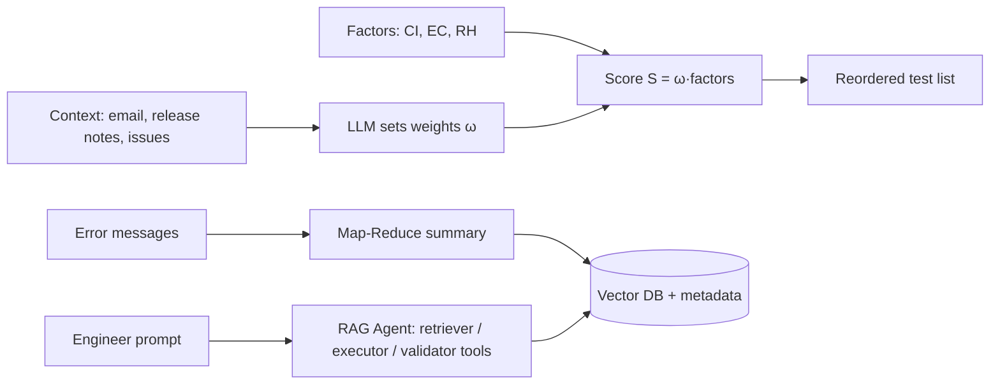

<!-- generated by yt-paper; edits will be overwritten -->
[DVCon](../dvcon/index.md) › [US](../dvcon/us.md) › [2025](../dvcon/by-year.md#2025) › [Verification](../dvcon/by-topic.md#verification)

# A Large Language Model-Based Framework for Enhancing Integrated Regression

<figure class="rep-fig" markdown>
{ loading=lazy }
<figcaption>Figure 1. Architecture overview — from the original paper (Jin Choi et al.)</figcaption>
</figure>

[:material-open-in-new: Original paper](https://dvcon-proceedings.org/wp-content/uploads/1045.pdf){ .md-button .md-button--primary target=_blank }

| | |
|---|---|
| Authors | Jin Choi (Samsung), Sangwoo Noh (Samsung), Seonghee Yim (Samsung), Seonil Brian Choi (Samsung) |
| Venue | DVCon US 2025 |
| Topic | Verification |
| Type | PAPER |
| ID | `ref-20261018-8b34` |

## Summary

**An LLM-based framework that dynamically reweights test-case prioritization factors per verification context, summarizes regression logs with Map-Reduce into a vector database, and exposes RAG-enhanced tool-bound agents to improve data availability during integrated regression.**

**테스트 케이스 우선순위 요소를 검증 컨텍스트에 따라 LLM으로 동적 재가중하고, 로그를 Map-Reduce 방식으로 요약해 벡터 DB에 저장하며, RAG 기반 도구 연동 에이전트로 통합 회귀(integrated regression) 중 데이터 접근성을 높이는 LLM 기반 프레임워크입니다.**

## Key Insights

- Test prioritization score combines Change Impact (ΔRTL × updated issues), Execution Cost (1/expected runtime), and Regression History (N_fail/N_total × t_failed × latest-status discount); LLM sets the weights ω from context (email, release notes, issue reports). Early stage: ω_CI=0.7, ω_EC=0.2, ω_RH=0.1; late stage: 0.1/0.3/0.6.

- 테스트 우선순위 점수는 Change Impact(ΔRTL × 업데이트된 이슈 수), Execution Cost(1/예상 실행 시간), Regression History(N_fail/N_total × t_failed × 최신 상태 할인율)를 결합하며, LLM이 이메일, 릴리스 노트, 이슈 리포트 등 컨텍스트로부터 가중치 ω를 설정합니다. 초기 단계에서는 ω_CI=0.7, ω_EC=0.2, ω_RH=0.1, 후기 단계에서는 0.1/0.3/0.6입니다.

- In the early-stage scenario, RTL-change test cases finished in 96.7 hours, a 79.1% reduction versus no prioritization. In the late-stage scenario, remaining failed tests finished about 12.3 hours faster.

- 초기 단계 시나리오에서 RTL 변경 관련 테스트 케이스는 96.7시간에 완료되어 우선순위를 적용하지 않은 경우 대비 79.1% 단축되었습니다. 후기 단계 시나리오에서는 남은 실패 테스트 케이스가 약 12.3시간 더 빨리 완료되었습니다.

- Log summarization uses Map-Reduce (chosen over Refined) with a 15-iteration cap on the collapse loop; average log of 184.04 MB reduced to 232-byte summaries (~99.87% size reduction), LLM summarization took 5.15 s, and vector DB search over 109 documents took about 0.015 s.

- 로그 요약은 Refined 방식 대신 Map-Reduce를 채택했으며, collapse 루프에 15회 반복 상한을 두었습니다. 평균 184.04 MB 로그를 232바이트 요약으로 줄여 약 99.87%의 데이터 크기 감소를 보였고, LLM 요약에는 5.15초, 109개 문서 대상 벡터 DB 검색에는 약 0.015초가 소요되었습니다.

- Mistral-7B was used without fine-tuning, served with vLLM. The RAG agent answered a spec query (clock) in about 0.03 s using top-5 retrieved documents; the paper reports only these two scenarios and no broader quantitative benchmark.

- 파인튜닝 없이 vLLM으로 서빙한 Mistral-7B를 사용했습니다. RAG 에이전트는 top-5 검색 문서를 활용해 스펙 질의(clock)에 평균 0.03초 만에 응답했습니다. 논문은 두 가지 시나리오만 보고하며 더 광범위한 정량 벤치마크는 제시하지 않습니다.

- Limitations noted by the authors: FAISS lacks native metadata filtering, a single agent degraded reliability (multi-agent proposed), and the LLM-determined weights leave no direct hook for engineer preference overrides.

- 저자들이 언급한 한계: FAISS는 메타데이터 필터링을 기본 지원하지 않으며, 단일 에이전트는 신뢰성을 떨어뜨려 다중 에이전트가 제안되었고, LLM이 정한 가중치는 엔지니어 선호를 직접 반영할 경로가 없습니다.

## Detailed Summary

### Background and Problem

- Integrated regression runs tens of thousands of test cases under limited resources. Priorities shift across verification stages: early on, RTL changes dominate; later, persistently failing tests matter more. Manual or heuristic prioritization is slow and suboptimal.

- 통합 회귀(integrated regression)는 제한된 자원으로 수만 개의 테스트 케이스를 실행합니다. 검증 단계에 따라 우선순위가 바뀝니다. 초기에는 RTL 변경이 중요하고, 후기에는 지속적으로 실패하는 테스트가 중요합니다. 수동 또는 휴리스틱 기반 우선순위 결정은 느리고 최적이 아닙니다.

- Logs can reach hundreds of MB per run, and duplicated errors across test cases make root-cause analysis slow.

- 로그는 실행 한 번당 수백 MB에 이를 수 있으며, 테스트 케이스 간 중복 에러 때문에 근본 원인 분석이 느려집니다.

- Data (specs, results, issues) is scattered across systems, which lengthens verification turnaround.

- 데이터(스펙, 결과, 이슈)가 여러 시스템에 흩어져 있어 검증 turnaround time이 길어집니다.

- The paper targets three challenges: test case prioritization, log volume overload, and data availability.

- 본 논문은 테스트 케이스 우선순위, 로그 볼륨 과부하, 데이터 접근성의 세 가지 과제를 다룹니다.

### Architecture and Methodology

- **Test prioritization.** Three pre-computed factors:
  - Change Impact: $CI = \Delta RTL \times$ updated issues count (Eq. 1).
  - Execution Cost: $EC = 1/t(\text{expected run time})$ from historical data (Eq. 2).
  - Regression History: $RH = \frac{N_{fail}}{N_{total}} \times t_{failed} \times \text{discount}$, where the discount is 0.5 if the latest status is passed and 1 if failed (Eq. 3).
  - The LLM is given the factor definitions in the system prompt and the context in the human prompt. It outputs structured weights, and the final score is $S = \omega_{CI}CI + \omega_{EC}EC + \omega_{RH}RH$ (Eq. 4). Test cases are sorted by S.

- **테스트 우선순위.** 사전 계산된 세 가지 요소를 사용합니다.
  - Change Impact: $CI = \Delta RTL \times$ 업데이트된 이슈 수 (식 1).
  - Execution Cost: 이력 데이터 기반 $EC = 1/t(\text{예상 실행 시간})$ (식 2).
  - Regression History: $RH = \frac{N_{fail}}{N_{total}} \times t_{failed} \times \text{discount}$이며, 최신 상태가 passed이면 discount는 0.5, failed이면 1입니다 (식 3).
  - LLM은 시스템 프롬프트로 요소 정의를, 휴먼 프롬프트로 컨텍스트를 받습니다. 구조화된 가중치를 출력하며, 최종 점수는 $S = \omega_{CI}CI + \omega_{EC}EC + \omega_{RH}RH$ (식 4)이고 S 기준으로 정렬합니다.

- **Log summarization.** The paper chooses Map-Reduce over Refined. Map summarizes chunks in parallel, and Reduce collapses summaries until they fit the token limit. Chunk and overlap sizes are tuned to offset Map-Reduce's lower consistency. Logs are not preprocessed, so file paths and error context are retained. The collapse loop is capped at 15 iterations. Summaries and metadata go into a FAISS vector database.

- **로그 요약.** 논문은 Refined 대신 Map-Reduce를 선택했습니다. Map은 청크를 병렬로 요약하고, Reduce는 토큰 한도에 맞을 때까지 요약을 축약합니다. Map-Reduce의 낮은 일관성은 청크 및 overlap 크기 조정으로 보완합니다. 로그는 전처리하지 않아 파일 경로와 에러 문맥을 보존합니다. collapse 루프는 15회로 제한합니다. 요약과 메타데이터는 FAISS 벡터 DB에 저장합니다.

- **RAG-enhanced Agent.** An agent bound to tools reasons over requests. Tool types are retrievers (spec search, top-5 documents), executors (e.g., Query Executor, API Executor for re-running tests), and validators (Query Validator). Tool descriptions and explicit human prompts are stressed as critical for correct tool selection.

- **RAG 강화 에이전트.** 도구에 연결된 에이전트가 요청을 추론합니다. 도구 유형은 retriever(스펙 검색, top-5 문서), executor(Query Executor, 테스트 재실행용 API Executor), validator(Query Validator)입니다. 올바른 도구 선택을 위해 도구 설명과 명시적 휴먼 프롬프트가 중요하다고 강조합니다.

- **Setup.** Mistral-7B without fine-tuning, served with vLLM.

- **환경.** 파인튜닝 없이 vLLM으로 서빙한 Mistral-7B를 사용합니다.

### Results and Conclusions

- **Early stage (RTL changes).** The LLM set ω_CI=0.7, ω_EC=0.2, ω_RH=0.1. Test cases for RTL-changed blocks ran first. Time for these cases was 96.7 hours, a 79.1% reduction versus no prioritization.

- **초기 단계(RTL 변경).** LLM은 ω_CI=0.7, ω_EC=0.2, ω_RH=0.1로 설정했습니다. RTL이 변경된 블록의 테스트가 먼저 실행되었으며, 해당 케이스 완료 시간은 96.7시간으로 우선순위를 적용하지 않은 경우 대비 79.1% 감소했습니다.

- **Late stage (high pass rate).** The LLM set ω_CI=0.1, ω_EC=0.3, ω_RH=0.6. Shorter, historically failing tests ran first. Completion of the remaining failures was about 12.3 hours faster. Overall execution time did not drop much, because longer tests were deferred to the end.

- **후기 단계(높은 pass rate).** LLM은 ω_CI=0.1, ω_EC=0.3, ω_RH=0.6으로 설정했습니다. 짧고 과거에 실패한 테스트가 먼저 실행되었으며, 남은 실패 테스트 완료는 약 12.3시간 빨라졌습니다. 긴 테스트를 뒤로 미뤘기 때문에 전체 실행 시간은 크게 줄지 않았습니다.

- **Log summarization.** Average log size was 184.04 MB. Summaries averaged 232 bytes (about 99.87% reduction). Error size was about 0.29 KB. LLM summarization took 5.15 s, DB storage 0.009 s, and search over 109 documents about 0.015 s. Context-style queries worked better than bare keywords.

- **로그 요약.** 평균 로그 크기는 184.04 MB였고 요약은 평균 232바이트(약 99.87% 감소)였습니다. 에러 크기는 약 0.29 KB입니다. LLM 요약에 5.15초, DB 저장에 0.009초, 109개 문서 검색에 약 0.015초가 걸렸습니다. 단순 키워드보다 문맥 기반 질의가 더 효과적이었습니다.

- **RAG agent.** The clock spec query returned top-5 documents with LLM explanations in about 0.03 s. The failed-test re-run workflow used Query Executor, Query Validator, and API Executor. The paper gives no timing numbers for this workflow.

- **RAG 에이전트.** clock 스펙 질의는 top-5 문서와 LLM 설명을 약 0.03초 만에 반환했습니다. 실패 테스트 재실행 워크플로는 Query Executor, Query Validator, API Executor를 사용합니다. 이 워크플로의 소요 시간 수치는 제시되지 않았습니다.

- **Limitations and future work.** The paper evaluates only two prioritization scenarios and does not benchmark against other methods. FAISS lacks native metadata filtering, which forces over-fetching. A single agent reduced reliability, so multi-agent designs are proposed. Engineer preferences are not directly injectable into the score. Block- or IP-level hierarchical prioritization is left as future work. A verification-specific fine-tuned model is suggested.

- **한계 및 향후 과제.** 논문은 두 가지 우선순위 시나리오만 평가하며 다른 방법과의 벤치마크는 없습니다. FAISS는 메타데이터 필터링을 기본 지원하지 않아 과다 검색이 필요합니다. 단일 에이전트는 신뢰성을 떨어뜨려 다중 에이전트 설계를 제안합니다. 엔지니어 선호를 점수에 직접 주입하는 경로는 없습니다. 블록/IP 단위 계층적 우선순위와 검증 특화 파인튜닝 모델은 향후 과제로 남겼습니다.

- **Conclusion.** The framework shows that LLM-driven weighting, log compression, and RAG tooling can cut turnaround time for integrated regression. The quantitative evidence is limited to the reported scenarios.

- **결론.** LLM 기반 가중치 조정, 로그 압축, RAG 도구 연동이 통합 회귀의 turnaround time을 줄일 수 있음을 보였습니다. 정량적 근거는 보고된 시나리오에 한정됩니다.

## Videos

<iframe src="https://www.youtube-nocookie.com/embed/Y6quamriBzo" title="[DVCON2025]A Large Language Model-Based Frameworkfor Enhancing Integrated Regression" loading="lazy" allow="accelerometer; clipboard-write; encrypted-media; gyroscope; picture-in-picture; web-share" referrerpolicy="strict-origin-when-cross-origin" allowfullscreen></iframe>

**[DVCON2025]A Large Language Model-Based Frameworkfor Enhancing Integrated Regression** — [Watch on YouTube](https://www.youtube.com/watch?v=Y6quamriBzo) · [Video page](../videos/Y6quamriBzo.md)
