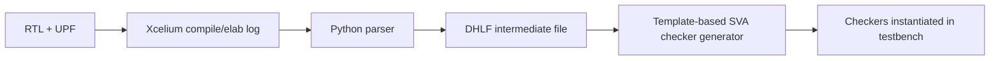

<!-- generated by yt-paper; edits will be overwritten -->
[DVCon](../dvcon/index.md) › [US](../dvcon/us.md) › [2023](../dvcon/by-year.md#2023) › [Verification](../dvcon/by-topic.md#verification)

# Automation for Early Detection of X-propagation in Power-Aware Simulation Verification using UPF IEEE 1801

<figure class="rep-fig" markdown>
{ loading=lazy }
<figcaption>Figure 11: Insertion of generated checkers and assertions — from the original paper (Tony Gladvin George et al.)</figcaption>
</figure>

[:material-open-in-new: Original paper](https://dvcon-proceedings.org/wp-content/uploads/1060-Automation-for-Early-Detection-of-X-propagation-in-Power-Aware-simulation-verification-Using-UPF-IEEE-1801.pdf){ .md-button .md-button--primary target=_blank } [:material-presentation-play: Official talk](https://youtu.be/dHFgAAT77bE){ .md-button target=_blank }

| | |
|---|---|
| Authors | Tony Gladvin George (Samsung Electronics), Ramesh Kumar (Samsung Electronics), Kyuho Shim (Samsung Electronics), Karan K (Samsung Electronics), Wooseong Cheong (Samsung Electronics), ByungChul Yoo (Samsung Electronics) |
| Venue | DVCon US 2023 |
| Topic | Verification |
| Type | PAPER |
| ID | `ref-20261018-8b44` |

## Summary

**The paper proposes a Python-based flow that parses UPF and Xcelium elaboration logs to auto-generate SystemVerilog checkers and assertions for isolation, retention, and power-sequencing, so X-propagation fails fast and root-cause analysis is shortened.**

**UPF와 Xcelium elaboration log를 Python으로 파싱해 isolation, retention, power sequencing용 SystemVerilog checker와 assertion을 자동 생성하여, X가 전파되면 scoreboard 불일치를 기다리지 않고 즉시 실패하도록 하고 RCA 시간을 줄이는 방법을 제안한다.**

## Key Insights

- Generating checkers from UPF objects plus RTL hierarchy from the elaboration log lets assertions fail at the moment an unexpected X reaches a clamped or retained signal, instead of waiting for scoreboard mismatches.

- UPF 객체와 elaboration log에서 얻은 RTL 계층 정보로 checker를 생성하면, 예상치 못한 X가 clamp되거나 retention되어야 할 신호에 도달하는 순간 assertion이 실패하여 scoreboard 불일치를 기다릴 필요가 없다.

- The elaboration log, not the UPF alone, is required to resolve RTL hierarchy paths, because UPF wildcards such as -applies_to_inputs do not list individual ports.

- -applies_to_inputs 같은 UPF 와일드카드는 개별 포트를 나열하지 않으므로, UPF만으로는 RTL 계층 경로를 확정할 수 없고 elaboration log가 필요하다.

- In the reported Samsung Memory Division project (11 bugs, 40-day tape-out window), bug discovery stabilized about nine days before synthesis, described as roughly 20% left-shift.

- 11개 버그를 대상으로 한 Samsung Memory Division 프로젝트(tape-out까지 40일)에서 버그 발견이 synthesis 9일 전에 안정화되었으며, 이를 약 20% left-shift로 보고했다.

- Reported effort tradeoff: about 10% additional upfront effort for scripts and checkers, and about 25% triage time saved; the checkers are designed for reuse across projects.

- 보고된 노력 대비 효과: 스크립트와 checker 준비에 초기 약 10% 추가 노력이 들지만 triage 단계에서 약 25% 시간이 절약되며, checker는 프로젝트 간 재사용을 목표로 설계되었다.

- The evidence is a single industrial case study with no published per-bug timing data, so the quantitative gains should be treated as indicative rather than rigorous.

- 근거는 단일 산업 사례 연구이며 버그별 시간 데이터가 공개되지 않았으므로, 정량적 이득은 엄밀한 수치가 아닌 참고 수준으로 보아야 한다.

## Detailed Summary

### Background and Problem

- X-propagation in UPF simulation is traced via scoreboards and waveforms, so origin-finding and bug-fix turnaround are slow; the paper cites a typical cycle of about 1 day for Lint/Elab, 2 days sanity, 5 days regression, and 5 days triage.

- UPF 시뮬레이션에서 X 전파는 scoreboard와 waveform으로 추적되어 원인 파악과 버그 수정 turnaround가 느리다. 논문은 Lint/Elab 약 1일, sanity 2일, regression 5일, triage 5일의 전형적 주기를 제시한다.

- Vendor static low-power checks (e.g., missing isolation cell) do not verify control-signal sequencing of isolation and retention cells (ISO enable → retention enable → power off → power on → retention disable → ISO disable).

- 벤더의 정적 low-power 검사(예: isolation cell 누락)는 isolation 및 retention 셀의 제어 신호 시퀀싱(ISO enable → retention enable → power off → power on → retention disable → ISO disable)을 검증하지 못한다.

### Architecture and Methodology

- The parser extracts `set_isolation`, `set_retention`, and supply objects, and maps them to RTL hierarchy from the elaboration log.

- 파서는 `set_isolation`, `set_retention`, supply 객체를 추출하고 elaboration log의 RTL 계층과 매핑한다.

- Templates emit power-state, isolation clamp (`iso_check_*N`), and retention save/restore (`ret_check_*N`) properties, each paired with a cover property.

- 템플릿은 power-state, isolation clamp(`iso_check_*N`), retention save/restore(`ret_check_*N`) property를 생성하며, 각각 cover property와 쌍을 이룬다.

### Results and Conclusions

- Single industrial case study (Samsung Memory Division, 11 bugs): bug discovery moved earlier, stabilizing about nine days before synthesis (described as ~20% left-shift).

- 단일 산업 사례 연구(Samsung Memory Division, 버그 11개): 버그 발견 시점이 앞당겨져 synthesis 9일 전에 안정화되었으며, 약 20% left-shift로 보고되었다.

- Reported effort: about 10% extra upfront for scripts and checkers, about 25% triage time saved; per-bug timing was not tracked, so gains are indicative only.

- 보고된 노력: 스크립트와 checker에 초기 약 10% 추가 노력, triage 약 25% 절감. 버그별 시간은 추적되지 않았으므로 이득은 참고 수준이다.

## Videos

<iframe src="https://www.youtube-nocookie.com/embed/nqmA1fsXAJM" title="[DVCON2023] Automation for Early Detection of X-propagation in Power-Aware Simulation Verification" loading="lazy" allow="accelerometer; clipboard-write; encrypted-media; gyroscope; picture-in-picture; web-share" referrerpolicy="strict-origin-when-cross-origin" allowfullscreen></iframe>

**[DVCON2023] Automation for Early Detection of X-propagation in Power-Aware Simulation Verification** — [Watch on YouTube](https://www.youtube.com/watch?v=nqmA1fsXAJM) · [Video page](../videos/nqmA1fsXAJM.md)

**Official presentation:** [DVCon U.S. 2023](https://youtu.be/dHFgAAT77bE){ target=_blank }
