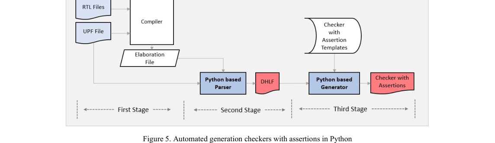
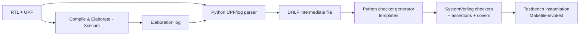

<!-- generated by yt-paper; edits will be overwritten -->
[DVCon](../dvcon/index.md) › [US](../dvcon/us.md) › [2023](../dvcon/by-year.md#2023) › [Verification](../dvcon/by-topic.md#verification)

# Automation for Early Detection of X-propagation in Power-Aware Simulation Verification using UPF IEEE 1801

<figure class="rep-fig" markdown>
{ loading=lazy }
<figcaption>Figure 5. Automated generation checkers with assertions in Python — from the original paper (Tony Gladvin George et al.)</figcaption>
</figure>

[:material-open-in-new: Original paper](https://dvcon-proceedings.org/wp-content/uploads/1060-Automation-for-Early-Detection-of-X-propagation-in-Power-Aware-simulation-verification-Using-UPF-IEEE-1801.pdf){ .md-button .md-button--primary target=_blank }

| | |
|---|---|
| Authors | Tony Gladvin George (Samsung Electronics, Memory Division), Ramesh Kumar (Samsung Electronics, Memory Division), Kyuho Shim (Samsung Electronics, Memory Division), Karan K (Samsung Electronics, Memory Division), Wooseong Cheong (Samsung Electronics, Memory Division), ByungChul Yoo (Samsung Electronics, Memory Division) |
| Venue | DVCon US 2023 |
| Topic | Verification |
| Type | PAPER |
| ID | `ref-20261018-8b44` |

## Summary

**The paper proposes a Python-based flow that parses UPF 1801 intent plus the Xcelium elaboration log to auto-generate SystemVerilog checkers and assertions for power sequencing, isolation clamping, and retention, so X-propagation is caught at the failing assertion instead of at a downstream scoreboard.**

**이 논문은 UPF 1801 전력 의도와 Xcelium elaboration 로그를 Python으로 파싱해 전력 시퀀싱, isolation 클램프 값, retention 검사를 위한 SystemVerilog checker와 assertion을 자동 생성함으로써, X 전파를 하류 scoreboard가 아니라 실패한 assertion 지점에서 바로 검출하는 방법을 제안한다.**

## Key Insights

- Traditional X-propagation debugging relies on scoreboard failures and waveform tracing, which delays detection until the X reaches a data-integrity check; auto-generated assertions fail at the point where an unexpected X or a power-sequence violation occurs, shortening RCA.

- 기존 X 전파 디버그는 scoreboard 실패와 파형 추적에 의존하므로, X가 데이터 무결성 검사에 도달할 때까지 검출이 지연된다. 자동 생성된 assertion은 예기치 않은 X나 전력 시퀀스 위반이 발생한 지점에서 바로 실패하여 RCA 시간을 줄인다.

- The UPF file alone is insufficient for generating checkers because it does not give RTL hierarchy paths; the flow therefore takes hierarchical signal names from the Xcelium elaboration log and stores them in an intermediate Design-Hierarchy List File (DHLF).

- UPF 파일만으로는 RTL 계층 경로를 얻을 수 없으므로, 이 흐름은 Xcelium elaboration 로그에서 계층 신호 이름을 가져와 중간 파일인 Design-Hierarchy List File(DHLF)에 저장한다.

- Generated checkers cover three areas: power-state entry with ISO_EN checks (power_gating property), isolation clamp-value checks (iso_check_*N), and retention save/restore checks (ret_check_*N), each paired with cover properties for checker coverage closure.

- 생성되는 checker는 세 영역을 다룬다. 전력 상태 진입 및 ISO_EN 검사(power_gating property), isolation 클램프 값 검사(iso_check_*N), retention save/restore 검사(ret_check_*N)이며, 각 검사에는 checker 커버리지를 위한 cover property가 함께 붙는다.

- In the case study, the team found 11 bugs; the bug trend stabilized nine days before synthesis (about 20% left shift), and the paper reports roughly 10% extra up-front effort and 25% triage time savings. These are a single-project, proof-of-concept estimate, not a controlled benchmark.

- 사례 연구에서 11개의 버그를 발견했으며, 버그 추세는 synthesis 9일 전에 안정화되어 약 20%의 left shift가 나타났다. 또한 초기 추가 노력은 약 10%, triage 시간은 약 25% 절감된 것으로 보고된다. 이는 단일 프로젝트 기반의 proof-of-concept 추정치이며 통제된 벤치마크 결과가 아니다.

- Because checkers are generated from templates and are tied to UPF objects, they are claimed to scale with the number of power domains and to be reusable across projects, with the flow kept independent of the simulator, though the implementation is Cadence Xcelium-specific.

- checker는 템플릿에서 생성되고 UPF 객체와 연결되므로 전력 도메인 수와 무관하게 확장 가능하고 프로젝트 간 재사용이 가능하다고 주장한다. 흐름 자체는 시뮬레이터에 독립적이라고 설명하지만 구현은 Cadence Xcelium 기반이다.

## Detailed Summary

### Background and Problem

- In SoC power-aware simulation, power domains are shut down and isolation/retention cells are controlled by UPF (IEEE 1801) power intent. When a domain is off, its outputs are not necessarily driven to binary values, so X values can spread to thousands of signals within a few clock cycles.

- SoC 전력 인지 시뮬레이션에서 전력 도메인은 꺼지고, isolation 및 retention 셀은 UPF(IEEE 1801) 전력 의도에 따라 제어된다. 도메인이 꺼지면 출력이 반드시 이진 값으로 구동되지는 않으므로, X 값이 몇 클럭 사이에 수천 개의 신호로 퍼질 수 있다.

- The traditional flow detects this only when a data-integrity scoreboard fails. Root-cause analysis then requires waveform tracing. The paper reports a typical per-regression cost of about 1 day for Lint/Compile/Elaboration with UPF, 2 days of sanity simulation, 5 days of regression, about 5 days of triage, and 2 days of UPF/design fixes. Exact per-bug timelines were not tracked, so the triage figure is an estimate.

- 기존 흐름은 데이터 무결성 scoreboard가 실패할 때에만 이를 검출하며, 이후 파형 추적으로 근본 원인을 분석해야 한다. 논문은 회귀 1회당 대략 UPF 포함 Lint/Compile/Elaboration 1일, sanity 시뮬레이션 2일, regression 5일, triage 약 5일, UPF/설계 수정 2일이 소요된다고 보고한다. 버그별 실제 소요 시간은 추적하지 않았으므로 triage 수치는 추정치이다.

- Tool-generated low-power checks are limited. A static checker may flag a missing isolation cell, but it does not verify the operation of isolation and retention control signals or the power sequence (ISO enable → retention enable → power off → power on → retention disable → ISO disable). The paper groups X-propagation root causes into four categories: missing isolation cell, missing control signal, missing data-signal connection, and wrong power-sequence control.

- 기존 자동 저전력 검사는 한계가 있다. 정적 checker는 isolation 셀 누락 정도는 찾을 수 있지만, isolation 및 retention 제어 신호의 동작이나 전력 시퀀스(ISO enable → retention enable → power off → power on → retention disable → ISO disable)는 검증하지 못한다. 논문은 X 전파의 근본 원인을 네 가지로 분류한다. isolation 셀 누락, 제어 신호 누락, 데이터 신호 연결 누락, 잘못된 전력 시퀀스 제어이다.

### Architecture and Methodology

The flow has three stages, with Python used to automate each one:

Python으로 자동화된 세 단계 흐름이다.

- **Stage 1 (preparation):** RTL and UPF are compiled and elaborated. The elaboration log provides the list of UPF objects and the RTL signals connected to them. The paper notes that UPF alone cannot supply hierarchy paths, and that parsing RTL directly is out of scope.

- **1단계(준비):** RTL과 UPF를 컴파일 및 elaboration한다. elaboration 로그는 UPF 객체 목록과 이에 연결된 RTL 신호를 제공한다. 논문은 UPF만으로는 계층 경로를 얻을 수 없다고 설명하며, RTL을 직접 파싱하는 방식은 범위 밖이라고 밝힌다.

- **Stage 2 (parser):** A Python parser, invoked from the Makefile after elaboration succeeds, resolves UPF constructs (`set_isolation`, `set_isolation_control`, `set_retention`, `set_retention_control`, `map_retention_cell`, `create_supply_net`, `create_supply_set`, `create_supply_port`). It expands object-level rules such as `-applies_to inputs` into concrete signal lists, and it writes the DHLF file that holds power-domain supply states, isolation, retention, and RTL hierarchy information.

- **2단계(파서):** elaboration 성공 후 Makefile에서 호출되는 Python 파서가 UPF 구문(`set_isolation`, `set_isolation_control`, `set_retention`, `set_retention_control`, `map_retention_cell`, `create_supply_net`, `create_supply_set`, `create_supply_port`)을 해석한다. `-applies_to inputs`와 같은 객체 단위 규칙을 구체적인 신호 목록으로 확장하고, 전력 도메인의 공급 상태, isolation, retention, RTL 계층 정보를 담은 DHLF 파일을 생성한다.

- **Stage 3 (generator):** Templates are filled from the DHLF. The generated checkers contain:
  - *Power-state check:* `property power_gating` asserts that `(Power_state = POWER_DOWN) |=> (ISO_EN == 1)`, with a matching cover property to confirm every domain enters low-power.
  - *Isolation clamp check:* `seq_iso_check_*N` and `property iso_check_*N` check that, after ISO_EN rises, each isolated RTL signal equals the UPF `-clamp_value`.
  - *Retention checks:* `seq_ret_check_*N` and `property ret_check_*N` check that save and restore strobes toggle in the correct power states and that the retained value after restore equals the value captured before power-down.

- **3단계(생성기):** DHLF를 이용해 템플릿을 채운다. 생성되는 checker는 다음을 포함한다.
  - *전력 상태 검사:* `property power_gating`은 `(Power_state = POWER_DOWN) |=> (ISO_EN == 1)`을 단언하며, 모든 도메인이 저전력 상태에 진입했는지 확인하는 cover property가 함께 있다.
  - *Isolation 클램프 검사:* `seq_iso_check_*N`과 `property iso_check_*N`은 ISO_EN이 상승한 후 각 격리된 RTL 신호가 UPF `-clamp_value`와 같은지 확인한다.
  - *Retention 검사:* `seq_ret_check_*N`과 `property ret_check_*N`은 save/restore 스트로브가 올바른 전력 상태에서 토글되는지, 그리고 restore 후 값이 power-down 전 값과 같은지 확인한다.

- The generated checkers are instantiated in the testbench in a hierarchy parallel to the SoC design, and each one is grouped into power, isolation, or retention modules. Cover bins report checker coverage. Once coverage reaches its target, power-control sequencing is considered verified.

- 생성된 checker는 SoC 설계와 병렬인 계층으로 testbench에 인스턴스화되며, 전력, isolation, retention 모듈로 묶인다. Cover bin이 checker 커버리지를 보고한다. 커버리지가 목표에 도달하면 전력 제어 시퀀싱이 검증된 것으로 본다.

- Assertions fire immediately on an unexpected X or a sequence violation, so the RCA engineer is directed to the source rather than to the downstream scoreboard.

- 예기치 않은 X나 시퀀스 위반이 발생하면 assertion이 즉시 실패하므로, RCA 엔지니어는 하류 scoreboard가 아니라 원인 지점으로 바로 안내된다.

### Results and Conclusions

- The case study is a Samsung memory-division chip. The team took a project that had an approximately 40-day span from sanity-clean RTL to the start of synthesis, and it compared the bug-discovery curve with and without the automation.

- 사례 연구는 Samsung 메모리 사업부의 칩이다. sanity-clean RTL부터 synthesis 시작까지 약 40일이 걸린 프로젝트를 대상으로, 자동화 유무에 따른 버그 발견 곡선을 비교했다.

- Without automation, most bugs were reported mid-project and the trend stabilized only near tape-out (Figure 12). With automation, most bugs were found early, and the trend stabilized nine days before synthesis, which the paper describes as about 20% left shift (Figure 13). The comparison covers 11 bugs and is a proof-of-concept rather than a statistically controlled evaluation.

- 자동화가 없을 때는 대부분의 버그가 프로젝트 중반에 보고되었고 추세는 tape-out 근처에서야 안정되었다(Figure 12). 자동화가 있을 때는 대부분의 버그가 초기에 발견되었고, 추세는 synthesis 9일 전에 안정되었다. 논문은 이를 약 20%의 left shift라고 설명한다(Figure 13). 비교 대상은 11개 버그이며, 통계적으로 통제된 평가가 아닌 proof-of-concept이다.

- Effort: about 10% extra effort was required up front to prepare scripts and checkers. The paper reports about 25% time saving in triage. Reusability of the generic checkers is expected to reduce deployment effort in later projects.

- 노력: 스크립트와 checker 준비에 초기 약 10%의 추가 노력이 필요했고, triage에서는 약 25%의 시간 절감이 보고되었다. 범용 checker의 재사용성으로 후속 프로젝트의 배포 노력이 줄어들 것으로 기대된다.

- The paper claims scalability across any number of power domains, reduced manual assertion writing, and assertion/cover coverage that supports metric-driven sign-off. It also notes that the flow depends on the Cadence Xcelium elaboration log, and that a RTL-parsing alternative was left as future work.

- 논문은 임의 개수의 전력 도메인에 대한 확장성, 수작업 assertion 작성 감소, 메트릭 기반 sign-off를 지원하는 assertion/cover 커버리지를 주장한다. 또한 흐름이 Cadence Xcelium elaboration 로그에 의존하며, RTL 파싱 대안은 향후 과제로 남겨졌다고 밝힌다.

## Videos

<iframe src="https://www.youtube-nocookie.com/embed/nqmA1fsXAJM" title="[DVCON2023] Automation for Early Detection of X-propagation in Power-Aware Simulation Verification" loading="lazy" allow="accelerometer; clipboard-write; encrypted-media; gyroscope; picture-in-picture; web-share" referrerpolicy="strict-origin-when-cross-origin" allowfullscreen></iframe>

**[DVCON2023] Automation for Early Detection of X-propagation in Power-Aware Simulation Verification** — [Watch on YouTube](https://www.youtube.com/watch?v=nqmA1fsXAJM) · [Video page](../videos/nqmA1fsXAJM.md)
