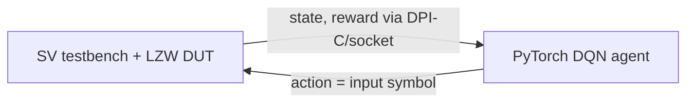

<!-- generated by yt-paper; edits will be overwritten -->
[DVCon](../dvcon/index.md) › [US](../dvcon/us.md) › [2023](../dvcon/by-year.md#2023) › [Verification](../dvcon/by-topic.md#verification)

# Closing Functional Coverage With Deep Reinforcement Learning: A Compression Encoder Example

<figure class="rep-fig" markdown>
{ loading=lazy }
<figcaption>Figure 5: The co-simulation architecture — from the original paper (Eric Ohana et al.)</figcaption>
</figure>

[:material-open-in-new: Original paper](https://dvcon-proceedings.org/wp-content/uploads/1046-Closing-Functional-Coverage-With-Deep-Reinforcement-Learning-A-Compression-Encoder-Example.pdf){ .md-button .md-button--primary target=_blank }

| | |
|---|---|
| Authors | Eric Ohana (Queensland University of Technology, The University of Bielefeld) |
| Venue | DVCon US 2023 |
| Topic | Verification |
| Type | PAPER |
| ID | `ref-20261018-8ec5` |

## Summary

**A DQN agent, co-simulated with a SystemVerilog testbench via DPI-C, generates input symbol stimulus driven by functional-coverage reward and closes all 136 CAM write bins of an LZW encoder, where uniform random reached only 28.**

**DPI-C로 SystemVerilog 테스트벤치와 공동 시뮬레이션되는 DQN 에이전트가 기능 커버리지 보상을 기반으로 입력 심볼 자극을 생성하여, 균일 랜덤이 28개만 채운 LZW 인코더의 CAM 쓰기 빈 136개를 모두 닫았습니다.**

## Key Insights

- Mapping the testbench to RL (agent = intelligent stimulus generator, environment = DUT plus non-stimulus TB, reward = coverage bin hits) gives a concrete framework for closing coverage without hand-written directed tests.

- 테스트벤치를 RL로 매핑하면(에이전트 = 지능형 자극 생성기, 환경 = DUT와 비자극 TB, 보상 = 커버리지 빈 히트) 직접 작성하는 directed test 없이 커버리지를 닫을 수 있는 구체적 틀이 제공됩니다.

- Uniform random stimulus hit only 28 of 136 CAM write bins (CAM occupancy 44 of 152), while the DQN agent hit 133 bins (97.79%) in a 500-episode run.

- 균일 랜덤 자극은 CAM 쓰기 빈 136개 중 28개만 채웠고(CAM 점유율 152개 중 44개), DQN 에이전트는 500 에피소드 실행에서 133개(97.79%)를 채웠습니다.

- The three remaining bins were closed by a second 750-episode run, and merging both runs gave full CAM write coverage; the authors attribute this to a slower epsilon decay.

- 남은 3개 빈은 750 에피소드 재실행으로 닫혔으며, 두 실행을 병합하면 CAM 쓰기 커버리지가 전부 달성됩니다. 저자들은 이를 더 느린 epsilon 감소 덕분으로 봅니다.

- The state is a 69-bit vector of the last 17 input symbols plus a valid bit, fed to a 4-layer FFNN with 16 Q-value outputs, one per 4-bit input symbol.

- 상태는 마지막 17개 입력 심볼과 valid 비트로 구성된 69비트 벡터이며, 이를 4계층 FFNN에 넣어 4비트 입력 심볼마다 하나씩 총 16개의 Q값을 출력합니다.

- Co-simulation uses DPI-C calling embedded Python with a socket link and 8-bit array encoding; the approach is demonstrated on a single LZW encoder, so generalization to industrial designs is unproven.

- 공동 시뮬레이션은 DPI-C로 임베디드 Python을 호출하고 소켓 링크와 8비트 배열 인코딩을 사용합니다. 이 접근은 단일 LZW 인코더에서만 시연되어 산업 설계로의 일반화는 아직 검증되지 않았습니다.

## Detailed Summary

### Background and Problem

- Constrained-random, coverage-driven verification stalls at functional coverage closure, which typically requires manual constraint tuning and directed tests.

- 제약 랜덤, 커버리지 기반 검증은 기능 커버리지 클로저 단계에서 정체되며, 보통 수동 제약 튜닝과 directed test 작성이 필요합니다.

- The paper treats RTL simulation as a sequential decision process and maps it to RL: the agent is an intelligent testbench generating stimulus, the environment is the DUT plus non-stimulus TB, and the reward is coverage bin hits.

- 이 논문은 RTL 시뮬레이션을 순차적 의사결정 과정으로 보고 RL에 매핑합니다. 에이전트는 지능형 자극 생성 테스트벤치이고, 환경은 DUT와 비자극 TB이며, 보상은 커버리지 빈 히트입니다.

- Test vehicle: an LZW encoder (4-bit symbols, 16-entry CAM). CAM write coverage has 136 bins; uniform random stimulus hit only 28 (CAM occupancy 44/152).

- 검증 대상은 LZW 인코더(4비트 심볼, 16-entry CAM)입니다. CAM 쓰기 커버리지는 136개 빈이며, 균일 랜덤 자극은 28개만 채웠습니다(CAM 점유율 152개 중 44개).

### Architecture and Methodology

- DQN agent in PyTorch: 4-layer FFNN, 69-bit state (last 17 input symbols plus valid bit), 16 Q-value outputs, one per input symbol. Policy is ε-greedy with linear decay from 1.0 to 0.0.

- PyTorch 기반 DQN 에이전트: 4계층 FFNN, 69비트 상태(마지막 17개 입력 심볼과 valid 비트), 입력 심볼당 하나씩 총 16개의 Q값 출력. 정책은 ε-greedy이며 1.0에서 0.0까지 선형 감소합니다.

- Q-learning update with α = 0.01 and γ = 0.75. An episode is one input sequence, run until the CAM is full.

- Q-learning 업데이트에 α = 0.01, γ = 0.75를 사용합니다. 에피소드는 CAM이 가득 찰 때까지 실행되는 하나의 입력 시퀀스입니다.

- Reward: CAM write gives the number of symbols written; CAM match gives valid symbols + 1.

- 보상: CAM 쓰기는 기록된 심볼 수, CAM 매치는 유효 심볼 수 + 1입니다.

- Co-simulation: the SystemVerilog TB calls embedded Python via DPI-C, exchanging 8-bit arrays over a socket.

- 공동 시뮬레이션: SystemVerilog TB가 DPI-C로 임베디드 Python을 호출하며, 소켓을 통해 8비트 배열을 교환합니다.

### Results and Conclusions

- The 500-episode run hit 133 of 136 CAM write bins (97.79%), versus a maximum of 28 for uniform random.

- 500 에피소드 실행은 CAM 쓰기 빈 136개 중 133개(97.79%)를 채웠으며, 균일 랜덤의 최대 28개와 비교됩니다.

- A 750-episode rerun hit 127 bins, including the three missing ones. Merging both runs gives full CAM write coverage.

- 750 에피소드 재실행은 127개 빈을 채웠고 누락된 3개도 포함됩니다. 두 실행을 병합하면 CAM 쓰기 커버리지가 전부 달성됩니다.

- The authors suggest RTL designs that resist standard closure and need heavy manual constraint work as candidates. Evidence is a single design; the code is available on request.

- 저자들은 표준 클로저에 저항하고 수동 제약 작업이 많이 필요한 RTL 설계를 후보로 제시합니다. 근거는 단일 설계이며, 코드는 요청 시 제공됩니다.

## Videos

<iframe src="https://www.youtube-nocookie.com/embed/s-CB6ioRcRo" title="[DVCON2023]Closing Functional Coverage  With Deep Reinforcement Learning: A Compression Encoder" loading="lazy" allow="accelerometer; clipboard-write; encrypted-media; gyroscope; picture-in-picture; web-share" referrerpolicy="strict-origin-when-cross-origin" allowfullscreen></iframe>

**[DVCON2023]Closing Functional Coverage  With Deep Reinforcement Learning: A Compression Encoder** — [Watch on YouTube](https://www.youtube.com/watch?v=s-CB6ioRcRo) · [Video page](../videos/s-CB6ioRcRo.md)
