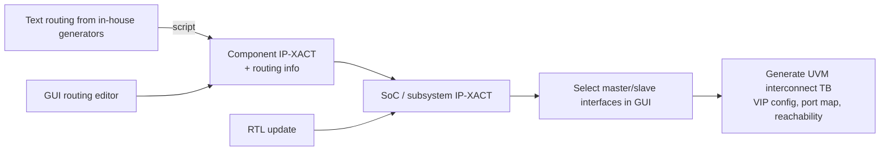

<!-- generated by yt-paper; edits will be overwritten -->
[DVCon](../dvcon/index.md) › [US](../dvcon/us.md) › [2018](../dvcon/by-year.md#2018) › [Verification](../dvcon/by-topic.md#verification)

# IP-XACT based SoC Interconnect Verification Automation

<figure class="rep-fig" markdown>
{ loading=lazy }
<figcaption>Figure 10. Working flow and GUI of IP-XACT based interconnect verification environment generation — from the original paper (YoungRae Cho et al.)</figcaption>
</figure>

[:material-open-in-new: Original paper](https://dvcon-proceedings.org/wp-content/uploads/ip-xact-based-soc-interconnect-verification-automation.pdf){ .md-button .md-button--primary target=_blank }

| | |
|---|---|
| Authors | YoungRae Cho (Samsung Electronics Co., Ltd., Seoul, Korea), YoungSik Kim (Samsung Electronics Co., Ltd., Seoul, Korea), Seonil Brian Choi (Samsung Electronics Co., Ltd., Seoul, Korea) |
| Venue | DVCon US 2018 |
| Topic | Verification |
| Type | PAPER |
| ID | `ref-20261018-8f13` |

## Summary

**Samsung describes generating the UVM-based SoC backbone interconnect verification environment (VIP instantiation, port mapping, and reachability/memory-map configuration) directly from IP-XACT metadata, with a routing-information packaging flow for interconnect components, cutting setup time from over two weeks to one day.**

**삼성전자는 SoC 백본 인터커넥트 검증 환경(VIP 인스턴스화, 포트 매핑, reachability 및 메모리 맵 설정)을 IP-XACT 메타데이터로부터 직접 생성하고, 인터커넥트 컴포넌트의 라우팅 정보를 IP-XACT에 패키징하는 흐름을 제시하여 초기 환경 구축 시간을 2주 이상에서 1일로 줄였다고 보고한다.**

## Key Insights

- Manual per-VIP configuration and DUT port mapping scale with the number of masters times slaves; the paper reports tens of thousands of lines of port-connection code, and the recent environment connects more than 50 master and 400 slave interfaces to VIPs.

- VIP별 수동 설정과 DUT 포트 매핑은 마스터 수 × 슬레이브 수에 비례해 늘어나며, 논문은 포트 연결 코드가 수만 줄에 달한다고 보고한다. 최근 환경은 50개 이상의 마스터와 400개 이상의 슬레이브 인터페이스를 VIP에 연결한다.

- IP-XACT routing information (input bus interface, memory map, subspace map, reference to output interface, base address, address space) is complex to author by hand, so scripts converted text-based generator output into IP-XACT, covering 120 of 130 interconnect components in the last SoC project; a GUI editor covered the remainder.

- IP-XACT 라우팅 정보(입력 bus interface, memory map, subspace map, 출력 인터페이스 참조, base address, address space)는 수작업 작성이 복잡해, 스크립트로 텍스트 기반 생성기 출력을 IP-XACT로 변환했다. 마지막 SoC 프로젝트에서 130개 인터커넥트 컴포넌트 중 120개가 자동 추가되었고, 나머지는 GUI 편집기로 처리했다.

- Routing patterns differ by bridge type: AMBA bridges split the input address range evenly across outputs (e.g., a 1-by-4 AXI2APB bridge over 0x0-0xffff gives 0x4000 per output), while one-to-one protocol bridges map the full input range directly to one output.

- 라우팅 패턴은 브리지 유형에 따라 다르다. AMBA 브리지는 입력 주소 범위를 출력들에 균등 분할한다(예: 0x0-0xffff 입력의 1-by-4 AXI2APB 브리지는 출력당 0x4000). 1:1 프로토콜 브리지는 입력 전체 범위를 하나의 출력에 직접 매핑한다.

- Generating the environment from the integrated SoC IP-XACT (hierarchy, protocol, master/slave mode, port mapping, width, and master-to-slave routing) reduced initial environment creation from over two weeks to one day, and allows re-generation on each RTL update (1-2 times per week), with more than 5 different TBs for SoC and subsystems.

- SoC 및 서브시스템의 통합 IP-XACT(계층, 프로토콜, master/slave 모드, 포트 매핑, 폭, master-to-slave 라우팅)로부터 환경을 생성하여 초기 환경 구축을 2주 이상에서 1일로 단축했고, RTL 변경(주 1~2회)마다 재생성이 가능하며 SoC와 서브시스템용 5개 이상의 TB를 생성했다고 보고한다.

- Any hierarchical interface, not only leaf IP end points, can be selected as a VIP attachment point; the paper attributes fewer false-negative reports and earlier bug discovery to this flow, but these are qualitative results without a detailed baseline comparison.

- VIP 연결 지점은 리프 IP 끝단 인터페이스만이 아니라 SoC 계층 내 임의의 인터페이스를 선택할 수 있다. 논문은 false-negative 리포트 감소와 초기 버그 발견 증가를 이 흐름의 효과로 제시하지만, 이는 상세한 기준선 비교가 없는 정성적 결과이다.

## Detailed Summary

### Background and Problem

- Modern SoC backbone interconnects connect a very large number of master IPs (CPU cores, MCUs) and slave IPs (memories, peripherals). Verifying them requires protocol checking, transaction-type conversion, reachability, routing correctness, memory-map and address-space checks, deadlock freedom, and performance (bottleneck) analysis.

- 최신 SoC의 백본 인터커넥트는 CPU 코어, MCU 등 매우 많은 마스터 IP와 메모리, 주변장치 등 슬레이브 IP를 연결한다. 이를 검증하려면 프로토콜 검사, 트랜잭션 타입 변환, reachability, 라우팅 정확성, 메모리 맵 및 주소 공간 검사, deadlock 방지, 성능(병목) 분석이 필요하다.

- The verification setup is a UVM-based environment in which the real master and slave IP interfaces are replaced by VIPs (master VIPs for host CPUs, slave VIPs for memory controllers and peripherals). The paper also uses Interconnect Validator VIP for system-level end-to-end checking.

- 검증 구조는 UVM 기반 환경으로, 실제 마스터/슬레이브 IP 인터페이스를 VIP로 대체한다(호스트 CPU에는 마스터 VIP, 메모리 컨트롤러와 주변장치에는 슬레이브 VIP). 논문은 종단 간 시스템 레벨 검사를 위해 Interconnect Validator VIP도 함께 사용한다.

- The per-VIP configuration (hierarchy, interface type, port names and widths, FIFO depth, outstanding count), the SoC spec (memory map, address space, decoding, reachability), and the DUT port connections were entered manually through a spreadsheet-based flow. Each SoC RTL change (instance name, hierarchy, port name, routing) had to be propagated by hand, which was slow and error-prone and could produce false failures or hide real bugs.

- VIP별 설정(계층, 인터페이스 타입, 포트 이름과 폭, FIFO 깊이, outstanding 수), SoC 스펙(메모리 맵, 주소 공간, 디코딩, reachability), DUT 포트 연결은 스프레드시트 기반 흐름으로 수동 입력했다. SoC RTL 변경(인스턴스 이름, 계층, 포트 이름, 라우팅)마다 이를 손으로 반영해야 했으며, 이는 느리고 오류가 발생하기 쉬워 거짓 실패를 만들거나 실제 버그를 가릴 수 있었다.

### Architecture and Methodology

- **Shift to metadata:** The SoC integration flow already uses IP-XACT for cluster- and chip-level RTL generation. The authors extend IP-XACT to also carry verification-relevant information: component port lists, bit widths, bus interfaces, memory maps, and interconnect routing.

- **메타데이터 기반 전환:** SoC 통합 흐름은 이미 클러스터 및 칩 레벨 RTL 생성에 IP-XACT를 사용한다. 저자들은 IP-XACT를 확장해 검증에 필요한 정보도 담도록 했다. 컴포넌트 포트 목록, 비트 폭, bus interface, memory map, 인터커넥트 라우팅이 여기에 포함된다.

- **Routing-information packaging:** IP-XACT routing for an interconnect links the input bus interface, its memory map, subspace maps, references to output interfaces, base addresses, and address spaces. Three inputs are handled:
  - AMBA generators (AMBA Designer) already emit routing in IP-XACT.
  - In-house bus generators emit routing as text; a script converts it into IP-XACT.
  - For AMBA bridges (e.g., 1-by-16 AXI2APB), the input range is evenly divided over the outputs. For one-to-one protocol bridges (e.g., AXI to APB), the full input range maps to one output.

- **라우팅 정보 패키징:** 인터커넥트의 IP-XACT 라우팅은 입력 bus interface, 해당 memory map, subspace map, 출력 인터페이스 참조, base address, address space를 연결한다. 세 가지 입력 경로를 처리한다.
  - AMBA 생성기(AMBA Designer)는 이미 IP-XACT에 라우팅을 포함해 생성한다.
  - 사내 bus 생성기는 라우팅을 텍스트로 출력하며, 스크립트가 이를 IP-XACT로 변환한다.
  - AMBA 브리지(예: 1-by-16 AXI2APB)는 입력 범위를 출력들에 균등 분할하고, 1:1 프로토콜 브리지(예: AXI에서 APB)는 입력 전체 범위를 하나의 출력에 매핑한다.

- **GUI fallback:** For designers unfamiliar with IP-XACT, a GUI editor lets them click an input slave interface to create a memory map, click an output master to create an address space (e.g., 0x10000), and drag the address space onto the memory map at a base address.

- **GUI 대체 경로:** IP-XACT에 익숙하지 않은 설계자를 위해 GUI 편집기를 제공한다. 입력 슬레이브 인터페이스를 클릭해 memory map을 만들고, 출력 마스터를 클릭해 address space(예: 0x10000)를 만든 뒤, 이를 memory map에 base address와 함께 드래그한다.

- **Environment generation flow:** Subsystem and SoC IP-XACT already contains port mappings, bit widths, and hierarchy. The authors built an automated flow with an EDA partner: load the integrated SoC IP-XACT, select the master and slave interfaces to attach VIPs (GUI), and generate the testbench. Reachability and memory maps from any master to any slave are computed from the metadata, so VIP configuration and port mapping are no longer entered by hand.

- **환경 생성 흐름:** 서브시스템 및 SoC IP-XACT에는 이미 포트 매핑, 비트 폭, 계층 정보가 들어 있다. 저자들은 EDA 파트너와 함께 자동화 흐름을 구축했다. 통합된 SoC IP-XACT를 불러오고, GUI에서 VIP를 붙일 마스터/슬레이브 인터페이스를 선택하면 테스트벤치가 생성된다. 임의의 마스터에서 임의의 슬레이브까지의 reachability와 메모리 맵은 메타데이터로부터 계산되므로 VIP 설정과 포트 매핑을 손으로 입력할 필요가 없다.

### Results and Conclusions

- **Scale:** The recent SoC environment includes more than 50 master and 400 slave interfaces connected to VIPs.

- **규모:** 최근 SoC 환경은 VIP에 연결된 50개 이상의 마스터와 400개 이상의 슬레이브 인터페이스를 포함한다.

- **Routing automation coverage:** In the last SoC project, routing information was added automatically for 120 of 130 interconnect components.

- **라우팅 자동화 범위:** 마지막 SoC 프로젝트에서 인터커넥트 컴포넌트 130개 중 120개의 라우팅 정보가 자동으로 추가되었다.

- **Setup time:** The initial interconnect validation environment took over two weeks manually; with IP-XACT automation it takes about one day.

- **구축 시간:** 초기 인터커넥트 검증 환경은 수작업으로 2주 이상 걸렸으나, IP-XACT 자동화로 약 1일이 걸린다.

- **Flexibility:** Any hierarchical interface can be selected as a verification point, not only end-to-end leaf IP interfaces. More than 5 different testbenches can be generated for the SoC and its subsystems.

- **유연성:** 종단 간 리프 IP 인터페이스만이 아니라 계층 내 임의의 인터페이스를 검증 지점으로 선택할 수 있다. SoC와 서브시스템을 위해 5개 이상의 서로 다른 테스트벤치를 생성할 수 있다.

- **Turnaround:** Testbenches can be regenerated for every RTL update (1-2 per week) early in the project.

- **처리 속도:** 프로젝트 초기에 RTL 업데이트(주 1~2회)마다 테스트벤치를 재생성할 수 있다.

- **Reported quality effects:** Fewer false-negative reports, more regression runs, and more interconnect bugs found early. These are qualitative observations from an industrial experience report; no quantitative baseline comparison is given.

- **보고된 품질 효과:** false-negative 리포트 감소, 회귀 실행 증가, 초기 인터커넥트 버그 발견 증가. 이는 산업 현장 경험 보고에 따른 정성적 관찰이며, 상세한 기준선 비교는 제시되지 않았다.

- **Limitation:** Routing information must still be added for every interconnect component, which the authors acknowledge is a burden on the design integration flow.

- **한계:** 모든 인터커넥트 컴포넌트에 라우팅 정보를 추가해야 하며, 저자들은 이것이 설계 통합 흐름의 부담이라고 인정한다.

## Videos

<iframe src="https://www.youtube-nocookie.com/embed/dwO7ltLeOk4" title="[DVCON2019] IP-XACT based SoC Interconnect Verification Automation" loading="lazy" allow="accelerometer; clipboard-write; encrypted-media; gyroscope; picture-in-picture; web-share" referrerpolicy="strict-origin-when-cross-origin" allowfullscreen></iframe>

**[DVCON2019] IP-XACT based SoC Interconnect Verification Automation** — [Watch on YouTube](https://www.youtube.com/watch?v=dwO7ltLeOk4) · [Video page](../videos/dwO7ltLeOk4.md)
