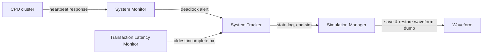

<!-- generated by yt-paper; edits will be overwritten -->
[DVCon](../dvcon/index.md) › [US](../dvcon/us.md) › [2019](../dvcon/by-year.md#2019) › [Verification](../dvcon/by-topic.md#verification)

# Coherency Verification & Deadlock Detection Using Perspec/Portable Stimulus

<figure class="rep-fig" markdown>
{ loading=lazy }
<figcaption>Figure 5: Deadlock Detection Verification Environment — from the original paper (Moonki Jang et al.)</figcaption>
</figure>

[:material-open-in-new: Original paper](https://dvcon-proceedings.org/wp-content/uploads/coherency-verification--deadlock-detection-using-perspecportable-stimulus.pdf){ .md-button .md-button--primary target=_blank }

| | |
|---|---|
| Authors | Moonki Jang, Jiwoong Kim, Hyerim Chung (Samsung Electronics), Phu L. Huynh, Shai Fuss (Cadence Design Systems) |
| Venue | DVCon US 2019 |
| Topic | Verification |
| Type | PAPER |
| ID | `ref-20261018-90da` |

## Summary

**Samsung and Cadence describe using Perspec/PSS, with a reusable coherency action library and a heartbeat-based deadlock detection environment, to verify cache coherency and PCIe-induced deadlocks in an automotive multi-core SoC, reporting qualitative rather than quantitative results.**

**Samsung과 Cadence는 재사용 가능한 coherency action 라이브러리와 heartbeat 기반 deadlock detection 환경을 결합해 Perspec/PSS로 automotive 멀티코어 SoC의 cache coherency 및 PCIe 유발 deadlock을 검증한 사례를 소개하며, 정량적 결과보다는 정성적 결과를 보고한다.**

## Key Insights

- Perspec configuration tables (Processor Info, Memory Info) in Excel/CSV auto-generate PSS types and control-knob structures; the paper reports the compute subsystem modeling took a couple of hours with no coding, mostly spent collecting the configuration data.

- Excel/CSV 형태의 Perspec 설정 테이블(Processor Info, Memory Info)로부터 PSS 타입과 control-knob 구조체가 자동 생성되며, 저자들은 compute subsystem 모델링이 코딩 없이 수 시간(a couple of hours)이 걸렸고 대부분의 시간은 설정 정보를 찾는 데 쓰였다고 보고한다.

- Atomic coherency actions (write_data, copy_data, read_check_data) are composed into reusable building blocks: pss_wr_cp_rc is combined with parallel blocks for a 3-core scenario and with cdn_coherency_ops_c::false_sharing_rw_base, using constraints to keep processor cores unique across concurrent actions.

- 원자적 coherency action(write_data, copy_data, read_check_data)을 조합해 재사용 가능한 블록을 만든다. pss_wr_cp_rc는 parallel 블록으로 3-core 시나리오에 쓰이고, cdn_coherency_ops_c::false_sharing_rw_base와도 결합되며, 동시에 실행되는 action들의 코어가 서로 겹치지 않도록 constraint로 제어한다.

- The deadlock detection environment uses a System Monitor (missing CPU heartbeat response), a Transaction Latency Monitor (oldest incomplete transaction), and a System Tracker (CPU state, scenario, suspect transaction, estimated time) to terminate the simulation automatically and capture a log and waveform around the deadlock.

- Deadlock detection 환경은 System Monitor(CPU heartbeat 누락 감지), Transaction Latency Monitor(가장 오래된 미완료 트랜잭션 추적), System Tracker(CPU 상태, 시나리오, 의심 트랜잭션, 추정 발생 시각 기록)로 구성되어 시뮬레이션을 자동 종료하고 deadlock 주변의 로그와 waveform을 확보한다.

- The PCIe deadlock case is a 7-step chain: non-posted reads fill the RC request buffer, config writes stall, a Writeback is blocked, ReadOnce snoops queue behind it, and a WriteLineUnique clean&invalidate snoop cannot be delivered, so the snoop queue saturates. PSS describes the parallel activities and lets Perspec randomize their scheduling.

- PCIe deadlock 사례는 7단계 연쇄로 설명된다. Non-posted read가 RC 요청 버퍼를 채우고 config write가 막히며, CPU Writeback이 차단되고, ReadOnce snoop이 그 뒤에서 대기하며, WriteLineUnique의 Clean&Invalidate snoop을 전달할 수 없어 snoop queue가 포화된다. PSS는 이 병렬 활동을 기술하고 Perspec이 스케줄링을 랜덤화한다.

- The paper gives no quantitative speedup or coverage figures. Coherency suites were generated and run, while PCIe deadlock results were still pending (to be presented at DVCon 2019). Reuse across projects requires avoiding hard-coded processor and memory names, which the authors say calls for a methodology and library beyond the PSS language itself.

- 논문은 속도 향상이나 coverage 수치 등 정량적 결과를 제시하지 않는다. Coherency 테스트 스위트는 생성 및 실행되었고, PCIe deadlock 결과는 DVCon 2019에서 발표 예정으로 보류되었다. 저자들은 프로젝트 간 재사용을 위해 프로세서/메모리 이름을 하드코딩하지 않아야 하며, 이를 위해서는 PSS 언어 외에 methodology와 library가 필요하다고 설명한다.

## Detailed Summary

### Background and Problem

- Automotive and mobile SoCs integrate many processor cores, multi-level caches (private L1, cluster L2, optional LLC in the coherent interconnect), a GPU/NPU, and coherent IO masters (PCIe, Ethernet, USB) connected via ACE/ACE-Lite.

- Automotive 및 mobile SoC는 다수의 processor core, 다단계 cache(코어별 private L1, 클러스터 L2, coherent interconnect 내 선택적 LLC), GPU/NPU, 그리고 ACE/ACE-Lite로 연결된 coherent IO master(PCIe, Ethernet, USB 등)를 포함한다.

- Manually building enough test suites for coherency (false-sharing, true-sharing, exclusive access, DVM) and for deadlock/livelock avoidance is labor-intensive. The number of cores, masters, and cache levels multiplies the combinations.

- Coherency(false-sharing, true-sharing, exclusive access, DVM) 및 deadlock/livelock 회피를 위한 테스트 스위트를 수작업으로 만드는 일은 노동 집약적이다. Core 수, master 수, cache 레벨 수에 따라 조합이 크게 늘어난다.

- PCIe-related deadlocks arise only from specific transaction sequences and timing. Root-causing them post-silicon is very difficult and costly, so the authors target simulation-level reproduction before tape-out.

- PCIe 관련 deadlock은 특정 트랜잭션 순서와 타이밍에서만 발생한다. Post-silicon 단계에서 근본 원인을 찾기는 매우 어렵고 비용이 크므로, 저자들은 tape-out 이전에 시뮬레이션 수준에서 재현하는 것을 목표로 한다.

### Architecture and Methodology

Test development follows four steps: (1) model the compute subsystem, (2) develop memory coherency scenarios, (3) develop PSS models for other subsystems, (4) develop subsystem scenarios. The paper details only steps 1 and 2 in depth.

테스트 개발은 (1) compute subsystem 모델링, (2) 메모리 coherency 시나리오 개발, (3) 다른 subsystem의 PSS 모델 개발, (4) subsystem 시나리오 개발의 4단계로 진행된다. 논문은 1단계와 2단계만 자세히 다룬다.

- **Compute subsystem modeling:** The Perspec coherency library is driven by configuration tables. The Processor Info table (#tag, #kind, #cluster) lists 12 cores (M0–B3) in 3 clusters. The Memory Info table lists DDR0, DDR1, and DDR2 with address ranges and #enabled. Perspec auto-generates types such as sml_processor_tag_e and the control-knob structure sml_proc_subset_select_s.

- **Compute subsystem 모델링:** Perspec coherency library는 설정 테이블로 구동된다. Processor Info 테이블(#tag, #kind, #cluster)은 3개 클러스터에 걸친 12개 core(M0–B3)를 나열한다. Memory Info 테이블은 DDR0, DDR1, DDR2의 주소 범위와 #enabled 항목을 담는다. Perspec은 sml_processor_tag_e 같은 타입과 control-knob 구조체 sml_proc_subset_select_s를 자동 생성한다.

- **Atomic actions and composition:** `write_data`, `copy_data`, and `read_check_data` are chained in `pss_wr_cp_rc` with a random `proc_tag_l`. That action is then used in `pss_wr_cp_rc_3cores`, which runs three instances in `parallel` with pairwise `!=` constraints on the core tags. A further scenario, `pss_fs_rw_mem_rw`, runs `pss_wr_cp_rc` in parallel with `cdn_coherency_ops_c::false_sharing_rw_base`, using a soft size/cluster constraint on the subset and a `foreach` constraint so the two sides use different cores.

- **원자적 action과 조합:** write_data, copy_data, read_check_data를 pss_wr_cp_rc에서 chain으로 묶고, 무작위 proc_tag_l을 사용한다. 이 action은 pss_wr_cp_rc_3cores에서 쌍별 `!=` constraint로 core tag를 구분한 채 세 인스턴스를 parallel로 실행하는 데 쓰인다. 또 다른 시나리오 pss_fs_rw_mem_rw는 pss_wr_cp_rc를 cdn_coherency_ops_c::false_sharing_rw_base와 병렬로 실행하며, subset 크기/클러스터에 soft constraint를 걸고 foreach constraint로 두 측이 서로 다른 core를 사용하도록 한다.

- **Deadlock detection environment (Fig. 5):**
  1. *System Monitor:* a status timer raises periodic interrupts; the CPU replies with a heartbeat response, or a failure response on SError, livelock, or similar failures. Missing heartbeats past a timeout mark a deadlock and notify the System Tracker.
  2. *Transaction Latency Monitor:* records latency for all CPU-originated transactions and passes the oldest incomplete transaction to the System Tracker.
  3. *System Tracker:* gathers CPU status (PC, GPRs, PSTATE, fault status, ESR), the current scenario, the suspect transaction, and the estimated deadlock time; writes a log and ends the simulation.
  4. *Simulation Manager:* generates and runs the Perspec scenarios, parses the log, and triggers a waveform dump around the failure point via save & restore.

- **Deadlock detection 환경(Fig. 5):**
  1. *System Monitor:* 상태 점검 타이머가 주기적으로 인터럽트를 발생시키고, CPU는 heartbeat response로 응답한다. SError, livelock 등 장애 시에는 failure response를 보낸다. 제한 시간 동안 heartbeat가 없으면 deadlock으로 판단하여 System Tracker에 알린다.
  2. *Transaction Latency Monitor:* CPU가 발생시킨 모든 트랜잭션의 지연을 기록하고, 가장 오래된 미완료 트랜잭션 정보를 System Tracker에 넘긴다.
  3. *System Tracker:* CPU 상태(PC, GPR, PSTATE, fault status, ESR), 현재 시나리오, 의심 트랜잭션, 추정 deadlock 시각을 수집하고 로그 파일을 생성한 뒤 시뮬레이션을 종료한다.
  4. *Simulation Manager:* Perspec 시나리오의 생성과 실행을 관리하고 로그를 분석하며, save & restore를 이용해 장애 지점 주변의 waveform을 dump한다.

- **PCIe deadlock scenario (Fig. 6):** Non-posted reads fill the PCIe RC request buffer, which blocks config writes. A CPU Writeback is then blocked on the write channel. The PCIe EP's ReadOnce for address A generates a snoop that cannot proceed past the outstanding WriteBack. Coherent reads from the EP saturate the snoop queue, and the EP's WriteLineUnique for A generates a Clean&Invalidate snoop that cannot be delivered. The deadlock follows at step 7.

- **PCIe deadlock 시나리오(Fig. 6):** Non-posted read가 PCIe RC 요청 버퍼를 채워 config write를 막는다. 이어서 CPU의 Writeback이 write 채널에서 차단된다. PCIe EP가 주소 A에 대해 발행한 ReadOnce는 미완료 WriteBack 뒤에서 진행하지 못하는 snoop을 생성한다. EP의 coherent read들이 snoop queue를 채우고, EP의 WriteLineUnique(주소 A)는 Clean&Invalidate snoop을 생성하지만 queue가 포화되어 CPU cluster에 전달되지 못한다. 7단계에서 deadlock이 완성된다.

- **PSS encoding:** A setup phase (`pcie_config`, `pcie_rc_mem_write`, `write_cache`) is followed by a `parallel` block. Cores A3, A0, A1, and A2 run PCIe RC reads, a read with invalidate, and a read with config write. A sequence in the PCIe EP runs `pcie_ep_mem_write` followed by repeated `pcie_ep_mem_read`. Perspec randomizes core selection and scheduling, and Fig. 7 shows one generated test.

- **PSS 표현:** Setup 단계(pcie_config, pcie_rc_mem_write, write_cache) 뒤에 parallel 블록이 온다. Core A3, A0, A1, A2는 각각 PCIe RC read, read와 invalidate, read와 config write를 수행한다. PCIe EP 쪽 sequence는 pcie_ep_mem_write 후 pcie_ep_mem_read를 반복한다. Perspec이 core 선택과 스케줄링을 무작위화하며, Fig. 7은 생성된 테스트 하나를 보여준다.

### Results and Conclusions

- The coherency test suites were generated and run on the project design. The authors say this was fast because of the Perspec coherency library and scenario reuse from a previous project.

- Coherency 테스트 스위트는 대상 설계에 대해 생성 및 실행되었다. 저자들은 Perspec coherency library와 이전 프로젝트 시나리오 재사용 덕분에 빠르게 진행되었다고 설명한다.

- PCIe deadlock scenarios were still running at the time of writing, and additional SoC-level PCIe scenarios were under development. Final results were deferred to DVCon 2019. The paper reports no quantitative metrics (speedup, coverage percentages, or bugs found).

- PCIe deadlock 시나리오는 작성 시점에 실행 중이었고, 추가 SoC 수준 PCIe 시나리오가 개발 중이었다. 최종 결과는 DVCon 2019로 미뤄졌다. 논문은 속도 향상, coverage 비율, 발견된 버그 수 등 정량적 지표를 제시하지 않는다.

- Qualitative lessons: PSS scenarios were simpler to write than hand-written C tests. Portable stimulus needs a library and methodology in addition to the language, analogous to UVM. Scenarios should avoid referring to project-specific processor or memory names.

- 정성적 교훈: PSS 시나리오는 수작업 C 테스트보다 작성이 쉬웠다. Portable stimulus에는 언어 외에 UVM과 유사하게 library와 methodology가 필요하다. 시나리오는 프로젝트별 프로세서/메모리 이름을 참조하지 않아야 한다.

- Stated contributions: application of PSS to SoC-level coherency and deadlock tasks, a horizontal project-to-project reuse methodology, and a deadlock detection verification environment.

- 명시된 기여: SoC 수준 coherency 및 deadlock 작업에 PSS 적용, 프로젝트 간(horizontal) 재사용 methodology, deadlock detection 검증 환경.

## Videos

<iframe src="https://www.youtube-nocookie.com/embed/4qtButQK_lU" title="[DVCON2019] Coherency Verification & Deadlock Detection Using Perspec/Portable Stimulus" loading="lazy" allow="accelerometer; clipboard-write; encrypted-media; gyroscope; picture-in-picture; web-share" referrerpolicy="strict-origin-when-cross-origin" allowfullscreen></iframe>

**[DVCON2019] Coherency Verification & Deadlock Detection Using Perspec/Portable Stimulus** — [Watch on YouTube](https://www.youtube.com/watch?v=4qtButQK_lU) · [Video page](../videos/4qtButQK_lU.md)
