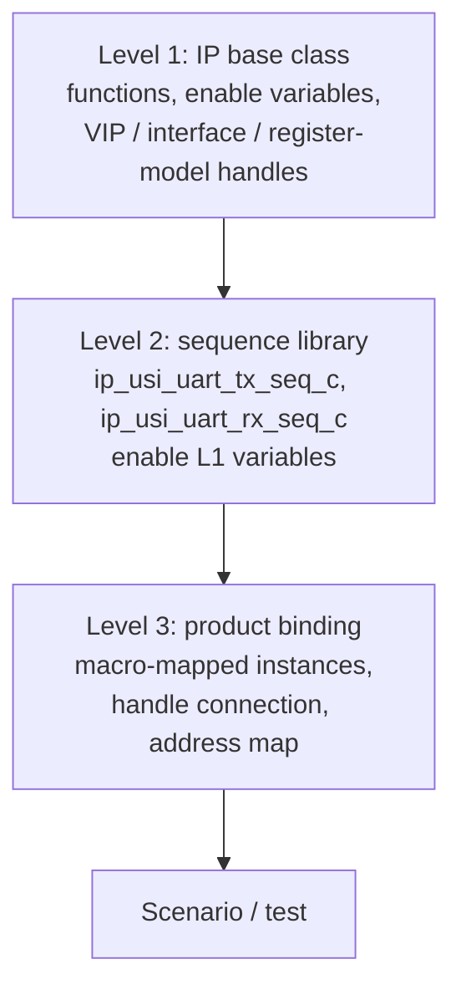

<!-- generated by yt-paper; edits will be overwritten -->
[DVCon](../dvcon/index.md) › [US](../dvcon/us.md) › [2023](../dvcon/by-year.md#2023) › [Verification](../dvcon/by-topic.md#verification)

# Strategies to Maximize Reusability of UVM Test Scenarios in SoC Verification

<figure class="rep-fig" markdown>
{ loading=lazy }
<figcaption>Figure 1. A three-level inheritance code structure to maximize code reusability — from the original paper (Hyeonman Park et al.)</figcaption>
</figure>

[:material-open-in-new: Original paper](https://dvcon-proceedings.org/wp-content/uploads/1050-Strategies-to-Maximize-Reusability-of-UVM-Test-Scenarios-in-SoC-Verification.pdf){ .md-button .md-button--primary target=_blank }

| | |
|---|---|
| Authors | Hyeonman Park, Namyoung Kim, Kyoungmin Lee, Hongkyu Kim, Jaein Hong, Kiseok Bae (Samsung Electronics Inc.) |
| Venue | DVCon US 2023 |
| Topic | Verification |
| Type | PAPER |
| ID | `ref-20261018-912a` |

## Summary

**The paper proposes a three-level UVM class inheritance structure that isolates reusable IP sequences from product-specific code, plus a metadata-driven interpreter that auto-generates composite system-control scenarios, reporting about 86-88% code reuse and an 87% reduction in scenario count on two automotive SoC generations.**

**이 논문은 재사용 가능한 IP 시퀀스를 제품 종속 코드에서 분리하는 3단계 UVM 클래스 상속 구조와, 메타데이터를 읽어 복합 시스템 제어 시나리오를 자동 생성하는 인터프리터를 제안하며, 두 세대 자동차용 SoC에서 약 86~88%의 코드 재사용률과 시나리오 수 87% 감소를 보고한다.**

## Key Insights

- Three-level class layering (first: IP functions and VIP/interface/register-model handles; second: sequence library; third: product binding via macros) lets the first two levels be reused unchanged; only the third level changes per product.

- 3단계 클래스 계층화(1단계: IP 기능과 VIP/인터페이스/레지스터 모델 핸들, 2단계: 시퀀스 라이브러리, 3단계: 매크로를 통한 제품 바인딩)로 1·2단계를 수정 없이 재사용하고, 제품별 변경은 3단계에만 국한된다.

- On BLOCK1, about 86% of UVM code lines fall in the reusable first and second levels (Table 2); across BLOCK1-4 of the second-generation product, about 88% of total code is reused or auto-generated, with about 14% requiring edits (Table 4).

- BLOCK1에서 UVM 코드 라인의 약 86%가 재사용 가능한 1·2단계에 속한다(Table 2). 2세대 제품의 BLOCK1~4 전체에서는 코드의 약 88%가 수정 없이 재사용되거나 자동 생성되며, 약 14%의 코드 라인만 편집이 필요하다(Table 4).

- Replacing hand-written scenario frameworks with metadata (sequence order via ';', '&', and newline operators) plus an interpreter reached the same block coverage with only 13% of the scenarios, a reduction of 87% (Table 3).

- 수작업 시나리오 프레임워크 대신 메타데이터(';', '&', 줄바꿈 연산자로 시퀀스 순서 기술)와 인터프리터를 사용하자 같은 블록 커버리지를 전체 시나리오의 13%만으로 달성했으며, 이는 87% 감소에 해당한다(Table 3).

- System-control functions (resets, low power, GPIO pad control) are wrapped into product-independent APIs such as system_reset(kind) so scenario writers need no hardware-implementation details; the API bodies remain product-dependent.

- 시스템 제어 기능(리셋, 저전력, GPIO 패드 제어)을 system_reset(kind)와 같은 제품 독립적 API로 감싸 시나리오 작성자가 하드웨어 구현 세부사항을 알 필요가 없게 한다. 단, API 내부 구현은 여전히 제품 종속적이다.

- The approach targets intra-platform reuse on UVM for early bring-up (shift-left), positioned against PSS-EDA tools that focus mainly on cross-platform C-test reuse and leave power/reset control to manual coding.

- 이 접근은 조기 bring-up(shift-left)을 위해 동일 플랫폼 내 UVM 재사용에 초점을 둔다. 주로 플랫폼 간 C 테스트 재사용에 집중하고 전력/리셋 제어는 수작업 코딩이 필요한 기존 PSS-EDA 도구와 대비된다.

## Detailed Summary

### Background and Problem

- SoC functional verification dominates overall TAT, so both simulation time and scenario development time must shrink. This paper targets the second lever: reusing scenario code.

- SoC 기능 검증은 전체 TAT의 대부분을 차지하므로 시뮬레이션 시간과 시나리오 개발 시간을 모두 줄여야 한다. 이 논문은 두 번째 축인 시나리오 코드 재사용을 다룬다.

- PSS-EDA tools (Accellera PSS 1.0) mainly compose IP-level data-manipulation sequences and emphasize reuse across simulation, emulation, and silicon. The paper argues that system-control logic (reset, power, GPIO pad control) is where most design bugs occur, yet PSS tools do not provide it by default and it must be hand-coded.

- PSS-EDA 도구(Accellera PSS 1.0)는 주로 IP 수준 데이터 조작 시퀀스를 조합하며, 시뮬레이션·에뮬레이션·실리콘 간 재사용에 중점을 둔다. 논문은 설계 버그의 대부분이 시스템 제어 로직(리셋, 전력, GPIO 패드 제어)에서 발생하지만, PSS 도구는 이를 기본 제공하지 않아 수작업 코딩이 필요하다고 지적한다.

- Conventional practice either inlines system-control code into each IP sequence (code growth, no reuse) or places it in product-specific "common tasks" (reusable only within one product).

- 기존 방식은 시스템 제어 코드를 각 IP 시퀀스에 직접 삽입하거나(코드 증가, 재사용 불가), 제품별 "common task"에 두는 방식(한 제품 내에서만 재사용 가능)이다.

- Complex scenarios are built from hand-written frameworks. The paper notes that the conventional flow cannot create scenarios with more than four sequences or more than two concurrent sequences without adding new frameworks.

- 복합 시나리오는 수작업 프레임워크로 구성된다. 논문은 기존 흐름에서 시퀀스 4개를 초과하거나 동시에 2개를 초과하는 시나리오는 새 프레임워크를 추가하지 않고는 만들 수 없다고 밝힌다.

### Architecture and Methodology

**Three-level class inheritance (Figs. 1-2).** The example is a UART IP with four instances and TX/RX functions, giving two functions × four instances = eight operation sequences.

**3단계 클래스 상속 (Fig. 1-2).** 예시는 인스턴스 4개와 TX/RX 기능을 가진 UART IP이며, 2개 기능 × 4개 인스턴스 = 8개 동작 시퀀스가 된다.

- Level 1 holds all IP functions, the variables that trigger them, and the VIP/interface/register-model handles. Changes to functions are localized here.

- 1단계는 모든 IP 기능, 이를 트리거하는 변수, VIP/인터페이스/레지스터 모델 핸들을 보유한다. 기능 변경은 이 단계에 국한된다.

- Level 2 wraps the functions as sequences that enable Level 1 variables, forming a library for composite scenarios.

- 2단계는 기능을 1단계 변수를 활성화하는 시퀀스로 감싸 복합 시나리오용 라이브러리를 구성한다.

- Level 3 binds sequences to the target product (instance count, register model, hardware hierarchy). Only this level is modified per product.

- 3단계는 시퀀스를 대상 제품(인스턴스 수, 레지스터 모델, 하드웨어 계층)에 바인딩한다. 제품마다 수정되는 것은 이 단계뿐이다.

**System-control APIs (Fig. 3, Table 1).** System functions move from inline code to common tasks and then to a single product-independent API (for example, `system_reset(kind)` or `control_hardware_reset("POR" | "WDT0" | "WDT1")`). Hardware-dependent bodies stay inside the API, so scenario writers use it without hardware details.

**시스템 제어 API (Fig. 3, Table 1).** 시스템 기능은 인라인 코드에서 common task로, 다시 제품 독립적인 단일 API(예: `system_reset(kind)` 또는 `control_hardware_reset("POR" | "WDT0" | "WDT1")`)로 옮겨진다. 하드웨어 종속 구현은 API 내부에 남아 시나리오 작성자는 하드웨어 세부사항 없이 사용할 수 있다.

**Metadata-driven scenario flow (Figs. 4-6).**

**메타데이터 기반 시나리오 흐름 (Fig. 4-6).**

- The conventional flow (Fig. 4a) requires building a framework first and then placing sequences in it.

- 기존 흐름(Fig. 4a)은 프레임워크를 먼저 만든 뒤 시퀀스를 배치한다.

- The proposed flow (Fig. 4b) has the developer pick sequences and APIs from repositories and describe the order in metadata. An interpreter then generates the framework and the UVM test class.

- 제안 흐름(Fig. 4b)은 개발자가 저장소에서 시퀀스와 API를 골라 메타데이터로 순서를 기술하면, 인터프리터가 프레임워크와 UVM 테스트 클래스를 생성한다.

- Operators: newline = serial, `&` = parallel, `{a; b; c}` = sequential group inside a parallel branch.

- 연산자: 줄바꿈 = 직렬, `&` = 병렬, `{a; b; c}` = 병렬 분기 안의 순차 그룹.

- Example (Fig. 5): `seq_a` then `{seq_b; seq_c; seq_d} & task_0`, then `seq_e & task_1`, then `task_2`. The interpreter emits a class whose task body calls `seq_a.start()`, forks the `seq_b→seq_c→seq_d` chain alongside `task_0()`, and so on.

- 예시(Fig. 5): `seq_a` 다음 `{seq_b; seq_c; seq_d} & task_0`, 다음 `seq_e & task_1`, 다음 `task_2`. 인터프리터는 `seq_a.start()`를 호출하고, `seq_b→seq_c→seq_d` 체인을 `task_0()`과 fork로 병렬 실행하는 클래스를 생성한다.

- Fig. 6 applies this to UART: parallel operation of all instances, sequential operation, and system-level and block-level reset mid-operation. The paper states this needs no UVM background.

- Fig. 6은 UART에 적용한 사례로, 모든 인스턴스의 병렬 동작, 순차 동작, 동작 중 시스템 및 블록 단위 리셋을 검증한다. 논문은 UVM 배경 지식이 필요 없다고 밝힌다.

### Results and Conclusions

- **Code reuse (Table 2, BLOCK1, five IPs):** about 86% of lines are in the reusable Levels 1-2; the remaining 14% is adapted per SoC.

- **코드 재사용 (Table 2, BLOCK1, IP 5개):** 약 86%의 라인이 재사용 가능한 1~2단계에 속하며, 나머지 14%는 SoC별로 조정한다.

- **Code distribution (Table 4, four blocks, second-generation product):** about 88% of code is reused unchanged or auto-generated; about 14% of lines need editing. The paper's own numbers differ slightly (86% vs 88%) across sections.

- **코드 분포 (Table 4, 블록 4개, 2세대 제품):** 약 88%의 코드가 수정 없이 재사용되거나 자동 생성되며, 약 14%의 라인은 편집이 필요하다. 논문 내 수치(86% 대 88%)는 섹션마다 약간 다르다.

- **Scenario count (Table 3):** the same block coverage on both generations is reached with 13% of the scenarios, a reduction of 87%.

- **시나리오 수 (Table 3):** 두 세대 모두 같은 블록 커버리지를 전체 시나리오의 13%로 달성하여 87% 감소했다.

- **Setup:** two automotive SoC generations on the same architecture. The first generation was re-organized into the new structure; the second was built by reusing Levels 1-2.

- **설정:** 같은 아키텍처의 자동차용 SoC 2세대. 1세대는 새 구조로 재구성되었고, 2세대는 1~2단계를 재사용하여 구축되었다.

- **Claims:** earlier bug discovery through early scenario availability, fewer human-coding errors, and maintained verification quality. The paper gives no per-bug data, schedule numbers, or simulation-runtime results.

- **주장:** 시나리오를 조기에 확보하여 버그를 더 일찍 발견하고, 수작업 코딩 오류를 줄이며, 검증 품질을 유지한다고 한다. 버그별 데이터, 일정 수치, 시뮬레이션 런타임 결과는 제시되지 않았다.

- **Scope:** the method targets reuse within one execution platform (UVM), complementing rather than replacing PSS cross-platform reuse. The paper does not quantify the cost of building the interpreter or the metadata syntax.

- **범위:** 단일 실행 플랫폼(UVM) 내 재사용을 대상으로 하며, PSS의 플랫폼 간 재사용을 대체하기보다 보완한다. 인터프리터 구축 비용과 메타데이터 문법의 비용은 정량화되지 않았다.

Note: the document is a full paper, not truncated. The author hint (g.pavithra) does not match the byline, so the document's byline is used.

참고: 문서는 잘린 부분 없이 전체 논문이다. 저자 힌트(g.pavithra)는 본문 저자 표기와 일치하지 않으므로 문서의 저자 표기를 사용했다.

## Videos

<iframe src="https://www.youtube-nocookie.com/embed/q6NioNTKDLs" title="[DVCON2023]Strategies to Maximize Reusability of UVM Test Scenarios in SoC Verification" loading="lazy" allow="accelerometer; clipboard-write; encrypted-media; gyroscope; picture-in-picture; web-share" referrerpolicy="strict-origin-when-cross-origin" allowfullscreen></iframe>

**[DVCON2023]Strategies to Maximize Reusability of UVM Test Scenarios in SoC Verification** — [Watch on YouTube](https://www.youtube.com/watch?v=q6NioNTKDLs) · [Video page](../videos/q6NioNTKDLs.md)
