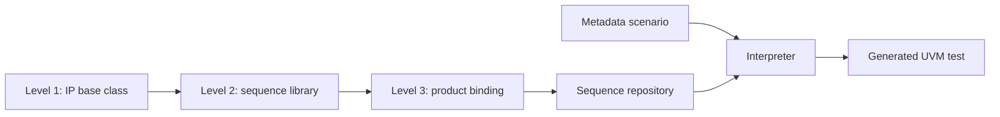

<!-- generated by yt-paper; edits will be overwritten -->
[DVCon](../dvcon/index.md) › [US](../dvcon/us.md) › [2023](../dvcon/by-year.md#2023) › [Verification](../dvcon/by-topic.md#verification)

# Strategies to Maximize Reusability of UVM Test Scenarios in SoC Verification

<figure class="rep-fig" markdown>
{ loading=lazy }
<figcaption>Figure 1. A three-level inheritance code structure to maximize code reusability — from the original paper (Hyeonman Park et al.)</figcaption>
</figure>

[:material-open-in-new: Original paper](https://dvcon-proceedings.org/wp-content/uploads/1050-Strategies-to-Maximize-Reusability-of-UVM-Test-Scenarios-in-SoC-Verification.pdf){ .md-button .md-button--primary target=_blank }

| | |
|---|---|
| Authors | Hyeonman Park (Samsung Electronics Inc.), Namyoung Kim (Samsung Electronics Inc.), Kyoungmin Lee (Samsung Electronics Inc.), Hongkyu Kim (Samsung Electronics Inc.), Jaein Hong (Samsung Electronics Inc.), Kiseok Bae (Samsung Electronics Inc.) |
| Venue | DVCon US 2023 |
| Topic | Verification |
| Type | PAPER |
| ID | `ref-20261018-912a` |

## Summary

**A three-level UVM class inheritance structure (first two levels reused unchanged) plus a metadata-plus-interpreter flow for composite scenario generation reduced scenario count by 87% across two automotive SoC generations.**

**3단계 UVM 클래스 상속 구조(1~2단계는 수정 없이 재사용)와 메타데이터 기반 인터프리터를 통한 복합 시나리오 생성 흐름으로, 두 세대의 automotive SoC에서 시나리오 수를 87% 줄였습니다.**

## Key Insights

- Separating IP-specific sequences (levels 1-2) from product binding (level 3) leaves only about 14% of BLOCK1 test code to modify per SoC, with about 86% reusable as-is.

- IP 전용 시퀀스(1~2단계)와 제품 바인딩(3단계)을 분리하면 BLOCK1 테스트 코드의 약 86%가 그대로 재사용되고, SoC별로 수정이 필요한 부분은 약 14%뿐입니다.

- System-control functions (resets, low power, pad control) are wrapped as common tasks and consolidated into product-agnostic APIs such as system_reset(kind), hiding hardware dependencies from scenario developers.

- 시스템 제어 기능(reset, low power, pad control)은 common task로 감싼 뒤 system_reset(kind)과 같은 제품 독립적 API로 통합되어, 시나리오 개발자가 하드웨어 의존성을 신경 쓰지 않아도 됩니다.

- Describing scenarios as metadata (serial, parallel, and grouped sequence ordering) and generating UVM code with an interpreter reached the same block coverage with 13% of the scenarios, an 87% reduction.

- 시퀀스 순서(직렬, 병렬, 그룹 직렬)를 메타데이터로 기술하고 인터프리터로 UVM 코드를 생성하면, 동일한 블록 커버리지를 13%의 시나리오 수로 달성해 87% 감소를 보였습니다.

- Across four blocks of the second-generation product, about 88% of total test code is reusable or auto-generated, which the authors credit with enabling early-phase scenario coverage.

- 두 번째 세대 제품의 4개 블록에서 전체 테스트 코드의 약 88%가 재사용 또는 자동 생성되며, 저자들은 이것이 초기 단계 시나리오 커버리지 확보에 기여했다고 봅니다.

- The evidence is limited to two in-house automotive SoCs on one architecture, with no quantitative comparison against commercial PSS tools and few coverage-metric details.

- 근거는 한 아키텍처 위의 사내 automotive SoC 2종에 국한되며, 상용 PSS 도구와의 정량적 비교나 커버리지 지표 세부 정보는 부족합니다.

## Detailed Summary

### Background and Problem

- SoC verification TAT is dominated by functional verification; PSS-EDA tools reuse scenarios across platforms but focus on C-based tests and IP-level data manipulation, leaving system control (reset, power, pad) largely hand-coded.

- SoC 검증 TAT는 기능 검증이 지배적입니다. PSS-EDA 도구는 플랫폼 간 시나리오 재사용을 지원하지만 C 기반 테스트와 IP 수준 데이터 조작에 초점을 맞추어, reset, power, pad 같은 시스템 제어는 여전히 수작업 코딩이 필요합니다.

- Most design bugs arise in system control logic, so early bring-up needs simple scenarios extended to composite ones on the same platform.

- 설계 버그 대부분이 시스템 제어 로직에서 발생하므로, 초기 bring-up에서는 단순 시나리오를 만든 뒤 같은 플랫폼에서 복합 시나리오로 확장할 필요가 있습니다.

- Mixing IP and system code in one class, or inlining system-control code per test, prevents reuse and duplicates code per target.

- IP 코드와 시스템 코드를 한 클래스에 섞거나 테스트마다 시스템 제어 코드를 인라인으로 넣으면 재사용이 어렵고 타깃별로 코드가 중복됩니다.

### Architecture and Methodology

- Three-level UVM class inheritance: Level 1 holds IP functions, activation variables, and VIP/interface/register-model handles; Level 2 enables functions and builds a TX/RX sequence library; Level 3 binds handles and instances via macros (example: 4 UART instances × 2 functions = 8 sequences).

- 3단계 UVM 클래스 상속 구조: 1단계는 IP 기능, 기능 활성화 변수, VIP/interface/register model 핸들을 가지며, 2단계는 기능을 활성화하고 TX/RX 시퀀스 라이브러리를 구성하며, 3단계는 매크로로 핸들과 인스턴스를 바인딩합니다(예: UART 4개 인스턴스 × 2기능 = 시퀀스 8개).

- System-control functions are encapsulated as common tasks, then unified into a product-agnostic API (e.g., system_reset(kind)).

- 시스템 제어 기능은 common task로 캡슐화한 뒤 system_reset(kind)과 같은 제품 독립 API로 통합합니다.

- Scenario flow: a metadata file defines sequence order (newline = serial, "&" = parallel, "{...;...}" = grouped serial); an interpreter emits UVM test classes with fork/join.

- 시나리오 흐름: 메타데이터 파일이 시퀀스 순서를 정의하고(줄바꿈 = 직렬, "&" = 병렬, "{...;...}" = 그룹 직렬), 인터프리터가 fork/join을 포함한 UVM 테스트 클래스를 생성합니다.

### Results and Conclusions

- Two automotive SoC generations on the same architecture: generation 1 was re-organized into the new structure; generation 2 was built from reused Level 1-2 classes.

- 같은 아키텍처 위의 automotive SoC 2세대 검증: 1세대는 새 구조로 재구성했고, 2세대는 재사용된 1~2단계 클래스로 구성했습니다.

- About 86% of BLOCK1 code is in reusable Level 1-2 classes; about 14% is modified per SoC.

- BLOCK1 코드의 약 86%가 재사용 가능한 1~2단계 클래스에 있고, 약 14%만 SoC별로 수정합니다.

- The same coverage on BLOCK1-BLOCK4 was reached with 13% of the scenario count (87% reduction).

- BLOCK1~BLOCK4에서 동일한 커버리지를 시나리오 수의 13%로 달성했습니다(87% 감소).

- Across the second-generation product, about 88% of total test code is reused or auto-generated.

- 2세대 제품 전체 테스트 코드의 약 88%가 재사용 또는 자동 생성됩니다.

- Limitations: no quantitative comparison with commercial PSS tools, results from one company's internal products, and limited coverage-metric detail.

- 한계: 상용 PSS 도구와의 정량적 비교가 없고, 한 회사의 사내 제품에 대한 결과이며, 커버리지 지표 세부 정보가 제한적입니다.

## Videos

<iframe src="https://www.youtube-nocookie.com/embed/q6NioNTKDLs" title="[DVCON2023]Strategies to Maximize Reusability of UVM Test Scenarios in SoC Verification" loading="lazy" allow="accelerometer; clipboard-write; encrypted-media; gyroscope; picture-in-picture; web-share" referrerpolicy="strict-origin-when-cross-origin" allowfullscreen></iframe>

**[DVCON2023]Strategies to Maximize Reusability of UVM Test Scenarios in SoC Verification** — [Watch on YouTube](https://www.youtube.com/watch?v=q6NioNTKDLs) · [Video page](../videos/q6NioNTKDLs.md)
