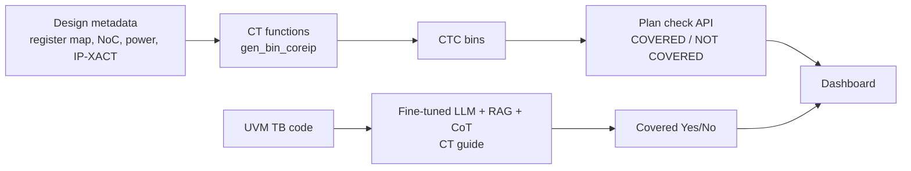

<!-- generated by yt-paper; edits will be overwritten -->
[DVCon](../dvcon/index.md) › [US](../dvcon/us.md) › [2025](../dvcon/by-year.md#2025) › [Verification](../dvcon/by-topic.md#verification)

# An Early Stage Coverage Measurement Methodology For Common Features Of System-On-Chip Verification, Using Design Metadata And Large Language Models

<figure class="rep-fig" markdown>
{ loading=lazy }
<figcaption>Figure 3. Overall Architecture for the CTC — from the original paper (Myeongwhan Hyun et al.)</figcaption>
</figure>

[:material-open-in-new: Original paper](https://dvcon-proceedings.org/wp-content/uploads/1030.pdf){ .md-button .md-button--primary target=_blank }

| | |
|---|---|
| Authors | Myeongwhan Hyun, Jaehyeok Lee, Jin Choi, Dongjoo Kim, Seonghee Yim, Youngsik Kim, Seonil Brian Choi (Samsung Electronics Co. Ltd., Seoul, Korea) |
| Venue | DVCon US 2025 |
| Topic | Verification |
| Type | PAPER |
| ID | `ref-20261018-9206` |

## Summary

**The paper proposes Common Task Coverage (CTC), which derives coverage bins for common SoC features and IPs from design metadata so they can be measured in the verification plan and UVM testbench early, with a fine-tuned DeepSeek-Coder-V2 RAG/CoT model judging TB implementation coverage.**

**이 논문은 설계 메타데이터로부터 SoC 공통 기능 및 IP의 커버리지 bin을 도출하여 검증 계획과 UVM TB에서 조기에 측정할 수 있게 하는 Common Task Coverage(CTC)를 제안하며, TB 구현 커버리지 판정에는 RAG/CoT를 적용한 fine-tuned DeepSeek-Coder-V2를 사용한다.**

## Key Insights

- CTC bins are generated from design metadata (register map, NoC spec, power spec, IP-XACT) rather than post-simulation data, so omitted Common Tasks can be caught at the verification-plan stage.

- CTC bin은 사후 시뮬레이션 데이터가 아니라 설계 메타데이터(register map, NoC 사양, power 사양, IP-XACT)에서 생성되므로, 누락된 Common Task를 검증 계획 단계에서 찾아낼 수 있다.

- Plan-level gap analysis found 293 of 10,641 bins uncovered (2.75%) in Project A and 216 of 4,325 (4.99%) in Project B; oversight accounted for 58.36% and 96.30% of gaps respectively.

- 계획 단계 갭 분석에서 Project A는 10,641개 bin 중 293개(2.75%), Project B는 4,325개 bin 중 216개(4.99%)가 미커버였으며, 갭의 원인은 각각 58.36%와 96.30%가 누락(oversight)이었다.

- The reported LLM metrics (accuracy 0.94, F1 0.98) do not match the paper's own confusion matrix (TP 9657, FN 218, FP 1211, TN 216), which gives roughly 0.87 accuracy and 0.93 F1; these figures should be reconciled before relying on them.

- 보고된 LLM 지표(accuracy 0.94, F1 0.98)는 논문 자체의 confusion matrix(TP 9657, FN 218, FP 1211, TN 216)와 일치하지 않으며, 이 행렬로 계산하면 accuracy 약 0.87, F1 약 0.93이 나온다. 의존하기 전에 이 수치를 재확인해야 한다.

- In the CT-guide ablation, omitting the Design Overview or Example section reduced accuracy by more than 0.1, while the test-implementation-only case was lowest yet still above 0.65 on all metrics.

- CT guide ablation에서 Design Overview 또는 Example 섹션을 제외하면 accuracy가 0.1 이상 떨어졌고, test implementation 섹션만 포함한 경우가 가장 낮았으나 모든 지표가 0.65 이상이었다.

- The evaluation uses a single project's confusion matrix with no baseline, and the review-time reduction from at least 7 days to 1-2 days is reported without methodological detail.

- 평가는 단일 프로젝트의 confusion matrix만 사용하고 baseline 비교가 없으며, 리뷰 기간이 최소 7일에서 1-2일로 줄었다는 주장은 방법론 세부 사항 없이 보고되었다.

## Detailed Summary

### Background and Problem

- Common Tasks (CTs) for shared features (clock, reset, power, security, CMU/PMU) make up over 40% of UVM verification effort, but conventional coverage is only measurable after simulation.

- 클럭, 리셋, 전력, 보안, CMU/PMU 등 공통 기능을 위한 Common Task(CT)는 UVM 검증 工数의 40% 이상을 차지하지만, 기존 커버리지는 시뮬레이션 이후에만 측정할 수 있다.

- A CT omitted during verification planning is discovered late, when fixing it is costly. Code coverage also cannot effectively measure clock and power scenarios.

- 검증 계획 단계에서 누락된 CT는 후반에 발견되어 수정 비용이 크다. 코드 커버리지로는 클럭 및 전력 시나리오를 효과적으로 측정하기 어렵다.

### Architecture and Methodology

- Coverage bins are derived from design metadata: register map (IP names), NoC spec (masters), power spec (power features), and IP-XACT (hierarchy and interfaces). CT functions such as `gen_bin_coreip` emit per-IP bins for each feature and sub-feature.

- 커버리지 bin은 설계 메타데이터에서 도출된다: register map(IP 이름), NoC 사양(master), power 사양(power feature), IP-XACT(계층 및 인터페이스). `gen_bin_coreip` 같은 CT 함수가 feature 및 sub-feature별 IP 단위 bin을 생성한다.

- Verification-plan check: a dashboard API matches bins to the plan. An exact match is COVERED; otherwise NOT COVERED, with a reason and waiver workflow.

- 검증 계획 점검: 대시보드 API가 bin을 계획과 매칭한다. 정확히 일치하면 COVERED, 그렇지 않으면 NOT COVERED로 기록하며, 사유 작성 및 waiver 절차를 거친다.

- TB check: a locally deployed DeepSeek-Coder-V2, fine-tuned on RTL, TB, plan, and HDD, uses FAISS-based RAG and CoT prompting. It judges Yes/No coverage against a CT guide with five sections (Purpose, Scope, Design Overview, Test Implementation, Example).

- TB 점검: 로컬에 배포된 DeepSeek-Coder-V2를 RTL, TB, 검증 계획, HDD로 fine-tuning하고, FAISS 기반 RAG와 CoT 프롬프팅을 적용한다. 다섯 개 섹션(Purpose, Scope, Design Overview, Test Implementation, Example)으로 구성된 CT guide를 기준으로 Yes/No 커버리지를 판정한다.

- Apache Airflow syncs bins to a DB; a Vue.js dashboard shows block-level heat maps.

- Apache Airflow가 bin을 DB에 동기화하며, Vue.js 대시보드가 블록 단위 heat map을 보여준다.

### Results and Conclusions

- Verification plan: Project A had 293 gaps in 10,641 bins (2.75%); Project B had 216 gaps in 4,325 bins (4.99%). Oversight was the dominant cause.

- 검증 계획: Project A는 10,641개 bin 중 293개(2.75%), Project B는 4,325개 bin 중 216개(4.99%)에서 갭이 발견되었다. 주요 원인은 누락(oversight)이었다.

- LLM (one project): reported accuracy 0.94, precision 0.89, recall 0.98, F1 0.98. The confusion matrix (TP 9657, FN 218, FP 1211, TN 216) gives about 0.87 accuracy and 0.93 F1, so the reported accuracy and F1 are inconsistent with it.

- LLM(단일 프로젝트): 보고된 accuracy는 0.94, precision 0.89, recall 0.98, F1 0.98이다. 그러나 confusion matrix(TP 9657, FN 218, FP 1211, TN 216)로 계산하면 accuracy 약 0.87, F1 약 0.93이 되어 보고 값과 일치하지 않는다.

- Guide ablation over six cases: detailed guides score higher. Omitting Design Overview or Example drops accuracy by more than 0.1. Test-implementation-only is lowest but above 0.65 on all metrics.

- 여섯 가지 guide ablation: 상세한 guide일수록 점수가 높다. Design Overview 또는 Example을 제외하면 accuracy가 0.1 이상 떨어진다. Test Implementation만 포함한 경우가 가장 낮지만 모든 지표가 0.65 이상이다.

- Review time reportedly fell from at least 7 days to 1-2 days. Stated limitations: dependence on metadata quality, simulation-only scope, and no static CDC/RDC integration.

- 리뷰 기간은 최소 7일에서 1-2일로 줄었다고 보고된다. 명시된 한계는 메타데이터 품질 의존성, 시뮬레이션 기반 범위, CDC/RDC 정적 검증 미통합이다.

## Videos

<iframe src="https://www.youtube-nocookie.com/embed/Z0j0T3lPedk" title="[DVCON2025]Early Stage Coverage Methodology Common Features SOC Verification Design Metadata, LLMs" loading="lazy" allow="accelerometer; clipboard-write; encrypted-media; gyroscope; picture-in-picture; web-share" referrerpolicy="strict-origin-when-cross-origin" allowfullscreen></iframe>

**[DVCON2025]Early Stage Coverage Methodology Common Features SOC Verification Design Metadata, LLMs** — [Watch on YouTube](https://www.youtube.com/watch?v=Z0j0T3lPedk) · [Video page](../videos/Z0j0T3lPedk.md)
