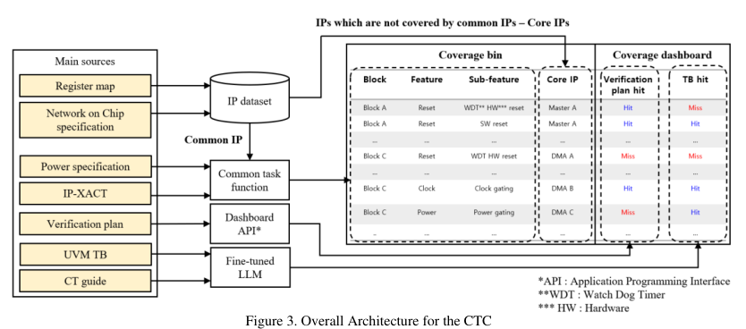
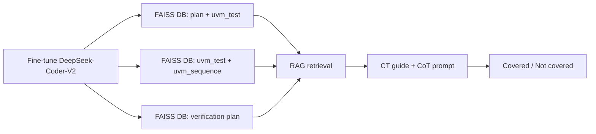

<!-- generated by yt-paper; edits will be overwritten -->
[DVCon](../dvcon/index.md) › [US](../dvcon/us.md) › [2025](../dvcon/by-year.md#2025) › [Verification](../dvcon/by-topic.md#verification)

# An Early Stage Coverage Measurement Methodology For Common Features Of System-On-Chip Verification, Using Design Metadata And Large Language Models

<figure class="rep-fig" markdown>
{ loading=lazy }
<figcaption>Figure 3. Overall Architecture for the CTC — from the original paper (Myeongwhan Hyun et al.)</figcaption>
</figure>

[:material-open-in-new: Original paper](https://dvcon-proceedings.org/wp-content/uploads/1030.pdf){ .md-button .md-button--primary target=_blank }

| | |
|---|---|
| Authors | Myeongwhan Hyun (Samsung Electronics), Jaehyeok Lee (Samsung Electronics), Jin Choi (Samsung Electronics), Dongjoo Kim (Samsung Electronics), Seonghee Yim (Samsung Electronics), Youngsik Kim (Samsung Electronics), Seonil Brian Choi (Samsung Electronics) |
| Venue | DVCon US 2025 |
| Topic | Verification |
| Type | PAPER |
| ID | `ref-20261018-9206` |

## Summary

**The paper proposes Common Task Coverage (CTC), which derives coverage bins for common SoC features and IPs from design metadata so they can be measured early in the verification plan, and uses a fine-tuned DeepSeek-Coder-V2 with RAG and CoT to measure coverage of UVM testbenches.**

**본 논문은 설계 metadata로부터 SoC 공통 기능 및 IP의 커버리지 bin을 도출하여 초기 검증 단계에서 측정할 수 있게 하는 Common Task Coverage(CTC)를 제안하고, RAG와 CoT를 적용한 fine-tuned DeepSeek-Coder-V2로 UVM TB의 커버리지를 판정합니다.**

## Key Insights

- Coverage bins are generated from design metadata (register map, NoC spec, power spec, IP-XACT) rather than post-simulation, so coverage gaps in the verification plan can be found before RTL freeze.

- 커버리지 bin을 사후 시뮬레이션이 아니라 design metadata(register map, NoC 명세, power 명세, IP-XACT)에서 생성하므로, RTL freeze 이전에 검증 계획의 커버리지 gap을 찾을 수 있습니다.

- Verification-plan check on two projects: Project A 293 gaps out of 10,641 bins (2.75%); Project B 216 gaps out of 4,325 bins (4.99%). Oversight caused 58.36% of gaps in A and 96.30% in B.

- 두 프로젝트의 검증 계획 점검 결과: Project A는 10,641 bin 중 293 gap(2.75%), Project B는 4,325 bin 중 216 gap(4.99%)입니다. Gap 원인 중 oversight는 Project A에서 58.36%, Project B에서 96.30%를 차지했습니다.

- The fine-tuned LLM on TB coverage reports accuracy 0.94, precision 0.89, recall 0.98, F1 0.98 on one project. However, the confusion-matrix counts (TP 9657, FN 218, FP 1211, TN 216) give accuracy ≈0.87 and F1 ≈0.93, so the reported accuracy and F1 do not match the table and should be checked.

- 한 프로젝트에서 fine-tuned LLM의 TB 커버리지 판정은 accuracy 0.94, precision 0.89, recall 0.98, F1 0.98로 보고됩니다. 다만 confusion matrix 개수(TP 9657, FN 218, FP 1211, TN 216)로 계산하면 accuracy ≈0.87, F1 ≈0.93이 되어 보고된 accuracy 및 F1과 표가 일치하지 않으므로 확인이 필요합니다.

- Ablation over CT guide sections shows that Test Implementation is essential (all metrics above 0.65 even alone), and removing Design Overview or Example in Cases 4 and 5 cut accuracy by more than 0.1.

- CT guide 섹션별 ablation에서 Test Implementation은 필수적이며(단독으로도 모든 지표 0.65 이상), Design Overview 또는 Example을 제거한 Case 4와 5에서는 accuracy가 0.1 이상 떨어졌습니다.

- Reported review turnaround dropped from a minimum of seven days of manual review to 1-2 days or less; the paper does not provide a controlled benchmark for this.

- 수동 리뷰의 최소 소요 기간이 7일에서 1~2일 이하로 줄었다고 보고하지만, 논문은 이에 대한 통제된 벤치마크를 제시하지 않습니다.

## Detailed Summary

### Background and Problem

- SoC designs integrate pre-verified IPs, so SoC-level verification focuses on integration of common features (clock, reset, security, power) and common IPs (CMU, PMU). The paper states that Common Tasks (CTs) account for over 40% of UVM-based verification effort.

- SoC는 사전 검증된 IP를 통합하여 만들어지므로, SoC 레벨 검증은 공통 기능(clock, reset, security, power)과 공통 IP(CMU, PMU)의 통합 검증에 초점을 둡니다. 논문은 Common Task(CT)가 전체 UVM 기반 검증 노력의 40% 이상을 차지한다고 밝힙니다.

- Two problems are identified: (1) conventional coverage can only be measured after simulation, so a CT omitted during verification planning is found late, increasing ASIC respin risk; (2) power and clock scenarios are poorly captured by code coverage.

- 두 가지 문제를 지적합니다. (1) 기존 커버리지는 시뮬레이션 이후에만 측정할 수 있어, 검증 계획 단계에서 누락된 CT가 늦게 발견되고 ASIC respin 위험이 커집니다. (2) power 및 clock 시나리오는 코드 커버리지로 잘 측정되지 않습니다.

- Separate teams write CTs and integrate them into the UVM TB, so implementation inconsistencies can occur. Manual review by project managers and DV engineers reportedly took at least seven days.

- CT 작성과 UVM TB 통합을 서로 다른 팀이 담당하여 구현 불일치가 발생할 수 있습니다. 프로젝트 매니저와 DV 엔지니어의 수동 리뷰에는 최소 7일이 걸린다고 보고합니다.

### Architecture and Methodology

The CTC flow has three measurement steps.

CTC 흐름은 세 단계의 측정으로 구성됩니다.

1. **Coverage bins from design metadata.** Four specifications supply metadata: register map (IP names, base addresses), NoC spec (masters), power spec (power features per block), and IP-XACT (hierarchies, interfaces). Core IPs are identified by excluding common IPs covered by CTs. CT functions such as `gen_bin_coreip` generate bins per Feature / Sub-feature / IP and per RTL label. In the Figure 4 example, CLOCK_GATING_BY_SW in BLK_A returns CPU_A and DMA_A.

1. **design metadata 기반 커버리지 bin 생성.** 네 가지 명세가 metadata를 제공합니다: register map(IP 이름, base address), NoC 명세(master), power 명세(블록별 power 기능), IP-XACT(계층, 인터페이스). CT가 다루는 공통 IP를 제외하여 core IP를 식별하고, `gen_bin_coreip` 같은 CT 함수가 Feature / Sub-feature / IP 단위 및 RTL label 단위로 bin을 생성합니다. Figure 4 예시에서 BLK_A의 CLOCK_GATING_BY_SW는 CPU_A와 DMA_A를 반환합니다.

2. **Verification-plan check.** A dashboard API compares CT pairs (Feature, Sub-feature, IP) in the plan against the generated bins. Exact matches are marked COVERED. Mismatches or omissions are marked NOT COVERED and need a reason, and can be WAIVED after review.

2. **검증 계획 점검.** 대시보드 API가 계획서의 CT 쌍(Feature, Sub-feature, IP)을 생성된 bin과 비교합니다. 정확히 일치하면 COVERED로 기록하고, 불일치나 누락이면 NOT COVERED로 기록하며 사유를 요구하고, 검토 후 WAIVED로 변경할 수 있습니다.

3. **LLM-based TB check.** The base model is DeepSeek-Coder-V2, fine-tuned on in-house RTL, TB, verification plans, and HDD. The pipeline is:

3. **LLM 기반 TB 점검.** 기본 모델은 DeepSeek-Coder-V2이며, 사내 RTL, TB, 검증 계획, HDD로 fine-tuning합니다. 파이프라인은 위 mermaid 다이어그램과 같습니다. 기밀 데이터 보호를 위해 로컬 모델을 사용합니다.

The prompt contains test commands, sequences, and the CT guide (Purpose, Scope, Design Overview, Test Implementation, Example). Chain of Thought is used so the model reasons step by step. The model runs locally to protect confidential data.

프롬프트에는 테스트 명령, sequence, CT guide(Purpose, Scope, Design Overview, Test Implementation, Example)가 포함됩니다. 모델이 단계별로 추론하도록 Chain of Thought를 적용합니다. 대시보드는 Apache Airflow(주기적 DB 동기화)와 Vue.js로 구현되어 블록 단위 heat map, 상태 보고서, waiver 관리를 제공합니다.

A dashboard built on Apache Airflow (periodic sync to DB) and Vue.js shows block-level heat maps, status reports, and waiver management.

### 결과 및 결론

### Results and Conclusions

- **검증 계획(Table IV):** Project A는 39개 CT, 10,641개 bin에서 293개 gap(2.75%)을 찾았습니다. 원인별로 new IP/feature 117건, 설계 수정 5건, oversight 171건입니다. Project B는 35개 CT, 4,325개 bin에서 216개 gap(4.99%)을 찾았고, 원인은 new 4건, 수정 4건, oversight 208건입니다.

- **Verification plan (Table IV):** Project A used 39 CTs and 10,641 bins, with 293 gaps (2.75%): 117 from new IPs/features, 5 from design modifications, 171 from oversight. Project B used 35 CTs and 4,325 bins, with 216 gaps (4.99%): 4 new, 4 modifications, 208 oversight.

- **LLM TB 점검(Table V):** 한 프로젝트에서 TP 9657, FN 218, FP 1211, TN 216입니다. 보고된 지표는 accuracy 0.94, precision 0.89, recall 0.98, F1 0.98입니다. Precision(≈0.889)과 recall(≈0.978)은 개수와 일치합니다. 그러나 개수로 계산한 accuracy는 (9657+216)/11302 ≈ 0.87이고 F1은 ≈0.93이므로, 보고된 accuracy 및 F1과 matrix가 일치하지 않습니다. 논문은 이를 설명하지 않으므로 해당 지표는 주의해서 해석해야 합니다.

- **LLM TB check (Table V):** On one project, TP 9657, FN 218, FP 1211, TN 216. The reported metrics are accuracy 0.94, precision 0.89, recall 0.98, F1 0.98. Precision (≈0.889) and recall (≈0.978) agree with the counts. However, accuracy from the counts is (9657+216)/11302 ≈ 0.87, and F1 is ≈0.93, so the reported accuracy and F1 are inconsistent with the matrix. The paper does not explain this, and the metrics should be treated with caution.

- **Ablation(Figure 9, 6개 케이스):** 전체 guide(Case 6)가 가장 좋은 지표를 보입니다. Test Implementation만 포함하면 점수가 가장 낮지만 모든 지표가 0.65 이상입니다. Design Overview 또는 Example을 제거하면(Case 4, 5) accuracy가 0.1 이상 떨어집니다. Scope만 포함한 Case 3은 Case 6과 비슷해, scope 정보는 다른 섹션에서 추론 가능할 수 있습니다.

- **Ablation (Figure 9, six cases):** The full guide (Case 6) gives the best metrics. Test Implementation alone gives the lowest scores, but all metrics stay above 0.65. Removing Design Overview or Example (Cases 4 and 5) lowers accuracy by more than 0.1. Scope-only (Case 3) is comparable to Case 6, so scope may be inferable from other sections.

- **리뷰 시간:** 최소 7일에서 1~2일 이하로 줄었다고 보고합니다. 이는 자체 보고 수치이며 통제된 기준선이 없습니다.

- **Review time:** Reported to fall from at least seven days to one to two days or less. This is a self-reported figure with no controlled baseline.

- **한계(저자 제시):** metadata 품질에 대한 의존, CDC/RDC 같은 정적 검증 통합의 부족, 복잡한 설계에서 LLM 성능의 가변성. 향후 과제로 LLM 적응성 향상, 정적 검증 통합, metadata 추출 자동화를 제시합니다.

- **Limitations (stated by authors):** Dependence on metadata quality, focus on simulation rather than static checks (CDC/RDC), and variable LLM performance on complex designs. Future work covers LLM adaptability, static-verification integration, and automated metadata extraction.

- **범위 참고:** 평가는 Samsung 한 회사의 익명화된 두 프로젝트와 LLM 평가용 프로젝트 한 건에 기반합니다. 기존 커버리지 도구와의 비교 baseline은 제시되지 않습니다.

- **Scope note:** The evaluation comes from a single company (Samsung), with two anonymized projects and one LLM-evaluation project. The paper does not compare against baseline coverage tools.

&nbsp;

## Videos

<iframe src="https://www.youtube-nocookie.com/embed/Z0j0T3lPedk" title="[DVCON2025]Early Stage Coverage Methodology Common Features SOC Verification Design Metadata, LLMs" loading="lazy" allow="accelerometer; clipboard-write; encrypted-media; gyroscope; picture-in-picture; web-share" referrerpolicy="strict-origin-when-cross-origin" allowfullscreen></iframe>

**[DVCON2025]Early Stage Coverage Methodology Common Features SOC Verification Design Metadata, LLMs** — [Watch on YouTube](https://www.youtube.com/watch?v=Z0j0T3lPedk) · [Video page](../videos/Z0j0T3lPedk.md)
