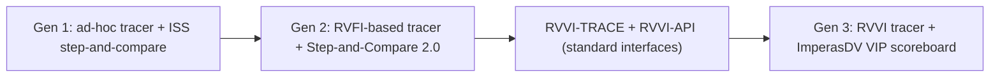

<!-- generated by yt-paper; edits will be overwritten -->
[DVCon](../dvcon/index.md) › [US](../dvcon/us.md) › [2023](../dvcon/by-year.md#2023) › [Verification](../dvcon/by-topic.md#verification)

# The Evolution of RISC-V Processor Verification: Open Standards and Verification IP

<figure class="rep-fig" markdown>
{ loading=lazy }
<figcaption>Figure 5: The third generation CORE-V-VERIF environment — from the original paper (Lee Moore et al.)</figcaption>
</figure>

[:material-open-in-new: Original paper](https://dvcon-proceedings.org/wp-content/uploads/1124-The-evolution-of-RISC-V-processor-verification-open-standards-and-verification-IP.pdf){ .md-button .md-button--primary target=_blank }

| | |
|---|---|
| Authors | Lee Moore (Imperas Software), Aimee Sutton (Imperas Software), Mike Thompson (OpenHW Group) |
| Venue | DVCon US 2023 |
| Topic | Verification |
| Type | PAPER |
| ID | `ref-20261018-921a` |

## Summary

**The paper traces three generations of the OpenHW CORE-V-VERIF UVM environment, showing how the RVVI standard tracer and API interfaces and an architectural reference-model VIP (ImperasDV) replaced ad-hoc step-and-compare logic and enabled independent checking of asynchronous interrupt handling.**

**이 논문은 OpenHW CORE-V-VERIF UVM 환경의 3세대 발전을 정리하며, RVVI 표준 트레이서/API와 아키텍처 참조 모델 VIP(ImperasDV)가 ad-hoc step-and-compare 로직을 대체하여 비동기 인터럽트 처리를 독립적으로 검증할 수 있게 되었음을 보여준다.**

## Key Insights

- Step-and-compare with an ISS fails on asynchronous events: the ISS sees interrupts and debug requests as aligned to instruction start, while RTL may take them at a different instruction, producing false negatives. Gen 2 avoided this by not connecting async events to the reference model, but that left the DUT's response to async events unverified.

- ISS 기반 step-and-compare는 비동기 이벤트에서 실패한다. ISS는 인터럽트와 디버그 요청을 명령 시작에 정렬된 것으로 보는 반면 RTL은 다른 명령에서 이를 받아들일 수 있어 false negative가 발생한다. 2세대는 비동기 이벤트를 참조 모델에 연결하지 않아 이를 피했지만, 그 결과 DUT의 비동기 이벤트 응답은 독립적으로 검증되지 못했다.

- RVVI-TRACE stores the net changes that occur between instruction retirements, with timestamps, in a SystemVerilog queue, so a checker can validate the DUT's handling of async inputs. RVFI lacked support for more than one register change per retirement, which RISC-V Zc instructions can require.

- RVVI-TRACE는 명령 retire 사이에 발생한 net 변화를 시각 정보와 함께 SystemVerilog 큐에 저장하여, 체커가 DUT의 비동기 입력 처리를 검증할 수 있게 한다. RVFI는 retire당 둘 이상의 레지스터 변화를 표현할 수 없었는데, 이는 RISC-V Zc 명령에서 필요할 수 있다.

- For randomly timed interrupts, the architectural model computes the set of legal outcomes. In the paper's staircase example with interrupts 0-7 there are 9 legal outcomes (take any one of 8 interrupts, or none). This analysis found a real CV32E40X bug (GitHub issue #665) where the DUT entered debug via ebreak instead of a legal interrupt.

- 무작위 시점의 인터럽트에 대해 아키텍처 모델은 합법적 결과 집합을 계산한다. 인터럽트 0-7이 등장하는 staircase 예제에서 합법적 결과는 9가지이다(8개 인터럽트 중 하나를 받아들이거나 아무것도 받지 않음). 이 분석으로 CV32E40X의 실제 버그(GitHub issue #665)가 발견되었다. DUT가 합법적 인터럽트 대신 ebreak로 디버그 모드에 진입한 것이다.

- Gen 3 replaces the hand-coded reference model and step-and-compare logic with ImperasDV VIP, which implements the RVVI-API. The VIP performs state comparison and keeps results in an internal scoreboard. The paper gives no quantitative effort or coverage metrics, so the claimed gains are qualitative.

- 3세대는 손으로 작성한 참조 모델과 step-and-compare 로직을 RVVI-API를 구현한 ImperasDV VIP로 대체한다. VIP는 상태 비교를 수행하고 결과를 내부 scoreboard에 보관한다. 논문은 실행 시간, 작업량, 커버리지 등 정량 지표를 제시하지 않으므로 얻은 이득은 정성적 주장이다.

## Detailed Summary

### Background and Problem

- CORE-V-VERIF is the OpenHW Group Verification Task Group's open-source UVM environment for CORE-V RISC-V cores, developed since 2019. Gens 1 and 2 used a C reference model (Imperas OVPsim ISS) run in lock-step with the DUT. The testbench compared PC, GPRs and CSRs at every instruction retirement (step-and-compare).

- CORE-V-VERIF는 OpenHW Group Verification Task Group이 2019년부터 개발한 CORE-V RISC-V 코어용 오픈소스 UVM 환경이다. 1세대와 2세대는 C 참조 모델(Imperas OVPsim ISS)을 DUT와 lock-step으로 실행했다. 테스트벤치는 명령 retire마다 PC, GPR, CSR 상태를 비교했다(step-and-compare).

- An ISS models time in instructions, while RTL models time in clock cycles. Side effects and asynchronous events (interrupts, debug requests) can therefore be timed differently in the ISS and the RTL. In Gen 1 this produced false-negative mismatches and required core-specific handling for each asynchronous event.

- ISS는 시간을 명령 단위로, RTL은 클록 사이클 단위로 모델링한다. 따라서 side effect와 비동기 이벤트(인터럽트, 디버그 요청)의 타이밍이 ISS와 RTL에서 다를 수 있다. 1세대에서는 이로 인해 false negative 불일치가 발생했고, 비동기 이벤트마다 코어별 처리가 필요했다.

- The effort needed for Gen 1 and Gen 2 was high, and OpenHW planned verification closure for at least five more cores, so a more reusable methodology was needed.

- 1세대와 2세대의 작업량이 컸고, OpenHW는 최소 5개 이상의 추가 코어에 대해 검증 종료를 계획하고 있었기 때문에 재사용성이 높은 방법론이 필요했다.

### Architecture and Methodology

- **Gen 1:** An ad-hoc, undocumented tracer bound to the RTL exposes GPR, PC and CSR state. The RTL clock is gated at each retirement so the ISS can execute one instruction, and the two states are compared.

- **1세대:** 문서화되지 않은 ad-hoc tracer가 RTL에 바인딩되어 GPR, PC, CSR 상태를 노출한다. 각 retire 시점에 RTL 클록을 게이팅하여 ISS가 명령 하나를 실행하게 한 뒤 두 상태를 비교한다.

- **Gen 2:** The tracer follows an RVFI-derived interface with CORE-V extensions (e.g., rvfi_dbg, rvfi_dbg_mode). It is usually implemented as a SystemVerilog bind module. Debug entry is seen between instructions. Async events go to the RTL only, and the tracer reports them so the step-and-compare logic can inform the ISS. This fixed the Gen 1 false negatives but left a hole: the reference model cannot independently check the DUT's interrupt priority or selection.

- **2세대:** tracer는 RVFI에서 파생되고 CORE-V 확장(예: rvfi_dbg, rvfi_dbg_mode)을 포함하는 인터페이스를 따른다. 보통 SystemVerilog bind 모듈로 구현된다. 디버그 진입은 명령 사이에서 보인다. 비동기 이벤트는 RTL에만 전달되며, tracer가 이를 보고하면 step-and-compare 로직이 ISS에 알린다. 이로써 1세대의 false negative는 해결되었지만, 참조 모델이 DUT의 인터럽트 우선순위나 선택을 독립적으로 검사할 수 없다는 공백이 남았다.

- **RVVI standard:** RVVI-TRACE is a SystemVerilog interface between the DUT and testbench, with a queue for net changes between retirements. RVVI-API is a set of DPI-C functions for the reference model and VIP. Among them are volatile CSR and memory registration functions (`rvviRefCsrSetVolatile`, `rvviRefMemorySetVolatile`). The reference model then tracks volatile addresses and propagates read/write data, which removes the need for testbench-side register-skip lists.

- **RVVI 표준:** RVVI-TRACE는 DUT와 테스트벤치 사이의 SystemVerilog 인터페이스이며, 명령 retire 사이의 net 변화를 담는 큐를 가진다. RVVI-API는 참조 모델과 VIP용 DPI-C 함수 집합이다. 그중에는 volatile CSR 및 메모리 등록 함수(`rvviRefCsrSetVolatile`, `rvviRefMemorySetVolatile`)가 있다. 참조 모델은 volatile 주소를 추적하고 읽기/쓰기 데이터를 전파하므로, 테스트벤치 쪽의 레지스터 제외 목록이 필요 없어진다.

- **Gen 3:** The RVVI tracer replaces the CORE-V tracer. ImperasDV VIP, which embeds an architectural reference model and implements RVVI-API, replaces the Imperas reference model. It performs the comparisons and holds the results in a scoreboard. Hand-coded step-and-compare logic is removed. The migration from RVFI to RVVI was still ongoing when the paper was written.

- **3세대:** RVVI tracer가 CORE-V tracer를 대체한다. 아키텍처 참조 모델을 내장하고 RVVI-API를 구현한 ImperasDV VIP가 Imperas 참조 모델을 대체한다. VIP가 비교를 수행하고 결과를 scoreboard에 보관한다. 손으로 작성한 step-and-compare 로직은 제거되었다. 논문 작성 시점에도 RVFI에서 RVVI로의 전환은 진행 중이었다.

- **Async analysis (staircase case):** Interrupt lines ramp up on successive clock edges. The interrupt condition is $\text{IRQ} = \text{MSTATUS.MIE} \land ((\text{MIE} \land \text{MIP}) \neq 0)$. The architectural model cannot know which interrupt the DUT sampled, so it enumerates the legal outcomes from the RVVI-TRACE transitions. The DUT's chosen path must belong to that set. The example has 9 legal outcomes.

- **비동기 분석(staircase 사례):** 인터럽트 라인이 연속된 클록 엣지마다 계단식으로 상승한다. 인터럽트 조건은 $\text{IRQ} = \text{MSTATUS.MIE} \land ((\text{MIE} \land \text{MIP}) \neq 0)$이다. 아키텍처 모델은 DUT가 어떤 인터럽트를 샘플링했는지 알 수 없으므로, RVVI-TRACE의 전이 정보로부터 합법적 결과를 열거한다. DUT가 선택한 경로는 이 집합에 속해야 한다. 이 예제의 합법적 결과는 9가지이다.

### Results and Conclusions

- The paper reports no quantitative metrics such as runtime, effort or coverage numbers. Its claims about reuse, robustness and efficiency are qualitative.

- 논문은 실행 시간, 작업량, 커버리지 수치 같은 정량 지표를 제시하지 않는다. 재사용성, 견고성, 효율성에 대한 주장은 정성적이다.

- The staircase analysis flagged a real CV32E40X bug. After an `mret`, the DUT executed `ebreak` and entered debug mode, which matched none of the legal outcomes. This is tracked as openhwgroup/cv32e40x issue #665.

- staircase 분석으로 CV32E40X의 실제 버그가 발견되었다. `mret` 이후 DUT가 `ebreak`를 실행해 디버그 모드에 진입했는데, 이는 어떤 합법적 결과와도 일치하지 않았다. 이 버그는 openhwgroup/cv32e40x issue #665로 추적된다.

- Gen 3 removes the error-prone step-and-compare logic and lets the processor's response to asynchronous events be validated independently.

- 3세대는 오류가 발생하기 쉬운 step-and-compare 로직을 제거하고, 비동기 이벤트에 대한 프로세서 응답을 독립적으로 검증할 수 있게 한다.

- Future work: automated functional coverage of retired instructions, enabled by the common RVVI tracer interface and the standard ISA definition.

- 향후 과제: 공통 RVVI tracer 인터페이스와 표준 ISA 정의를 기반으로 retire된 명령의 기능 커버리지를 자동 생성한다.

- The paper is a case study. Its main contribution is the methodology and interface evolution, not a benchmark.

- 이 논문은 사례 연구이며, 핵심 기여는 벤치마크가 아니라 방법론과 인터페이스의 발전 과정이다.

## Videos

<iframe src="https://www.youtube-nocookie.com/embed/jRK3zGUbXwc" title="[DVCON2023]The Evolution of RISC-V Processor Verification: Open Standards and Verification IP" loading="lazy" allow="accelerometer; clipboard-write; encrypted-media; gyroscope; picture-in-picture; web-share" referrerpolicy="strict-origin-when-cross-origin" allowfullscreen></iframe>

**[DVCON2023]The Evolution of RISC-V Processor Verification: Open Standards and Verification IP** — [Watch on YouTube](https://www.youtube.com/watch?v=jRK3zGUbXwc) · [Video page](../videos/jRK3zGUbXwc.md)
