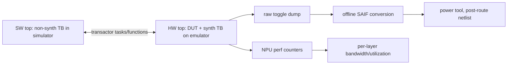

<!-- generated by yt-paper; edits will be overwritten -->
[DVCon](../dvcon/index.md) › [US](../dvcon/us.md) › [2022](../dvcon/by-year.md#2022) › [Emulation](../dvcon/by-topic.md#emulation)

# Emulation based Power and Performance Workloads on ML NPUs

<figure class="rep-fig" markdown>
{ loading=lazy }
<figcaption>Figure 1. Co-Emulation — from the original paper (Pragati Mishra et al.)</figcaption>
</figure>

[:material-open-in-new: Original paper](https://dvcon-proceedings.org/wp-content/uploads/Emulation-based-Power-and-Performance-Workloads-on-ML-NPUs.pdf){ .md-button .md-button--primary target=_blank }

| | |
|---|---|
| Authors | Pragati Mishra (Arm Ltd, Bengaluru, India), Ritu Suresh (Arm Ltd, Cambridge, UK), Issac P Zacharia (Arm Ltd, Cambridge, UK), Jitendra Aggarwal (Arm Ltd, Bengaluru, India) |
| Venue | DVCon US 2022 |
| Topic | Emulation |
| Type | PAPER |
| ID | `ref-20261018-9438` |

## Summary

**Arm migrated an ML NPU power/performance testbench from simulation to emulation using Accellera-style HW/SW co-emulation, cutting workload runtimes by roughly 560x to 860x while producing SAIF toggle data for average-power analysis.**

**Arm은 Accellera 방식의 HW/SW co-emulation을 사용해 ML NPU의 전력/성능 테스트벤치를 시뮬레이션에서 에뮬레이션으로 옮겼고, SAIF 토글 데이터를 생성하면서 워크로드 실행 시간을 약 560x~860x 단축했습니다.**

## Key Insights

- Moving an NPU power/performance testbench from simulation to emulation cut runtimes from 233,352-381,338 s to 385-493 s after TB optimization (Table 1), an overall gain of 560x-860x per test (the text cites 600-800x).

- ML NPU 전력/성능 테스트벤치를 시뮬레이션에서 에뮬레이션으로 옮긴 결과, TB 최적화 후 실행 시간이 233,352~381,338초에서 385~493초로 줄었습니다(Table 1). 테스트별 전체 이득은 560x~860x이며, 본문은 600~800x로 제시합니다.

- Raw emulator toggle dumps are converted offline into SAIF, so the emulator is not occupied by wave dumps; power is computed on the post-route netlist because RTL-based power deviates 15-20% from silicon.

- 에뮬레이터의 raw 토글 덤프를 오프라인에서 SAIF로 변환하므로 파형 덤프로 에뮬레이터가 점유되지 않습니다. RTL 기반 전력은 실리콘 대비 15~20% 편차가 있어 전력은 post-route netlist에서 계산합니다.

- Reducing HW-SW communication overhead (larger transaction buffers, fewer redundant SW calls, efficient memory read/write handling) contributed a further 2-2.5x on top of the 330x raw emulation speedup.

- HW-SW 통신 오버헤드를 줄이면(더 큰 transaction buffer, 중복 SW 호출 감소, 효율적인 메모리 읽기/쓰기 처리) 원시 에뮬레이션 가속 330x에 더해 추가로 2~2.5x의 이득을 얻었습니다.

- Key limitations: SDF-annotated power cannot run on emulators, and all RTL/TB memories must be replaced with synthesizable models.

- 주요 한계는 에뮬레이터에서 SDF 어노테이션 기반 전력 분석이 불가능하다는 점과, 모든 RTL/TB 메모리를 합성 가능한 모델로 교체해야 한다는 점입니다.

- Simulation-vs-emulation toggle mismatches were traced to compiler optimizations and resolved by switching off emulator logic optimization and adding synthesis switches.

- 시뮬레이션과 에뮬레이션 간 토글 불일치는 컴파일러 최적화에서 원인을 찾았으며, 에뮬레이터 로직 최적화 엔진을 끄고 합성 스위치를 추가하여 해결했습니다.

## Detailed Summary

### Background and Problem

- Power verification needs long runs (billions of cycles) to capture average power (toggle/SAIF) and peak power hot spots; simulators manage only hundreds of thousands of cycles.

- 전력 검증에는 평균 전력(토글/SAIF)과 피크 전력 핫스팟을 잡기 위한 장시간(수십억 사이클) 실행이 필요하지만, 시뮬레이터는 수십만 사이클 수준에 머뭅니다.

- Arm NPU power and performance workloads took several weeks to a month in simulation, which motivated migrating the design to an emulation platform.

- Arm NPU의 전력/성능 워크로드는 시뮬레이션에서 수 주에서 한 달이 걸려, 설계를 에뮬레이션 플랫폼으로 옮기게 되었습니다.

### Architecture and Methodology

- Testbench split into HW and SW tops per the Accellera co-emulation standard; transaction-based SV task/function pairs connect them. Larger transaction buffers removed redundant SW calls.

- Accellera co-emulation 표준에 따라 테스트벤치를 HW top과 SW top으로 분리했고, transaction 기반 SV task/function 쌍으로 연결했습니다. transaction buffer를 키워 중복 SW 호출을 줄였습니다.

- Raw toggle data is dumped during the run and converted offline to SAIF, freeing the emulator. Zero-delay average power is computed on the post-route netlist with tests that maximize toggling (a worst-case scenario).

- 실행 중 raw 토글 데이터를 덤프하고 이를 오프라인에서 SAIF로 변환하여 에뮬레이터를 비워 둡니다. 평균 전력은 post-route netlist 기준 0-delay로 계산하며, 토글을 최대화한 테스트(최악 조건 시나리오)를 사용했습니다.

### Results and Conclusions

- Run-time gain of 330x over simulation; HW-SW channel and memory-access tuning added 2-2.5x, for an overall gain of 600-800x per the text. Table 1 shows per-test overall gains of 560x-860x.

- 시뮬레이션 대비 실행 시간 330x 단축; HW-SW 채널 및 메모리 접근 최적화로 2~2.5x가 추가되어 본문 기준 전체 600~800x입니다. Table 1에서 테스트별 전체 이득은 560x~860x입니다.

- Limitations: SDF-annotated power is not supported on emulators, RTL power deviates 15-20% from silicon, and all memories must be synthesizable.

- 한계: 에뮬레이터에서 SDF 어노테이션 전력 분석 불가, RTL 전력은 실리콘 대비 15~20% 편차, 모든 메모리는 합성 가능해야 함.

- The paper is an industrial experience report; it gives no quantitative accuracy comparison of emulation-derived power against silicon.

- 산업 사례 보고서이며, 에뮬레이션 기반 전력 값과 실리콘의 정량적 정확도 비교는 제시하지 않습니다.

## Videos

<iframe src="https://www.youtube-nocookie.com/embed/RQPen0RqbUs" title="[DVCON2022]Emulation Based Power and Performance Workloads on ML NPUs" loading="lazy" allow="accelerometer; clipboard-write; encrypted-media; gyroscope; picture-in-picture; web-share" referrerpolicy="strict-origin-when-cross-origin" allowfullscreen></iframe>

**[DVCON2022]Emulation Based Power and Performance Workloads on ML NPUs** — [Watch on YouTube](https://www.youtube.com/watch?v=RQPen0RqbUs) · [Video page](../videos/RQPen0RqbUs.md)
