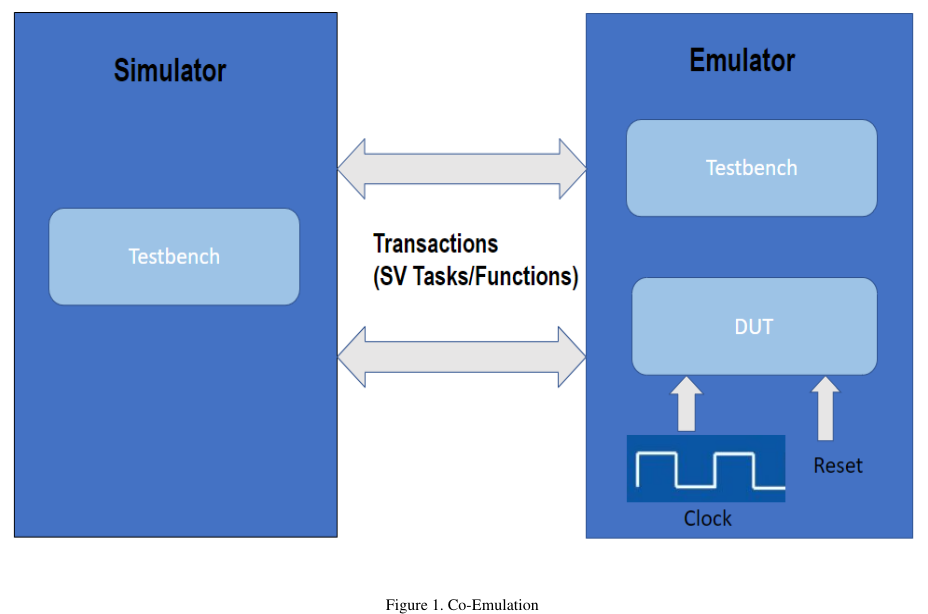
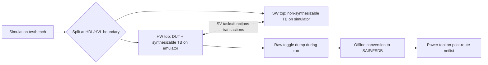

<!-- generated by yt-paper; edits will be overwritten -->
[DVCon](../dvcon/index.md) › [US](../dvcon/us.md) › [2022](../dvcon/by-year.md#2022) › [Emulation](../dvcon/by-topic.md#emulation)

# Emulation based Power and Performance Workloads on ML NPUs

<figure class="rep-fig" markdown>
{ loading=lazy }
<figcaption>Figure 1. Co-Emulation — from the original paper (Pragati Mishra et al.)</figcaption>
</figure>

[:material-open-in-new: Original paper](https://dvcon-proceedings.org/wp-content/uploads/Emulation-based-Power-and-Performance-Workloads-on-ML-NPUs.pdf){ .md-button .md-button--primary target=_blank }

| | |
|---|---|
| Authors | Pragati Mishra (Arm Ltd, Bengaluru), Ritu Suresh (Arm Ltd, Cambridge), Issac P Zacharia (Arm Ltd, Cambridge), Jitendra Aggarwal (Arm Ltd, Bengaluru) |
| Venue | DVCon US 2022 |
| Topic | Emulation |
| Type | PAPER |
| ID | `ref-20261018-9438` |

## Summary

**Arm migrated an ML NPU simulation testbench to an Accellera-style HW/SW co-emulation setup, using offline SAIF generation for power and RTL counters for performance, which cut run times by 560x to 860x per test.**

**Arm은 ML NPU 시뮬레이션 테스트벤치를 Accellera 방식의 HW/SW co-emulation 환경으로 이전했으며, 전력은 오프라인 SAIF 생성으로, 성능은 RTL 카운터로 측정하여 테스트별로 560x~860x의 실행 시간 단축을 달성했습니다.**

## Key Insights

- Splitting the simulation testbench at the HDL/HVL boundary (DUT and synthesizable TB on the emulator, non-synthesizable TB on the simulator) and linking them with SystemVerilog transaction tasks/functions gave a 330x run-time gain before optimization.

- 테스트벤치를 HDL/HVL 경계에서 분할하고(DUT와 합성 가능한 TB는 에뮬레이터, 합성 불가능한 TB는 시뮬레이터에서 실행), SystemVerilog 트랜잭션 task/function으로 연결하여 최적화 전 330x의 실행 시간 이득을 얻었습니다.

- Enlarging the transaction buffer to remove redundant SW calls, plus more efficient memory read/write handling, added another 2-2.5x and brought the overall gain to 600-800x.

- 트랜잭션 버퍼 크기를 늘려 중복 SW 호출을 제거하고, 메모리 read/write 처리를 효율화하여 추가로 2-2.5x를 얻었으며, 전체 이득은 600-800x가 되었습니다.

- Raw toggle data is dumped during the emulation run and converted offline into SAIF/FSDB with an emulator-specific script, so power collection does not occupy the emulator.

- Raw toggle 데이터는 에뮬레이션 실행 중에 덤프되고, 에뮬레이터 전용 스크립트로 오프라인에서 SAIF/FSDB로 변환되므로 전력 데이터 수집이 에뮬레이터를 점유하지 않습니다.

- Average power is computed from 0-delay toggle activity on the post-route netlist, because RTL-based power estimates deviate 15-20% from silicon; SDF-annotated power is not possible in emulation.

- RTL 기반 전력 추정은 실리콘 대비 15-20% 편차가 있어, 평균 전력은 post-route netlist에서 0-delay toggle 활동으로 계산합니다. 에뮬레이션에서는 SDF annotated 전력 분석이 불가능합니다.

- Emulation makes multi-billion-cycle power and performance runs feasible (performance runs can occupy the emulator for days), enabling several power analysis iterations before tape-out.

- 수십억 사이클 규모의 전력 및 성능 실행이 가능해져(성능 테스트는 에뮬레이터를 며칠간 점유) tape-out 이전에 여러 차례 전력 분석을 반복할 수 있습니다.

## Detailed Summary

### Background and Problem

- Average power (battery life) is derived from toggle activity captured as SAIF and fed to power tools. Peak power requires finding hot spots over billions of cycles using user-defined sampling.

- 평균 전력(배터리 수명)은 toggle 활동을 SAIF로 캡처하여 전력 툴에 입력하는 방식으로 구합니다. 피크 전력은 사용자가 정한 샘플링 방식으로 수십억 사이클에 걸쳐 hot spot을 찾아야 합니다.

- The paper states that software simulators run only a few hundred thousand cycles, which is insufficient for accurate power analysis. Hardware emulators (FPGA- or processor-based) run at MHz speeds and can execute billions of cycles.

- 논문은 소프트웨어 시뮬레이터가 수십만 사이클 정도만 실행할 수 있어 정확한 전력 분석에는 부족하다고 설명합니다. 하드웨어 에뮬레이터(FPGA 또는 processor 기반)는 MHz 속도로 동작하여 수십억 사이클을 실행할 수 있습니다.

- For Arm NPUs, simulation-based power and performance workloads took several weeks to a month, which made simulation the bottleneck. This motivated migrating the design to an emulation platform.

- Arm NPU의 전력 및 성능 워크로드는 시뮬레이션에서 수 주에서 한 달까지 걸려 병목이 되었고, 이것이 에뮬레이션 플랫폼으로 설계를 이전하는 동기가 되었습니다.

### Architecture and Methodology

- The testbench was split into a dual-top hierarchy. The HW top holds the DUT and synthesizable TB modules and runs on the emulator. The SW top holds the non-synthesizable modules and runs on the simulator. The split follows the Accellera co-emulation methodology.

- 테스트벤치를 dual-top 계층으로 분할했습니다. HW top에는 DUT와 합성 가능한 TB 모듈을 두어 에뮬레이터에서 실행하고, SW top에는 합성 불가능한 모듈을 두어 시뮬레이터에서 실행합니다. 분할은 Accellera co-emulation 방법론을 따릅니다.

- HW-SW communication is transaction-based, using SystemVerilog tasks and functions. Each SW-side call has a matching HW-side task or function that serves as a hierarchical reference.

- HW-SW 통신은 SystemVerilog task 및 function을 이용한 트랜잭션 기반 방식입니다. SW 쪽의 각 호출에 대응하는 HW 쪽 task 또는 function이 계층적 참조 역할을 합니다.

- After migration, throughput was low. Redundant SW calls were removed by increasing the transaction buffer size, which gave a large improvement.

- 이전 후 처리량이 낮았습니다. 트랜잭션 버퍼 크기를 키워 중복 SW 호출을 줄였고, 이로 인해 큰 개선이 있었습니다.

- Performance: NPU counters were added in RTL to measure bandwidth at various pipeline layers. Scripts break the counter data down per layer and report bandwidth and hardware utilization metrics.

- 성능 측정: 대역폭을 파이프라인 계층별로 계산하기 위해 RTL에 NPU 카운터를 추가했습니다. 스크립트로 카운터 데이터를 계층별로 분해하여 대역폭과 하드웨어 utilization 지표를 산출합니다.

- Power: raw toggle data is dumped during the emulation run. An emulator-specific offline script then converts it into SAIF/FSDB, using the forward SAIF, hierarchy, and output options as inputs. This keeps the emulator free. The power tool computes average power on the post-route netlist using 0-delay toggling. The tests enable all compute resources to create a worst-case, possibly unrealistic, power scenario.

- 전력 측정: 에뮬레이션 실행 중 raw toggle 데이터를 덤프합니다. 이후 에뮬레이터 전용 오프라인 스크립트가 forward SAIF, 계층 구조, 출력 옵션을 입력으로 받아 SAIF/FSDB로 변환하므로 에뮬레이터를 점유하지 않습니다. 전력 툴은 post-route netlist에서 0-delay toggle을 이용해 평균 전력을 계산합니다. 테스트는 모든 연산 자원을 활성화하여 현실에서는 발생하지 않을 수도 있는 최악의 전력 시나리오를 만듭니다.

- Challenges and fixes: compiler optimizations caused simulation-vs-emulation mismatches, which were resolved with appropriate synthesis compiler switches. Toggle mismatches in power benchmarks were resolved by switching off the emulator logic optimization engine. Emulator debug features were used to regress the HDL-HVL boundary. Performance benchmarks occupy the emulator for days, and stability was handled by the EDA vendor. Online streaming of raw toggle data directly to power tools was still in progress.

- 문제와 해결: 컴파일러 최적화로 인해 시뮬레이션과 에뮬레이션 간 불일치가 발생했고, 합성 시 적절한 컴파일러 스위치를 추가하여 해결했습니다. 전력 벤치마크의 toggle 불일치는 에뮬레이터의 로직 최적화 엔진을 끄는 방식으로 해결했습니다. HDL-HVL 경계에 대한 회귀 검증과 디버그에는 에뮬레이터 디버그 기능을 사용했습니다. 성능 벤치마크는 에뮬레이터를 며칠간 점유하며, 안정성은 EDA 벤더가 담당했습니다. raw toggle 데이터를 전력 툴로 직접 스트리밍하는 online streaming 모드는 진행 중입니다.

- Limitations: SDF-annotated power is not possible in emulation. RTL-based power has a 15-20% deviation from silicon, so post-route netlists are used. All RTL/TB memories must be replaced with synthesizable models.

- 한계: 에뮬레이션에서는 SDF annotated 전력 측정이 불가능합니다. RTL 기반 전력은 실리콘 대비 15-20% 편차가 있어 post-route netlist를 사용합니다. 모든 RTL/TB 메모리는 합성 가능한 모델로 교체해야 합니다.

### Results and Conclusions

- Migration gave a 330x run-time speedup over simulation. Optimizing the HW-SW channel and memory read/write calls added 2-2.5x, for an overall gain of 600-800x.

- 에뮬레이션 이전으로 시뮬레이션 대비 330x의 실행 시간 향상을 얻었습니다. HW-SW 채널과 메모리 read/write 호출을 최적화하여 추가로 2-2.5x를 얻었고, 전체 이득은 600-800x입니다.

- Per-test results (seconds):

- 테스트별 결과(초 단위):

| Test | Simulation | Emulation | Optimized Emulation | Gain (Sim vs Emu) |
|---|---|---|---|---|
| Test 1 | 233,352 | 692 | 385 | 600x |
| Test 2 | 344,232 | 1,264 | 493 | 700x |
| Test 3 | 257,075 | 1,036 | 458 | 560x |
| Test 4 | 374,534 | 1,020.08 | 488 | 760x |
| Test 5 | 381,338 | 900 | 441 | 860x |

| 테스트 | 시뮬레이션 | 에뮬레이션 | 최적화된 에뮬레이션 | 이득 (시뮬레이션 대비 에뮬레이션) |
|---|---|---|---|---|
| Test 1 | 233,352 | 692 | 385 | 600x |
| Test 2 | 344,232 | 1,264 | 493 | 700x |
| Test 3 | 257,075 | 1,036 | 458 | 560x |
| Test 4 | 374,534 | 1,020.08 | 488 | 760x |
| Test 5 | 381,338 | 900 | 441 | 860x |

- The listed gain figures match the simulation-to-optimized-emulation ratios (for example, 233,352 / 385 ≈ 606x). The paper reports no quantified accuracy numbers beyond the claim that emulation results are closer to actual power.

- 표에 기재된 이득 수치는 시뮬레이션 대비 최적화된 에뮬레이션 시간의 비율과 일치합니다(예: 233,352 / 385 ≈ 606x). 논문은 실제 전력에 더 가깝다는 주장 외에 정량화된 정확도 수치는 제시하지 않습니다.

- Conclusion: emulation proved to be a better verification technique for NPU power and performance workloads, because the speed allows repeated power analysis before tape-out.

- 결론: NPU 전력 및 성능 워크로드에 있어 에뮬레이션은 더 나은 검증 기법임이 입증되었으며, 속도 덕분에 tape-out 이전에 전력 분석을 반복할 수 있습니다.

## Videos

<iframe src="https://www.youtube-nocookie.com/embed/RQPen0RqbUs" title="[DVCON2022]Emulation Based Power and Performance Workloads on ML NPUs" loading="lazy" allow="accelerometer; clipboard-write; encrypted-media; gyroscope; picture-in-picture; web-share" referrerpolicy="strict-origin-when-cross-origin" allowfullscreen></iframe>

**[DVCON2022]Emulation Based Power and Performance Workloads on ML NPUs** — [Watch on YouTube](https://www.youtube.com/watch?v=RQPen0RqbUs) · [Video page](../videos/RQPen0RqbUs.md)
