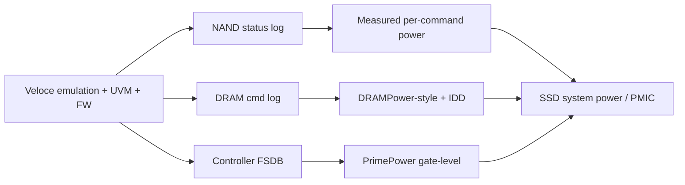

<!-- generated by yt-paper; edits will be overwritten -->
[DVCon](../dvcon/index.md) › [US](../dvcon/us.md) › [2023](../dvcon/by-year.md#2023) › [Emulation](../dvcon/by-topic.md#emulation)

# System-Level Power Estimation of SSDs under Real Workloads using Emulation

<figure class="rep-fig" markdown>
{ loading=lazy }
<figcaption>Figure 3. Overview of SSD system-level power estimation methodology — from the original paper (Sangmin Kim et al.)</figcaption>
</figure>

[:material-open-in-new: Original paper](https://dvcon-proceedings.org/wp-content/uploads/1099-System-Level-Power-Estimation-of-SSDs-under-Real-Workloads-using-Emulation.pdf){ .md-button .md-button--primary target=_blank }

| | |
|---|---|
| Authors | Sangmin Kim, Kwanghyo Ahn, Changhoon Han, Hyunsik Kim, Jaewoo Im (Samsung Electronics Co., Ltd.) |
| Venue | DVCon US 2023 |
| Topic | Emulation |
| Type | PAPER |
| ID | `ref-20261018-9555` |

## Summary

**The paper estimates SSD average and peak power by combining emulator-logged NAND/DRAM command activity with silicon-measured per-command power and gate-level controller power, reaching up to 8% error on peak total power against silicon.**

**이 논문은 에뮬레이터에서 기록한 NAND/DRAM 명령 활동에 실리콘으로 측정한 명령별 전력과 게이트 레벨 컨트롤러 전력을 결합해 SSD 평균 및 피크 전력을 추정하며, 실리콘 대비 피크 총전력 오차는 최대 8%입니다.**

## Key Insights

- Total average power error is 3% on average and 5% at most across four I/O scenarios (sequential/random read/write), while total peak power error averages 5% with a maximum of 8%.

- 네 가지 I/O 시나리오(순차/랜덤 읽기·쓰기)에서 총 평균 전력 오차는 평균 3%, 최대 5%이며, 총 피크 전력 오차는 평균 5%, 최대 8%입니다.

- Component-level errors are larger than the totals: NAND reaches 9% and DRAM 10% in average power, and some normalized peak-power DRAM entries (e.g., 0.78 in sequential read) are far from 1.00, so totals alone mask component error.

- 컴포넌트 단위 오차는 총합보다 큽니다. 평균 전력에서 NAND는 9%, DRAM은 10%에 달하며, 정규화된 피크 전력 DRAM 값 중 일부(예: 순차 읽기 0.78)는 1.00에서 크게 벗어나므로 총합만으로는 컴포넌트 오차가 가려집니다.

- The method replaces equation-based models with per-command silicon power applied to timestamped command logs from modified NAND and DDR4 behavior models, which allows time-resolved peak estimation rather than only averages.

- 이 방식은 Equation 기반 모델 대신 수정된 NAND 및 DDR4 행동 모델에서 얻은 타임스탬프 명령 로그에 실리콘 측정 명령별 전력을 적용하므로, 평균뿐 아니라 시간 분해능이 있는 피크 추정이 가능합니다.

- DRAM refresh commands are excluded from the emulator dump to keep log size manageable for multi-millisecond runs, so refresh power is computed analytically from tREFI, tRFC and IDD5B.

- 에뮬레이터 덤프 크기를 줄이기 위해 DRAM refresh 명령은 덤프에서 제외되며, refresh 전력은 tREFI, tRFC, IDD5B로 해석적으로 계산합니다.

- Estimation windows are 10–100 ms while silicon measurements span seconds, only maximum-performance scenarios without power-saving modes were evaluated, and peak accuracy depends on whether the workload covers the corner case that produces the silicon peak.

- 추정 구간은 10~100 ms인 반면 실리콘 측정은 초 단위이며, 최대 성능 시나리오만 평가했고 절전 모드는 포함하지 않았습니다. 피크 정확도는 실리콘 피크를 만드는 corner case를 테스트가 포함하는지에 달려 있습니다.

## Detailed Summary

### Background and Problem

- SSD power rises with interface speed (PCIe 5.0, up to 13,000 MB/s), and prior equation-based NAND/DRAM models give only average power. They cannot resolve intra-command fluctuation, so peak current against PMIC input limits cannot be checked.

- SSD 전력은 인터페이스 속도(PCIe 5.0, 최대 13,000 MB/s)와 함께 증가합니다. 기존 Equation 기반 NAND/DRAM 모델은 평균 전력만 제공하여 명령 내부의 전력 변동을 해석하지 못하므로, PMIC 입력 전류 한계에 대한 피크 전류를 확인할 수 없습니다.

- Peak events are rare corner cases and need long (~100 ms) realistic I/O runs on large controllers (tens of millions of instances) with firmware, which favors hardware/software co-verification over RTL simulation.

- 피크 이벤트는 드문 corner case이며, 펌웨어를 포함한 대형 컨트롤러(수천만 인스턴스)에서 약 100 ms 길이의 현실적 I/O 실행이 필요합니다. 따라서 RTL 시뮬레이션보다 하드웨어/소프트웨어 공동 검증이 적합합니다.

### Architecture and Methodology

- A UVM environment runs on the Veloce emulator. NAND and DDR4 behavior models are modified to expose command-status registers, which are dumped as timestamped per-channel, per-way logs.

- UVM 환경을 Veloce 에뮬레이터에서 구동합니다. NAND 및 DDR4 행동 모델을 수정해 명령 상태 레지스터를 노출하고, 이를 채널·way별 타임스탬프 로그로 덤프합니다.

- NAND power applies silicon-measured per-command values (Read, Program, Erase, Read/Write DMA; SLC/TLC; multi-plane), with AC timing matched to silicon.

- NAND 전력은 실리콘으로 측정한 명령별 값(Read, Program, Erase, Read/Write DMA; SLC/TLC; multi-plane)을 적용하며, AC 타이밍은 실리콘과 일치시킵니다.

- DRAM power follows DRAMPower: command log plus measured IDD values. The controller uses gate-level PrimePower on FSDB dumps.

- DRAM 전력은 DRAMPower 방식을 따릅니다. 명령 로그와 측정된 IDD 값을 사용합니다. 컨트롤러는 FSDB 덤프에 대해 게이트 레벨 PrimePower를 사용합니다.

- System power is the sum of components, or uses a measured PMIC efficiency curve for internal-PMIC designs.

- 시스템 전력은 컴포넌트 합으로 구하거나, 내부 PMIC 설계의 경우 측정된 PMIC 효율 곡선을 사용합니다.

### Results and Conclusions

- On a commercial SSD across four scenarios, average total power error averaged 3% (max 5%). Component maxima were NAND 9%, DRAM 10%, and controller 3%.

- 상용 SSD에서 네 가지 시나리오를 평가한 결과, 총 평균 전력 오차는 평균 3%(최대 5%)였습니다. 컴포넌트 최대 오차는 NAND 9%, DRAM 10%, 컨트롤러 3%입니다.

- Peak total power error averaged 5% (max 8%). Component peak errors are larger, for example DRAM at 0.78 normalized in sequential read.

- 총 피크 전력 오차는 평균 5%(최대 8%)였습니다. 컴포넌트 피크 오차는 더 크며, 예를 들어 순차 읽기 DRAM은 정규화 값 0.78입니다.

- Limitations: estimation windows of 10–100 ms versus seconds-range silicon measurement, maximum-performance scenarios only, and a single device. Peak accuracy depends on corner-case coverage in the test.

- 한계: 추정 구간은 10~100 ms인 반면 실리콘 측정은 초 단위이며, 최대 성능 시나리오만 평가했고 단일 장치에서 수행했습니다. 피크 정확도는 테스트의 corner-case 커버리지에 따라 달라집니다.

## Videos

<iframe src="https://www.youtube-nocookie.com/embed/x32Ey9cnaMw" title="[DVCON2023] System-Level Power Estimation of SSDs under Real Workloads using Emulation" loading="lazy" allow="accelerometer; clipboard-write; encrypted-media; gyroscope; picture-in-picture; web-share" referrerpolicy="strict-origin-when-cross-origin" allowfullscreen></iframe>

**[DVCON2023] System-Level Power Estimation of SSDs under Real Workloads using Emulation** — [Watch on YouTube](https://www.youtube.com/watch?v=x32Ey9cnaMw) · [Video page](../videos/x32Ey9cnaMw.md)
