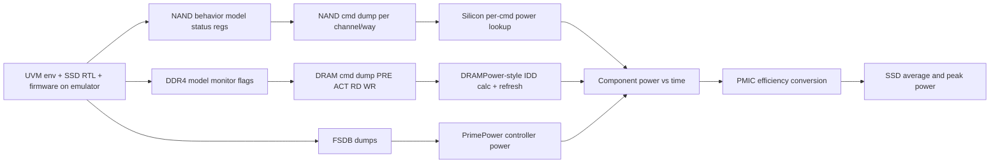

<!-- generated by yt-paper; edits will be overwritten -->
[DVCon](../dvcon/index.md) › [US](../dvcon/us.md) › [2023](../dvcon/by-year.md#2023) › [Emulation](../dvcon/by-topic.md#emulation)

# System-Level Power Estimation of SSDs under Real Workloads using Emulation

<figure class="rep-fig" markdown>
{ loading=lazy }
<figcaption>Figure 3. Overview of SSD system-level power estimation methodology — from the original paper (Sangmin Kim et al.)</figcaption>
</figure>

[:material-open-in-new: Original paper](https://dvcon-proceedings.org/wp-content/uploads/1099-System-Level-Power-Estimation-of-SSDs-under-Real-Workloads-using-Emulation.pdf){ .md-button .md-button--primary target=_blank }

| | |
|---|---|
| Authors | Sangmin Kim (Samsung Electronics), Kwanghyo Ahn (Samsung Electronics), Changhoon Han (Samsung Electronics), Hyunsik Kim (Samsung Electronics), Jaewoo Im (Samsung Electronics) |
| Venue | DVCon US 2023 |
| Topic | Emulation |
| Type | PAPER |
| ID | `ref-20261018-9555` |

## Summary

**Proposes an emulation-based SSD system power estimation flow that converts silicon-measured per-command NAND/DRAM power and emulated command activity into time-resolved average and peak power, with a maximum error of 8% on a commercial SSD.**

**실리콘에서 측정한 명령별 NAND/DRAM 전력과 에뮬레이션으로 얻은 명령 활동을 결합해 시간 분해 평균 및 피크 전력을 추정하는 에뮬레이션 기반 SSD 시스템 전력 추정 방법을 제안하며, 상용 SSD에서 최대 오차 8%를 보고한다.**

## Key Insights

- Per-command silicon power combined with command-state tracing from modified NAND behavior-model status registers and DDR4 monitor flags yields time-resolved power, enabling peak estimation that equation-based average-power models (J. Ji et al. [2]) cannot provide.

- 명령별 실리콘 전력과, 수정된 NAND 행동 모델 상태 레지스터 및 DDR4 모니터 플래그에서 얻은 명령 상태 추적을 결합하면 시간 분해 전력을 얻을 수 있다. 이를 통해 수식 기반 평균 전력 모델 [2]로는 불가능한 피크 전력 추정이 가능해진다.

- Emulation with real firmware makes 10-100 ms power windows feasible for a controller of tens of millions of instances, whereas the silicon measurements were taken over a seconds range, so the two are not time-aligned.

- 실제 펌웨어를 실행하는 에뮬레이션으로 수천만 인스턴스 규모 컨트롤러에 대해 10–100 ms 전력 추정 구간이 가능하다. 반면 실리콘 측정은 초 단위 범위에서 이루어졌으므로 두 측정의 시간 구간은 정렬되어 있지 않다.

- Total average power errors are 2%, 3%, 5%, and 2% (average 3%, max 5%) across sequential/random read/write, but component-level average errors reach 9% for NAND and 10% for DRAM (random read).

- 전체 평균 전력 오차는 순차 읽기/쓰기, 랜덤 읽기/쓰기에서 각각 2%, 3%, 5%, 2%(평균 3%, 최대 5%)이다. 컴포넌트 단위 평균 오차는 NAND 9%, DRAM 10%(랜덤 읽기)까지 커진다.

- Total peak power errors are 8%, 4%, 5%, and 4% (average 5%, max 8%), yet Table II shows component peak errors up to 22% for DRAM (sequential read, 0.78) and 12% for NAND (sequential read, 0.88); the 8% figure applies to the system total only.

- 전체 피크 전력 오차는 8%, 4%, 5%, 4%(평균 5%, 최대 8%)이다. 그러나 Table II에서 컴포넌트 피크 오차는 DRAM 순차 읽기 22%(0.78), NAND 순차 읽기 12%(0.88)까지 나타난다. 8% 수치는 시스템 전체에만 해당한다.

- The authors attribute peak error to corner-case stimulus missing from the emulated workload, so peak accuracy depends on deliberately constructed test cases. DRAM refresh tracing was disabled to limit dump size and modeled analytically from tREFI, tRFC, and IDD5B instead.

- 저자들은 피크 오차의 원인을 에뮬레이션 워크로드에 빠진 코너 케이스 자극으로 본다. 따라서 피크 정확도는 의도적으로 구성한 테스트 케이스에 의존한다. DRAM 리프레시 추적은 덤프 크기를 줄이기 위해 비활성화했고, tREFI, tRFC, IDD5B로 해석적으로 모델링했다.

## Detailed Summary

### Background and Problem

- SSD performance keeps rising (the paper cites PCIe 5.0 parts with sequential read up to 13,000 MB/s [1]), and higher throughput raises power, so accurate system-level power estimation matters.

- SSD 성능은 계속 높아지고 있으며(논문은 PCIe 5.0 제품의 순차 읽기 최대 13,000 MB/s를 인용 [1]), 처리량 증가는 전력 증가로 이어지므로 정확한 시스템 레벨 전력 추정이 중요하다.

- An SSD consists of a controller SoC, NAND flash, and DRAM cache. A mature SoC power flow exists for the controller, but NAND and DRAM power are hard to estimate.

- SSD는 컨트롤러 SoC, NAND 플래시, DRAM 캐시로 구성된다. 컨트롤러는 성숙한 SoC 전력 추정 흐름을 사용할 수 있지만, NAND와 DRAM의 전력은 추정이 어렵다.

- Prior work by J. Ji et al. [2] estimates NAND and DRAM average power with equation-based models. It does not capture power fluctuation within a command, so it cannot give peak power. Peak power matters because instantaneous current must not exceed the PMIC maximum input current.

- J. Ji 등 [2]의 기존 연구는 수식 기반 모델로 NAND와 DRAM의 평균 전력을 추정한다. 명령 내부의 전력 변동을 반영하지 못하므로 피크 전력을 구할 수 없다. 순간 전류가 PMIC의 최대 입력 전류를 넘지 않아야 하므로 피크 전력도 중요하다.

- Requirements: the controller design is tens of millions of instances, firmware must run, and the simulated window must be long (about 100 ms), because peak power appears only in corner cases. The authors therefore use emulation-based hardware/software co-verification.

- 요구 조건: 컨트롤러 설계는 수천만 인스턴스 규모이고 펌웨어를 실행해야 하며, 피크 전력은 코너 케이스에서만 나타나므로 시뮬레이션 구간이 길어야 한다(약 100 ms). 따라서 저자들은 에뮬레이션 기반 하드웨어/소프트웨어 공동 검증을 사용한다.

### Architecture and Methodology

The UVM-based verification environment runs on a hardware emulator (Veloce, Siemens EDA [9]) together with the SSD hardware and firmware. Power is estimated per component and then combined.

UVM 기반 검증 환경이 하드웨어 에뮬레이터(Veloce, Siemens EDA [9])에서 SSD 하드웨어 및 펌웨어와 함께 동작한다. 전력은 컴포넌트별로 추정한 뒤 합산한다.

- **NAND:** The behavior model is modified to add internal status registers that record the active command (Read, Program, Erase, Read DMA, Write DMA), the SLC/TLC mode, and multi-plane status bits. A dump file per NAND channel logs timestamps and each way's status (Fig. 4). Silicon-measured input power is taken for each command, conditioned on SLC/TLC and multi-plane operation. The behavior model's AC timing parameters are set to the values measured alongside the power, so simulated read/write performance matches the measured performance. Power is the sum of per-command power applied at each command's occurrence, accumulated per channel.

- **NAND:** 행동 모델(behavior model)을 수정하여 활성 명령(Read, Program, Erase, Read DMA, Write DMA), SLC/TLC 모드, 멀티 플레인 상태 비트를 기록하는 내부 상태 레지스터를 추가한다. NAND 채널마다 타임스탬프와 각 way의 상태를 기록하는 덤프 파일을 생성한다(Fig. 4). 명령별 입력 전력은 실리콘 측정값을 사용하며 SLC/TLC 모드와 멀티 플레인 동작에 따라 구분한다. 행동 모델의 AC 타이밍 파라미터는 전력과 함께 측정한 값으로 설정하여 시뮬레이션상의 읽기/쓰기 성능이 측정값과 일치하도록 한다. 각 명령이 발생하는 시점에 명령별 전력을 적용하고 채널별로 누적한다.

- **DRAM:** The emulator DDR4 model [4] is mostly encrypted, but monitoring signals are exposed in an unencrypted module. Condition flags generate a DRAM command dump for precharge, activate, write, and read. The refresh flag is disabled because frequent refresh enlarges the dump file in multi-millisecond runs. Refresh power is computed analytically from the average refresh interval tREFI, the refresh cycle time tRFC (JEDEC DDR4 [6]), and the burst refresh current IDD5B. The per-command calculation follows DRAMPower [5] with measured IDD values.

- **DRAM:** 에뮬레이터의 DDR4 메모리 모델 [4]은 대부분 암호화되어 있으나 모니터링 신호는 비암호화 모듈로 제공된다. 조건 플래그로 precharge, activate, write, read 명령의 DRAM 명령 덤프를 생성한다. 리프레시 플래그는 빈번한 리프레시가 수 ms 단위 실행의 덤프 파일 크기를 키우므로 비활성화한다. 리프레시 전력은 JEDEC DDR4 표준 [6]의 평균 리프레시 간격 tREFI, 리프레시 사이클 시간 tRFC, 버스트 리프레시 전류 IDD5B로 계산한다. 명령별 계산은 실측 IDD 값을 사용하는 DRAMPower [5] 방식과 유사하다.

- **Controller:** FSDB waveform dumps are fed to Synopsys PrimePower [7], a gate-level power tool. Process, temperature, and voltage are set close to nominal to correlate with silicon. Probing controller state signals is described as a way to track operation at peak power. UPF-based power-aware simulation with isolation, retention, and power-gating signals is mentioned as a possible extension but was not used, because only maximum-performance cases were evaluated.

- **컨트롤러:** FSDB 파형 덤프를 게이트 레벨 전력 도구인 Synopsys PrimePower [7]에 입력한다. 실리콘과의 상관관계를 높이기 위해 공정, 온도, 전압 조건을 공칭 조건에 가깝게 설정한다. 컨트롤러 상태 신호를 프로브하여 피크 전력 상황의 동작을 추적하는 방법이 설명되어 있다. 격리/보존/파워 게이팅 신호를 다루는 UPF 기반 전력 인지 시뮬레이션은 확장 가능한 방법으로 언급되지만 사용하지 않았다. 최대 성능 시나리오만 평가했기 때문이다.

- **System power:** With an external PMIC, the component currents are summed. With an internal PMIC, the PMIC efficiency is measured across output currents to build an efficiency curve (similar to [8]). The PMIC output current is then converted to input current using that curve.

- **시스템 전력:** 외부 PMIC를 사용하는 경우 컴포넌트 전류를 합산한다. 내부 PMIC를 사용하는 경우 출력 전류별 PMIC 효율을 측정하여 효율 곡선을 만들고([8]과 유사) 이를 이용해 PMIC 출력 전류를 입력 전류로 변환한다.

### Results and Conclusions

- **Setup:** The methodology was applied to a commercial SSD over four I/O scenarios: sequential read/write and random read/write. Values in the tables are normalized to silicon measurements (measured = 1.00). The same product firmware ran on silicon and in simulation. Estimation covered 10–100 ms, while silicon measurements covered a seconds range.

- **실험 조건:** 상용 SSD에 방법론을 적용하여 순차 읽기/쓰기, 랜덤 읽기/쓰기의 4가지 I/O 시나리오를 평가했다. 표의 값은 실리콘 측정값으로 정규화했다(measured = 1.00). 실리콘과 시뮬레이션에 동일한 제품 펌웨어를 사용했다. 추정은 10–100 ms 구간에서 수행되었고 실리콘 측정은 초 단위 범위에서 이루어졌다.

- **Average power (Table I):** Total estimates were 0.98 (SR), 1.03 (SW), 0.95 (RR), and 1.02 (RW). This gives an average error of 3% and a maximum of 5%. Component maxima were NAND 9% (RR, 0.91), DRAM 10% (RR, 0.90), and controller 3% (RW, 0.97). The authors note that the periodic waveform repeats several times within the window, which supports the accuracy of the average estimate.

- **평균 전력(Table I):** 전체 추정값은 SR 0.98, SW 1.03, RR 0.95, RW 1.02였다. 평균 오차는 3%, 최대 오차는 5%이다. 컴포넌트별 최대 오차는 NAND 9%(RR, 0.91), DRAM 10%(RR, 0.90), 컨트롤러 3%(RW, 0.97)이다. 저자들은 파형이 추정 구간 내에서 여러 번 주기적으로 반복되어 평균 추정의 정확도가 확보되었다고 설명한다.

- **Peak power (Table II):** Total estimates were 0.92 (SR), 0.96 (SW), 0.95 (RR), and 0.96 (RW). This gives an average error of about 5% and a maximum of 8%. Component-level peak errors are larger: DRAM 0.78 for SR (22%), NAND 0.88 for SR (12%), and controller at most 5%. The abstract's 8% maximum applies to the system total.

- **피크 전력(Table II):** 전체 추정값은 SR 0.92, SW 0.96, RR 0.95, RW 0.96이다. 평균 오차는 약 5%, 최대 오차는 8%이다. 컴포넌트 단위 피크 오차는 더 크다. DRAM은 SR에서 0.78(22%), NAND는 SR에서 0.88(12%)이며, 컨트롤러는 최대 5%이다. 초록의 8% 최대 오차는 시스템 전체 값에 해당한다.

- **Error source:** The authors attribute the peak error to corner cases. If the emulated workload does not reproduce the silicon peak event, that event is missed. Recreating such events requires specific test cases, which verification engineers would need to collect over time.

- **오차 원인:** 저자들은 피크 오차의 원인을 코너 케이스로 본다. 에뮬레이션 워크로드가 실리콘의 피크 이벤트를 재현하지 못하면 해당 이벤트를 놓치게 된다. 이를 재현하려면 특정 테스트 케이스가 필요하며, 검증 엔지니어가 시간을 두고 수집해야 한다.

- **Limitations (as stated or evident in the text):** Only one commercial SSD and one emulation platform (Veloce) were used, though the authors state the method is not vendor-specific. Smaller designs may use Verilog simulation. Power-saving modes were not evaluated. The sentence introducing the controller peak-power analysis in the source is incomplete.

- **한계(본문에 명시되었거나 본문에서 확인되는 사항):** 상용 SSD 1종과 Veloce 플랫폼 1종만 사용했다. 저자들은 이 방법이 벤더 특정적이지 않다고 밝히지만, 검증된 범위는 이에 한정된다. 소규모 설계에는 Verilog 시뮬레이션을 사용할 수 있다. 전력 절감 모드는 평가하지 않았다. 원문에서 컨트롤러 피크 전력 분석을 소개하는 문장은 미완성 상태이다.

- **Conclusion:** Combining silicon-measured per-command power with emulation-based command tracing gives system-level average and peak power estimates for SSDs with a maximum error of 8%.

- **결론:** 실리콘에서 측정한 명령별 전력과 에뮬레이션 기반 명령 추적을 결합하여, 최대 오차 8%로 SSD의 시스템 레벨 평균 및 피크 전력을 추정할 수 있다.

## Videos

<iframe src="https://www.youtube-nocookie.com/embed/x32Ey9cnaMw" title="[DVCON2023] System-Level Power Estimation of SSDs under Real Workloads using Emulation" loading="lazy" allow="accelerometer; clipboard-write; encrypted-media; gyroscope; picture-in-picture; web-share" referrerpolicy="strict-origin-when-cross-origin" allowfullscreen></iframe>

**[DVCON2023] System-Level Power Estimation of SSDs under Real Workloads using Emulation** — [Watch on YouTube](https://www.youtube.com/watch?v=x32Ey9cnaMw) · [Video page](../videos/x32Ey9cnaMw.md)
