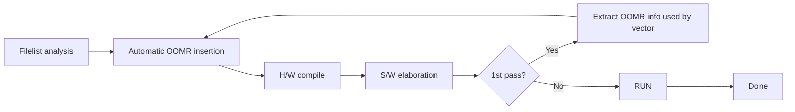

<!-- generated by yt-paper; edits will be overwritten -->
[DVCon](../dvcon/index.md) › [US](../dvcon/us.md) › [2018](../dvcon/by-year.md#2018) › [Verification](../dvcon/by-topic.md#verification)

# UVM Acceleration Using Hardware Emulator at Pre-silicon Stage

<figure class="rep-fig" markdown>
{ loading=lazy }
<figcaption>Figure 2 Dual Domain Framework — from the original paper (Sunil Roe et al.)</figcaption>
</figure>

[:material-open-in-new: Original paper](https://dvcon-proceedings.org/wp-content/uploads/uvm-acceleration-using-hardware-emulator-at-pre-silicon-stage.pdf){ .md-button .md-button--primary target=_blank }

| | |
|---|---|
| Authors | Sunil Roe (Samsung Electronics Co., Ltd.), YunGi Um (Samsung Electronics Co., Ltd.), Hyunwoo Koh (Samsung Electronics Co., Ltd.), Hyunsun Ahn (Samsung Electronics Co., Ltd.), Youngsik Kim (Samsung Electronics Co., Ltd.), Seonil Brian Choi (Samsung Electronics Co., Ltd.) |
| Venue | DVCon US 2018 |
| Topic | Verification |
| Type | PAPER |
| ID | `ref-20261018-979c` |

## Summary

**Proposes a pre-silicon UVM acceleration methodology on a hardware emulator, combining simulation-profiling-based vector selection, HVL/HDL dual-domain partitioning, and automated OOMR signal extraction, which yields 17x (normal) and 21x (power-aware) speedup on a Samsung mobile AP CPU block.**

**하드웨어 에뮬레이터 기반의 pre-silicon UVM 가속 방법론으로, 시뮬레이션 프로파일링 기반 벡터 선정, HVL/HDL dual-domain 분할, OOMR 신호 자동 추출을 결합하여 Samsung 모바일 AP CPU 블록에서 일반 테스트 17배, 전력 인지 테스트 21배의 가속을 달성했다.**

## Key Insights

- Profile hit ratios (signal toggles per vector) before emulating: CPU-oriented L4 vectors execute 99.53% on the hardware side versus about 94% for the non-CPU L2 vectors, so high-HW-ratio vectors should be prioritized to maximize emulator ROI.

- 에뮬레이션 전에 벡터별 hit ratio(신호 토글 비율)를 프로파일링하라. CPU 중심 L4 벡터는 HW 측에서 99.53%가 실행되는 반면 non-CPU L2 벡터는 약 94%이므로, HW 비중이 높은 벡터를 우선 선정해야 에뮬레이터 ROI를 극대화할 수 있다.

- Dual-domain (HVL_TOP/HDL_TOP) partitioning must avoid per-clock HVL-HDL events. The PPMU example moves the rd_req_cnt counting logic into the HDL interface, exports it with $export_read, and lets the HVL monitor read it only when needed.

- Dual-domain(HVL_TOP/HDL_TOP) 분할에서는 클럭마다 발생하는 HVL-HDL 이벤트를 피해야 한다. PPMU 예시에서는 카운터 로직(rd_req_cnt)을 HDL 인터페이스로 옮기고 $export_read로 export한 뒤, HVL 모니터가 필요할 때만 읽도록 했다.

- Missing OOMR (Out-Of-Module Reference) signals freeze test vectors (e.g., a wait on oPwrAck never resolves) and force slow emulator waveform debugging. The proposed flow runs one pre-pass (HW compile plus SW elaboration) to extract the OOMR list used by the vector, then performs a single full image build, so an extra image build is unconditional but iteration is eliminated.

- 누락된 OOMR(Out-Of-Module Reference) 신호는 테스트 벡터를 멈추게 하고(예: oPwrAck 대기가 영원히 풀리지 않음), 에뮬레이터에서 느린 파형 디버그를 유발한다. 제안 흐름은 HW 컴파일과 SW elaboration을 한 번 수행해 벡터가 실제로 사용하는 OOMR 목록을 추출한 뒤 전체 이미지를 한 번 빌드하므로, 추가 이미지 빌드 1회 비용은 들지만 반복 빌드는 제거된다.

- Measured speedup on a ~100M-gate mobile AP with no test modification: normal tests 217.7h to 12.8h (x17, 121 vectors); power-aware tests 90.5h to 4.4h (x21, 16 vectors); 137 scenarios total. Gains are limited because average simulation time is only about 2h (normal) and 5h (power-aware); the authors expect larger gains for 1000M-gate designs with multi-day simulations.

- 약 100M 게이트 모바일 AP에서 테스트 수정 없이 측정한 결과: 일반 테스트 217.7h에서 12.8h(17배, 121개 벡터), 전력 인지 테스트 90.5h에서 4.4h(21배, 16개 벡터), 총 137개 시나리오. 평균 시뮬레이션 시간이 일반 약 2h, 전력 인지 약 5h로 짧아 이득이 제한되며, 저자들은 1000M 게이트 이상의 수 일 단위 시뮬레이션에서 더 큰 이득을 기대한다.

- Early-stage workarounds: when liberty files are invalid, host-executed simulation models are used instead of custom synthesizable models (some emulator-to-host communication penalty but no compile errors); UPF is handled on black-boxed stubbed RTL; DFS uses one clock instance with PLL parameters as local parameters.

- 초기 단계의 우회 방법: liberty 파일이 무효하면 합성 가능 모델을 직접 만들지 않고 호스트에서 실행되는 시뮬레이션 모델을 사용한다(에뮬레이터-호스트 통신 오버헤드는 있으나 컴파일 오류 없이 자동화 가능). Stub된 블록은 UPF black box로 처리하고, DFS는 클럭 인스턴스 하나와 PLL 파라미터를 local parameter로 전달하는 방식으로 구성한다.

## Detailed Summary

### Background and Problem

- Mobile SoC complexity makes simulation-only UVM verification too slow at SoC level. The paper cites emulation as 10x to 100x faster than simulation with modest degradation on large designs [1], and proposes reusing the existing UVM environment on an emulator [2].

- 모바일 SoC의 복잡도가 높아져 시뮬레이션만으로는 SoC 레벨 UVM 검증이 너무 느리다. 논문은 에뮬레이션이 시뮬레이션보다 10배에서 100배 빠르며 대규모 설계에서도 성능 저하가 크지 않다고 인용한다[1]. 또한 기존 UVM 환경을 에뮬레이터에서 재사용하는 방법을 제안한다[2].

- Naive reuse is inefficient for three reasons. Emulator capacity is scarce and shared, so vector selection matters. Any vector whose hardware share is low (heavy HW/SW communication) gains little or slows down. A single UVM top must be split into HVL and HDL domains [3], and every cross-domain event costs performance.

- 단순 재사용은 비효율적이다. 에뮬레이터 용량은 제한되고 공유되므로 벡터 선정이 중요하다. HW 비중이 낮은 벡터(HW/SW 통신이 많은 벡터)는 이득이 작거나 오히려 느려진다. 단일 UVM top은 HVL과 HDL 도메인으로 나눠야 하며[3], 도메인 간 이벤트마다 성능 비용이 발생한다.

- The authors identify five practical problems: vector selection, HVL/HDL communication cost, missing OOMR signal exports that cause iterative rebuilds and slow waveform debug, invalid liberty files that block synthesizable models, and UPF/RTL mismatch when blocks are stubbed. DFS clock generation is a sixth concern.

- 저자들은 다섯 가지 실무 문제를 제시한다. 벡터 선정, HVL/HDL 통신 비용, 누락된 OOMR 신호 export로 인한 반복 빌드와 느린 파형 디버그, 무효한 liberty 파일로 인한 합성 가능 모델 생성 불가, stub된 RTL과 UPF 불일치다. DFS 클럭 생성도 여섯 번째 고려 사항이다.

### Architecture and Methodology

- **Simulation profiling:** the hit ratio (percentage of signal toggles during a vector) splits each vector into a hardware part and a software part. Figure 1 shows L4 (CPU-oriented) at 99.53% HW and L2 (non-CPU IP) at about 94%. Acceleration time is estimated from SW time, HW time, and communication time.

- **시뮬레이션 프로파일링:** hit ratio(벡터 실행 중 신호 토글 비율)로 각 벡터를 HW 부분과 SW 부분으로 나눈다. 그림 1은 L4(CPU 중심)가 HW 99.53%, L2(non-CPU IP)가 약 94%임을 보여준다. 가속 시간은 SW 시간, HW 시간, 통신 시간을 합산해 추정한다.

- **Dual-domain framework (Figure 2):** the TB runs on the software side (HVL_TOP with UVM driver, monitor, and sequencer), while the DUT and pin interfaces run on the hardware side (HDL_TOP). Communication uses a DPI-C interface and an OOMR set. The run flow alternates control between the two sides at TB delays and TB calls, which triggers hardware-software synchronization.

- **Dual-domain 프레임워크(그림 2):** TB는 SW 측(UVM driver, monitor, sequencer를 포함한 HVL_TOP)에서 실행되고, DUT와 핀 인터페이스는 HW 측(HDL_TOP)에서 실행된다. 통신은 DPI-C 인터페이스와 OOMR 집합을 통해 이뤄진다. 실행 흐름은 TB 지연과 TB 호출 시점마다 제어권을 두 측 사이에서 넘기며, 이때 HW-SW 동기화가 수행된다.

- **PPMU example (Figures 3 and 4):** the original monitor samples arvalid & arready on every aclk and increments rd_req_cnt, which produces an HVL-HDL event each cycle. The refactor moves the counter into the HDL interface and registers it with `$export_read`, so the HVL side reads it on demand and performs the same check without the per-cycle traffic.

- **PPMU 예시(그림 3, 4):** 기존 모니터는 매 aclk마다 arvalid & arready를 샘플링해 rd_req_cnt를 증가시키므로, 사이클마다 HVL-HDL 이벤트가 발생한다. 리팩터링에서는 카운터를 HDL 인터페이스로 옮기고 `$export_read`로 등록한다. 그러면 HVL 측이 필요할 때만 값을 읽어 같은 검사를 수행하며 사이클마다의 트래픽이 사라진다.

- **OOMR handling (Figures 6 and 8):** in the current flow, OOMR information is entered manually, and each missed signal means another HW compile. Figure 7 shows a test frozen at a wait on oPwrAck, because that signal was never exported. The proposed flow runs HW compile and SW elaboration once to extract the OOMR signals the vector actually uses, feeds that list into an automatic insertion step, and performs the second, complete image build.

- **OOMR 처리(그림 6, 8):** 현재 흐름에서는 OOMR 정보를 수동으로 입력하며, 신호가 빠질 때마다 HW 컴파일을 다시 한다. 그림 7은 oPwrAck가 export되지 않아 해당 대기에서 테스트가 멈춘 사례다. 제안 흐름은 HW 컴파일과 SW elaboration을 한 번 수행해 벡터가 실제로 사용하는 OOMR 신호를 추출하고, 이를 자동 삽입 단계에 넘긴 뒤 완전한 두 번째 이미지를 빌드한다.

- **Design libraries:** when liberty is absent, the paper uses host-executed simulation models instead of hand-written synthesizable models. This keeps the build automated and compile-error free, at the cost of emulator-to-host communication overhead, which the authors judge acceptable early in a project.

- **설계 라이브러리:** liberty가 없으면 손으로 만든 합성 가능 모델 대신 호스트에서 실행되는 시뮬레이션 모델을 사용한다. 이렇게 하면 빌드를 자동화하고 컴파일 오류를 피할 수 있지만, 에뮬레이터와 호스트 간 통신 오버헤드가 생긴다. 저자들은 프로젝트 초기에는 이 비용이 허용 가능하다고 본다.

- **Power-aware emulation:** RTL blocks are often stubbed for capacity or compile time (emulation compile is 2 to 3 times slower than simulation compile). The compiler must treat stubbed blocks as UPF black boxes without errors.

- **전력 인지 에뮬레이션:** 용량이나 컴파일 시간 때문에 RTL 블록을 stub하는 경우가 많다(에뮬레이션 컴파일은 시뮬레이션 컴파일보다 2~3배 느림). 컴파일러는 stub된 블록을 오류 없이 UPF black box로 처리해야 한다.

- **DFS emulation:** creating many clock instances at the top degrades performance. The approach creates one clock instance and passes PLL-derived frequencies as local parameters.

- **DFS 에뮬레이션:** 최상위에 여러 클럭 인스턴스를 만들면 성능이 떨어진다. 이 방식은 클럭 인스턴스 하나를 만들고 PLL에서 유도된 주파수를 local parameter로 전달한다.

### Results and Conclusions

- **Test set:** a mobile AP run on the emulator, CPU-block scenarios, with 137 total scenarios (121 normal and 16 power-aware), all executed unmodified.

- **테스트 세트:** CPU 블록 시나리오를 모바일 AP에서 에뮬레이터로 실행했다. 총 137개 시나리오(일반 121개, 전력 인지 16개)를 수정 없이 모두 실행했다.

| Test type | Vectors | Simulation (h) | Emulation (h) | Speed-up |
|---|---|---|---|---|
| Normal | 121 | 217.7 | 12.8 | x17 |
| Power-aware | 16 | 90.5 | 4.4 | x21 |

| 테스트 유형 | 벡터 수 | 시뮬레이션(h) | 에뮬레이션(h) | 가속비 |
|---|---|---|---|---|
| 일반 | 121 | 217.7 | 12.8 | x17 |
| 전력 인지 | 16 | 90.5 | 4.4 | x21 |

- **Limitations noted by the authors:** the design is about 100M gates, and average simulation time is only about 2h (normal) and 5h (power-aware). Those short runs limit the speed-up. The authors expect larger gains for designs over 1000M gates whose simulations take several days.

- **저자들이 언급한 한계:** 설계 규모는 약 100M 게이트이고, 평균 시뮬레이션 시간은 일반 약 2시간, 전력 인지 약 5시간에 불과하다. 이렇게 짧은 실행 시간이 가속비를 제한한다. 저자들은 시뮬레이션이 수 일씩 걸리는 1000M 게이트 이상 설계에서 더 큰 이득을 기대한다.

- **Conclusion:** the paper combines profiling-based vector prioritization, HVL/HDL partitioning that moves clock-related HVL code into HDL, one-iteration OOMR automation, host-run models for missing liberty, and UPF and DFS setups. The reported pilot result is 17x to 21x over pure simulation. The paper does not provide quantitative results for the profiling-based acceleration estimate in Figure 1(b), nor a before/after measurement for the OOMR automation flow.

- **결론:** 논문은 프로파일링 기반 벡터 우선순위 선정, 클럭 관련 HVL 코드를 HDL로 옮기는 HVL/HDL 분할, 한 번의 반복으로 끝나는 OOMR 자동화, liberty가 없을 때 호스트 실행 모델 사용, UPF 및 DFS 설정을 결합한다. 보고된 파일럿 결과는 순수 시뮬레이션 대비 17배에서 21배의 가속이다. 논문은 그림 1(b)의 프로파일링 기반 가속 추정에 대한 정량적 결과나, OOMR 자동화 흐름의 전후 비교 측정 결과는 제시하지 않는다.

## Videos

<iframe src="https://www.youtube-nocookie.com/embed/xKAp0lC5BjI" title="[DVCON2018] UVM Acceleration Using Hardware Emulator at Pre-silicon Stage" loading="lazy" allow="accelerometer; clipboard-write; encrypted-media; gyroscope; picture-in-picture; web-share" referrerpolicy="strict-origin-when-cross-origin" allowfullscreen></iframe>

**[DVCON2018] UVM Acceleration Using Hardware Emulator at Pre-silicon Stage** — [Watch on YouTube](https://www.youtube.com/watch?v=xKAp0lC5BjI) · [Video page](../videos/xKAp0lC5BjI.md)
