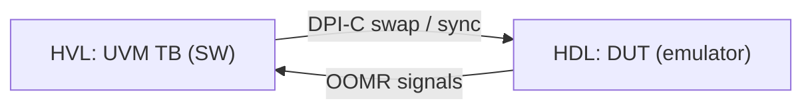

<!-- generated by yt-paper; edits will be overwritten -->
[DVCon](../dvcon/index.md) › [US](../dvcon/us.md) › [2018](../dvcon/by-year.md#2018) › [Emulation](../dvcon/by-topic.md#emulation)

# UVM Acceleration Using Hardware Emulator at Pre-silicon Stage

<figure class="rep-fig" markdown>
{ loading=lazy }
<figcaption>Figure 5. Running Flow of UVM Acceleration — from the original paper (Sunil Roe et al.)</figcaption>
</figure>

[:material-open-in-new: Original paper](https://dvcon-proceedings.org/wp-content/uploads/uvm-acceleration-using-hardware-emulator-at-pre-silicon-stage.pdf){ .md-button .md-button--primary target=_blank }

| | |
|---|---|
| Authors | Sunil Roe (Samsung Electronics), YunGi Um (Samsung Electronics), Hyunwoo Koh (Samsung Electronics), Hyunsun Ahn (Samsung Electronics), Youngsik Kim (Samsung Electronics), Seonil Brian Choi (Samsung Electronics) |
| Venue | DVCon US 2018 |
| Topic | Emulation |
| Type | PAPER |
| ID | `ref-20261018-979c` |

## Summary

**Samsung's pilot flow runs an existing UVM environment on a hardware emulator by splitting it into HVL/HDL domains, selecting vectors by simulation profiling, and automating OOMR signal export, reaching 17x (normal) and 21x (power-aware) speedups on a mobile AP.**

**삼성의 파일럿 플로우는 기존 UVM 환경을 HVL/HDL 도메인으로 분리해 하드웨어 에뮬레이터에서 실행하고, 시뮬레이션 프로파일링으로 벡터를 선별하며, OOMR 신호 export를 자동화하여 모바일 AP에서 일반 테스트 17x, 파워 어웨어 테스트 21x의 가속을 달성했다.**

## Key Insights

- Simulation hit-ratio profiling ranks vectors cheaply: CPU-centric L4 vectors show 99.53% HW-side activity versus about 94% for L2 non-CPU vectors, so L4 is prioritized for scarce emulator capacity.

- 시뮬레이션 hit ratio 프로파일링으로 벡터 우선순위를 저비용으로 정할 수 있다. CPU 중심 L4 벡터는 HW 측 활동이 99.53%인 반면 CPU가 없는 L2 벡터는 약 94%이므로, 제한된 에뮬레이터 자원에는 L4를 우선 배정한다.

- Per-clock HVL-HDL crossings must be avoided; the paper moves PPMU-style counter checks into the HDL-side interface and exports the counter so the HVL monitor reads it only when needed.

- 클록마다 발생하는 HVL-HDL 교차를 피해야 한다. 논문은 PPMU형 카운터 체크를 HDL 측 인터페이스로 옮기고 카운터를 export하여, HVL 모니터가 필요할 때만 읽도록 한다.

- Automatic OOMR extraction (one pilot hardware compile plus software elaboration to dump used signals, then a second build) replaces iterative manual signal insertion and waveform debugging; the paper does not quantify the time saved.

- OOMR 자동 추출은 파일럿 하드웨어 컴파일과 소프트웨어 elaboration으로 사용된 신호를 덤프한 뒤 두 번째 빌드를 수행하는 방식으로, 반복적인 수동 신호 삽입과 파형 디버그를 대체한다. 논문은 절약된 시간을 정량화하지 않았다.

- On a ~100MG mobile AP with unmodified vectors, normal tests ran 217.7h in simulation versus 12.8h on emulation (17x) and power-aware tests 90.5h versus 4.4h (21x); the authors attribute the modest gain to short ~2h average simulation runs.

- 약 100MG 모바일 AP에서 벡터 수정 없이 일반 테스트는 시뮬레이션 217.7h 대 에뮬레이션 12.8h(17x), 파워 어웨어 테스트는 90.5h 대 4.4h(21x)였다. 저자들은 평균 시뮬레이션 시간이 약 2h로 짧은 점을 이득이 제한된 이유로 든다.

## Detailed Summary

### Background and Problem

- Mobile SoC complexity makes simulation-only UVM regressions too slow at SoC level. Emulation is cited as 10x to 100x faster, but a UVM testbench cannot run on an emulator unchanged.

- 모바일 SoC의 복잡도 증가로 SoC 레벨에서 시뮬레이션만으로 수행하는 UVM 회귀 테스트는 너무 느리다. 에뮬레이션은 10x~100x 빠르다고 언급되지만, UVM testbench는 수정 없이 에뮬레이터에서 실행할 수 없다.

- Splitting the testbench into HVL and HDL domains creates HVL/HDL communication overhead, which can make emulation slower than simulation if vectors are not selected or restructured.

- testbench를 HVL과 HDL 도메인으로 나누면 HVL/HDL 간 통신 오버헤드가 생기며, 벡터를 선별하거나 구조를 조정하지 않으면 에뮬레이션이 시뮬레이션보다 느려질 수 있다.

- Emulator capacity is scarce and costly, so vectors must be prioritized by expected acceleration, and images contain only the needed SoC blocks.

- 에뮬레이터 자원은 희소하고 비싸므로 예상 가속 효과에 따라 벡터 우선순위를 정해야 하며, 이미지에는 필요한 SoC 블록만 포함한다.

### Architecture and Methodology

- Dual-domain framework: the UVM testbench (HVL_TOP, software side) and the DUT (HDL_TOP, hardware side) communicate through a DPI-C interface. Control swaps at vector statements and sync points on TB delays or calls.

- Dual-domain 프레임워크: UVM testbench(HVL_TOP, SW 측)와 DUT(HDL_TOP, HW 측)는 DPI-C 인터페이스로 통신한다. 제어는 벡터 문장과 TB 지연 또는 호출에 의한 sync 지점에서 전환된다.

- Signals crossing the boundary (OOMR) are extracted automatically in one pilot build instead of manual insertion with repeated rebuilds.

- 경계를 넘는 신호(OOMR)는 수동 삽입과 반복 재빌드 대신 파일럿 빌드 한 번으로 자동 추출한다.

- Non-synthesizable host simulation models are used when liberty files are invalid. UPF stubs are handled at black boxes. A single clock instance with local parameters supports DFS.

- liberty 파일이 유효하지 않으면 비합성 호스트 시뮬레이션 모델을 사용한다. UPF 스텁은 black box에서 처리하며, DFS는 로컬 파라미터를 가진 단일 클록 인스턴스로 지원한다.

### Results and Conclusions

- Mobile AP (~100MG), 137 scenarios (16 power-aware), run without vector modification. Normal: 121 vectors, 217.7h simulation to 12.8h emulation (17x). Power-aware: 16 vectors, 90.5h to 4.4h (21x).

- 약 100MG 모바일 AP에서 137개 시나리오(파워 어웨어 16개)를 벡터 수정 없이 실행했다. 일반 테스트: 121개 벡터, 시뮬레이션 217.7h에서 에뮬레이션 12.8h(17x). 파워 어웨어 테스트: 16개 벡터, 90.5h에서 4.4h(21x).

- Speedup is limited by short average simulation runs (about 2h normal, 5h power-aware). The authors expect larger gains on a >1000MG AP with multi-day simulations.

- 평균 시뮬레이션 실행 시간이 짧아(일반 약 2h, 파워 어웨어 약 5h) 가속 효과가 제한된다. 저자들은 시뮬레이션이 수 일 걸리는 1000MG 이상 AP에서 더 큰 이득을 기대한다.

- Results are from a pilot on one mobile AP. The OOMR automation benefit is described qualitatively only.

- 결과는 한 모바일 AP에 대한 파일럿이다. OOMR 자동화의 효과는 정성적으로만 기술되어 있다.

## Videos

<iframe src="https://www.youtube-nocookie.com/embed/xKAp0lC5BjI" title="[DVCON2018] UVM Acceleration Using Hardware Emulator at Pre-silicon Stage" loading="lazy" allow="accelerometer; clipboard-write; encrypted-media; gyroscope; picture-in-picture; web-share" referrerpolicy="strict-origin-when-cross-origin" allowfullscreen></iframe>

**[DVCON2018] UVM Acceleration Using Hardware Emulator at Pre-silicon Stage** — [Watch on YouTube](https://www.youtube.com/watch?v=xKAp0lC5BjI) · [Video page](../videos/xKAp0lC5BjI.md)
