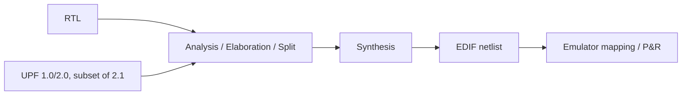

<!-- generated by yt-paper; edits will be overwritten -->
[DVCon](../dvcon/index.md) › [Europe](../dvcon/europe.md) › [2022](../dvcon/by-year.md#2022) › [Emulation](../dvcon/by-topic.md#emulation)

# An Accelerated System Level CPU Verification through Simulation-Emulation Co-Existence

<figure class="rep-fig" markdown>
{ loading=lazy }
<figcaption>Figure 11 : Unified Compilation flow for Power Aware Run — from the original paper (Ruchi Misra et al.)</figcaption>
</figure>

[:material-open-in-new: Original paper](https://dvcon-proceedings.org/wp-content/uploads/74321.pdf){ .md-button .md-button--primary target=_blank }

| | |
|---|---|
| Authors | Ruchi Misra, Samridh Deva, Sai Krishna Pallekonda, Alok Kumar, Garima Srivastava (Samsung Semiconductors India R&D, Bangalore), Youngsik Kim, Seonil Brian Choi (Samsung Electronics, Korea); DVCon Europe |
| Venue | DVCon Europe 2022 |
| Topic | Emulation |
| Type | PAPER |
| ID | `ref-20261018-98d5` |

## Summary

**The paper proposes splitting SoC-level CPU verification between simulation and emulation, moving long-running coherency, DVFS and UPF-based power-aware scenarios to emulators while reusing the same synthesizable RTL in both PA-simulation and PA-emulation flows.**

**이 논문은 SoC 수준 CPU 검증을 시뮬레이션과 에뮬레이션으로 나누어, 장시간 실행되는 coherency, DVFS, UPF 기반 power-aware 시나리오를 에뮬레이터로 옮기고 PA-시뮬레이션과 PA-에뮬레이션에서 동일한 synthesizable RTL을 재사용하는 방법을 제안한다.**

## Key Insights

- Partition the test plan: long-running low-power and random stress tests go to the emulator, while checker-heavy or debug-heavy cases are recreated in simulation.

- 테스트 플랜을 분할하십시오. 장시간 실행되는 low-power 및 random stress 테스트는 에뮬레이터로 보내고, checker 의존도가 높거나 디버그가 어려운 케이스는 시뮬레이션에서 재현합니다.

- Sharing the same synthesizable RTL and UPF intent between PA-simulation and PA-emulation keeps precedence rules and debug continuity across both targets.

- PA-시뮬레이션과 PA-에뮬레이션에서 동일한 synthesizable RTL과 UPF intent를 공유하면 두 타깃 사이의 precedence rule과 디버그 연속성을 유지할 수 있습니다.

- The authors report up to 40x savings in time and resources, and at least 50X time saving for critical long-pole features on Exynos mobile and automotive SoCs; these are indicative, and per-scenario numbers appear only in a plot (Fig. 16).

- 저자들은 시간 및 리소스를 최대 40x 절감했고, Exynos 모바일 및 자동차 SoC의 critical long-pole 기능에서 최소 50X 시간 절감을 보고했습니다. 이 수치는 참고용이며, 시나리오별 수치는 Fig. 16의 그래프에만 나타납니다.

- A common integration pitfall is power-bias enable clashes across IPs, which the authors resolved by setting enable_bias to false for all IPs and the SoC top.

- IP 간 power bias enable 충돌은 흔한 통합 문제이며, 저자들은 모든 IP와 SoC top에서 enable_bias를 false로 설정하여 해결했습니다.

- Emulator UPF support is limited to UPF 1.0/2.0 plus a subset of 2.1, so the supported constructs must be verified before adopting the flow.

- 에뮬레이터의 UPF 지원은 UPF 1.0/2.0과 UPF 2.1의 일부 명령으로 제한되므로, 도입 전 지원되는 구문을 반드시 확인해야 합니다.

## Detailed Summary

### Background and Problem

- SoC-level simulation of multi-core CPUs, GPUs, accelerators, DDR and peripherals is too slow for long power-up/power-down sequences, coherency stress and DVFS sweeps, which makes iterative debug expensive.

- 멀티코어 CPU, GPU, 가속기, DDR, 주변장치를 포함한 SoC 수준 시뮬레이션은 장시간의 power-up/power-down 시퀀스, coherency stress, DVFS 스윕에 비해 너무 느려 반복적인 디버그 비용이 큽니다.

- Emulators map the DUT onto FPGAs and run near real speed, but they lack some checkers and are harder to debug, so the test plan must be partitioned between the two environments.

- 에뮬레이터는 DUT를 FPGA에 매핑하여 실제 속도에 가깝게 동작하지만 일부 checker가 부족하고 디버그가 어려우므로, 테스트 플랜을 두 환경 사이에서 분할해야 합니다.

### Architecture and Methodology

- Test planning: low-power and random stress tests are prioritized for emulation. Cases that need missing checkers or deep debug are recreated in simulation.

- 테스트 계획: low-power 및 random stress 테스트를 에뮬레이션에 우선 배정합니다. checker가 필요하거나 깊은 디버그가 필요한 케이스는 시뮬레이션에서 재현합니다.

- Migration: sanity tests run first. C tests are compiled into full or base images, and scripts automate binary separation, license checkout and waveform start/stop into a single command.

- 마이그레이션: sanity 테스트를 먼저 실행합니다. C 테스트는 full 또는 base 이미지로 컴파일되며, 스크립트가 바이너리 분리, 라이선스 획득, 파형 덤프 시작/종료를 단일 명령으로 자동화합니다.

- Coherency stress mixes DVM, exclusive accesses and IO-coherent traffic, with varied page-table attributes, memory ordering and forced cache evictions. DVFS and clock-gating, retention and power-down scenarios also run on the emulator.

- Coherency stress는 DVM, exclusive access, IO-coherent 트래픽을 혼합하고, page-table 속성, 메모리 순서, 강제 cache eviction을 변화시킵니다. DVFS, clock gating, retention, power-down 시나리오도 에뮬레이터에서 실행합니다.

- PA flow: RTL and UPF are analyzed, elaborated, split and synthesized into EDIF. The synthesizable RTL is shared between PA-simulation and PA-emulation, and a PowerMgt C++ API controls power domains.

- PA 흐름: RTL과 UPF를 analysis, elaboration, split 후 synthesis하여 EDIF를 생성합니다. synthesizable RTL은 PA-시뮬레이션과 PA-에뮬레이션에서 공유되며, PowerMgt C++ API가 power domain을 제어합니다.

### Results and Conclusions

- Simulation and emulation run times were compared for functional and low-power scenarios on two emulator platforms (Cadence and Synopsys). The per-scenario data appear only as plots (Fig. 16), so no exact figures are given in the text.

- 두 가지 에뮬레이터 플랫폼(Cadence, Synopsys)에서 기능 및 low-power 시나리오의 시뮬레이션과 에뮬레이션 run time을 비교했습니다. 시나리오별 데이터는 그래프(Fig. 16)로만 제시되어 본문에는 정확한 수치가 없습니다.

- The paper reports up to 40x time and resource savings (Sec. III) and at least 50X time saving on critical long-pole features in Exynos mobile and automotive SoCs.

- 논문은 시간 및 리소스를 최대 40x 절감(Sec. III)했고, Exynos 모바일 및 자동차 SoC의 critical long-pole 기능에서 최소 50X 시간 절감을 보고합니다.

- Common issues: power-bias enable clashes across IPs (fixed with enable_bias=false on all IPs and the top) and stale or corrupt cell-library paths that need manual updates.

- 주요 이슈: IP 간 power bias enable 충돌(모든 IP와 top에서 enable_bias=false로 해결)과 stale 또는 corrupt cell-library 경로(수동 갱신 필요).

- The authors describe the results as indicative and limited to the emulator-supported UPF subset.

- 저자들은 결과를 참고용으로 설명하며, 에뮬레이터가 지원하는 UPF 부분집합으로 한정된다고 밝힙니다.

## Videos

<iframe src="https://www.youtube-nocookie.com/embed/KxjDULVuMQE" title="[DVCON2022_EUROPE]An Accelerated System Level CPU Verification through Simulation-Emulation Co-Exist" loading="lazy" allow="accelerometer; clipboard-write; encrypted-media; gyroscope; picture-in-picture; web-share" referrerpolicy="strict-origin-when-cross-origin" allowfullscreen></iframe>

**[DVCON2022_EUROPE]An Accelerated System Level CPU Verification through Simulation-Emulation Co-Exist** — [Watch on YouTube](https://www.youtube.com/watch?v=KxjDULVuMQE) · [Video page](../videos/KxjDULVuMQE.md)
