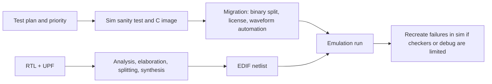

<!-- generated by yt-paper; edits will be overwritten -->
[DVCon](../dvcon/index.md) › [Europe](../dvcon/europe.md) › [2022](../dvcon/by-year.md#2022) › [Emulation](../dvcon/by-topic.md#emulation)

# An Accelerated System Level CPU Verification through Simulation-Emulation Co-Existence

<figure class="rep-fig" markdown>
{ loading=lazy }
<figcaption>Figure 11 : Unified Compilation flow for Power Aware Run — from the original paper (Ruchi Misra et al.)</figcaption>
</figure>

[:material-open-in-new: Original paper](https://dvcon-proceedings.org/wp-content/uploads/74321.pdf){ .md-button .md-button--primary target=_blank }

| | |
|---|---|
| Authors | Ruchi Misra, Samridh Deva, Sai Krishna Pallekonda, Alok Kumar, Garima Srivastava (Samsung Semiconductors India R&D, Bangalore); Youngsik Kim, Seonil Brian Choi (Samsung Electronics, Korea); DVCon Europe |
| Venue | DVCon Europe 2022 |
| Topic | Emulation |
| Type | PAPER |
| ID | `ref-20261018-98d5` |

## Summary

**Samsung describes a methodology that offloads long-running SoC-level CPU scenarios (cache coherency, DVFS, UPF-based power-aware runs) from simulation to emulation while reusing the same synthesizable design, reporting up to 40x and at least 50x time savings on critical long-pole features.**

**삼성 연구진은 SoC 레벨 CPU 검증의 장시간 시나리오(캐시 코히어런시, DVFS, UPF 기반 PA 런)를 동일한 합성 가능 설계를 재사용하면서 시뮬레이션에서 에뮬레이션으로 옮기는 방법론을 제시하며, 핵심 long-pole 기능에서 최대 40배 및 최소 50배의 시간 절감을 보고한다.**

## Key Insights

- Long-running, multi-iteration scenarios (power-up/power-down sequences, full-chip coherency stress, DVFS sweeps) are the best candidates for emulation; the paper reports up to 40x savings in time and resources (Section III) and at least 50X time savings in closing critical long-pole features on Exynos Mobile and Automotive SoCs (Results item 7).

- 장시간 반복이 필요한 시나리오(전원 on/off 시퀀스, 풀칩 코히어런시 스트레스, DVFS 스윕)가 에뮬레이션에 가장 적합하다. 논문은 시간 및 리소스에서 최대 40배 절감(Section III)과 Exynos Mobile 및 Automotive SoC에서 핵심 long-pole 기능 클로저에 최소 50X 시간 절감(Results 항목 7)을 보고한다.

- Keeping synthesizable design components identical between PA simulation and PA emulation targets preserves debug continuity and common UPF semantics, so failures can move between the two environments.

- PA 시뮬레이션과 PA 에뮬레이션 타깃에서 합성 가능 설계 컴포넌트를 동일하게 유지하여 디버그 연속성과 공통 UPF 시맨틱을 확보하므로, 두 환경 사이에서 실패를 옮겨 분석할 수 있다.

- Emulation-specific limitations (missing checkers, difficult debug) are handled by splitting the test plan: long or stress tests run on emulation, and failing cases are recreated in simulation for analysis.

- 에뮬레이션의 한계(체커 부재, 디버그 난이도)는 테스트 계획을 분리하여 해결한다. 장시간 또는 스트레스 테스트는 에뮬레이션에서 실행하고, 실패 케이스는 시뮬레이션에서 재현한다.

- Most frequent UPF-on-emulator compile issues were power-well bias conflicts between IP and SoC top (resolved by setting enable_bias to false) and stale or corrupt cell library paths that must be updated manually because IP library release schedules differ.

- UPF-on-에뮬레이터에서 가장 빈번한 컴파일 이슈는 IP와 SoC top 간 power well bias 충돌(enable_bias를 false로 설정하여 해결)과 IP별 라이브러리 릴리스 일정 차이로 생기는 stale 또는 corrupt cell 라이브러리 경로(수동 갱신 필요)였다.

## Detailed Summary

### Background and Problem

- Full-SoC simulation becomes very slow as designs integrate multiple heterogeneous CPU cores, GPUs, accelerators, peripherals, and DDR. This makes iterative debug slow and sometimes ineffective.

- 다수의 이기종 CPU 코어, GPU, 가속기, 주변장치, DDR을 통합한 풀 SoC 시뮬레이션은 매우 느려지며, 이로 인해 반복적인 디버그가 시간이 많이 들고 비효율적이 된다.

- Low-power verification needs many power-up and power-down sequences. Coherency tests that involve real GPU or multimedia RTL with real CPUs also run for a long time in simulation.

- 저전력 검증에는 많은 power-up 및 power-down 시퀀스가 필요하다. 실제 GPU 또는 멀티미디어 RTL과 실제 CPU가 결합된 코히어런시 테스트도 시뮬레이션에서 장시간 실행된다.

- Multi-cluster SoCs with private L1, private/shared L2, shared L3, and system-level or last-level cache make full-chip coherency verification essential. The processor vendor may not supply the inter-cluster coherency mechanism.

- 멀티 클러스터 SoC의 경우 코어별 private L1, private/shared L2, shared L3 캐시와 시스템 레벨 또는 last-level 캐시가 존재하므로 풀칩 코히어런시 검증이 필수적이다. 프로세서 벤더가 클러스터 간 코히어런시 메커니즘을 제공하지 않을 수도 있다.

- Prior UPF work (DVCon 2009, NORCHIP 2009, DVCon 2010) established simulation-based power-aware verification. The paper argues that power-aware verification is now the long pole of the verification lifecycle.

- 기존 UPF 연구(DVCon 2009, NORCHIP 2009, DVCon 2010)는 시뮬레이션 기반 PA 검증을 확립했다. 논문은 이제 PA 검증이 검증 라이프사이클의 long pole이 되었다고 주장한다.

### Architecture and Methodology

**Emulator setup and compilation.** The DUT is mapped onto one or more FPGAs and memory chips in the emulator server. The test environment runs on interface FPGAs that implement the hardware testbench. The server connects to a host PC over a high-speed board. The compile flow has four stages: front-end RTL synthesis to gate-level netlists; system-level back-compilation (splitting large netlists, system place-and-route, and STA); core-level mapping onto the emulator server; and FPGA place-and-route that produces binaries. The paper notes that an optimized compile balances compile efficiency against emulation performance.

**에뮬레이터 구성 및 컴파일.** DUT는 에뮬레이터 서버의 하나 이상의 FPGA와 메모리 칩에 매핑된다. 테스트 환경은 하드웨어 테스트벤치를 구현하는 인터페이스 FPGA에서 동작한다. 서버는 고속 보드를 통해 호스트 PC와 연결된다. 컴파일 흐름은 4단계로 구성된다. 첫째, 프론트엔드 RTL 합성으로 게이트 레벨 넷리스트를 생성한다. 둘째, 시스템 레벨 백엔드 컴파일(대형 넷리스트 분할, 시스템 place-and-route, STA)을 수행한다. 셋째, 코어 레벨 매핑을 에뮬레이터 서버에 수행한다. 넷째, FPGA place-and-route로 바이너리를 생성한다. 논문은 최적화된 컴파일이 컴파일 효율과 에뮬레이션 성능 사이의 균형을 맞춰야 한다고 언급한다.

**Test planning.** Critical and long-running functional and low-power scenarios, plus random stress traffic, are targeted at emulation. Cases that need missing checkers or are hard to debug are recreated in simulation. Tests are prioritized so that milestones are not blocked by long-running scenarios.

**테스트 계획.** 장시간 실행되는 중요한 기능 및 저전력 시나리오와 랜덤 스트레스 트래픽은 에뮬레이션 대상으로 지정한다. 누락된 체커가 필요하거나 디버그가 어려운 케이스는 시뮬레이션에서 재현한다. 장시간 시나리오로 인해 검증 마일스톤이 막히지 않도록 테스트 우선순위를 정한다.

**Sim-to-emulation migration.** Sanity tests are migrated first. C test images are built, and either a full image or a base image is used depending on which blocks are involved. Scripts split the binary and a Tcl file handles the setup. The authors automated the manual steps (binary separation, license application, waveform start/stop) into a single-input, single-command flow.

**시뮬레이션에서 에뮬레이션으로의 마이그레이션.** 먼저 sanity 테스트를 이관한다. C 테스트 이미지를 빌드하고, 관련 블록에 따라 full image 또는 base image를 사용한다. 스크립트로 바이너리를 분리하고 Tcl 파일로 설정을 처리한다. 저자들은 수동 단계(바이너리 분리, 라이선스 적용, 파형 덤프 시작/종료)를 단일 입력, 단일 명령 흐름으로 자동화했다.

**Scenarios covered:**

**다룬 시나리오:**

- Coherency: a stress scenario mixing DVM, exclusive accesses, and IO-coherent transactions, with varied page-table attributes and memory ordering, creating multiple cache-line evictions.

- 코히어런시: DVM, exclusive access, IO-coherent 트랜잭션을 혼합한 스트레스 시나리오이며, page table 속성과 메모리 오더링을 변화시키고 다수의 cache-line eviction을 생성한다.

- DVFS: frequency and voltage scaling across memory interface, cores, and coherent interconnect. The authors note these sweeps take huge simulation time.

- DVFS: 메모리 인터페이스, 코어, 코히어런트 인터커넥트에 대한 주파수 및 전압 스케일링. 저자들은 이러한 스윕이 시뮬레이션에서 매우 많은 시간을 소요한다고 지적한다.

- Low power: core/cluster clock gating, memory retention, and full power-down and sleep, run both without and with UPF.

- 저전력: 코어/클러스터 클록 게이팅, 메모리 리텐션, 완전한 power-down 및 sleep. UPF 적용 전후 모두에서 실행한다.

**UPF enablement.** The design is compiled with the same synthesizable components for PA simulation and PA emulation. The emulator supports UPF 1.0 and 2.0 (IEEE 1801-2009) and a limited subset of UPF 2.1 (IEEE 1801-2013), along with hierarchical and non-hierarchical UPF. The flow is:

**UPF 지원.** PA 시뮬레이션과 PA 에뮬레이션에 동일한 합성 가능 컴포넌트를 사용하여 설계를 컴파일한다. 에뮬레이터는 UPF 1.0 및 2.0(IEEE 1801-2009)과 UPF 2.1(IEEE 1801-2013)의 제한된 부분집합을 지원하며, 계층적 및 비계층적 UPF를 모두 지원한다. 흐름은 다음과 같다.

The PA compile flow feeds RTL and UPF into the EDA tool. After analysis, elaboration, splitting, and synthesis, it produces EDIF netlists. The authors list the benefits as common semantics between sim and emulation, similar UPF construct support, early error flagging inherited from the simulator, precedence rules carried over from the simulation target, and debug continuity.

PA 컴파일 흐름은 RTL과 UPF를 EDA 도구에 입력한다. 분석, elaboration, 분할, 합성 이후 EDIF 넷리스트를 생성한다. 저자들이 제시한 이점은 시뮬레이션과 에뮬레이션 간 공통 시맨틱, 유사한 UPF 구문 지원, 시뮬레이터의 조기 에러 검출 활용, 시뮬레이션 타깃에서 이어받은 우선순위 규칙, 디버그 연속성이다.

**Enablement steps.** Update the Makefile and fix power-related ports on IP instances. Gather the full UPF library list. Convert libraries to emulation-compatible formats with a lib-to-DB script. Resolve UPF version and tool-option issues. Then run basic single- and multi-core power-down tests to confirm the test intent. The PowerMgt C++ class exposes APIs for power-aware control on the emulator, and Figure 12 and Figure 13 list the relevant UPF commands and APIs.

**활성화 단계.** Makefile을 수정하고 IP 인스턴스의 전원 관련 포트를 수정한다. 전체 UPF 라이브러리 목록을 확보한다. lib-to-DB 스크립트로 라이브러리를 에뮬레이션 호환 형식으로 변환한다. UPF 버전 및 도구 옵션 이슈를 해결한다. 이후 단일/다중 코어 power-down 기본 테스트를 실행하여 테스트 의도를 확인한다. PowerMgt C++ 클래스는 에뮬레이터에서 전원 인식 제어를 위한 API를 제공하며, 관련 UPF 명령과 API는 Figure 12와 Figure 13에 정리되어 있다.

**Common errors.** (1) Power-well bias enable/disable rules differ across IPs and clash with the SoC-level rule. The fix was to set enable_bias to false for all IPs and the SoC top. (2) Cell libraries from IPs have different release schedules, so stale or corrupt library paths appear during integration and must be updated manually.

**주요 에러.** (1) IP마다 다른 power well bias 활성화/비활성화 규칙이 SoC 레벨 규칙과 충돌한다. 해결책은 모든 IP와 SoC top에 enable_bias를 false로 설정하는 것이었다. (2) IP 셀 라이브러리의 릴리스 일정이 달라 통합 시 stale 또는 corrupt 라이브러리 경로가 발생하며 수동으로 갱신해야 한다.

### Results and Conclusions

- The paper reports that multiple long-running functional and low-power scenarios were ported to emulation and ran faster than in simulation on the same design drop.

- 여러 장시간 기능 및 저전력 시나리오를 에뮬레이션으로 이관했으며, 동일 설계 드롭에서 시뮬레이션보다 빠르게 실행되었다고 보고한다.

- Stated savings: up to 40x in time and resources (Section III), and at least 50X in closing certain critical long-pole features on Exynos Mobile and Automotive SoCs (Results item 7).

- 명시된 절감 효과: 시간 및 리소스에서 최대 40배(Section III), Exynos Mobile 및 Automotive SoC의 핵심 long-pole 기능 클로저에서 최소 50X(Results 항목 7).

- The authors also report fewer iterations, lower debug time, and a shorter verification schedule. They describe the results as indicative and based on emulators from two vendors, Cadence and Synopsys.

- 저자들은 반복 횟수, 디버그 시간, 검증 일정이 줄었다고 보고한다. 결과는 Cadence와 Synopsys 두 벤더의 에뮬레이터 기반이며 참고용(indicative)이라고 설명한다.

- Emulation is used to find critical bugs early rather than to achieve full coverage. Automation lets engineers move between simulation and emulation as needed.

- 에뮬레이션은 전체 커버리지 달성보다 중요한 버그를 조기에 찾는 데 사용된다. 자동화 덕분에 필요에 따라 시뮬레이션과 에뮬레이션 사이를 쉽게 전환할 수 있다.

- Limitation: the extracted text includes only figure captions for the run-time comparison (Figure 16) and the PA results on the Synopsys platform (Figure 17). No numeric run-time values are present in the text, so the speedup figures above are the paper's own summary claims.

- 한계: 추출된 텍스트에는 런타임 비교(Figure 16)와 Synopsys 플랫폼의 PA 결과(Figure 17)에 대한 figure caption만 있으며, 런타임 수치 값은 없다. 따라서 위의 속도 향상 수치는 논문 저자의 요약 주장이다.

## Videos

<iframe src="https://www.youtube-nocookie.com/embed/KxjDULVuMQE" title="[DVCON2022_EUROPE]An Accelerated System Level CPU Verification through Simulation-Emulation Co-Exist" loading="lazy" allow="accelerometer; clipboard-write; encrypted-media; gyroscope; picture-in-picture; web-share" referrerpolicy="strict-origin-when-cross-origin" allowfullscreen></iframe>

**[DVCON2022_EUROPE]An Accelerated System Level CPU Verification through Simulation-Emulation Co-Exist** — [Watch on YouTube](https://www.youtube.com/watch?v=KxjDULVuMQE) · [Video page](../videos/KxjDULVuMQE.md)
