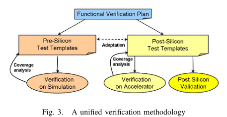

<!-- generated by yt-paper; edits will be overwritten -->
[DATE](../date/index.md) › [2011](../date/by-year.md#2011) › [Verification](../date/by-topic.md#verification)

# A Unified Methodology for Pre-Silicon Verification and Post-Silicon Validation

<figure class="rep-fig" markdown>
{ loading=lazy }
<figcaption>Fig. 3. A unified verification methodology — from the original paper (Allon Adir et al.)</figcaption>
</figure>

[:material-open-in-new: Original paper](https://past.date-conference.com/proceedings-archive/2011/DATE11/PDFFILES/12.4_3.PDF){ .md-button .md-button--primary target=_blank }

| | |
|---|---|
| Authors | Allon Adir (IBM Research - Haifa), Shady Copty (IBM Research - Haifa), Shimon Landa (IBM Research - Haifa), Amir Nahir (IBM Research - Haifa), Gil Shurek (IBM Research - Haifa), Avi Ziv (IBM Research - Haifa), Charles Meissner (IBM Server and Technology Group, Austin), John Schumann (IBM Server and Technology Group, Austin); DATE 2011 (EDAA) |
| Venue | DATE 2011 |
| Topic | Verification |
| Type | PAPER |
| ID | `ref-20261018-9bfe` |

## Summary

**Proposes a unified pre-/post-silicon verification methodology that shares one verification plan, a common test-template language, and common coverage models across simulation, acceleration, and silicon, realized in the bare-metal directable exerciser Threadmill and applied to IBM POWER7.**

**사전 실리콘 검증과 사후 실리콘 검증이 하나의 검증 계획, 공통 test-template 언어, 공통 coverage 모델을 공유하도록 하는 통합 방법론을 제안하며, 이를 베어메탈 directable exerciser인 Threadmill로 구현해 IBM POWER7에 적용한다.**

## Key Insights

- Silicon has far lower observability than simulation or acceleration, so coverage of post-silicon exercisers is measured by running them on accelerators in a silicon-like environment.

- 실리콘은 시뮬레이션이나 가속기보다 관찰성이 현저히 낮으므로, post-silicon exerciser의 coverage는 가속기에서 실리콘과 유사한 환경으로 실행해 측정한다.

- Post-silicon generation must be lightweight: Threadmill generates tests statically without a reference model and checks results by re-running the same test multiple times with controlled variability (e.g., machine mode or thread priority changes).

- post-silicon 생성기는 가벼워야 하며, Threadmill은 reference model 없이 정적으로 테스트를 생성하고 동일 테스트를 여러 번 실행하되 machine mode나 thread priority 등을 바꿔 가며 결과를 비교하는 방식으로 검사한다.

- On POWER7, the Exercisers-on-Accelerators (EoA) effort reached 88.70% core coverage versus 92.78% for core simulation, with a combined total of 98.06%; control-oriented units (IFU, ISU) were close to simulation.

- POWER7에서 EoA(Exercisers-on-Accelerators) 노력은 core coverage 88.70%를 달성해 core simulation의 92.78%에 근접했고, 합산 total은 98.06%였다. 제어 중심 유닛(IFU, ISU)은 시뮬레이션과 가까웠다.

- Threadmill's EoA phase caught a show-stopper bug shortly before the first tape-out that would otherwise have forced an additional tape-out; the paper supports its benefits with experience and qualitative claims rather than controlled comparisons.

- Threadmill의 EoA 단계는 첫 tape-out 직전에 show-stopper 버그를 찾아내 추가 tape-out을 막았다. 다만 논문은 통제된 비교가 아니라 경험과 정성적 주장으로 이점을 뒷받침한다.

## Detailed Summary

### Background and Problem

- Post-silicon validation finds bugs that escape pre-silicon verification, yet its methodology is little published and silicon offers limited observability.

- Post-silicon validation은 pre-silicon 검증을 빠져나간 버그를 찾아내지만, 관련 방법론은 거의 공개되어 있지 않고 실리콘은 관찰성이 제한적이다.

- Silicon runs are short relative to setup: a 10,000-instruction test runs in under 1 ms, but preparation can exceed one minute, giving under 0.002% utilization.

- 실리콘 실행 시간은 준비 시간에 비해 매우 짧다. 10,000개 명령 테스트는 1 ms 미만에 실행되지만 준비에는 1분 이상이 걸려 활용률이 0.002% 미만이다.

- Pre-silicon generators (Genesys-Pro) rely on constraint solving and reference-model-driven biasing, which is too heavy for silicon, so the methodology cannot simply be copied across domains.

- Pre-silicon 생성기(Genesys-Pro)는 제약 조건 해결과 reference model 기반 bias에 의존하므로 실리콘에 적용하기엔 무겁고, 방법론을 단순 복사할 수 없다.

### Architecture and Methodology

- One verification plan, a shared test-template language, and shared coverage models span simulation, acceleration, and silicon; each line item is mapped to target platforms.

- 하나의 검증 계획, 공유 test-template 언어, 공유 coverage 모델을 시뮬레이션, 가속기, 실리콘에 걸쳐 사용하며, 각 line item을 대상 플랫폼에 매핑한다.

- Accelerators serve as a third platform: fast enough to run exercisers and observable enough to measure coverage. Silicon regression suites are harvested from accelerator coverage shortly before first silicon.

- 가속기는 세 번째 플랫폼으로 쓰인다. Exerciser를 실행할 만큼 빠르고 coverage를 측정할 만큼 관찰 가능하다. 첫 실리콘 도착 직전에 가속기 coverage를 바탕으로 실리콘용 regression suite를 만든다.

- Threadmill is a bare-metal exerciser. An offline builder embeds the test-template and architecture model into a self-contained image. Generation is static (no reference model), and checking compares repeated runs of the same test under controlled variability (e.g., machine mode, thread priority). Reserved registers hold interesting data values.

- Threadmill은 베어메탈 exerciser다. 오프라인 builder가 test-template과 아키텍처 모델을 자체 완결형 이미지에 내장한다. 생성은 정적으로(reference model 없이) 이뤄지며, 검사는 제어된 변동(예: machine mode, thread priority)을 준 동일 테스트의 반복 실행 결과를 비교하는 방식이다. 관심 있는 데이터 값은 예약된 레지스터에 둔다.

### Results and Conclusions

- Applied to IBM POWER7 (8 SMT cores, up to 4 threads per core), where EoA coverage was tightly integrated with core verification.

- IBM POWER7(코어당 SMT 8개, 스레드 최대 4개)에 적용했으며, EoA coverage를 core 검증과 긴밀하게 통합했다.

- Core coverage: EoA 88.70% vs. core simulation 92.78%, combined total 98.06%.

- Core coverage: EoA 88.70% 대 core simulation 92.78%, 합산 total 98.06%.

- EoA caught a show-stopper bug before first tape-out; bring-up was shorter and more complex bugs were found earlier by bare-metal tools. Evidence is experiential, not a controlled comparison.

- EoA는 첫 tape-out 전에 show-stopper 버그를 찾았다. Bring-up은 더 짧았고, 복잡한 버그가 더 일찍, 베어메탈 도구로 발견되었다. 근거는 통제된 비교가 아닌 경험적 관찰이다.

## Videos

<iframe src="https://www.youtube-nocookie.com/embed/wZv0WaC4JkM" title="[DATE2011]A Unified Methodology for Pre-Silicon Verification and Post-Silicon Validation" loading="lazy" allow="accelerometer; clipboard-write; encrypted-media; gyroscope; picture-in-picture; web-share" referrerpolicy="strict-origin-when-cross-origin" allowfullscreen></iframe>

**[DATE2011]A Unified Methodology for Pre-Silicon Verification and Post-Silicon Validation** — [Watch on YouTube](https://www.youtube.com/watch?v=wZv0WaC4JkM) · [Video page](../videos/wZv0WaC4JkM.md)
