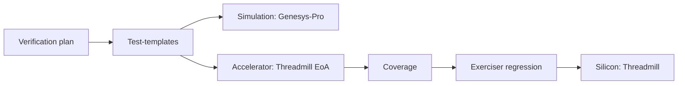

<!-- generated by yt-paper; edits will be overwritten -->
[DATE](../date/index.md) › [2011](../date/by-year.md#2011) › [Verification](../date/by-topic.md#verification)

# A Unified Methodology for Pre-Silicon Verification and Post-Silicon Validation

<figure class="rep-fig" markdown>
{ loading=lazy }
<figcaption>Fig. 3. A unified verification methodology — from the original paper (Allon Adir et al.)</figcaption>
</figure>

[:material-open-in-new: Original paper](https://past.date-conference.com/proceedings-archive/2011/DATE11/PDFFILES/12.4_3.PDF){ .md-button .md-button--primary target=_blank }

| | |
|---|---|
| Authors | Allon Adir (IBM Research - Haifa), Shady Copty (IBM Research - Haifa), Shimon Landa (IBM Research - Haifa), Amir Nahir (IBM Research - Haifa), Gil Shurek (IBM Research - Haifa), Avi Ziv (IBM Research - Haifa), Charles Meissner (IBM Server and Technology Group, Austin, TX), John Schumann (IBM Server and Technology Group, Austin, TX); DATE 2011 (EDAA) |
| Venue | DATE 2011 |
| Topic | Verification |
| Type | PAPER |
| ID | `ref-20261018-9bfe` |

## Summary

**Proposes a unified pre- and post-silicon verification methodology that shares one verification plan, a common test-template language, and common coverage models across simulation, acceleration, and silicon, realized as the bare-metal directable exerciser Threadmill and validated on IBM POWER7.**

**공통 검증 계획, 공통 test-template 언어, 공통 coverage 모델을 시뮬레이션, 가속기, 실리콘 전반에 적용하는 pre-/post-silicon 통합 검증 방법론을 제안하며, 이를 bare-metal directable exerciser인 Threadmill로 구현해 IBM POWER7에서 검증했다.**

## Key Insights

- Silicon has low observability and very low execution utilization (a 10,000-instruction test runs in under 1 ms against more than 1 minute of setup, below 0.002%), so post-silicon generators must trade generation precision for lightweight, high-volume test generation.

- 실리콘은 관측성이 낮고 실행 활용도가 매우 낮다(10,000 명령 테스트는 1 ms 미만에 실행되지만 설정에는 1분 이상 걸려 활용도가 0.002% 미만). 따라서 post-silicon generator는 생성 정밀도를 낮추고 경량의 대량 테스트 생성을 택해야 한다.

- Hardware accelerators act as a third platform: fast enough to run post-silicon exercisers and observable enough to measure their coverage, enabling coverage-closed regression suites to be harvested before silicon returns.

- 가속기는 세 번째 플랫폼으로 쓰인다. post-silicon exerciser를 실행할 만큼 빠르고 coverage를 측정할 만큼 관측 가능하므로, 실리콘 도착 전에 coverage 기반 회귀 스위트를 확보할 수 있다.

- A shared verification plan and declarative test-template language let bugs move between platforms (silicon to accelerator to simulation) for recreation, root-cause analysis, and fix validation.

- 공통 검증 계획과 선언형 test-template 언어 덕분에 버그를 플랫폼 간(실리콘 → 가속기 → 시뮬레이션) 이동시켜 재현, root-cause 분석, 수정 검증을 할 수 있다.

- Threadmill replaces the reference model with static generation and multi-pass execution comparison, with controlled variability (machine mode, thread priorities) to expose control-path bugs while keeping compared resources predictable.

- Threadmill은 reference model 대신 정적 생성과 multi-pass 실행 비교를 사용하며, 비교 대상 자원의 예측 가능성을 유지하면서 machine mode나 thread priority 변경으로 variability를 주어 control-path 버그를 노출한다.

- On POWER7, the EoA effort reached 88.70% core-total coverage versus 92.78% for core simulation, reached 98.06% combined, and caught a show-stopper bug before the first tape-out.

- POWER7에서 EoA는 core-total coverage 88.70%를 달성해 core simulation의 92.78%와 비교 가능했고, 결합 시 98.06%에 도달했으며, 첫 tape-out 전에 show-stopper 버그를 잡아냈다.

## Detailed Summary

### Background and Problem

- Post-silicon validation finds bugs that escape pre-silicon verification, but its methodology is far less mature, and silicon offers little observability for checking or coverage.

- Post-silicon validation은 pre-silicon 검증을 빠져나간 버그를 찾아내지만, 방법론은 pre-silicon보다 훨씬 덜 성숙했고 실리콘은 checking과 coverage에 필요한 관측성이 낮다.

- Silicon has long load and initialization times: a 10,000-instruction test runs in under 1 ms, while setup can exceed one minute, giving utilization below 0.002%.

- 실리콘은 로딩 및 초기화 시간이 길다. 10,000 명령 테스트는 1 ms 미만에 끝나지만 설정에는 1분 이상 걸려 활용도가 0.002% 미만이다.

- Pre-silicon generators (Genesys-Pro) rely on constraint solving and a reference model, which is too heavy for silicon's speed and simplicity needs.

- Pre-silicon generator(Genesys-Pro)는 constraint solving과 reference model에 의존하므로 실리콘의 속도 및 단순성 요구에는 무겁다.

### Architecture and Methodology

- One verification plan feeds all platforms (simulation, acceleration, silicon). Each line item maps to test-templates in a common language, and the same coverage models measure progress.

- 하나의 검증 계획이 모든 플랫폼(시뮬레이션, 가속기, 실리콘)에 공급된다. 각 line item은 공통 언어의 test-template으로 변환되며, 동일한 coverage 모델로 진행 상황을 측정한다.

- Accelerators run post-silicon exercisers and measure their coverage. Exerciser templates harvested from accelerator coverage form a regression suite that continues on silicon.

- 가속기에서 post-silicon exerciser를 실행하고 그 coverage를 측정한다. 가속기 coverage에서 추출한 exerciser template이 회귀 스위트를 이루며 실리콘에서 계속 실행된다.

- Threadmill is a bare-metal exerciser. An off-line builder embeds the test-template and architectural model as data structures in the image. Generation is static (no reference model), and checking uses multi-pass execution comparison with controlled variability.

- Threadmill은 bare-metal exerciser다. Off-line builder가 test-template과 architectural model을 이미지에 data structure로 내장한다. 생성은 정적(reference model 없음)이며, 검사는 제어된 variability를 가진 multi-pass 실행 비교로 수행한다.

### Results and Conclusions

- Applied to IBM POWER7 (8 SMT cores, up to 4 threads per core). EoA caught a show-stopper bug shortly before the first tape-out.

- IBM POWER7(코어당 SMT, 최대 4 스레드를 갖는 8코어)에 적용했다. EoA는 첫 tape-out 직전에 show-stopper 버그를 찾아냈다.

- Core-total coverage (Table I): EoA 88.70% versus core simulation 92.78%; combined total 98.06%. Control units (IFU, ISU) came out close to core simulation.

- Core-total coverage(Table I): EoA 88.70% 대 core simulation 92.78%, 결합 총계 98.06%. 제어 중심 유닛(IFU, ISU)은 core simulation과 근접했다.

- The authors report a shorter bring-up, more complex bugs found earlier by bare-metal tools, and a low escape count. These are qualitative claims without further numbers in the paper.

- 저자들은 bring-up 단축, 더 복잡한 버그를 더 일찍 bare-metal 도구로 발견, 낮은 escape 수를 보고한다. 이는 논문에서 추가 수치 없이 정성적으로 제시된 주장이다.

## Videos

<iframe src="https://www.youtube-nocookie.com/embed/wZv0WaC4JkM" title="[DATE2011]A Unified Methodology for Pre-Silicon Verification and Post-Silicon Validation" loading="lazy" allow="accelerometer; clipboard-write; encrypted-media; gyroscope; picture-in-picture; web-share" referrerpolicy="strict-origin-when-cross-origin" allowfullscreen></iframe>

**[DATE2011]A Unified Methodology for Pre-Silicon Verification and Post-Silicon Validation** — [Watch on YouTube](https://www.youtube.com/watch?v=wZv0WaC4JkM) · [Video page](../videos/wZv0WaC4JkM.md)
