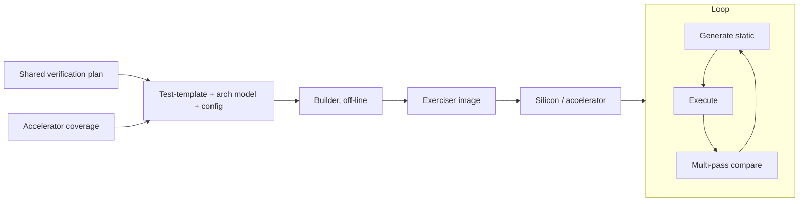

<!-- generated by yt-paper; edits will be overwritten -->
[DATE](../date/index.md) › [2011](../date/by-year.md#2011) › [Verification](../date/by-topic.md#verification)

# A Unified Methodology for Pre-Silicon Verification and Post-Silicon Validation

<figure class="rep-fig" markdown>
{ loading=lazy }
<figcaption>Fig. 3. A unified verification methodology — from the original paper (Allon Adir et al.)</figcaption>
</figure>

[:material-open-in-new: Original paper](https://past.date-conference.com/proceedings-archive/2011/DATE11/PDFFILES/12.4_3.PDF){ .md-button .md-button--primary target=_blank }

| | |
|---|---|
| Authors | Allon Adir (IBM Research - Haifa), Shady Copty (IBM Research - Haifa), Shimon Landa (IBM Research - Haifa), Amir Nahir (IBM Research - Haifa), Gil Shurek (IBM Research - Haifa), Avi Ziv (IBM Research - Haifa), Charles Meissner (IBM Server and Technology Group, Austin, TX), John Schumann (IBM Server and Technology Group, Austin, TX) |
| Venue | DATE 2011 |
| Topic | Verification |
| Type | PAPER |
| ID | `ref-20261018-9bfe` |

## Summary

**The paper proposes a unified pre-silicon/post-silicon verification methodology that shares one verification plan, a common test-template language, and common coverage models, and realizes it as Threadmill, a bare-metal directable exerciser that uses accelerators to measure coverage of silicon-side tools, which was applied to IBM POWER7.**

**이 논문은 하나의 검증 계획, 공통 test-template 언어, 공통 coverage 모델을 공유하는 pre-silicon/post-silicon 통합 검증 방법론을 제안하고, 이를 가속기로 silicon 측 도구의 coverage를 측정하는 bare-metal directable exerciser인 Threadmill로 구현하여 IBM POWER7에 적용한 결과를 보고한다.**

## Key Insights

- Silicon runs are dominated by setup: a 10,000-instruction test finishes in under 1 ms, but power-on and loading can exceed one minute, giving execution utilization below 0.002%. The post-silicon generator therefore trades generation precision for lightweight, high-volume generation.

- Silicon 실행은 setup 시간이 지배적이다. 10,000 instruction 테스트는 1 ms 이내에 끝나지만 power-on과 loading에는 1분 이상 걸려 실행 utilization이 0.002% 미만이다. 따라서 post-silicon generator는 생성 정밀도를 낮추고 가볍고 대량의 생성을 택해야 한다.

- Silicon has too little observability to measure coverage. Accelerators act as a third platform that is fast enough to run simple exercisers and observable enough to measure their coverage, and accelerator coverage was used to build an exerciser test-template regression before first silicon.

- Silicon은 coverage를 측정할 만큼 관측성이 부족하다. 가속기는 제3의 플랫폼으로서 exerciser를 충분히 빠르게 실행하면서도 그 coverage를 측정할 수 있게 해주며, 가속기 coverage는 first silicon 이전에 exerciser test-template 회귀 suite를 만드는 데 사용되었다.

- Threadmill has no reference model. Its checking relies on multi-pass comparison of the same test case with controlled variability (machine mode, thread priorities) and restricted nondeterministic resources. The authors report this is effective for control-path and mixed control/data-path bugs but is limited in scope.

- Threadmill에는 reference model이 없다. 대신 동일한 테스트를 여러 번 실행하는 multi-pass 비교로 검사하며, 실행 간 변동성(machine mode, thread priority 변경)을 주고 비결정적 자원은 제한한다. 저자들은 이 방식이 control-path 및 control/data-path 혼합 버그에 효과적이지만 범위가 제한적이라고 보고한다.

- On POWER7, EoA (exercisers on accelerators) reached a core-level total coverage of 98.06, versus 92.78 for core simulation and 96.18 for unit simulation, as read from the Core Total row of Table I, and one show-stopper bug was found shortly before the first tape-out.

- POWER7에서 EoA(accelerator 상의 exerciser)는 Table I의 Core Total 행을 기준으로 core 수준 total coverage 98.06을 달성했으며, 이는 core simulation 92.78, unit simulation 96.18과 비교된다. 또한 first tape-out 직전에 show-stopper 버그 하나가 발견되었다.

- A shared declarative test-template language let bugs move between Genesys-Pro (simulation), Threadmill (accelerator), and silicon for recreation and fix validation. Overly specific templates were noted to run out of variation on silicon and start repeating tests.

- 공유된 선언형 test-template 언어 덕분에 버그가 Genesys-Pro(simulation), Threadmill(accelerator), silicon 사이에서 재현 및 수정 검증을 위해 이동할 수 있었다. 지나치게 구체적인 template은 silicon에서 변형 여지가 소진되어 유사한 테스트를 반복하게 된다고 지적되었다.

## Detailed Summary

### Background and Problem

- Pre-silicon coverage-driven verification (CDV) is mature, using a verification plan, test-templates, and coverage analysis. Post-silicon validation has far less published methodology and mostly focuses on on-line checking and debugging.

- Pre-silicon coverage-driven verification(CDV)은 검증 계획, test-template, coverage 분석을 갖춘 성숙한 방법론이다. 반면 post-silicon validation은 공개된 방법론이 적고, 주로 on-line 검사와 디버깅 기능에 집중되어 있다.

- Pre- and post-silicon verification each miss bugs the other finds, so the paper argues for a bridge built on shared methodology rather than copying tools between domains.

- Pre-silicon과 post-silicon은 서로 놓치는 버그가 다르므로, 도구를 단순 복사하기보다 공유 방법론으로 두 영역을 연결해야 한다는 것이 논문의 주장이다.

- Silicon differs from simulation in three ways that block direct reuse of a pre-silicon generator:
  - **Speed and setup:** a 10,000-instruction test runs in under 1 ms, but power-on and loading take over a minute (utilization below 0.002%). The silicon platform therefore needs a continuously running exerciser that generates, executes, and checks tests in a loop.
  - **Observability:** silicon exposes little internal state, so scoreboards, assertions, and coverage measurement are limited.
  - **Simplicity:** hardware failures are hard to debug, and early bring-up may lack an OS or file I/O, so the tool must be simple and self-contained.

- Silicon은 다음 세 가지 측면에서 simulation과 달라 pre-silicon generator를 그대로 재사용할 수 없다.
  - **속도 및 setup:** 10,000 instruction 테스트는 1 ms 미만에 끝나지만, power-on과 loading에 1분 이상 걸린다(utilization 0.002% 미만). 따라서 생성, 실행, 검사를 루프로 계속 수행하는 exerciser가 필요하다.
  - **관측성:** 내부 상태 노출이 적어 scoreboard, assertion, coverage 측정이 제한된다.
  - **단순성:** 하드웨어 실패는 디버그가 어렵고, 초기 bring-up 단계에는 OS나 파일 I/O가 없을 수 있으므로 도구는 단순하고 자기완결적이어야 한다.

### Architecture and Methodology

The unified methodology (Fig. 3) is built on three components: one verification plan, directable stimuli generators for each platform, and common functional coverage models. It spans three platforms:

통합 방법론(Fig. 3)은 세 가지 요소로 구성된다. 하나의 검증 계획, 각 플랫폼에 맞는 directable stimuli generator, 공통 functional coverage 모델이다. 이는 세 플랫폼에 걸쳐 적용된다.

- **Simulation:** pre-silicon generation with Genesys-Pro, which uses constraint solving, biasing, and a reference model.

- **Simulation:** 제약 해결, bias, reference model을 쓰는 Genesys-Pro로 pre-silicon 생성을 수행한다.

- **Acceleration:** exercisers run on accelerators, where coverage is measurable.

- **Acceleration:** exerciser를 가속기에서 실행하며, 이 단계에서 coverage 측정이 가능하다.

- **Silicon:** the same test-template language drives exercisers on the chip.

- **Silicon:** 같은 test-template 언어로 칩 위의 exerciser를 구동한다.

Each verification plan line item is tied to target platforms and converted into test-templates in each tool's language. Coverage from accelerators is used to build a regression suite of exerciser test-templates shortly before first silicon returns.

검증 계획의 각 line item은 대상 플랫폼과 연결되고, 각 도구의 언어로 된 test-template으로 변환된다. 가속기에서 얻은 coverage로 first silicon이 돌아오기 직전에 exerciser test-template 회귀 suite를 만든다.

Threadmill is the bare-metal exerciser that implements this flow:

Threadmill은 이 흐름을 구현한 bare-metal exerciser다.

- An off-line **builder** converts the test-template and architectural model into data structures embedded in an executable image. No file or database access is needed at run time.

- 오프라인 **builder**가 test-template과 architectural model을 실행 이미지에 내장되는 데이터 구조로 변환한다. 실행 중에는 파일이나 데이터베이스 접근이 필요 없다.

- The image contains a thin OS-like service layer, the embedded data structures, and fixed exercising code. It loops indefinitely through generate, execute, and check.

- 이미지는 얇은 OS 유사 서비스 계층, 내장 데이터 구조, 고정된 exercising 코드로 구성된다. 생성, 실행, 검사를 무한 반복한다.

- Generation is static and lightweight (no reference model). Event constructs that are costly to generate are removed from the template language, and many Genesys-Pro testing-knowledge items are dropped.

- 생성은 정적이고 가볍다(reference model 없음). 생성 비용이 큰 event 구문은 template 언어에서 제외되었고, Genesys-Pro의 많은 testing knowledge 항목도 사용하지 않는다.

- For data-oriented events (for example, divide-by-zero), registers are reserved to hold interesting values, and the generator guarantees they are not modified.

- 데이터 중심 event(예: divide-by-zero)를 위해 특정 레지스터를 흥미로운 값을 담도록 예약하며, 테스트 중 수정되지 않도록 보장한다.

- Checking uses multi-pass comparison. The same test is run several times and selected resources (registers, part of memory) are compared. Nondeterministic resources, such as the final value of a shared location written by several threads, are restricted. Variability between passes, such as changing machine mode or thread priorities, increases bug exposure.

- 검사는 multi-pass 비교를 사용한다. 같은 테스트를 여러 번 실행하고 선택된 자원(레지스터, 메모리 일부)을 비교한다. 여러 스레드가 같은 위치에 쓰는 경우처럼 비결정적인 자원은 제한한다. Machine mode나 thread priority를 바꾸는 식의 pass 간 변동성은 버그 노출 확률을 높인다.

### Results and Conclusions

- **Target:** the method and Threadmill were applied to core verification of IBM POWER7 (eight SMT cores, up to four threads per core, 64-bit Power Architecture). This was the first use of the unified methodology in a large industrial project.

- **적용 대상:** 이 방법론과 Threadmill은 IBM POWER7(SMT 코어 8개, 코어당 최대 4 스레드, 64-bit Power Architecture)의 core 검증에 적용되었다. 대형 산업 프로젝트에서 통합 방법론이 처음 사용된 사례다.

- **Bugs:** EoA found high-impact bugs, including a show-stopper found shortly before the first tape-out that would otherwise have forced an extra tape-out. Multiple exercisers were used, but Threadmill was the only one using declarative test-templates.

- **버그:** EoA는 영향이 큰 버그를 찾았고, 그중 first tape-out 직전에 발견된 show-stopper 버그는 추가 tape-out을 유발했을 것이라고 보고된다. 여러 exerciser가 사용되었지만 선언형 test-template을 쓴 것은 Threadmill뿐이었다.

- **Coverage (Table I, core-level row):** Unit Sim 96.18, Core Sim 92.78, EoA 88.70, combined Total 98.06. The paper states that for control-oriented units (IFU, ISU), EoA coverage is almost similar to core simulation coverage.

- **Coverage(Table I, core 수준 행):** Unit Sim 96.18, Core Sim 92.78, EoA 88.70, 결합 Total 98.06. 논문은 control 중심 유닛(IFU, ISU)에서 EoA coverage가 core simulation coverage와 거의 유사하다고 서술한다.

- **Bring-up:** harvested test-templates gave the bring-up team a starting point and a progress-tracking means. The authors report a shorter bring-up, more complex bugs found earlier, and found by bare-metal tools that are easier to debug.

- **Bring-up:** 수집된 test-template은 bring-up 팀에 출발점과 진행 상황 추적 수단을 제공했다. 저자들은 bring-up이 더 짧아졌고, 더 복잡한 버그가 더 일찍, 디버그가 쉬운 bare-metal 도구로 발견되었다고 보고한다.

- **Root-cause workflow:** a silicon bug was narrowed on the accelerator with Threadmill templates and then recreated in simulation. Bug-fix validation reused the recreation templates across platforms.

- **근본 원인 분석 흐름:** silicon 버그는 가속기에서 Threadmill template으로 범위를 좁힌 뒤 simulation에서 재현되었다. 수정 검증에는 재현용 template들이 플랫폼 간에 재사용되었다.

- **Limitations and future work:** multi-pass checking is limited. The authors plan to extend the bridge to checking and coverage, and to add address-translation paths to better exercise cache coherency and memory/I/O subsystems.

- **한계 및 향후 과제:** multi-pass 검사는 제한적이다. 저자들은 연결 개념을 검사와 coverage로 확장하고, cache coherency 및 메모리/I/O 서브시스템을 더 잘 검증하기 위해 address translation 경로를 추가할 계획이다.

- **Conclusion:** a directable declarative generator can be adapted to post-silicon with a simple, fast generation engine, and the trade-off between generation smartness and speed should be tuned to the platform.

- **결론:** 선언형 directable generator는 단순하고 빠른 생성 엔진으로 post-silicon에 적응될 수 있으며, 생성의 지능성과 속도 사이의 절충은 플랫폼 요구에 맞게 조정되어야 한다.

## Videos

<iframe src="https://www.youtube-nocookie.com/embed/wZv0WaC4JkM" title="[DATE2011]A Unified Methodology for Pre-Silicon Verification and Post-Silicon Validation" loading="lazy" allow="accelerometer; clipboard-write; encrypted-media; gyroscope; picture-in-picture; web-share" referrerpolicy="strict-origin-when-cross-origin" allowfullscreen></iframe>

**[DATE2011]A Unified Methodology for Pre-Silicon Verification and Post-Silicon Validation** — [Watch on YouTube](https://www.youtube.com/watch?v=wZv0WaC4JkM) · [Video page](../videos/wZv0WaC4JkM.md)
