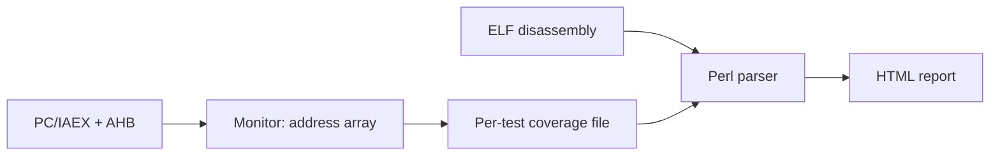

<!-- generated by yt-paper; edits will be overwritten -->
[DVCon](../dvcon/index.md) › [Europe](../dvcon/europe.md) › [2016](../dvcon/by-year.md#2016) › [Verification](../dvcon/by-topic.md#verification)

# A Metric-driven Methodology For Firmware Verification In Simulation/Emulation Environments

<figure class="rep-fig" markdown>
{ loading=lazy }
<figcaption>Figure 3 – Monitor interface and points of connection Data flow from these tracked points to the monitors and their temporary storage (the address array) are marked — from the original paper (Goran SAVIĆ et al.)</figcaption>
</figure>

[:material-open-in-new: Original paper](https://dvcon-proceedings.org/wp-content/uploads/a-metric-driven-methodology-for-firmware-verification-in-simulation-emulation-environments.pdf){ .md-button .md-button--primary target=_blank }

| | |
|---|---|
| Authors | Goran SAVIĆ (Elsys Eastern Europe d.o.o., Belgrade, Serbia); DVCon Europe |
| Venue | DVCon Europe 2016 |
| Topic | Verification |
| Type | PAPER |
| ID | `ref-20261018-9cff` |

## Summary

**The paper presents a low-cost, tool-independent firmware software-coverage flow that taps the Cortex PC/DWT IAEX and AHB buses in SystemVerilog, stores per-address read/write/execute counts, and renders ELF-annotated HTML reports via Perl, with an FPGA block-RAM variant.**

**이 논문은 Cortex의 PC/DWT IAEX 및 AHB 버스를 SystemVerilog로 감시해 주소별 read/write/execute 횟수를 저장하고, Perl로 ELF 주석이 달린 HTML 리포트를 생성하는 저비용·도구 독립적 펌웨어 소프트웨어 커버리지 방법론을 제시하며, FPGA용 block RAM 변형도 포함한다.**

## Key Insights

- Sampling the DWT IAEX bus instead of the PC avoids the ARM +4 byte PC offset and the bit pruning that synthesis causes in gate-level simulation, so the monitor still works in GLS.

- PC 대신 DWT IAEX 버스를 샘플링하면 ARM의 PC +4 바이트 오프셋과 게이트 레벨 시뮬레이션(GLS)에서 합성으로 인해 생기는 비트 제거 문제를 피할 수 있어, GLS에서도 모니터가 동작한다.

- Tracking both the PC (executed) and AHB (read/write) per address in a 32-bit-wide associative array captures data regions that never appear on the PC, which PC-only tracking would miss.

- 주소별로 PC(실행)와 AHB(read/write)를 32비트 전체 범위의 associative array에 함께 기록하면, PC에 나타나지 않는 데이터 영역도 포착할 수 있어 PC만 추적하는 방식이 놓치는 부분을 보완한다.

- The method reached 95–100% targeted coverage on two projects with less than 1% simulation performance and memory overhead, though it was applied only to critical firmware components.

- 두 프로젝트에서 목표 커버리지 95–100%를 달성했으며, 시뮬레이션 성능과 메모리 부하는 1% 미만이었다. 다만 중요한 펌웨어 컴포넌트에만 적용되었다.

- An FPGA variant marks one bit per 16-bit firmware element in block RAM, so an 8 KB RAM covers a 128 KB firmware image, trading full access-count detail for low resource cost.

- FPGA 변형은 block RAM에 16비트 펌웨어 요소당 1비트를 표시하여 128 KB 펌웨어를 8 KB RAM으로 커버하며, 자원 비용은 낮지만 접근 횟수 상세 정보는 포기한다.

## Detailed Summary

### Background and Problem

- Firmware on low-power ARM Cortex-M0+ SoCs is now critical, but standard firmware coverage tools are missing for parts such as bootcode and test functions.

- 저전력 ARM Cortex-M0+ SoC에서 펌웨어의 중요성이 커지고 있지만, bootcode나 테스트 함수 같은 부분을 위한 표준 펌웨어 커버리지 도구가 부족하다.

- Built-in SystemVerilog coverage on software is inefficient and requires deep software/hardware knowledge to find gaps.

- 소프트웨어에 대한 내장 SystemVerilog 커버리지는 비효율적이며, 누락된 부분을 찾으려면 깊은 소프트웨어/하드웨어 지식이 필요하다.

- Goal: a reusable, metric-driven firmware coverage flow built from SystemVerilog, Perl and HTML/CSS/JavaScript.

- 목표: SystemVerilog, Perl, HTML/CSS/JavaScript로 구성된 재사용 가능한 메트릭 기반 펌웨어 커버리지 흐름.

### Architecture and Methodology

- A SystemVerilog code coverage monitor taps the PC (via the DWT IAEX bus) and AHB, with one tracker per core and memory space.

- SystemVerilog 코드 커버리지 모니터가 PC(DWT IAEX 버스 경유)와 AHB를 감시하며, 코어와 메모리 공간별로 트래커를 둔다.

- A per-address associative array holds read, write and executed counters over the full 32-bit address range.

- 주소별 associative array가 32비트 전체 범위에 대해 read, write, executed 카운터를 유지한다.

- Each test writes a textual coverage file (offset-based, with `# core` and `# base` headers).

- 각 테스트는 텍스트 형식 커버리지 파일(오프셋 기반, `# core` 및 `# base` 헤더 포함)을 기록한다.

- A Perl script parses fromelf/objdump output into an ELF/section/function/instruction tree, merges results across regressions, and generates an HTML report. Uncovered items are marked red.

- Perl 스크립트가 fromelf/objdump 출력을 ELF/섹션/함수/명령어 트리로 파싱하고, 회귀 테스트 결과를 병합하여 HTML 리포트를 생성한다. 커버되지 않은 항목은 빨간색으로 표시된다.

- FPGA variant: one bit per 16-bit element in block RAM, read back through a debug interface.

- FPGA 변형: block RAM에 16비트 요소당 1비트를 사용하며, 디버그 인터페이스를 통해 읽어온다.

### Results and Conclusions

- Used in two projects, with targeted coverage of 95–100% depending on the component.

- 두 프로젝트에 적용되었으며, 컴포넌트에 따라 목표 커버리지 95–100%를 달성했다.

- Simulation load is under 1% in both performance and memory.

- 시뮬레이션 부하는 성능과 메모리 모두 1% 미만이다.

- For 128 KB firmware, the HTML report is about 2–6 MB, depending on whether C source is embedded.

- 128 KB 펌웨어 기준 HTML 리포트는 C 소스 포함 여부에 따라 약 2–6 MB이다.

- Limitations: the flow is practically bounded by simulation speed and is usually restricted to critical components. Full coverage is better done on FPGA boards, and the paper suggests color coding, multi-browser support and objdump as future work.

- 한계: 실질적으로 시뮬레이션 속도에 의해 제약되며, 주로 중요한 컴포넌트에만 적용된다. 전체 커버리지는 FPGA 보드에서 수행하는 것이 낫고, 논문은 색상 코딩, 다중 브라우저 지원, objdump 전환을 향후 과제로 제시한다.

## Videos

<iframe src="https://www.youtube-nocookie.com/embed/DDpWoJxADvE" title="[DVCON2016]A Metric-driven Methodology For Firmware Verification In Simulation/Emulation" loading="lazy" allow="accelerometer; clipboard-write; encrypted-media; gyroscope; picture-in-picture; web-share" referrerpolicy="strict-origin-when-cross-origin" allowfullscreen></iframe>

**[DVCON2016]A Metric-driven Methodology For Firmware Verification In Simulation/Emulation** — [Watch on YouTube](https://www.youtube.com/watch?v=DDpWoJxADvE) · [Video page](../videos/DDpWoJxADvE.md)
