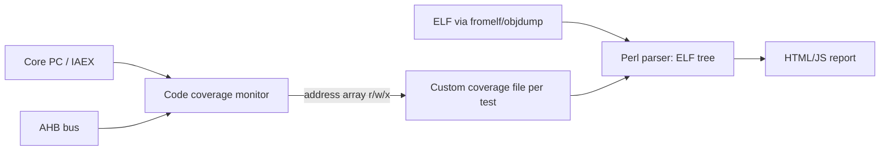

<!-- generated by yt-paper; edits will be overwritten -->
[DVCon](../dvcon/index.md) › [Europe](../dvcon/europe.md) › [2016](../dvcon/by-year.md#2016) › [Verification](../dvcon/by-topic.md#verification)

# A Metric-driven Methodology For Firmware Verification In Simulation/Emulation Environments

<figure class="rep-fig" markdown>
{ loading=lazy }
<figcaption>Figure 3 – Monitor interface and points of connection Data flow from these tracked points to the monitors and their temporary storage (the address array) are marked — from the original paper (Goran SAVIĆ et al.)</figcaption>
</figure>

[:material-open-in-new: Original paper](https://dvcon-proceedings.org/wp-content/uploads/a-metric-driven-methodology-for-firmware-verification-in-simulation-emulation-environments.pdf){ .md-button .md-button--primary target=_blank }

| | |
|---|---|
| Authors | Goran SAVIĆ (Elsys Eastern Europe d.o.o., Belgrade, Serbia); DVCon Europe (per source hint) |
| Venue | DVCon Europe 2016 |
| Topic | Verification |
| Type | PAPER |
| ID | `ref-20261018-9cff` |

## Summary

**The paper presents a low-cost, tool-independent firmware coverage flow in which SystemVerilog monitors record PC and AHB/IAEX accesses per address, and a Perl and HTML/JavaScript back end merges these with disassembled ELF files to produce a browsable coverage report.**

**이 논문은 SystemVerilog 모니터가 주소별 PC 및 AHB/IAEX 접근을 기록하고, Perl과 HTML/JavaScript 백엔드가 이를 역어셈블된 ELF 파일과 결합해 탐색 가능한 커버리지 리포트를 만드는, 저비용의 도구 독립적 펌웨어 커버리지 플로우를 제시합니다.**

## Key Insights

- Firmware coverage needs two monitored sources: the PC captures executed instructions, while the AHB data bus captures read/write accesses to data and constants that never appear in the PC. On ARM, the DWT IAEX bus gives the actual instruction address and still works in gate-level simulation, unlike direct PC access.

- 펌웨어 커버리지에는 두 가지 소스를 모니터링해야 합니다. PC는 실행된 명령어를 포착하고, AHB 데이터 버스는 PC에 나타나지 않는 데이터 및 상수에 대한 read/write 접근을 포착합니다. ARM에서는 DWT IAEX 버스가 실제 명령어 주소를 제공하며 GLS에서도 동작하므로 PC를 직접 사용하는 것보다 효율적입니다.

- Each tracked address keeps read, write and executed counters in a SystemVerilog associative array, which covers the full 32-bit address space. Address resolution is at least 2 bytes to distinguish 16-bit Thumb instructions from 32-bit ones.

- 추적되는 각 주소는 SystemVerilog 연관 배열에 read, write, executed 카운터를 가지며 32비트 전체 주소 공간을 다룹니다. 16비트 Thumb 명령어와 32비트 명령어를 구분하려면 주소 분해능이 최소 2바이트여야 합니다.

- The Perl script parses fromelf or objdump output into an ELF/section/function/instruction tree and merges per-test coverage files across a regression. Output is an HTML report in which functions below 100% are flagged red, and instructions with no expected access are flagged red too. The authors report under 1% simulation and memory overhead, and a 2–6 MB report for 128 KB of firmware.

- Perl 스크립트는 fromelf 또는 objdump 출력을 ELF/섹션/함수/명령어 트리로 파싱하고, 회귀 테스트 전체의 테스트별 커버리지 파일을 병합합니다. 리포트에서는 100% 미만인 함수와 예상 접근이 없는 명령어가 빨간색으로 표시됩니다. 저자들은 시뮬레이션 및 메모리 오버헤드가 1% 미만이고, 128 KB 펌웨어 기준 리포트 크기가 2–6 MB라고 보고합니다.

- A lightweight FPGA variant uses one bit per 16-bit instruction or data element, so 128 KB of firmware needs only an 8 KB block RAM. The reported coverage targets were 95–100% on two projects, and the whole tool was estimated at roughly 650–1,350 lines across SystemVerilog, Perl, HTML/CSS and JavaScript.

- FPGA용 경량 변형은 16비트 명령어 또는 데이터 요소당 1비트를 사용하므로 128 KB 펌웨어에 8 KB 블록 RAM이면 충분합니다. 두 프로젝트에서 목표 커버리지는 95–100%였고, 도구 전체 규모는 SystemVerilog, Perl, HTML/CSS, JavaScript를 합쳐 약 650–1,350줄로 추정됩니다.

## Detailed Summary

### Background and Problem

Embedded SoCs increasingly keep their functionality in firmware on the die, yet firmware is often verified with weak tooling. Standard functional and code coverage tools are well supported for RTL, but firmware coverage (bootcode, test functions) usually needs custom extensions. Using SystemVerilog `covergroup`/`coverpoint` for software coverage is inefficient and requires a verification engineer to know the target system's software in depth. Raw coverage reports from standard tools are cryptic, which motivates a custom, more accessible metric-driven flow.

임베디드 SoC는 점점 더 많은 기능을 다이 위의 펌웨어에 담고 있지만, 펌웨어 검증 도구는 여전히 부족합니다. RTL의 기능 및 코드 커버리지는 EDA 도구의 지원이 충분한 반면, 펌웨어 커버리지(bootcode, 테스트 함수 등)는 대개 사용자 정의 확장에 의존합니다. SystemVerilog의 `covergroup`/`coverpoint`로 소프트웨어 커버리지를 측정하는 방식은 비효율적이며, 검증 엔지니어가 대상 시스템의 소프트웨어를 깊이 이해해야 합니다. 표준 도구가 만드는 원시 커버리지 리포트는 해석이 어려워, 메트릭 중심의 보다 접근성 높은 커스텀 플로우가 필요하다는 것이 이 논문의 동기입니다.

### Architecture and Methodology

The flow was implemented on a low-power SoC with multiple ARM Cortex-M0+ cores in a Cadence SimVision environment. Each core has its own memory space, firmware and peripherals, so the monitor tags each record with its core and memory block.

이 플로우는 Cadence SimVision 환경에서 다중 ARM Cortex-M0+ 코어를 가진 저전력 SoC에 구현되었습니다. 각 코어는 고유한 메모리 공간, 펌웨어, 주변장치를 가지므로, 모니터는 각 레코드에 코어와 메모리 블록 정보를 함께 기록합니다.

- **Monitors:** the PC (or the DWT IAEX bus, which avoids the ARM PC offset and works in GLS) and the AHB bus feed a code coverage monitor. Figure 3 shows this interface.

- **모니터:** PC(또는 GLS에서도 동작하며 ARM PC 오프셋을 피할 수 있는 DWT IAEX 버스)와 AHB 버스가 코드 커버리지 모니터에 입력됩니다. 인터페이스는 Figure 3에 나타나 있습니다.

- **Collection:** a 32-bit associative array stores, per address, `read`, `write` and `executed` counters. New entries are added on first access.

- **수집:** 32비트 연관 배열이 주소별로 `read`, `write`, `executed` 카운터를 저장합니다. 처음 접근될 때 새 항목이 추가됩니다.

- **Output:** at the end of each test, a text file lists offsets per memory block, with `# block`, `# core` and `# base` headers and `r/w/x` counts.

- **출력:** 각 테스트 종료 시, 메모리 블록별 오프셋과 `r/w/x` 횟수를 적은 텍스트 파일이 생성됩니다. 헤더는 `# block`, `# core`, `# base`입니다.

- **Post-processing:** a Perl script parses disassembled ELF files (fromelf or objdump) into a tree of ELF, section, function and instruction nodes. It then merges coverage files from every test directory in a regression.

- **후처리:** Perl 스크립트가 역어셈블된 ELF 파일(fromelf 또는 objdump)을 ELF, 섹션, 함수, 명령어 노드로 이루어진 트리로 파싱합니다. 이후 회귀 테스트의 모든 테스트 디렉터리에서 커버리지 파일을 병합합니다.

- **Report:** the result is an HTML/CSS/JavaScript report with four levels (ELF, section, function, instruction/data) and links to assembly interleaved with C source. Labels are linked, and red marks indicate gaps.

- **리포트:** ELF, 섹션, 함수, 명령어/데이터의 4단계 구조를 가진 HTML/CSS/JavaScript 리포트가 생성됩니다. 어셈블리는 C 소스와 함께 표시되고, 레이블은 링크로 연결되며, 빨간색 표시는 커버리지 공백을 나타냅니다.

- **FPGA variant:** a block RAM with one bit per 16-bit element is driven by the PC/IAEX and AHB buses. Its contents are preserved across tests in a regression and read out through a debug interface.

- **FPGA 변형:** PC/IAEX 및 AHB 버스로 구동되는 블록 RAM에서 요소 하나당 1비트를 사용합니다. 회귀 테스트 간 내용이 유지되며, 디버그 인터페이스로 읽어냅니다.

### Results and Conclusions

- The method was used on two projects, with targeted coverage of 95–100% depending on the component. Its use is limited to critical firmware components.

- 이 방법은 두 개의 프로젝트에 적용되었으며, 컴포넌트에 따라 목표 커버리지는 95–100%였습니다. 사용 범위는 중요 펌웨어 컴포넌트로 제한됩니다.

- Simulation load is below 1% in both performance and memory.

- 시뮬레이션 부하는 성능과 메모리 모두 1% 미만입니다.

- The HTML report for 128 KB firmware is about 2–6 MB, depending on whether C source is included. The authors suggest raw data with dynamically generated HTML to keep the footprint manageable.

- 128 KB 펌웨어의 HTML 리포트는 C 소스 포함 여부에 따라 약 2–6 MB입니다. 저자들은 원시 데이터와 동적으로 생성되는 HTML을 함께 사용해 크기를 관리할 것을 제안합니다.

- The FPGA variant needs an 8 KB block RAM for 128 KB of firmware, a trade-off the authors call acceptable.

- FPGA 변형은 128 KB 펌웨어에 8 KB 블록 RAM이 필요하며, 저자들은 이를 수용 가능한 트레이드오프라고 평가합니다.

- Estimated code size is 100–200 lines of SystemVerilog, 400–800 lines of Perl, 50–250 lines of HTML/CSS and 150–300 lines of JavaScript (Table 1).

- 추정 코드 규모는 SystemVerilog 100–200줄, Perl 400–800줄, HTML/CSS 50–250줄, JavaScript 150–300줄입니다(Table 1).

- The authors argue that the flow is cheap, freely available and platform independent. They list future work on color coding, multi-browser support, and moving from the proprietary fromelf to objdump.

- 저자들은 이 플로우가 저비용이며, 무료로 사용 가능하고, 플랫폼에 독립적이라고 주장합니다. 향후 과제로는 색상 코딩, 다중 브라우저 지원, 독점 도구 fromelf에서 objdump로의 전환 등이 제시되었습니다.

- Known implementation issues include inconsistent C source formatting across developers and browser incompatibilities.

- 알려진 구현 이슈로는 개발자마다 다른 C 소스 포맷과 브라우저 호환성 문제가 있었습니다.

## Videos

<iframe src="https://www.youtube-nocookie.com/embed/DDpWoJxADvE" title="[DVCON2016]A Metric-driven Methodology For Firmware Verification In Simulation/Emulation" loading="lazy" allow="accelerometer; clipboard-write; encrypted-media; gyroscope; picture-in-picture; web-share" referrerpolicy="strict-origin-when-cross-origin" allowfullscreen></iframe>

**[DVCON2016]A Metric-driven Methodology For Firmware Verification In Simulation/Emulation** — [Watch on YouTube](https://www.youtube.com/watch?v=DDpWoJxADvE) · [Video page](../videos/DDpWoJxADvE.md)
