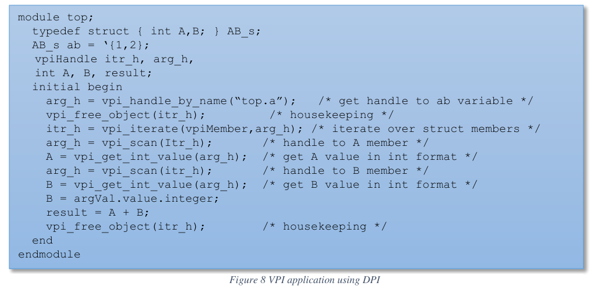
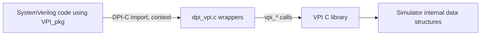

<!-- generated by yt-paper; edits will be overwritten -->
[DVCon](../dvcon/index.md) › [US](../dvcon/us.md) › [2016](../dvcon/by-year.md#2016) › [Verification](../dvcon/by-topic.md#verification)

# INTROSPECTION INTO SYSTEMVERILOG WITHOUT TURNING IT INSIDE OUT.

<figure class="rep-fig" markdown>
{ loading=lazy }
<figcaption>Figure 8 VPI application using DPI — from the original paper (Dave Rich et al.)</figcaption>
</figure>

[:material-open-in-new: Original paper](https://dvcon-proceedings.org/wp-content/uploads/introspection-into-systemverilog-without-turning-it-inside-out.pdf){ .md-button .md-button--primary target=_blank }

| | |
|---|---|
| Authors | Dave Rich (Mentor Graphics) |
| Venue | DVCon US 2016 |
| Topic | Verification |
| Type | PAPER |
| ID | `ref-20261018-9f02` |

## Summary

**The paper proposes a SystemVerilog package that wraps VPI routines as DPI-C imports, letting engineers query design structure (hierarchy, parameters, nets) from SystemVerilog code without writing C.**

**이 논문은 VPI 루틴을 DPI-C import로 감싼 SystemVerilog 패키지를 제안하여, 엔지니어가 C 코드를 작성하지 않고도 SystemVerilog 안에서 설계 구조(계층, 파라미터, 넷)를 질의할 수 있도록 합니다.**

## Key Insights

- VPI provides full design-query access through an opaque vpiHandle object model, but is C-only and cumbersome for model developers; DPI is simple for model integration but offers no design-query features. Combining the two yields native-looking introspection.

- VPI는 불투명한 vpiHandle 객체 모델을 통해 전체 설계 질의 기능을 제공하지만 C 전용이며 모델 개발자에게 번거롭습니다. DPI는 모델 통합에는 간단하지만 설계 질의 기능이 없습니다. 두 가지를 결합하면 네이티브 introspection처럼 보이는 기능을 얻을 수 있습니다.

- Pointer-typed VPI routines (e.g., s_vpi_value) cannot be imported directly, so wrappers are needed; vpi_get_value requires eight format-specific wrappers, one per value format, covering every SystemVerilog variable/net type. Aggregates are read by iterating over members.

- 포인터 타입 VPI 루틴(예: s_vpi_value)은 직접 import할 수 없어 래퍼가 필요합니다. vpi_get_value는 값 포맷별로 8개의 래퍼가 필요하며, 이는 모든 SystemVerilog 변수/넷 타입을 포괄합니다. 집합체는 멤버를 순회하여 읽습니다.

- DPI arguments are passed by value, so the callee cannot get a handle to the caller's expression; objects must be located by full pathname (vpi_handle_by_name). Suggested workarounds include a $get_handle-style system function, prefixing svGetNameFromScope() paths, and vpi_handle(vpiModule,NULL) for the top module.

- DPI 인자는 값으로 전달되므로 호출된 쪽은 호출 측 표현식에 대한 핸들을 얻을 수 없습니다. 따라서 객체는 전체 경로명(vpi_handle_by_name)으로 찾아야 합니다. 제안된 우회 방법에는 $get_handle 형식의 시스템 함수, svGetNameFromScope() 경로 접두어 추가, 최상위 모듈용 vpi_handle(vpiModule,NULL) 등이 있습니다.

- The package has been used in several production environments for module parameterization reports and network statistics, but not for interacting with the event scheduler. The paper gives no quantitative benchmarks, and VPI behavior may differ across tool vendors and must be verified beforehand.

- 이 패키지는 모듈 파라미터화 보고서와 넷 통계를 출력하는 용도로 여러 실제 환경에서 사용되었으나, 이벤트 스케줄러와의 상호작용에는 사용되지 않았습니다. 논문은 정량적 벤치마크를 제시하지 않으며, VPI 동작은 툴 벤더마다 다를 수 있어 사전 검증이 필요합니다.

## Detailed Summary

### Background and Problem

- Design and verification engineers often need analysis beyond functional behavior: memory bit counts, clock fanout, parameter values, net statistics. Verification tests may also need to change dynamically based on such results.

- 설계 및 검증 엔지니어는 기능 동작 이상의 분석이 필요한 경우가 많습니다. 예를 들어 메모리 비트 수, 클럭 팬아웃, 파라미터 값, 넷 통계 등입니다. 검증 테스트도 이러한 결과에 따라 동적으로 바뀌어야 할 수 있습니다.

- SystemVerilog natively supports only simple queries (filename/line number, array size and index range). Anything deeper requires the VPI, which is C/C++-only and was designed for tool developers.

- SystemVerilog는 기본적으로 단순한 질의(파일명/라인 번호, 배열 크기 및 인덱스 범위)만 지원합니다. 그 이상은 C/C++ 전용이며 툴 개발자를 위해 설계된 VPI가 필요합니다.

- The DPI offers a simple modeling interface that passes arguments across the language boundary by type, but it provides none of the design-query features of the VPI.

- DPI는 타입에 따라 인자를 전달하는 간단한 모델링 인터페이스를 제공하지만, VPI의 설계 질의 기능은 전혀 제공하지 않습니다.

- The paper argues that adding introspection natively is a formidable task at this stage of the language, and proposes an alternative built from existing elements: a package that exposes VPI through DPI.

- 논문은 현 단계에서 네이티브 introspection을 추가하는 것은 매우 어려운 작업이라고 보고, 기존 요소로 구성된 대안, 즉 VPI를 DPI로 노출하는 패키지를 제안합니다.

- The paper also notes that passing data through the VPI across language boundaries is complex and can carry a large performance penalty. No measurement is given for this claim.

- 논문은 또한 언어 경계를 넘는 VPI 데이터 전달이 복잡하며 큰 성능 저하를 동반할 수 있다고 언급합니다. 이 주장에 대한 측정 결과는 제시되지 않았습니다.

### Architecture and Methodology

- **VPI object model**: objects are referenced through a single opaque type, `vpiHandle`, which behaves like a base class. Properties are valid only for the relevant object types (for example, `vpiSize` applies to a net, not a module). The relationship is one-to-many from module to variables, and one-to-one from variable to containing module.

- **VPI 객체 모델**: 객체는 단일 불투명 타입 `vpiHandle`로 참조되며, 이는 베이스 클래스처럼 동작합니다. 속성은 해당 객체 타입에서만 유효합니다(예: `vpiSize`는 모듈이 아닌 넷에 적용). 모듈에서 변수로는 일대다, 변수에서 포함 모듈로는 일대일 관계입니다.

- **Common routines**: `vpi_handle_by_name`, `vpi_handle`, `vpi_iterate`, `vpi_scan`, `vpi_get`, `vpi_get_str`, `vpi_get_value`, and `vpi_put_value`.

- **주요 루틴**: `vpi_handle_by_name`, `vpi_handle`, `vpi_iterate`, `vpi_scan`, `vpi_get`, `vpi_get_str`, `vpi_get_value`, `vpi_put_value`.

- **DPI mapping**: `chandle` maps directly to `vpiHandle`, so `vpi_handle` can be imported as-is. Routines that take C pointers, such as `s_vpi_value`, need wrappers that return plain integers or strings. `vpi_get_value` needs eight format-specific wrappers, one for each value format. Aggregates such as structs and arrays are read by iterating over their members.

- **DPI 매핑**: `chandle`은 `vpiHandle`에 직접 대응하므로 `vpi_handle`은 그대로 import할 수 있습니다. `s_vpi_value`와 같이 C 포인터를 받는 루틴은 정수나 문자열을 직접 반환하는 래퍼가 필요합니다. `vpi_get_value`는 값 포맷마다 하나씩, 총 8개의 포맷별 래퍼가 필요합니다. 구조체, 배열 같은 집합체는 멤버를 순회하여 읽습니다.

- **Package `VPI_pkg`**: it contains the DPI-C imports (`VPI_handle_by_name`, `VPI_iterate`, `VPI_scan`, `VPI_get_str`, `VPI_handle`, `VPI_get`, `VPI_get_int_value`, `VPI_put_int_value`), a SystemVerilog wrapper `vpi_get_str` that hides the output-string argument, and object-type constants such as `vpiModule` (the full set is in Annexes K and M of IEEE 1800-2012). The C side is a thin wrapper library (`dpi_vpi.c`) that calls the standard `vpi_user.h` routines.

- **패키지 `VPI_pkg`**: DPI-C import(`VPI_handle_by_name`, `VPI_iterate`, `VPI_scan`, `VPI_get_str`, `VPI_handle`, `VPI_get`, `VPI_get_int_value`, `VPI_put_int_value`), 출력 문자열 인자를 숨기는 SystemVerilog 래퍼 `vpi_get_str`, 그리고 `vpiModule` 같은 객체 타입 상수(전체 목록은 IEEE 1800-2012의 Annex K, M)를 포함합니다. C 측은 표준 `vpi_user.h` 루틴을 호출하는 얇은 래퍼 라이브러리(`dpi_vpi.c`)입니다.

- **Example comparison (Figures 4 to 8)**: a struct-member sum is first written as a VPI call from SystemVerilog, then as a DPI function `sum(const AB_s*)` that receives the struct by value. Figure 8 shows the VPI-through-DPI version. It looks up `top.a` with `vpi_handle_by_name`, iterates `vpiMember` to read fields A and B, and returns `A+B`. The paper states that the same VPI C application can be written in SystemVerilog and looks almost the same.

- **예제 비교(Figure 4~8)**: 구조체 멤버 합계를 먼저 SystemVerilog에서 VPI 호출로 작성하고, 이후 값으로 구조체를 받는 DPI 함수 `sum(const AB_s*)`로 작성합니다. Figure 8은 DPI를 통한 VPI 버전을 보여줍니다. `vpi_handle_by_name`으로 `top.a`를 찾고, `vpiMember`를 순회하여 필드 A, B를 읽고, `A+B`를 반환합니다. 논문은 동일한 VPI C 애플리케이션을 SystemVerilog로도 거의 같은 모양으로 작성할 수 있다고 설명합니다.

- **Limitations and workarounds**: because DPI arguments are passed by value, the callee cannot obtain a handle to the caller's expression, so objects are located by full pathname. Proposed fixes include a `$get_handle(obj)`-style system function, a `vpi_handle_by_name` wrapper that prefixes the scope from `svGetNameFromScope()`, and `vpi_handle(vpiModule,NULL)` for the top of the hierarchy. Package and typedef names cannot be passed as handles and must be found by name or by scanning.

- **제약 및 우회 방법**: DPI 인자가 값으로 전달되므로 호출된 쪽은 호출 측 표현식의 핸들을 얻을 수 없어, 객체를 전체 경로명으로 찾아야 합니다. 제안된 해결책은 `$get_handle(obj)` 형태의 시스템 함수, `svGetNameFromScope()`로 얻은 스코프를 접두어로 붙이는 `vpi_handle_by_name` 래퍼, 계층의 최상단을 위한 `vpi_handle(vpiModule,NULL)`입니다. 패키지 및 typedef 이름은 핸들로 전달할 수 없으므로 이름 검색이나 스캔으로 찾아야 합니다.

- **Complete example**: a `top` module uses `doAllModules` to recurse through `vpiModule` handles. For each module it prints the timescale (`vpiTimeUnit`, `vpiTimePrecision`), prints parameters (`vpiParameter`), and collects nets (`vpiNet`) into an associative array keyed by the full name of the `vpiSimNet` handle. It also reads and writes `top.A` through `vpi_get_value`/`vpi_put_value` wrappers. The test design is a `DUT` with `sub` and `dub` submodules that have different parameters and timescales.

- **전체 예제**: `top` 모듈은 `doAllModules`로 `vpiModule` 핸들을 재귀 순회합니다. 각 모듈에 대해 타임스케일(`vpiTimeUnit`, `vpiTimePrecision`)을 출력하고, 파라미터(`vpiParameter`)를 출력하며, 넷(`vpiNet`)을 `vpiSimNet` 핸들의 전체 이름을 키로 하는 연관 배열에 수집합니다. 또한 `vpi_get_value`/`vpi_put_value` 래퍼로 `top.A`를 읽고 씁니다. 테스트 설계는 서로 다른 파라미터와 타임스케일을 가진 `sub`, `dub` 서브모듈을 포함하는 `DUT`입니다.

### Results and Conclusions

- The package lets verification engineers query and modify the design from SystemVerilog without C expertise, which the paper presents as a route to rapid prototyping.

- 이 패키지를 사용하면 C 전문성 없이도 SystemVerilog에서 설계를 질의하고 수정할 수 있으며, 논문은 이를 빠른 프로토타이핑 경로로 제시합니다.

- It has been used in several production environments to print module parameterization reports and network statistics. It has not been used to interact with the event scheduler.

- 여러 실제 환경에서 모듈 파라미터화 보고서와 넷 통계를 출력하는 데 사용되었습니다. 이벤트 스케줄러와의 상호작용에는 사용되지 않았습니다.

- The paper reports no quantitative performance measurements, so the performance claim about VPI boundary crossings remains unsupported by data here.

- 논문은 정량적 성능 측정 결과를 보고하지 않으므로, VPI 경계 횡단 성능에 대한 주장은 여기서 데이터로 뒷받침되지 않습니다.

- The package relies only on DPI and VPI as defined in the SystemVerilog standard. Behavior can differ across tool vendors, so it must be verified per tool.

- 패키지는 SystemVerilog 표준에 정의된 DPI와 VPI만 사용합니다. 그러나 툴 벤더마다 동작이 다를 수 있으므로 툴별 검증이 필요합니다.

- Native SystemVerilog introspection is left as a future possibility. The paper's approach is an interim, library-level alternative.

- 네이티브 SystemVerilog introspection은 향후 과제로 남겨 두었습니다. 논문의 접근법은 라이브러리 수준의 과도기적 대안입니다.

## Videos

<iframe src="https://www.youtube-nocookie.com/embed/gZAx9-JKQNQ" title="[DVCON2016]INTROSPECTION INTO SYSTEMVERILOG WITHOUT TURNING IT INSIDE OUT" loading="lazy" allow="accelerometer; clipboard-write; encrypted-media; gyroscope; picture-in-picture; web-share" referrerpolicy="strict-origin-when-cross-origin" allowfullscreen></iframe>

**[DVCON2016]INTROSPECTION INTO SYSTEMVERILOG WITHOUT TURNING IT INSIDE OUT** — [Watch on YouTube](https://www.youtube.com/watch?v=gZAx9-JKQNQ) · [Video page](../videos/gZAx9-JKQNQ.md)
