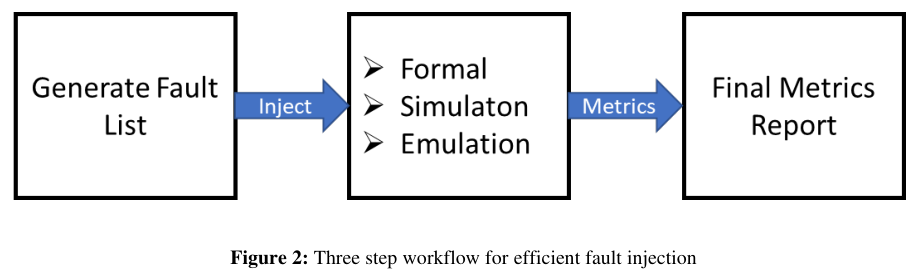
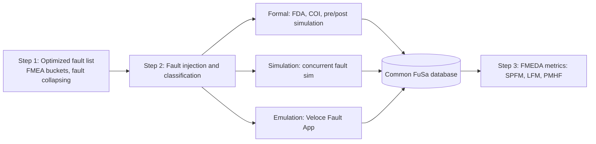

<!-- generated by yt-paper; edits will be overwritten -->
[DVCon](../dvcon/index.md) › [US](../dvcon/us.md) › [2023](../dvcon/by-year.md#2023) › [Verification](../dvcon/by-topic.md#verification)

# Complex Safety Mechanisms Require Interoperability and Automation For Validation And Metric Closure

<figure class="rep-fig" markdown>
{ loading=lazy }
<figcaption>Figure 2: Three step workflow for efficient fault injection — from the original paper (Daeseo Cha et al.)</figcaption>
</figure>

[:material-open-in-new: Original paper](https://dvcon-proceedings.org/wp-content/uploads/1048-Complex-Safety-Mechanisms-Require-Interoperability-For-Validation-And-Final-Metrics.pdf){ .md-button .md-button--primary target=_blank }

| | |
|---|---|
| Authors | Daeseo Cha (Samsung Korea), Vedant Garg (Siemens EDA, USA), Ann Keffer (Siemens EDA, USA), Arun Gogineni (Siemens EDA, USA), James Kim (Siemens EDA, South Korea), Woojoo Space Kim (Samsung Korea), Kunhyuk Kang (Samsung Korea), Seonil Brian Choi (Samsung Korea); DVCon Europe |
| Venue | DVCon US 2023 |
| Topic | Verification |
| Type | PAPER |
| ID | `ref-20261018-a877` |

## Summary

**The paper presents a three-step ISO 26262 fault-injection flow that splits an automotive SoC safety island's faults across formal, simulation, and emulation engines and merges all results in a common FuSa database to compute SPFM and close the metric.**

**이 논문은 자동차 SoC 안전 섬(safety island)의 고장을 formal, simulation, emulation 엔진에 나눠 주입하고 모든 결과를 공통 FuSa 데이터베이스에 모아 SPFM을 산출하는 ISO 26262 3단계 고장 주입 흐름을 제시합니다.**

## Key Insights

- Fault lists are optimized per failure mode (FMEA-driven bucketing, fault collapsing, excluding non-safety-critical faults) before any injection, so each engine receives only the faults it suits best.

- 고장 주입 전에 고장 목록을 failure mode별로 최적화합니다(FMEA 기반 버킷팅, 고장 병합, 안전 비중요 고장 제외). 그래서 각 엔진은 자신에게 가장 적합한 고장만 받습니다.

- Engine assignment follows the fault-injection strategy: emulation for CPU core and cache (STL and ECC protected) because simulation was too slow, simulation for the end-to-end-protected bus, and formal for the fault management unit (planned as next step).

- 엔진 배정은 주입 전략을 따릅니다. CPU 코어와 캐시는 시뮬레이션으로는 너무 느려 emulation으로 처리했습니다(STL 및 ECC 보호). 종단간(E2E) 보호가 된 버스는 simulation으로, 고장 관리 유닛은 다음 단계로 formal에 배정할 예정입니다.

- On a ~3M-gate automotive SoC, 4,782 faults were sampled from 636,046 total faults; 3,125 were detected (65.35%) and the margin of error was reported as ±1.19% at a 90% coverage goal, updated to ±1.293% after excluding Not Injected faults.

- 약 3M 게이트 자동차 SoC에서 총 636,046개 고장 중 4,782개를 샘플링했고 3,125개(65.35%)가 검출되었습니다. 90% 커버리지 목표 기준 MOE는 ±1.19%로 보고되었고, Not Injected 고장 제외 후 ±1.293%로 갱신되었습니다.

- Formal Cone-of-Influence analysis and engineering justification reclassified the 616 Undetected Unobserved faults; the CPU and cache block reached a final SPFM of 91.38%, below the ASIL D target of 99% that the paper cites for the highest level.

- Formal COI 분석과 엔지니어 판단으로 616개 UU 고장을 재분류했고, CPU 및 캐시 블록의 최종 SPFM은 91.38%였습니다. 이는 논문이 언급한 ASIL D 목표 99%에는 못 미칩니다.

- A common, configurable FuSa database that stores fault nodes, injection results and classifications is what makes cross-engine metric consolidation feasible; the 1-to-1 gate mapping between RTL, netlist and emulator is what keeps names and stimulus consistent across engines.

- 고장 노드, 주입 결과, 분류 정보를 저장하는 구성 가능한 공통 FuSa 데이터베이스가 여러 엔진의 메트릭 통합을 가능하게 합니다. RTL, 넷리스트, 에뮬레이터 간 1-to-1 게이트 매핑은 엔진 간 신호명과 자극 일관성을 유지합니다.

## Detailed Summary

### Background and Problem

- ISO 26262 Part 5 requires random hardware failure probabilities to be quantified through metrics such as SPFM, LFM, PMHF and FIT. ASIL D requires SPFM >= 99% (ASIL B >= 90%, ASIL C >= 97%).

- ISO 26262 Part 5는 SPFM, LFM, PMHF, FIT 같은 메트릭으로 랜덤 하드웨어 고장 확률을 정량화할 것을 요구합니다. ASIL D는 SPFM >= 99%를 요구합니다(ASIL B >= 90%, ASIL C >= 97%).

- Exhaustive fault campaigns (tens of thousands to millions of faults, hundreds of tests) are impractical on one engine as automotive SoCs grow. Open problems are (a) generating engine-specific fault lists, and (b) consolidating results from different injection runs into one final metric.

- 자동차 SoC가 커지면서 고장 수가 수만에서 수백만 개에 이르고, 테스트는 수백 개입니다. 이런 규모에서는 단일 엔진으로 전수 고장 캠페인을 수행하는 것이 비현실적입니다. 해결해야 할 과제는 (a) 엔진별 고장 목록 생성, (b) 서로 다른 주입 실행의 결과를 하나의 최종 메트릭으로 통합하는 것입니다.

- ISO 26262 Part 11 allows combining formal, simulation and emulation for fault classification. The paper's goal is to automate and integrate that combination end to end.

- ISO 26262 Part 11은 formal, simulation, emulation을 결합한 고장 분류를 허용합니다. 이 논문의 목표는 그 결합을 엔드투엔드로 자동화하고 통합하는 것입니다.

### Architecture and Methodology

The flow has three steps, executed independently but linked through a highly configurable common FuSa database:

흐름은 3단계로 구성되며, 각 단계는 독립적으로 실행되지만 구성 가능한 공통 FuSa 데이터베이스로 연결됩니다.

- **Step 1:** Fault-list optimization per node against all protecting safety mechanisms. SafetyScope generates the per-failure-mode (FM) lists and writes them to the FuSa database. Faults that are non-safety-critical are excluded.

- **Step 1:** 모든 보호 안전 메커니즘을 기준으로 노드별 고장 목록을 최적화합니다. SafetyScope가 failure mode(FM)별 목록을 생성하고 이를 FuSa 데이터베이스에 기록합니다. 안전 비중요 고장은 제외합니다.

- **Step 2:** Faults are classified as SPF, RF, MPFL, MPFD or SF. Formal (FDA) prunes non-propagating faults before and after simulation and aborts hard-to-prove cases. Simulation compares each faulty run against a stored good-simulation reference at observation points and alarms. Emulation (Veloce Fault App) uses a 1-to-1 gate mapping between RTL and netlist, so fault injection nets (FIN) and fault detection nets (FDN) are compared against a golden run.

- **Step 2:** 고장은 SPF, RF, MPFL, MPFD, SF로 분류됩니다. Formal(FDA)은 시뮬레이션 전후에 전파되지 않는 고장을 제거하고, 증명이 어려운 경우는 중단합니다. Simulation은 각 고장 실행 결과를 관찰점과 alarm에서 good simulation 기준값과 비교합니다. Emulation(Veloce Fault App)은 RTL과 넷리스트 사이 1-to-1 게이트 매핑을 사용하여, 고장 주입 넷(FIN)과 고장 검출 넷(FDN)을 골든 런과 비교합니다.

- **Step 3:** Fault classifications are consolidated into the SPFM, LFM and PMHF calculation for FMEDA.

- **Step 3:** 고장 분류 결과를 통합해 FMEDA용 SPFM, LFM, PMHF를 계산합니다.

**Experiment:** An automotive SoC of about 3M gates. Table 4 gives the safety island at 890K registers and 46.5M gates, CPU core with cache at 215K registers and 7.1M gates, and the bus at 470K registers. Per Figure 5, the CPU core and cache were handled by emulation (STL on the CPU, ECC on cache). The bus was handled by simulation (E2E protection, with more test vectors added for high traffic). The fault management unit was out of scope for this paper and is planned for formal. Statistical random sampling was applied to each sub-block (sub_block1 to sub_block13), and N samples were processed to close the injection.

**실험:** 약 3M 게이트 자동차 SoC입니다. 표 4에 따르면 안전 섬은 890K 레지스터와 46.5M 게이트, CPU 코어와 캐시는 215K 레지스터와 7.1M 게이트, 버스는 470K 레지스터입니다. 그림 5에 따라 CPU 코어와 캐시는 emulation으로(CPU는 STL, 캐시는 ECC로 보호), 버스는 simulation으로 처리했습니다(E2E 보호, 트래픽이 많은 테스트 벡터 추가). 고장 관리 유닛은 이 논문의 범위에서 제외되었고 formal로 처리할 예정입니다. 각 서브블록(sub_block1~sub_block13)에 통계적 랜덤 샘플링을 적용했고, 주입을 완료하기 위해 N개의 샘플을 처리했습니다.

### Results and Conclusions

- **Sampling and detection (Table 5):** 3,125 of 4,782 sampled faults were detected, a 65.35% detected ratio. The detection distribution was STL (SM1) 80.64%, ECC correctable (SM2) 16.86%, WDT (SM3) 1.76%, and ECC uncorrectable 0.74%. MOE was ±1.19% at a 90% coverage goal.

- **샘플링 및 검출 (표 5):** 샘플링된 4,782개 고장 중 3,125개가 검출되어 검출률은 65.35%입니다. 검출 분포는 STL(SM1) 80.64%, ECC 정정 가능(SM2) 16.86%, WDT(SM3) 1.76%, ECC 정정 불가 0.74%입니다. 90% 커버리지 목표 기준 MOE는 ±1.19%입니다.

- **Classification (Tables 7 and 8):** 616 UU faults were reduced using formal COI analysis, engineering justification (ECC, timer, flash), and signal back-propagation. 10 of 79 residual faults were moved to Safe. Not Injected faults were checked against simulation and dropped. The MOE was revised to ±1.293%. The final denominator is 4,782 minus 733 Not Injected = 4,049 (Table 8). Table 7 lists Not Injected as 728, so the two tables are not fully consistent in the source.

- **분류 (표 7, 8):** 616개 UU 고장은 formal COI 분석, 엔지니어 판단(ECC, 타이머, flash), 신호 역전파를 통해 줄었습니다. 79개 residual 고장 중 10개가 Safe로 이동했습니다. Not Injected 고장은 시뮬레이션으로 재확인한 뒤 제외했습니다. MOE는 ±1.293%로 갱신되었습니다. 최종 분모는 4,782에서 Not Injected 733개를 뺀 4,049입니다(표 8). 다만 표 7은 Not Injected를 728로 기재하고 있어, 원문 내 두 표가 완전히 일치하지는 않습니다.

- **Final metric (Table 10):** The CPU and cache block reached a final SPFM of 91.3805878%. This is above the 90% coverage goal, but below the ASIL D threshold of 99% cited earlier in the paper.

- **최종 메트릭 (표 10):** CPU 및 캐시 블록의 최종 SPFM은 91.3805878%입니다. 이는 90% 커버리지 목표는 넘지만, 논문이 앞서 언급한 ASIL D 기준 99%에는 못 미칩니다.

- **Bus (Table 9):** Detected fault percentages for the NOC-in-safety-island block were reported as 3.27%, 5.50% and 9.80% for successive tests, with a fourth test TBD. Bus simulation was not complete at the time of writing, so the bus results are preliminary.

- **버스 (표 9):** NOC-in-safety-island 블록의 검출률은 연속 테스트에서 3.27%, 5.50%, 9.80%로 보고되었고, 네 번째 테스트는 TBD입니다. 버스 시뮬레이션은 작성 시점에 완료되지 않아 버스 결과는 예비 결과입니다.

- **Conclusion:** The authors argue that interoperability across engines, optimized fault lists, and a common database cut time to close the loop from safety analysis to certification. They also stress that early RTL safety analysis before injection saves time. Close collaboration between product teams, methodology teams and EDA vendors is described as critical.

- **결론:** 저자들은 엔진 간 상호운용성, 최적화된 고장 목록, 공통 데이터베이스가 안전 분석에서 인증까지의 루프를 닫는 시간을 줄인다고 주장합니다. 또한 주입 전 RTL 단계의 조기 안전 분석이 시간을 절약한다고 강조합니다. 제품팀, 방법론팀, EDA 벤더 간의 긴밀한 협업이 중요하다고 설명합니다.

## Videos

<iframe src="https://www.youtube-nocookie.com/embed/fdWhjjj_lxs" title="[DVCON2023]Complex Safety Mechanisms Require Interoperability Automation Validation Metric Closure" loading="lazy" allow="accelerometer; clipboard-write; encrypted-media; gyroscope; picture-in-picture; web-share" referrerpolicy="strict-origin-when-cross-origin" allowfullscreen></iframe>

**[DVCON2023]Complex Safety Mechanisms Require Interoperability Automation Validation Metric Closure** — [Watch on YouTube](https://www.youtube.com/watch?v=fdWhjjj_lxs) · [Video page](../videos/fdWhjjj_lxs.md)
