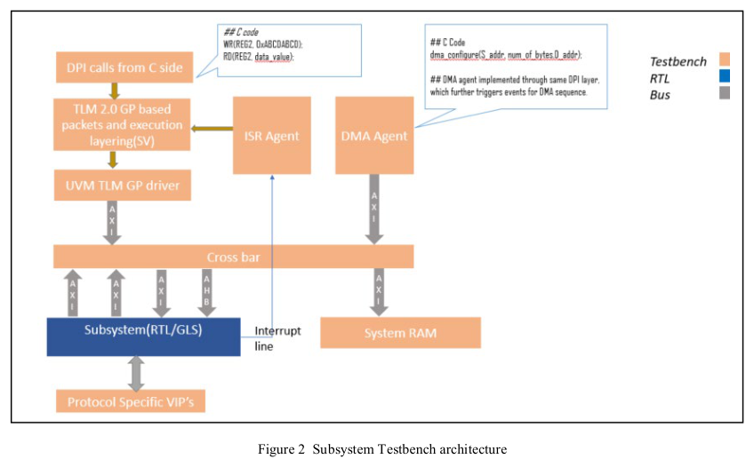

<!-- generated by yt-paper; edits will be overwritten -->
[DVCon](../dvcon/index.md) › [India](../dvcon/india.md) › [2019](../dvcon/by-year.md#2019) › [Verification](../dvcon/by-topic.md#verification)

# A pragmatic approach leveraging portable stimulus from subsystem to SoC level and SoC emulation

<figure class="rep-fig" markdown>
{ loading=lazy }
<figcaption>Figure 2 Subsystem Testbench architecture — from the original paper (Karandeep Singh et al.)</figcaption>
</figure>

[:material-open-in-new: Original paper](https://dvcon-proceedings.org/wp-content/uploads/a-pragmatic-approach-leveraging-portable-stimulus-from-subsystem-to-soc-level-and-soc-emulation-paper.pdf){ .md-button .md-button--primary target=_blank }

| | |
|---|---|
| Authors | Karandeep Singh (NXP Semiconductors, Noida), Aditya Chopra (NXP Semiconductors, Noida), Joachim Geishauser (NXP Semiconductors, Munich), Nitin Verma (NXP Semiconductors, Noida); DVCon Europe |
| Venue | DVCon India 2019 |
| Topic | Verification |
| Type | PAPER |
| ID | `ref-20261018-a8ba` |

## Summary

**The paper proposes a TLM 2.0 Generic Payload based, C-driven testbench infrastructure in which C tests written at subsystem level run unchanged through SoC simulation, SoC emulation and GLS, with SV/UVM transactors reached via DPI and C-level hooks mapping boot, clock and reset to SoC-specific functions.**

**이 논문은 TLM 2.0 Generic Payload 기반의 C 주도 테스트벤치 인프라를 제안하며, 서브시스템 레벨에서 작성한 C 테스트를 수정 없이 SoC 시뮬레이션, SoC 에뮬레이션, GLS까지 재사용하도록 하고, DPI를 통해 SV/UVM 트랜스포터에 접근하며 C 레벨 훅으로 boot, clock, reset을 SoC 전용 함수에 매핑합니다.**

## Key Insights

- Subsystem UVM/SV transactors are reported to be at least 3x faster than executing the same stimulus through the core, which is the stated rationale for keeping the bulk of processing in SV and driving it from C via DPI.

- 서브시스템 UVM/SV 트랜스포터는 동일한 자극을 코어로 실행하는 방식보다 최소 3배 빠른 것으로 보고되어, 대부분의 처리를 SV에 두고 DPI를 통해 C에서 구동하는 근거가 됩니다.

- C-to-SV communication is built on DPI with a non-blocking TLM 2.0 GP port: a C WR/RD call raises a trigger event, the waiting SV task executes the transaction, and control returns to C for the next command. C code changes do not require recompiling the bench.

- C-SV 통신은 non-blocking TLM 2.0 GP 포트 기반의 DPI로 구현됩니다. C의 WR/RD 호출이 트리거 이벤트를 발생시키면 대기 중이던 SV 태스크가 트랜잭션을 실행하고, 제어가 다시 C로 돌아가 다음 명령을 처리합니다. C 코드를 변경해도 벤치를 재컴파일할 필요가 없습니다.

- Context mapping lets the same C test run at subsystem and SoC: dummy subsystem functions for boot, clock, reset and fault handling are bound to SoC APIs, and UVM BFMs are switched from active to passive via factory override for vertical reuse at SoC.

- Context mapping을 통해 동일한 C 테스트를 서브시스템과 SoC에서 실행할 수 있습니다. boot, clock, reset, fault 처리용 더미 서브시스템 함수는 SoC API에 바인딩되며, factory override로 UVM BFM을 active에서 passive로 전환하여 SoC에서 수직 재사용을 합니다.

- Interrupts use a 256-depth semaphore: the base application layer is locked at L1 so no new transactions start, and the ISR runs at L1+1. Reset is handled by a reset env that samples both implicit (DUT-generated) and explicit (C-triggered) resets; for emulation, a TCL driver feeds a parameterized synthesizable reset driver covering POR, functional and destructive resets.

- 인터럽트는 256-depth semaphore로 처리됩니다. 인터럽트 발생 시 L1(기본 애플리케이션 계층)이 잠겨 새 트랜잭션이 시작되지 않고, ISR은 L1+1에서 실행됩니다. Reset은 암시적(DUT 생성)과 명시적(C 트리거) reset을 모두 샘플링하는 reset env로 처리되며, 에뮬레이션에서는 TCL 드라이버가 POR, functional, destructive reset을 지원하는 parameterized synthesizable reset driver를 구동합니다.

- Emulation porting requires only limited changes: memory and library cells switch from behavioral to vendor/RTL views, clock and reset generation are replaced by tool-specific methods, and the test C file is compiled to a hex image loaded at the core boot vector. The paper gives few quantitative results beyond the 3x speedup, so most claims about GLS and emulation benefit are qualitative.

- 에뮬레이션 이식에 필요한 변경은 제한적입니다. 메모리와 라이브러리 셀을 vendor/RTL 뷰로 바꾸고, clock 및 reset 생성은 툴 전용 방식으로 교체하며, 테스트 C 파일은 hex 이미지로 컴파일되어 코어 boot vector에 로드됩니다. 논문은 3배 속도 향상 외에 정량적 결과가 거의 없어, GLS 및 에뮬레이션 이점에 대한 주장은 대부분 정성적입니다.

## Detailed Summary

### Background and Problem

- SoC complexity and early time-to-market make verification closure hard. Porting tests from subsystem simulation to SoC simulation and then to emulation is typically a manual, costly effort.

- SoC의 복잡도 증가와 짧은 time-to-market으로 인해 검증 closure가 어려워지고 있습니다. 서브시스템 시뮬레이션에서 SoC 시뮬레이션, 이후 에뮬레이션으로 테스트를 이식하는 작업은 일반적으로 수작업이며 비용이 큽니다.

- The paper targets a portable-stimulus flow in which C tests are developed early at subsystem level and reused unchanged at SoC simulation, SoC emulation and gate-level simulation (GLS).

- 본 논문은 서브시스템 레벨에서 C 테스트를 조기에 작성하고, 이를 SoC 시뮬레이션, SoC 에뮬레이션, gate-level simulation(GLS)에서 수정 없이 재사용하는 portable stimulus 기반 흐름을 목표로 합니다.

- Goals are reusability, portability and interoperability. Protocol-specific details should not leak into the tests, and the same infrastructure should also serve native UVM sequence-based verification.

- 목표는 재사용성, 이식성, 상호운용성입니다. 프로토콜 세부 사항이 테스트에 노출되지 않아야 하며, 동일한 인프라가 네이티브 UVM 시퀀스 기반 검증에도 사용될 수 있어야 합니다.

### Architecture and Methodology

- **Subsystem testbench (Figure 2):** SV-UVM VIPs are wrapped in a C-BFM layer that uses TLM 2.0 GP ports. DPI carries cross-language function calls. At subsystem level the UVM driver acts as the execution core; at SoC level it is replaced by the real RTL core.

- **서브시스템 테스트벤치 (Figure 2):** SV-UVM VIP를 TLM 2.0 GP 포트를 사용하는 C-BFM 계층으로 감쌉니다. 언어 간 함수 호출은 DPI로 처리합니다. 서브시스템 레벨에서는 UVM 드라이버가 실행 코어 역할을 하며, SoC 레벨에서는 실제 RTL 코어로 대체됩니다.

- **Context mapping:** Dummy subsystem functions for boot, clock configuration, reset, and fault trigger/clear are bound to SoC APIs through a context pointer, so the C test itself does not change.

- **Context mapping:** boot, clock 설정, reset, fault trigger/clear를 위한 서브시스템의 더미 함수들이 context 포인터를 통해 SoC API에 바인딩되므로, C 테스트 자체는 변경되지 않습니다.

- **Hooks:** C-level callbacks for DMA, interrupts and similar peripheral events are served by the UVM driver at subsystem level and by the RTL master at SoC level.

- **훅(Hooks):** DMA, 인터럽트 등 주변장치 이벤트를 위한 C 레벨 콜백은 서브시스템에서는 UVM 드라이버가, SoC에서는 RTL master가 처리합니다.

- **C-SV DPI flow (Figures 5 and 6):** `run_test()` starts in SV and passes control to a sequence body that runs the C test through DPI in parallel with the execution sequence. A C WR/RD call raises a trigger event. The SV task waiting on `c_trigger` runs the command and returns through a non-blocking TLM port, which closes the DPI loop. C then advances to the next command.

- **C-SV DPI 흐름 (Figure 5, 6):** `run_test()`는 SV에서 시작되며, 제어를 sequence body로 넘깁니다. sequence body는 C 테스트를 DPI로 실행하는 동시에 실행용 sequence도 병렬로 구동합니다. C의 WR/RD 호출은 트리거 이벤트를 발생시킵니다. `c_trigger`를 기다리던 SV 태스크가 명령을 실행하고, non-blocking TLM 포트를 통해 응답하여 DPI 루프를 닫습니다. 이후 C는 다음 명령으로 진행합니다.

- **Reset (Figure 7):** A reset env is the base layer. Extended envs can be overridden per DUT/SoC. A CBFM event-based analysis port feeds the reset monitor so that implicit and explicit resets are both sampled. For emulation, a TCL driver inserts reset into a parameterized synthesizable reset driver that supports POR, functional and destructive resets.

- **Reset (Figure 7):** reset env가 기본 계층이며, DUT/SoC별로 확장 및 override할 수 있습니다. CBFM의 event 기반 analysis port가 reset monitor에 연결되어 암시적 reset과 명시적 reset을 모두 샘플링합니다. 에뮬레이션에서는 TCL 드라이버가 parameterized synthesizable reset driver에 reset을 삽입하며, 이 드라이버는 POR, functional, destructive reset을 지원합니다.

- **Interrupts (Figure 8):** A 256-depth semaphore sets priority levels. On an interrupt, L1 (base application) is locked so no new transaction is processed, and the ISR runs at L1+1.

- **인터럽트 (Figure 8):** 256-depth semaphore로 우선순위 레벨을 구성합니다. 인터럽트 발생 시 L1(기본 애플리케이션)이 잠겨 새 트랜잭션이 처리되지 않고, ISR은 L1+1에서 실행됩니다.

- **Vertical reuse:** AMBA UVM BFMs that are active at subsystem are factory-overridden to passive at SoC, so they monitor protocol activity using the subsystem investment.

- **수직 재사용:** 서브시스템에서 active인 AMBA UVM BFM을 factory override로 SoC에서 passive로 전환하여, 서브시스템 작업 결과를 활용해 프로토콜 활동을 모니터링합니다.

- **Protocol independence:** Sequences use TLM2-GP extensions for sideband signals. Changing the bus only requires updating the driver or adapter, not the tests, in the same way that UVM register-layer adapters isolate tests from protocol changes.

- **프로토콜 독립성:** sequence는 side-band 신호를 위해 TLM2-GP extension을 사용합니다. 버스가 변경되면 드라이버나 adapter만 갱신하면 되고 테스트는 바뀌지 않습니다. 이는 UVM register layer의 adapter가 테스트를 프로토콜 변경으로부터 격리하는 방식과 같습니다.

- **GLS:** Netlists are compiled in parallel with the TB and merged through a super block. Functional verification samples either virtual SDF (no input skew driving by the TB) or a timing wrapper that reproduces input skews from back-end data. Random deposits on non-resettable flops may be scripted in Perl.

- **GLS:** netlist를 TB와 병렬로 컴파일하고 super block으로 병합합니다. 기능 검증은 virtual SDF(TB가 입력 skew를 구동하지 않음) 또는 back-end 데이터의 입력 skew를 재현하는 timing wrapper 중 하나로 샘플링합니다. non-resettable flop에 대한 랜덤 deposit은 Perl 스크립트로 처리할 수 있습니다.

- **Emulation (Figure 9):** The memory view changes from behavioral to vendor-specific, library cells change to RTL where needed, and clock and reset generation are replaced with tool-specific methods. The test C file is compiled to a hex image loaded into system memory at the core boot vector. The core then fetches its first instruction after reset.

- **에뮬레이션 (Figure 9):** 메모리 뷰를 behavioral에서 vendor 전용으로 바꾸고, 필요한 경우 라이브러리 셀을 RTL로 교체하며, clock 및 reset 생성은 툴 전용 방식으로 대체합니다. 테스트 C 파일은 hex 이미지로 컴파일되어 코어 boot vector 위치의 시스템 메모리에 로드되며, 코어는 reset 이후 첫 명령을 가져와 실행합니다.

- Synthesizable Verilog slave memories are used to ease the move to emulation.

- 에뮬레이션으로의 이식을 쉽게 하기 위해 synthesizable Verilog slave memory를 사용합니다.

### Results and Conclusions

- The main quantitative result is that UVM/SV-based subsystem transactors are at least 3x faster than executing the same stimulus on the core, based on the authors' experiments.

- 가장 중요한 정량적 결과는 UVM/SV 기반 서브시스템 트랜스포터가 코어로 같은 자극을 실행하는 방식보다 최소 3배 빠르다는 점이며, 이는 저자들의 실험에 기반합니다.

- The authors also report faster RTL compilation and simulation due to a smaller database, faster GLS closure through parallel netlist compilation, and easier emulation bring-up. These are described qualitatively, without supporting numbers.

- 저자들은 또한 더 작은 database로 인해 RTL 컴파일 및 시뮬레이션이 빨라지고, netlist의 병렬 컴파일로 GLS closure가 빨라지며, 에뮬레이션 bring-up이 쉬워진다고 보고합니다. 다만 이는 정성적으로 기술되어 있으며 뒷받침하는 수치는 제시되지 않았습니다.

- Applications listed include SoC-level stimulus reuse, L-BIST and M-BIST verification, gate-level verification, power-analysis VCD generation, direct reuse in the emulator, and DFT verification.

- 적용 분야로는 SoC 레벨 자극 재사용, L-BIST 및 M-BIST 검증, gate-level 검증, 전력 분석용 VCD 생성, 에뮬레이터 직접 재사용, DFT 검증이 나열되어 있습니다.

- The paper argues that the same testbench works for native UVM sequence-based verification without a separate UVM environment. C tests can be changed without recompiling the bench, and SoC-independent test development is possible before subsystem integration. The TLM 2.0 GP interface also allows plug-in to SystemC hosts for early low-level driver development.

- 저자들은 이 테스트벤치가 별도의 UVM 환경 없이 네이티브 UVM 시퀀스 기반 검증에도 사용될 수 있다고 주장합니다. C 테스트는 벤치 재컴파일 없이 변경할 수 있으며, 서브시스템이 SoC에 통합되기 전에도 SoC 독립적인 테스트 개발이 가능합니다. 또한 TLM 2.0 GP 인터페이스 덕분에 SystemC 호스트에 연결하여 초기 저수준 드라이버 개발에 활용할 수 있습니다.

## Videos

<iframe src="https://www.youtube-nocookie.com/embed/hhA-6z-ySy0" title="[DVCON2019_INDIA]A Pragmatic Approach Leveraging Portable Stimulus from Subsystem to SoC  Emulation" loading="lazy" allow="accelerometer; clipboard-write; encrypted-media; gyroscope; picture-in-picture; web-share" referrerpolicy="strict-origin-when-cross-origin" allowfullscreen></iframe>

**[DVCON2019_INDIA]A Pragmatic Approach Leveraging Portable Stimulus from Subsystem to SoC  Emulation** — [Watch on YouTube](https://www.youtube.com/watch?v=hhA-6z-ySy0) · [Video page](../videos/hhA-6z-ySy0.md)
