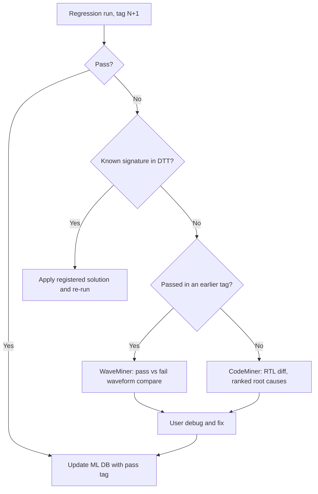

<!-- generated by yt-paper; edits will be overwritten -->
[DVCon](../dvcon/index.md) › [US](../dvcon/us.md) › [2025](../dvcon/by-year.md#2025) › [Verification](../dvcon/by-topic.md#verification)

# A Novel AI-ML Regression Flow for SoC verification

[:material-open-in-new: Original paper](https://dvcon-proceedings.org/wp-content/uploads/1132.pdf){ .md-button .md-button--primary target=_blank }

| | |
|---|---|
| Authors | Laura Leblanc |
| Venue | DVCon US 2025 |
| Topic | Verification |
| Type | PAPER |
| ID | `ref-20261018-aa86` |

## Summary

**Proposes a regression-debug flow that combines an in-house Defect Tracking Tool (DTT) with Cadence Verisium CodeMiner and WaveMiner, using pass/fail tag history to auto-apply known fixes and rank root-cause candidates for new failures, and claims up to 20x reduction in regression debug turnaround time.**

**사내 Defect Tracking Tool(DTT)과 Cadence Verisium CodeMiner·WaveMiner를 결합하여, 통과/실패 태그 이력으로 알려진 실패의 해결책을 자동 적용하고 신규 실패의 근본 원인 후보를 랭킹하는 회귀 디버그 플로우를 제안하며, 회귀 디버그 턴어라운드를 최대 20배 줄일 수 있다고 주장합니다.**

## Key Insights

- Known failures are triaged by DTT signature matching: if a registered solution exists, it is applied and the test re-run without user intervention, so tests that passed in an earlier tag are not re-debugged from scratch.

- DTT 시그니처 매칭으로 알려진 실패를 분류합니다. 등록된 해결책이 있으면 사용자 개입 없이 적용하고 재실행하므로, 이전 태그에서 통과했던 테스트를 처음부터 다시 디버그하지 않습니다.

- Failures are routed by history: a test that passed in an earlier tag but now shows a new error signature goes to WaveMiner (pass-vs-fail waveform comparison); a test with no pass history goes to CodeMiner (RTL diff between tag N-1 and N+1, ranked root-cause list), followed by manual debug.

- 이력에 따라 실패를 분기합니다. 이전 태그에서 통과했지만 새로운 오류 시그니처가 나타난 테스트는 WaveMiner(통과/실패 파형 비교)로, 통과 이력이 없는 테스트는 CodeMiner(태그 N-1과 N+1 사이 RTL 차이, 근본 원인 후보 랭킹)로 보내고 이후 수동 디버그를 수행합니다.

- Reported gains: 10-20x (abstract), 20x (regression, applications and results sections), and Table II ranges of 2-20x for regression TAT and 2-5x for debug time of simple tests; Table I shows total gains of ~77.5-91.6% for register access, block-specific and power tests (AI flow 10-45 min vs. manual 1-5 h).

- 보고된 이득: 초록 10-20배, 응용 및 결과 절의 20배, 표 II의 회귀 TAT 2-20배와 단순 테스트 디버그 2-5배 범위. 표 I은 레지스터 접근, 블록별, 파워 테스트에서 총 약 77.5-91.6%의 절감을 보여주며(AI 플로우 10-45분 대 수동 1-5시간), 단위 및 수치 해석에 주의가 필요합니다.

- The paper's speedup argument rests on parallel debug: the AI flow can process many failures at once (bounded by license count), whereas manual debug is sequential, so benefit grows with failure count.

- 저자들의 속도 향상 논거는 병렬 디버그에 기반합니다. AI 플로우는 라이선스 수가 허용하는 한 여러 실패를 동시에 처리할 수 있으나, 수동 디버그는 순차적입니다. 따라서 이득은 실패 건수가 많을수록 커진다고 주장합니다.

- Evidence is thin: test counts, number of repetitions, engineer sample size and baseline definitions are not specified, Table I units are mixed (hours vs. minutes), and Verisium internals are proprietary; DVChatBoat is future work only.

- 근거는 제한적입니다. 테스트 수, 반복 횟수, 엔지니어 표본 크기, 기준선 정의가 명시되지 않았고, 표 I의 단위(시간 대 분)가 혼재하며, Verisium 내부 구현은 비공개입니다. DVChatBoat는 향후 과제로만 언급됩니다.

## Detailed Summary

### Background and Problem

- In SoC regression (the paper cites suites of about 10,000 tests), every new IP, feature or RTL/TB change can break tests that previously passed. Debug is manual, iterative and largely sequential, and the abstract cites a turnaround of around one week per failing simulation.

- SoC 회귀 테스트(논문에서 약 10,000개 테스트 규모 언급)에서는 새 IP, 기능, RTL/TB 변경이 이전에 통과하던 테스트를 깨뜨릴 수 있습니다. 디버그는 수동이고 반복적이며 대부분 순차적으로 진행되며, 초록에서는 실패 시뮬레이션 하나당 턴어라운드가 약 1주일 수준이라고 언급합니다.

- The paper states verification can take up to 65% of the design cycle, with debug above 50% of verification effort (abstract). The introduction states that 70% of time goes to debug and analysis.

- 초록은 검증이 설계 주기의 최대 65%를 차지하고 디버그가 검증 노력의 50% 이상을 차지한다고 밝히며, 서론은 시간의 70%가 디버그 및 분석에 소요된다고 기술합니다.

- Existing techniques (auto-X detection, coverage-based ranking) use only current-run data and do not learn from history. Commercial AI-ML tools are described only at a high level because vendors disclose little.

- 기존 기법(auto-X 탐지, 커버리지 기반 랭킹)은 현재 실행 데이터만 사용하고 이력으로부터 학습하지 않습니다. 상용 AI-ML 도구는 벤더가 공개한 정보가 적어 개략적으로만 설명됩니다.

- Problem statement: repeated manual re-debug of already-passing tests is inefficient, so the authors propose an AI-ML flow to cut debug time and SoC verification turnaround.

- 문제 정의: 이미 통과하던 테스트를 반복적으로 수동 재디버그하는 것은 비효율적이므로, 저자들은 SoC 검증의 디버그 시간과 턴어라운드를 줄이기 위한 AI-ML 플로우를 제안합니다.

### Architecture and Methodology

Three engines form the flow:

세 가지 엔진으로 플로우를 구성합니다.

- **DTT (in-house Defect Tracking Tool)** mines simulation logs, Jira/bug data and older failure reports. It has three parts: ASD (Abnormal Simulation Detector, multiple linear regression to predict expected run time), DHF (Debug History Finder, Levenshtein-distance matching of error similarity), and DGS (Debug Guide System, BERT/XLNet/RandomForest classification of errors into 10 categories).

- **DTT(사내 Defect Tracking Tool)**: 시뮬레이션 로그, Jira/버그 데이터, 과거 실패 보고서를 마이닝합니다. ASD(Abnormal Simulation Detector, 예상 실행 시간 예측을 위한 다중 선형 회귀), DHF(Debug History Finder, Levenshtein 거리 기반 오류 유사도 매칭), DGS(Debug Guide System, BERT/XLNet/RandomForest 기반 오류를 10개 카테고리로 분류)로 구성됩니다.

- **CodeMiner (Verisium)** compares RTL revisions of an IP or SoC, classifies them, and ranks the changes most likely to disrupt behaviour (bug hotspots).

- **CodeMiner(Verisium)**: IP 또는 SoC의 RTL 리비전을 비교하고 분류하며, 동작을 가장 크게 바꿀 가능성이 있는 변경을 랭킹합니다(버그 핫스팟).

- **WaveMiner (Verisium)** compares waveforms across the suite and identifies which signals at which times are most likely root causes.

- **WaveMiner(Verisium)**: 테스트 스위트 전체의 파형을 비교하여 어떤 신호가 어느 시점에 근본 원인일 가능성이 높은지 식별합니다.

The process has three phases: Planning (test list plus the first passing tag for each test), Execution (regression on tag N+1), and Debug. The worked example: test T2 failed on tag N+1 but passed on N-1.

프로세스는 Planning(테스트 목록과 각 테스트의 최초 통과 태그), Execution(태그 N+1 회귀 실행), Debug의 세 단계로 구성됩니다. 예시: 테스트 T2는 태그 N+1에서 실패했지만 N-1에서는 통과했습니다.

Regression decision logic:

회귀 판단 로직:

1. A passing test updates its pass tag in the ML database.

1. 통과한 테스트는 ML 데이터베이스의 통과 태그를 갱신합니다.

2. A failing test is checked against DTT. If the signature is known, the registered fix is applied and the test re-run.

2. 실패한 테스트는 DTT에서 확인합니다. 시그니처가 알려진 것이면 등록된 해결책을 적용하고 재실행합니다.

3. A new failure is one of two kinds: (a) a test that passed in an older tag but now shows a new error signature, or (b) a brand-new test with no history.
   - (a) goes to WaveMiner for signal-level comparison against the passing run.
   - (b) goes to CodeMiner, which ranks RTL-diff root-cause candidates. The user then performs the final debug.

3. 신규 실패는 두 종류입니다: (a) 이전 태그에서는 통과했지만 새로운 오류 시그니처가 나타난 테스트, (b) 이력이 없는 신규 테스트.
   - (a)는 WaveMiner로 통과 실행과 신호 단위 비교를 수행합니다.
   - (b)는 CodeMiner로 전달되어 RTL 차이 기반 근본 원인 후보를 랭킹합니다. 이후 사용자가 최종 디버그를 수행합니다.

4. Once fixed, the pass tag is recorded in the ML database.

4. 수정이 끝나면 통과 태그를 ML 데이터베이스에 기록합니다.

The authors argue the flow scales from IP to sub-system to SoC. Snapshot creation and mining are faster for IP than for SoC. The flow can also run multiple failures in parallel, subject to license availability. A future DVChatBoat app (document-grounded assistant for debug guidance) is mentioned but not implemented.

저자들은 이 플로우가 IP에서 서브시스템, SoC까지 확장 가능하다고 주장합니다. 스냅샷 생성과 마이닝은 IP가 SoC보다 빠릅니다. 라이선스가 허용하는 범위에서 여러 실패를 병렬로 처리할 수 있습니다. 향후 적용 예정인 DVChatBoat(문서 기반 디버그 안내 어시스턴트)이 언급되지만 구현되지는 않았습니다.

### Results and Conclusions

- **Table I** (simple and complex tests) reports debug effort in hours for low-, mid- and high-experience engineers, against AI flow time in minutes. Register access: 3/2/1 h vs. 10 min, ~91.6% gain. Block-specific: 4/2/1 h vs. 30 min, ~78.6%. Power test: 5/3/2 h vs. 45 min, ~77.5%.

- **표 I**(단순 및 복잡 테스트)은 저/중/고 경력 엔지니어의 디버그 노력을 시간 단위로, AI 플로우 시간을 분 단위로 보고합니다. 레지스터 접근: 3/2/1시간 대 10분, 약 91.6% 절감. 블록별 테스트: 4/2/1시간 대 30분, 약 78.6%. 파워 테스트: 5/3/2시간 대 45분, 약 77.5%.

- **Table II** gives gains over traditional approach (based on an average engineer): simple-test debug 2-10x; simple-test overall TAT 2-5x; complex-test debug 2-5x; complex-test overall TAT 2-20x; regression TAT 2-20x.

- **표 II**는 평균 엔지니어 기준 기존 방식 대비 이득을 제시합니다: 단순 테스트 디버그 2-10배, 단순 테스트 전체 TAT 2-5배, 복잡 테스트 디버그 2-5배, 복잡 테스트 전체 TAT 2-20배, 회귀 TAT 2-20배.

- The authors conclude that AI-ML debugging is promising, that re-debug of known failures is avoided, and that engineers can focus on real RTL bugs.

- 저자들은 AI-ML 디버그가 유망하며, 알려진 실패의 재디버그를 피하고 엔지니어가 실제 RTL 버그에 집중할 수 있다고 결론짓습니다.

- Limitations: the number of tests, repetitions and engineers is not specified, and no variance or statistical method is reported. Table I units are inconsistent. Several figures (10-20x, 20x, 2-20x) are not clearly tied to one measured setup. Verisium internals are not disclosed, so the work is not reproducible from the text.

- 한계: 테스트 수, 반복 횟수, 엔지니어 표본 수가 명시되지 않았고, 분산이나 통계 방법도 보고되지 않았습니다. 표 I의 단위가 일관되지 않습니다. 여러 수치(10-20배, 20배, 2-20배)가 하나의 측정 환경과 명확히 연결되지 않습니다. Verisium 내부 구현은 공개되지 않아 본문만으로는 재현할 수 없습니다.

Korean translation:

&nbsp;

### 배경 및 문제

&nbsp;

- SoC 회귀 테스트(논문에서 약 10,000개 테스트 규모 언급)에서는 새 IP, 기능, RTL/TB 변경이 이전에 통과하던 테스트를 깨뜨릴 수 있습니다. 디버그는 수동이고 반복적이며 대부분 순차적으로 진행되며, 초록에서는 실패 시뮬레이션 하나당 턴어라운드가 약 1주일 수준이라고 언급합니다.

&nbsp;

- 초록은 검증이 설계 주기의 최대 65%를 차지하고 디버그가 검증 노력의 50% 이상을 차지한다고 밝히며, 서론은 시간의 70%가 디버그 및 분석에 소요된다고 기술합니다.

&nbsp;

- 기존 기법(auto-X 탐지, 커버리지 기반 랭킹)은 현재 실행 데이터만 사용하고 이력으로부터 학습하지 않습니다. 상용 AI-ML 도구는 벤더가 공개한 정보가 적어 개략적으로만 설명됩니다.

&nbsp;

- 문제 정의: 이미 통과하던 테스트를 반복적으로 수동 재디버그하는 것은 비효율적이므로, 저자들은 SoC 검증의 디버그 시간과 턴어라운드를 줄이기 위한 AI-ML 플로우를 제안합니다.

&nbsp;

### 구조 및 방법론

&nbsp;

세 가지 엔진으로 플로우를 구성합니다.

&nbsp;

- **DTT(사내 Defect Tracking Tool)**: 시뮬레이션 로그, Jira/버그 데이터, 과거 실패 보고서를 마이닝합니다. ASD(Abnormal Simulation Detector, 예상 실행 시간 예측을 위한 다중 선형 회귀), DHF(Debug History Finder, Levenshtein 거리 기반 오류 유사도 매칭), DGS(Debug Guide System, BERT/XLNet/RandomForest 기반 오류를 10개 카테고리로 분류)로 구성됩니다.

&nbsp;

- **CodeMiner(Verisium)**: IP 또는 SoC의 RTL 리비전을 비교하고 분류하며, 동작을 가장 크게 바꿀 가능성이 있는 변경을 랭킹합니다(버그 핫스팟).

&nbsp;

- **WaveMiner(Verisium)**: 테스트 스위트 전체의 파형을 비교하여 어떤 신호가 어느 시점에 근본 원인일 가능성이 높은지 식별합니다.

&nbsp;

프로세스는 Planning(테스트 목록과 각 테스트의 최초 통과 태그), Execution(태그 N+1 회귀 실행), Debug의 세 단계로 구성됩니다. 예시: 테스트 T2는 태그 N+1에서 실패했지만 N-1에서는 통과했습니다.

&nbsp;

회귀 판단 로직:

&nbsp;

1. 통과한 테스트는 ML 데이터베이스의 통과 태그를 갱신합니다.

&nbsp;

2. 실패한 테스트는 DTT에서 확인합니다. 시그니처가 알려진 것이면 등록된 해결책을 적용하고 재실행합니다.

&nbsp;

3. 신규 실패는 두 종류입니다: (a) 이전 태그에서는 통과했지만 새로운 오류 시그니처가 나타난 테스트, (b) 이력이 없는 신규 테스트.
   - (a)는 WaveMiner로 통과 실행과 신호 단위 비교를 수행합니다.
   - (b)는 CodeMiner로 전달되어 RTL 차이 기반 근본 원인 후보를 랭킹합니다. 이후 사용자가 최종 디버그를 수행합니다.

&nbsp;

4. 수정이 끝나면 통과 태그를 ML 데이터베이스에 기록합니다.

&nbsp;

저자들은 이 플로우가 IP에서 서브시스템, SoC까지 확장 가능하다고 주장합니다. 스냅샷 생성과 마이닝은 IP가 SoC보다 빠릅니다. 라이선스가 허용하는 범위에서 여러 실패를 병렬로 처리할 수 있습니다. 향후 적용 예정인 DVChatBoat(문서 기반 디버그 안내 어시스턴트)이 언급되지만 구현되지는 않았습니다.

&nbsp;

### 결과 및 결론

&nbsp;

- **표 I**(단순 및 복잡 테스트)은 저/중/고 경력 엔지니어의 디버그 노력을 시간 단위로, AI 플로우 시간을 분 단위로 보고합니다. 레지스터 접근: 3/2/1시간 대 10분, 약 91.6% 절감. 블록별 테스트: 4/2/1시간 대 30분, 약 78.6%. 파워 테스트: 5/3/2시간 대 45분, 약 77.5%.

&nbsp;

- **표 II**는 평균 엔지니어 기준 기존 방식 대비 이득을 제시합니다: 단순 테스트 디버그 2-10배, 단순 테스트 전체 TAT 2-5배, 복잡 테스트 디버그 2-5배, 복잡 테스트 전체 TAT 2-20배, 회귀 TAT 2-20배.

&nbsp;

- 저자들은 AI-ML 디버그가 유망하며, 알려진 실패의 재디버그를 피하고 엔지니어가 실제 RTL 버그에 집중할 수 있다고 결론짓습니다.

&nbsp;

- 한계: 테스트 수, 반복 횟수, 엔지니어 표본 수가 명시되지 않았고, 분산이나 통계 방법도 보고되지 않았습니다. 표 I의 단위가 일관되지 않습니다. 여러 수치(10-20배, 20배, 2-20배)가 하나의 측정 환경과 명확히 연결되지 않습니다. Verisium 내부 구현은 공개되지 않아 본문만으로는 재현할 수 없습니다.

&nbsp;

## Videos

<iframe src="https://www.youtube-nocookie.com/embed/jy4eXWjStE8" title="[DVCON2025]A Novel AI-ML Regression Flow forSoC verification" loading="lazy" allow="accelerometer; clipboard-write; encrypted-media; gyroscope; picture-in-picture; web-share" referrerpolicy="strict-origin-when-cross-origin" allowfullscreen></iframe>

**[DVCON2025]A Novel AI-ML Regression Flow forSoC verification** — [Watch on YouTube](https://www.youtube.com/watch?v=jy4eXWjStE8) · [Video page](../videos/jy4eXWjStE8.md)
