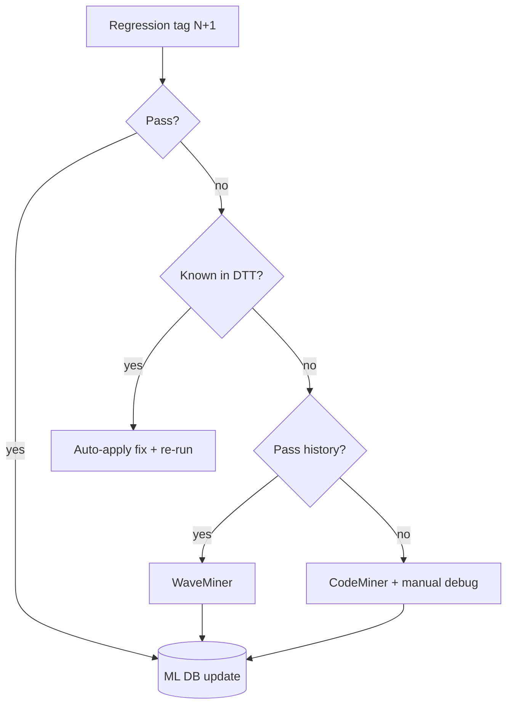

<!-- generated by yt-paper; edits will be overwritten -->
[DVCon](../dvcon/index.md) › [US](../dvcon/us.md) › [2025](../dvcon/by-year.md#2025) › [Verification](../dvcon/by-topic.md#verification)

# A Novel AI-ML Regression Flow for SoC verification

[:material-open-in-new: Original paper](https://dvcon-proceedings.org/wp-content/uploads/1132.pdf){ .md-button .md-button--primary target=_blank }

| | |
|---|---|
| Authors | Laura Leblanc (affiliation not given in document) |
| Venue | DVCon US 2025 |
| Topic | Verification |
| Type | PAPER |
| ID | `ref-20261018-aa86` |

## Summary

**Proposes a three-engine AI-ML debug flow (in-house DTT plus Cadence Verisium CodeMiner and WaveMiner) that reuses historical pass/fail data to triage SoC regression failures, claiming 10–20x overall debug-time reduction without quantitative validation beyond a small internal study.**

**과거 회귀 pass/fail 데이터를 재활용해 SoC 회귀 실패를 분류하는 3개 엔진 기반 AI-ML 디버그 플로우(사내 DTT + Cadence Verisium CodeMiner·WaveMiner)를 제안하며, 전체 디버그 시간 10–20배 단축을 주장하지만 소규모 내부 실험 이상의 정량 검증은 제시하지 않는다.**

## Key Insights

- Failures are triaged into known (DTT auto-applies registered fix and re-runs), new-with-history (WaveMiner compares pass/fail waveforms), and new-without-history (CodeMiner ranks RTL diffs between tags N-1 and N+1).

- 실패는 알려진 실패(DTT가 등록된 해결책을 자동 적용 후 재실행), 이력이 있는 신규 실패(WaveMiner가 pass/fail 파형 비교), 이력이 없는 신규 실패(CodeMiner가 태그 N-1과 N+1 사이 RTL 차이를 순위화)로 분류됩니다.

- The flow's claimed benefit scales with failure count: manual debug TAT grows with number of failures while the AI-ML flow parallelizes debug across licenses.

- 예상 이득은 실패 건수에 따라 커지는데, 수동 디버그 TAT는 실패 수에 비례해 증가하는 반면 AI-ML 플로우는 라이선스 수만큼 병렬 디버그를 수행한다고 주장합니다.

- Reported gains are 2-20x per metric (e.g., register access test debug 10 min vs 3/2/1 h for low/mid/high experience, ~91.6% gain), but the sample size, test count, and baseline are not described.

- 테스트별로 2–20배 이득이 보고됩니다(예: register access 테스트 디버그 10분 대 저/중/고 경력자 3/2/1시간, 약 91.6% 이득). 다만 표본 규모, 테스트 수, 기준선 설명은 없습니다.

- DTT uses Levenshtein-distance pattern matching for error similarity and BERT/XLNet/RandomForest to categorize simulation errors into 10 classes; the paper gives no accuracy metrics.

- DTT는 오류 유사도에 Levenshtein 거리 기반 패턴 매칭을 쓰고, BERT/XLNet/RandomForest로 시뮬레이션 오류를 10개 범주로 분류합니다. 분류 정확도 지표는 제시되지 않습니다.

- The abstract's 10–20x overall regression speedup and the body's 20x claim are not derived from a documented experiment, so the numbers should be treated as vendor-style estimates.

- 초록의 10–20배 회귀 가속과 본문의 20배 주장은 문서화된 실험에서 도출되지 않았으므로 벤더 추정치 수준으로 봐야 합니다.

## Detailed Summary

### Background and Problem

- Regression failures after each feature/testbench/design change cause debug to take up to a week; the paper states debug is ~70% of verification time and >50% of verification effort.

- 기능/테스트벤치/설계 변경마다 기존 통과 테스트가 실패할 수 있으며, 회귀 실패 디버그에 최대 일주일이 걸린다고 보고합니다. 논문은 디버그가 검증 시간의 약 70%, 검증 노력의 50% 이상을 차지한다고 말합니다.

- Debug is manual and sequential; in SoC regressions (~10,000 tests) failures are handled one by one, and simulation duration amplifies per-failure cost.

- 디버그는 수동이고 순차적이며, SoC 회귀(약 10,000개 테스트)에서는 실패를 하나씩 처리합니다. 시뮬레이션 시간이 길어 실패 한 건당 비용이 커집니다.

- Existing commercial tools (Verisium, Synopsys.ai) are summarized only at a high level, and the authors note vendor details are undisclosed.

- 상용 도구(Verisium, Synopsys.ai)는 개략적으로만 언급되며, 저자들은 벤더 세부 정보가 공개되지 않는다고 적습니다.

### Architecture and Methodology

- Three engines: in-house Defect Tracking Tool (DTT: Abnormal Simulation Detector, Debug History Finder using Levenshtein matching, Debug Guide System using BERT/XLNet/RandomForest for 10 error classes), Verisium CodeMiner (RTL diff ranking between tags), Verisium WaveMiner (pass/fail waveform comparison).

- 3개 엔진 구성: 사내 Defect Tracking Tool(DTT: Abnormal Simulation Detector, Levenshtein 매칭 기반 Debug History Finder, BERT/XLNet/RandomForest로 10개 오류 범주를 분류하는 Debug Guide System), Verisium CodeMiner(태그 간 RTL 차이 순위화), Verisium WaveMiner(pass/fail 파형 비교).

- Regression manager routes each failure: known failure → DTT auto-applies fix and re-runs; new with history → WaveMiner; new without history → CodeMiner, then manual debug; passing tests update the ML database.

- 회귀 관리자가 실패를 분기합니다. 알려진 실패는 DTT가 해결책을 자동 적용 후 재실행하고, 이력이 있는 신규 실패는 WaveMiner, 이력이 없는 신규 실패는 CodeMiner 후 수동 디버그로 처리하며, 통과한 테스트는 ML 데이터베이스를 갱신합니다.

### Results and Conclusions

- Debug-time table: register access test 10 min (AI-ML) vs 3/2/1 h, ~91.6% gain; block-specific 30 min vs 4/2/1 h, ~78.6%; power test 45 min vs 5/3/2 h, ~77.5%.

- 디버그 시간 표: register access 테스트 10분(AI-ML) 대 3/2/1시간, 약 91.6% 이득; block-specific 30분 대 4/2/1시간, 약 78.6%; power 테스트 45분 대 5/3/2시간, 약 77.5%.

- Claimed ranges: debug 2–10x for simple tests, 2–20x for complex-test TAT and regression TAT; the text states 20x for parallel debug.

- 주장 범위: 단순 테스트 디버그 2–10배, 복잡 테스트 TAT 및 회귀 TAT 2–20배이며, 본문은 병렬 디버그로 20배라고 적습니다.

- Experimental setup (test count, participants' statistics, repetitions) is only loosely described, so the gains are unverified. The paper mainly proposes a workflow, with a future DVChatBot extension.

- 실험 설정(테스트 수, 참가자 통계, 반복 횟수)은 느슨하게만 설명되어 이득은 검증되지 않았습니다. 논문의 주된 기여는 워크플로 제안이며, DVChatBot 확장은 향후 과제입니다.

## Videos

<iframe src="https://www.youtube-nocookie.com/embed/jy4eXWjStE8" title="[DVCON2025]A Novel AI-ML Regression Flow forSoC verification" loading="lazy" allow="accelerometer; clipboard-write; encrypted-media; gyroscope; picture-in-picture; web-share" referrerpolicy="strict-origin-when-cross-origin" allowfullscreen></iframe>

**[DVCON2025]A Novel AI-ML Regression Flow forSoC verification** — [Watch on YouTube](https://www.youtube.com/watch?v=jy4eXWjStE8) · [Video page](../videos/jy4eXWjStE8.md)
