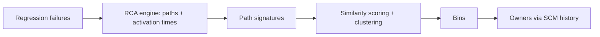

<!-- generated by yt-paper; edits will be overwritten -->
[DVCon](../dvcon/index.md) › [US](../dvcon/us.md) › [2012](../dvcon/by-year.md#2012) › [Verification](../dvcon/by-topic.md#verification)

# Failure Triage: The Neglected Debugging Problem

<figure class="rep-fig" markdown>
{ loading=lazy }
<figcaption>Figure 3: Failure Triage Flow — from the original paper (Sean Safarpour et al.)</figcaption>
</figure>

[:material-open-in-new: Original paper](https://dvcon-proceedings.org/wp-content/uploads/failure-triage-the-neglected-debugging-problem.pdf){ .md-button .md-button--primary target=_blank }

| | |
|---|---|
| Authors | Sean Safarpour (Vennsa Technologies), Evean Qin (Vennsa Technologies), Yu-Shen Yang (Vennsa Technologies), Brian Keng (University of Toronto) |
| Venue | DVCon US 2012 |
| Topic | Verification |
| Type | PAPER |
| ID | `ref-20261018-aa99` |

## Summary

**The paper proposes automated failure triage that builds signatures from root cause analysis (RCA) propagation paths and activation times, then clusters regression failures into bins by likely shared bug, outperforming error-message-based binning on two small case studies.**

**이 논문은 회귀 실패를 RCA(근본 원인 분석)의 전파 경로와 activation time으로 만든 signature로 자동 클러스터링하여, 동일 버그를 공유할 가능성이 높은 실패끼리 묶는 failure triage 기법을 제안하며, 두 개의 소규모 사례 연구에서 error message 기반 binning보다 우수함을 보인다.**

## Key Insights

- Error-message binning is misleading: in the VGA case it yields six bins for four actual bugs, while RCA-path signatures produce the correct four bins.

- Error message 기반 binning은 오해를 낳는다. VGA 사례에서는 실제 버그 4개에 대해 6개의 bin을 만든 반면, RCA 경로 signature는 올바른 4개의 bin을 생성했다.

- Signatures built from RCA excitation/propagation paths and activation times carry internal-design behavior that checker messages alone do not, so bins better approximate the true root cause.

- RCA의 excitation/propagation 경로와 activation time으로 만든 signature는 checker 메시지만으로는 얻을 수 없는 설계 내부 동작 정보를 담아, bin이 실제 근본 원인에 더 가깝게 맞춰진다.

- Triage bins also expose testbench and reference-model bugs, not only DUT RTL bugs (e.g., the FPU exception bin traced to the expected model and a VGA bin traced to wrong testbench stimulus models).

- Triage bin은 DUT RTL 버그뿐 아니라 testbench 및 reference model 버그도 드러낸다(예: FPU의 exception bin은 expected model로, VGA의 한 bin은 잘못된 testbench stimulus 모델로 추적됨).

- The paper gives no quantitative accuracy metric or baseline numbers; the claim of 'much higher accuracy' is supported only qualitatively by fix-verification per bin on two academic designs with seeded bugs.

- 논문은 정량적 정확도 지표나 baseline 수치를 제시하지 않으며, 'much higher accuracy' 주장은 시드된 버그가 있는 두 개의 학술 설계에서 bin별 fix 검증으로만 정성적으로 뒷받침된다.

- Known limitation: distinct bugs that are close in proximity may be merged into one bin, and clustering thresholds and weights must be tuned per environment.

- 알려진 한계: 서로 근접한 별개의 버그가 하나의 bin으로 합쳐질 수 있으며, clustering threshold와 가중치는 환경별로 튜닝해야 한다.

## Detailed Summary

### Background and Problem

- Triage is the first phase of regression debug: grouping failures by likely shared root cause and routing each group to the right owner. The paper cites debug as up to 50% of verification time [1].

- Triage는 회귀 debug의 첫 단계로, 실패들을 공통 근본 원인일 가능성에 따라 묶고 각 그룹을 적절한 owner에게 배정하는 작업이다. 논문은 debug가 verification 시간의 최대 50%를 차지한다고 인용한다[1].

- Current practice is either a dedicated engineer relying on "gut feel" or scripts that bin purely by error message and test owner. Both trade accuracy for speed.

- 현재 관행은 "gut feel"에 의존하는 전담 엔지니어 방식이거나, error message와 테스트 owner만으로 binning하는 스크립트 방식이다. 둘 다 정확도와 속도 사이에서 trade-off가 있다.

- Checker messages conflate distinct bugs caught by the same checker and split one bug caught by different checkers.

- Checker 메시지는 같은 checker가 잡은 별개의 버그를 하나로 묶고, 서로 다른 checker가 잡은 하나의 버그를 쪼갠다.

### Architecture and Methodology

- Flow: regression failures are analyzed by an RCA engine (OnPoint), which yields excitation/propagation paths and activation times. These form per-failure signatures, which are scored for similarity and clustered with a threshold into bins. Bins are then assigned to owners via source-control history.

- 흐름: 회귀 실패를 RCA 엔진(OnPoint)이 분석하여 excitation/propagation 경로와 activation time을 얻는다. 이것으로 실패별 signature를 만들고, 유사도를 계산한 뒤 threshold 기반 clustering으로 bin을 만든다. Bin은 SCM(소스 제어) 이력을 통해 owner에게 배정된다.

- Environment data (user messages, recent file changes, stimulus mode) bias weights or act as tie-breakers.

- 환경 정보(사용자 메시지, 최근 파일 변경, stimulus 모드)는 가중치를 조정하거나 동점 해소(tie-breaker)에 사용된다.

### Results and Conclusions

- FPU (OpenCores, 8 modules, 1415 LOC): five bins matching root causes. Message-only binning would give four bins, leaving at least two bug sources unidentified, plus one duplicate.

- FPU(OpenCores, 8개 모듈, 1415 LOC): 근본 원인과 일치하는 5개의 bin을 생성했다. Message 기반 binning이었다면 4개의 bin이 만들어져 최소 2개의 버그 원인이 식별되지 않고, 1개의 bin은 중복 오류를 보였을 것이다.

- VGA controller (17 modules, 4,076 LOC, ~90K gates, UVM, 50 SVA): four bins for four bugs. Message-only binning gives six.

- VGA 컨트롤러(17개 모듈, 4,076 LOC, 약 90K 게이트, UVM, 50 SVA): 4개 버그에 대해 4개의 bin을 생성했다. Message 기반 binning은 6개를 만든다.

- Bugs span RTL, testbench stimulus, and reference model. Correctness was checked by confirming that fixing each bin's bug removed all its failures.

- 버그는 RTL, testbench stimulus, reference model에 걸쳐 있다. 각 bin의 버그를 수정하면 해당 bin의 모든 실패가 사라지는 것으로 정확성을 확인했다.

- Limitations: no quantitative accuracy metric; industrial data undisclosed; close distinct bugs can merge.

- 한계: 정량적 정확도 지표가 없고, 산업 데이터는 공개되지 않았으며, 근접한 별개의 버그는 병합될 수 있다.

## Videos

<iframe src="https://www.youtube-nocookie.com/embed/rf-YoXpGpiM" title="[DVCON2012] Failure Triage The Neglected Debugging Problem" loading="lazy" allow="accelerometer; clipboard-write; encrypted-media; gyroscope; picture-in-picture; web-share" referrerpolicy="strict-origin-when-cross-origin" allowfullscreen></iframe>

**[DVCON2012] Failure Triage The Neglected Debugging Problem** — [Watch on YouTube](https://www.youtube.com/watch?v=rf-YoXpGpiM) · [Video page](../videos/rf-YoXpGpiM.md)
