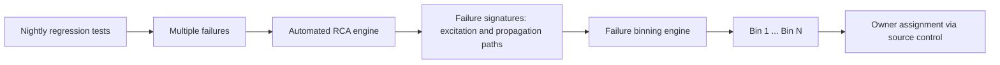

<!-- generated by yt-paper; edits will be overwritten -->
[DVCon](../dvcon/index.md) › [US](../dvcon/us.md) › [2012](../dvcon/by-year.md#2012) › [Verification](../dvcon/by-topic.md#verification)

# Failure Triage: The Neglected Debugging Problem

<figure class="rep-fig" markdown>
{ loading=lazy }
<figcaption>Figure 3: Failure Triage Flow — from the original paper (Sean Safarpour et al.)</figcaption>
</figure>

[:material-open-in-new: Original paper](https://dvcon-proceedings.org/wp-content/uploads/failure-triage-the-neglected-debugging-problem.pdf){ .md-button .md-button--primary target=_blank }

| | |
|---|---|
| Authors | Sean Safarpour (Vennsa Technologies, Inc.), Evean Qin (Vennsa Technologies, Inc.), Yu-Shen Yang (Vennsa Technologies, Inc.), Brian Keng (University of Toronto) |
| Venue | DVCon US 2012 |
| Topic | Verification |
| Type | PAPER |
| ID | `ref-20261018-aa99` |

## Summary

**The paper proposes an automated failure triage flow that builds signatures from root cause analysis (RCA) excitation and propagation paths instead of error messages, then bins regression failures by shared bug source, and it shows on two Opencores-based case studies (FPU and VGA controller) that the resulting bins match the true bug count where message-based binning does not.**

**이 논문은 오류 메시지 대신 RCA(근본 원인 분석)의 excitation 및 propagation 경로로 failure signature를 만들고, 이를 기반으로 회귀 실패를 공통 버그 원인별로 binning하는 자동화된 failure triage 흐름을 제시하며, Opencores 기반 두 사례(FPU, VGA 컨트롤러)에서 메시지 기반 binning과 달리 실제 버그 수와 일치하는 bin을 얻음을 보인다.**

## Key Insights

- Message-based triage fails in both directions: one checker can fire for several distinct bugs (in the FPU case, message-only binning gives four bins and leaves at least two bug sources unidentified), and one bug can fire different checkers across tests (in the VGA case, message-only binning gives six bins for four real errors).

- 메시지 기반 triage는 두 방향으로 모두 실패한다. 하나의 checker가 서로 다른 여러 버그에 의해 발화할 수 있고(FPU 사례에서 메시지만으로 binning하면 4개의 bin이 생기며, 최소 2개의 버그 소스가 식별되지 않은 채 남는다), 하나의 버그가 테스트에 따라 서로 다른 checker를 발화시킬 수도 있다(VGA 사례에서 메시지만으로 binning하면 실제 오류 4개에 대해 6개의 bin이 생긴다).

- RCA-derived signatures carry internal design behavior (excitation/propagation paths, fix values, activation times) that checker messages lack. The RCA engine is treated as a black box: circuit, error trace and expected value in, paths out.

- RCA에서 얻은 signature에는 checker 메시지에 없는 설계 내부 동작 정보(excitation/propagation 경로, 수정 값, activation time)가 담긴다. RCA 엔진은 블랙박스로 취급되며, 회로, 오류 trace, 기대값을 입력받아 경로를 출력한다.

- In the FPU study the flow produced five bins, and the authors manually confirmed that each bin maps to one root cause. Bins span RTL bugs (a missing pipeline stage, a wrong top-bit assignment, a case-statement decode error) and non-DUT bugs (testbench stimulus and an exception reference model), so triage is not limited to the DUT.

- FPU 사례에서 흐름은 5개의 bin을 생성했고, 저자들은 각 bin이 하나의 근본 원인에 대응함을 수작업으로 확인했다. bin은 RTL 버그(누락된 파이프라인 단계, 최상위 비트 할당 오류, case 문 디코딩 오류)와 DUT 외부 버그(testbench 자극 및 예외 기준 모델)를 모두 포함하므로, triage는 DUT에만 국한되지 않는다.

- Bin ownership can be routed using source-control data: the owners of the most common modules in a bin, or the author of the last change for that bin. Signatures also hint where the next engineer should start debugging.

- bin의 담당자는 소스 컨트롤 데이터로 지정할 수 있다. 즉 bin에서 가장 많이 등장하는 모듈의 소유자나 해당 bin의 마지막 변경 작성자를 활용한다. signature 경로는 다음 엔지니어가 디버그를 어디서 시작할지에 대한 단서도 제공한다.

- The paper claims 'much higher accuracy' than checker-signature methods, but it reports no quantitative accuracy or time-savings metrics. Evidence is two small case studies, validated by checking that fixing each bin's bug clears all its failures. The authors also note that closely located distinct bugs may be merged into one bin.

- 논문은 checker signature 기반 방식보다 '훨씬 높은 정확도'를 주장하지만, 정량적인 정확도나 시간 절감 수치는 제시하지 않는다. 근거는 두 개의 소규모 사례 연구이며, 각 bin의 버그를 수정했을 때 해당 bin의 모든 실패가 사라지는지로 검증했다. 저자들은 위치가 가까운 서로 다른 버그가 하나의 bin으로 합쳐질 수 있다고도 밝힌다.

## Detailed Summary

### Background and Problem

- Debug is estimated to consume up to 50% of total verification time [1]. Failure triage is the first step of regression debug: grouping failures by likely shared root cause and assigning each group to the right owner.

- 디버그는 전체 검증 시간의 최대 50%를 차지하는 것으로 추정된다 [1]. Failure triage는 회귀 디버그의 첫 단계로, 실패들을 공통 근본 원인별로 묶고 각 묶음을 적절한 담당자에게 배정하는 작업이다.

- Current practice is one of two imperfect approaches. A dedicated engineer triages by hand, relying on experience and "gut feel," which is accurate but slow. Or a script bins failures on the error message and test owner, which is fast but inaccurate.

- 현재는 두 가지 불완전한 방식이 쓰인다. 전담 엔지니어가 경험과 "감"에 의존해 수작업으로 분류하는 방식은 정확하지만 느리다. 스크립트가 오류 메시지와 테스트 담당자를 기준으로 묶는 방식은 빠르지만 부정확하다.

- Error messages are weak signatures. The paper's FPU example shows two distinct bugs caught by the same checker (should be split). The VGA example shows one bug caught by different checkers (should be merged). Both lead to wasted engineering time or missed bugs.

- 오류 메시지는 약한 signature다. 논문의 FPU 예시는 서로 다른 두 버그가 같은 checker에 잡히는 경우(분리되어야 함)를, VGA 예시는 하나의 버그가 서로 다른 checker에 잡히는 경우(병합되어야 함)를 보여준다. 두 경우 모두 엔지니어링 시간 낭비나 버그 누락으로 이어진다.

### Architecture and Methodology

The flow runs after nightly regression. Each failure gets a signature, failures are binned by signature similarity, and each bin goes to the best-suited engineer.

흐름은 야간 회귀 이후에 실행된다. 각 실패에 signature를 생성하고, signature 유사도를 기준으로 실패를 bin으로 묶은 뒤, 각 bin을 가장 적합한 엔지니어에게 전달한다.

- **Signature generation.** The RCA engine (OnPoint, or academic methods such as critical path tracing [2] or SAT/QBF/SMT-based diagnosis [2, 3]) is treated as a black box. It returns the suspect paths or circuit elements for a given circuit, error trace and expected value. OnPoint also returns fix waveforms and activation times. Extra environment data can refine the signature: user log messages (state-machine traces), source-control change history (for example, owners of recently changed files), and stimulus or mode information.

- **Signature 생성.** RCA 엔진(OnPoint 또는 critical path tracing [2], SAT/QBF/SMT 기반 진단 [2, 3] 같은 학술 방법)은 블랙박스로 취급된다. 회로, 오류 trace, 기대값이 주어지면 의심 경로 또는 회로 요소를 반환한다. OnPoint는 추가로 수정 파형과 activation time을 반환한다. 환경 데이터로 signature를 보강할 수 있다. 사용자 로그 메시지(상태 머신 trace), 소스 컨트롤 변경 이력(최근 변경된 파일의 소유자 등), 자극 및 모드 정보가 여기에 해당한다.

- **Binning.** Paths are reconstructed and ordered chronologically by activation time, an approximation that can be imperfect when paths contain cycles or overlap. Pairwise path similarity gives a score. A clustering algorithm with a tunable threshold groups failures. Environment data can weight path components or break ties. Thresholds may vary by environment.

- **Binning.** 경로를 재구성하고 activation time 기준으로 시간순 정렬한다. 이는 경로에 사이클이나 중첩이 있으면 완벽하지 않은 근사다. 경로 쌍의 유사도 점수를 계산하고, 임계값을 조정할 수 있는 clustering 알고리즘으로 실패를 묶는다. 환경 데이터는 경로 구성 요소에 가중치를 주거나 경계선상의 경우 동점 처리에 쓰일 수 있다. 임계값은 환경에 따라 달라질 수 있다.

- **Owner assignment.** The bin is routed to the owner of its most common modules, or to the author of the last change committed for that bin.

- **담당자 배정.** bin은 가장 많이 등장하는 모듈의 소유자, 또는 해당 bin에서 마지막으로 커밋된 변경의 작성자에게 배정된다.

- **Case studies.** Both designs were modified with dozens of injected "typical" bugs in RTL and testbench. The authors could not disclose commercial results, so the evaluation uses two student-built designs.
  - *FPU* (Opencores, single-precision IEEE 754): eight Verilog modules, 1,415 lines, six operations, four rounding modes, with an end-to-end checker, exception checkers and assertions. The flow produced five bins. Message-only binning would have given four bins and left at least two bug sources unidentified, plus one duplicated error.
  - *VGA controller* (Opencores, modified): 17 modules, 4,076 lines, about 90,000 synthesized gates. It is verified with UVM (register, timing, pixel data and FIFO tests), a C++ golden reference model and 50 SVA. The flow produced four bins, one per real error. Message-only binning would have given six bins.

- **사례 연구.** 두 설계 모두 RTL과 testbench에 "전형적인" 버그를 수십 개 주입했다. 상용 설계 결과는 공개할 수 없어, 대학원생과 함께 만든 두 샘플 설계로 평가했다.
  - *FPU*(Opencores, 단정밀도 IEEE 754): Verilog 8개 모듈, 1,415 라인, 6개 연산, 4개 반올림 모드. end-to-end checker, 예외 checker, assertion을 포함한다. 흐름은 5개의 bin을 생성했다. 메시지만으로 binning하면 4개의 bin이 생기고, 최소 2개의 버그 소스가 식별되지 않으며 1개의 오류가 중복된다.
  - *VGA 컨트롤러*(Opencores, 수정본): 17개 모듈, 4,076 라인, 합성 기준 약 90,000 게이트. UVM(레지스터, 타이밍, 픽셀 데이터, FIFO 테스트), C++ golden reference model, 50개의 SVA로 검증한다. 흐름은 실제 오류 하나당 하나씩, 총 4개의 bin을 생성했다. 메시지만으로 binning하면 6개의 bin이 생긴다.

### Results and Conclusions

- **FPU:** The five bins correctly separated distinct bugs. The bins included a missing pipeline stage (five failures in total, including four checker and one assertion failure), a bad stimulus in the testbench (a single exception, binned alone), a wrong top-bit assignment (two checkers), an incorrect case-statement decode (two assertions, two checkers and one exception), and an exception-model bug in the expected model (a single exception).

- **FPU:** 5개의 bin이 서로 다른 버그를 올바르게 분리했다. 포함된 bin은 다음과 같다. 누락된 파이프라인 단계(checker 4개와 assertion 1개, 총 5개 실패), testbench의 잘못된 자극(예외 1개, 단독 bin), 최상위 비트 할당 오류(checker 2개), 잘못된 case 문 디코딩(assertion 2개, checker 2개, 예외 1개), 기대 모델의 예외 처리 버그(예외 1개, 단독 bin).

- **VGA:** The four bins were a wrong-state assignment in the color processor (four assertion failures across three assertions), a wrong read-pointer bit in a FIFO (three assertions), a testbench instantiation error that fired both a checker and an assertion, and a reference-model bug (a single checker).

- **VGA:** 4개의 bin은 color processor의 잘못된 상태 기반 할당(3개 assertion에 걸친 assertion 실패 4개), FIFO read pointer의 잘못된 비트 선택(assertion 3개), checker와 assertion을 동시에 발화시킨 testbench의 잘못된 모델 인스턴스화, reference model 버그(checker 1개)다.

- The authors confirmed each bin by fixing its bug and checking that all failures in that bin disappeared.

- 저자들은 각 bin의 버그를 수정했을 때 해당 bin의 모든 실패가 사라지는지 확인하여 결과를 검증했다.

- Limitations: no quantitative accuracy or time-savings numbers are given, the case studies are small, and distinct bugs close in proximity may be merged. Future work targets better binning resolution and heuristics for testbench and environment bugs.

- 한계: 정량적인 정확도나 시간 절감 수치는 제시되지 않았고, 사례 연구가 소규모이며, 근접한 서로 다른 버그가 병합될 수 있다. 향후 연구는 binning 해상도 개선과 testbench 및 환경 기인 버그를 위한 휴리스틱 개발을 목표로 한다.

## Videos

<iframe src="https://www.youtube-nocookie.com/embed/rf-YoXpGpiM" title="[DVCON2012] Failure Triage The Neglected Debugging Problem" loading="lazy" allow="accelerometer; clipboard-write; encrypted-media; gyroscope; picture-in-picture; web-share" referrerpolicy="strict-origin-when-cross-origin" allowfullscreen></iframe>

**[DVCON2012] Failure Triage The Neglected Debugging Problem** — [Watch on YouTube](https://www.youtube.com/watch?v=rf-YoXpGpiM) · [Video page](../videos/rf-YoXpGpiM.md)
